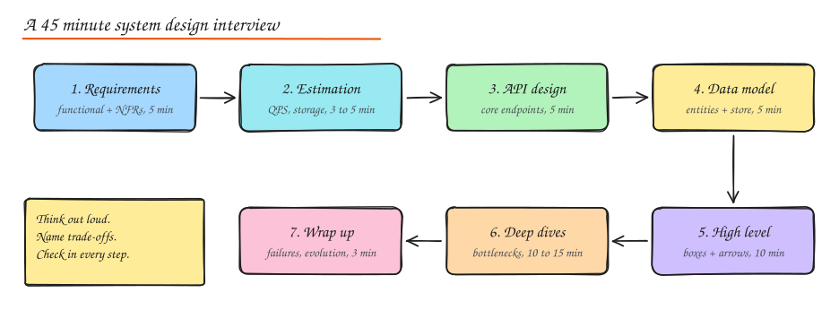

# The System Design Interview Framework

> **TL;DR**
> - A design interview is a simulated design review: you are graded on how you clarify, decide and justify, not on a single right answer.
> - Follow 7 steps: requirements, estimation, API, data model, high-level design, deep dives, wrap-up.
> - Pin non-functional requirements with numbers early; they decide the architecture more than the features do.
> - Always say the trade-off: "I chose X because of requirement R; it costs C, which I mitigate with M."

A design interview is not a quiz with one right answer. It is a simulation of you leading a design review. The interviewer watches **how you reduce ambiguity, make decisions, and defend trade-offs** while the problem keeps changing under you.



## What interviewers actually grade

Most product companies (Google, Meta, Amazon, Uber, Atlassian, Flipkart, Stripe and similar) use a rubric close to this:

| Signal | What "strong" looks like |
|---|---|
| Problem navigation | Asks the clarifying questions that change the design, not trivia. Scopes down to a core that fits 45 minutes. |
| Solution design | Produces a working end to end design early, then improves it. Every box has a reason to exist. |
| Technical depth | Can go two or three levels down on at least one component (storage engine, partitioning, consistency, queue semantics). |
| Trade-offs | States alternatives and why one wins **for these requirements**. Uses numbers. |
| Communication | Drives the conversation, keeps a visible structure, checks in, adapts to hints. |
| Operational maturity (senior+) | Talks about failure modes, monitoring, rollout, migration, cost, multi-region. |

> The single most common failure: jumping straight to boxes (Kafka! Redis! Cassandra!) before agreeing on what the system must do. The second most common: never going deep on anything.

## The 7 step script

### 1. Clarify requirements (about 5 min)

Split them explicitly. Write them on the board, the interviewer will refer back to them.

**Functional requirements**: what the user can do. Keep 3 to 5 core ones and say out loud which you are deferring.

- "Users can post a tweet up to 280 chars, with optional media."
- "Users see a home timeline of people they follow, newest first."
- Out of scope (say it): ads, DMs, search, trends.

**Non functional requirements** (NFRs): the qualities. These drive the architecture far more than the features do.

| NFR | Question to ask | Why it matters |
|---|---|---|
| Scale | DAU? reads vs writes? growth? | Decides single box vs sharded fleet |
| Latency | p99 target for the hot path? | Decides caching, precomputation, sync vs async |
| Availability | Is a minute of downtime a headline? | Decides redundancy, multi-AZ or multi-region |
| Consistency | Is stale data acceptable? For how long? | Decides CP vs AP stores, replication mode |
| Durability | Can we ever lose a write? | Decides fsync, replication factor, backups |
| Security / compliance | PII, payments, regions? | Encryption, data residency, audit |

Useful phrasing: *"I'll assume 200M DAU, read heavy around 100:1, p99 under 200 ms for timeline reads, eventual consistency of a few seconds is fine for timelines, but we must never lose a posted tweet. Does that match what you had in mind?"*

### 2. Back of the envelope estimation (3 to 5 min)

Only compute numbers that change a decision: QPS (do we need sharding? caching?), storage (does it fit on one machine?), bandwidth (do we need a CDN?). See [Back of the Envelope Estimation](02-back-of-envelope.md).

### 3. API design (about 5 min)

Write the 3 to 5 endpoints that serve the functional requirements. This forces precision on inputs, outputs and pagination.

```http
POST /v1/tweets                 { text, media_ids[] }        -> 201 { tweet_id }
GET  /v1/timeline?cursor=&limit=20                           -> 200 { tweets[], next_cursor }
POST /v1/users/{id}/follow                                     -> 204
```

Mention: auth via token in header, idempotency key on writes, cursor pagination for feeds, rate limits per user.

### 4. Data model (about 5 min)

List the core entities, their key fields and **access patterns**, then pick a store per access pattern (not per entity).

```text
User(user_id PK, name, created_at)
Tweet(tweet_id PK, author_id, text, media_url, created_at)   -- write once, read many
Follow(follower_id, followee_id, created_at)                 -- query both directions
Timeline(user_id, [tweet_id...])                             -- precomputed, in cache
```

### 5. High level design (about 10 min)

Draw the request path end to end for every functional requirement: client, DNS/CDN, load balancer, API gateway, services, caches, databases, queues, workers. Walk one write and one read through the diagram. Keep it simple and correct first.

### 6. Deep dives (10 to 15 min)

Pick the 2 or 3 hardest parts **for this problem** (or let the interviewer pick). Typical ones:

- The hot path at peak (fanout, hot keys, celebrity users)
- Data partitioning and the shard key
- Consistency between two stores (cache and DB, DB and search index)
- Exactly once style semantics (payments, counters)
- Failure of a dependency, a node, an AZ, a region

For each: state the problem with a number, give 2 options, pick one, explain the cost of that pick.

### 7. Wrap up (about 3 min)

Summarize the design in 4 sentences, list known bottlenecks, what you would monitor (golden signals), and how the design evolves at 10x.

## Communication habits that score

- **Write a visible agenda** at the start: "Requirements, estimates, API, data, high level, deep dives." It shows structure.
- **Name the trade-off, not just the choice.** "I'll use fanout on write because reads outnumber writes 100:1; the cost is write amplification for users with millions of followers, which I'll handle with a hybrid."
- **Use numbers to justify.** "At 2,300 writes per second a single Postgres primary is fine; reads at 230k QPS are not, so we cache."
- **Check in every 5 to 10 minutes.** "Do you want me to go deeper on the feed or on media upload?"
- **Say when something is a simplification.** It protects you from looking naive.

## Mid level vs senior vs staff answers

| Topic | Mid level | Senior | Staff |
|---|---|---|---|
| Requirements | Lists features | Pins NFRs with numbers | Questions the requirement itself, phases delivery |
| Storage | "Use Cassandra" | Explains partition key, access pattern, compaction cost | Talks migration path, multi-region replication, cost per GB |
| Failures | Adds replicas | Walks failure scenarios, retries, idempotency | Blast radius, cell architecture, graceful degradation, runbooks |
| Evolution | Not covered | 10x growth plan | Org and ownership boundaries, build vs buy |

## Common question patterns and what they test

| Pattern | Examples | Core challenge |
|---|---|---|
| Read heavy feeds | Twitter, Instagram, News feed | Fanout, caching, ranking |
| Write heavy ingest | Metrics, logging, ad clicks | Partitioning, batching, aggregation |
| Real time | Chat, Uber, collaborative docs | Connections, ordering, presence |
| Storage | Dropbox, S3, URL shortener | Chunking, metadata, dedupe, IDs |
| Correctness | Payments, booking, inventory | Transactions, idempotency, locks |
| Search and discovery | Typeahead, search engine | Indexing, ranking, latency |
| Infra primitives | Rate limiter, distributed cache, queue, ID generator | Algorithms + distribution |

## Interview questions

<details>
<summary>Why ask for non functional requirements before drawing anything?</summary>

Because NFRs decide the shape of the system. A URL shortener with 10 writes per second and a URL shortener with 100k writes per second have the same features but completely different storage, ID generation and caching designs. If you draw first, you will redesign later and look reactive.

</details>

<details>
<summary>The interviewer says "just assume infinite scale". How do you proceed?</summary>

Pick concrete, aggressive numbers anyway (for example 1B users, 10k writes/s, 1M reads/s) and state them. Designs need numbers to justify choices. Then design for horizontal scaling in every tier, call out partitioning keys and hot spots, and note where cost becomes the real constraint.

</details>

<details>
<summary>You realise mid interview that an earlier decision was wrong. What do you do?</summary>

Say so directly and fix it: "Given the 100:1 read ratio we just computed, a pull based timeline will be too slow at p99; I'm switching to fanout on write with a fallback for celebrities." Interviewers reward course correction with reasoning. Silently patching, or defending a bad choice, scores worse.

</details>

<details>
<summary>How do you choose what to deep dive into?</summary>

Pick the component where the requirements create the most tension: the hottest path, the hardest consistency guarantee, or the most expensive resource. Offer two options to the interviewer and let them choose; that is both collaborative and a signal you can see the risk areas.

</details>

## Related

- [Back of the Envelope Estimation](02-back-of-envelope.md)
- [What is System Design: HLD vs LLD and Requirements](../01-fundamentals/01-what-is-system-design.md)
- [Study Roadmap](03-study-roadmap.md)
