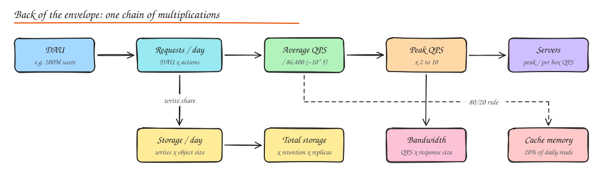

# Back of the Envelope Estimation

> **TL;DR**
> - Estimation exists to justify decisions (one box or many, cache or not, CDN or not), not to show arithmetic.
> - Shortcuts: a day is about 10^5 seconds; 1M requests/day is about 12/s; 1B/day is about 12k/s.
> - Chain it: DAU, requests/day, average QPS, peak QPS, storage, bandwidth, cache, servers.
> - Memory is fast, disk seeks are slow, cross-region round trips are slowest; design around that.

Estimation exists to **justify decisions**, not to impress with arithmetic. You want an order of magnitude answer in under 5 minutes that tells you: does this fit on one machine, do we need a cache, do we need sharding, do we need a CDN?

> Try it live: the **Capacity Estimator** lab in the interactive site does this chain for you with sliders.

## Numbers to memorise

### Throughput units: RPS, QPS, TPS

- **RPS (requests per second)**: HTTP or RPC requests hitting a service or load balancer.
- **QPS (queries per second)**: often used interchangeably with RPS; strictly, queries against a database or search engine. One page request can fan out into many queries.
- **TPS (transactions per second)**: business or database transactions committed per second (payments, orders). Usually the most expensive unit, because each one involves writes, locks and durable commits.

Always say which one you mean and at which layer: "40k RPS at the edge becomes 120k QPS on the cache and 2k TPS on the database".

### Powers of two and data sizes

| Power | Exact | Approx | Name |
|---|---|---|---|
| 2^10 | 1,024 | 1 thousand | 1 KB |
| 2^20 | 1,048,576 | 1 million | 1 MB |
| 2^30 | | 1 billion | 1 GB |
| 2^40 | | 1 trillion | 1 TB |
| 2^50 | | 1 quadrillion | 1 PB |

Handy sizes: a char is 1 byte (ASCII) or up to 4 (UTF-8), a UUID is 16 bytes (36 as text), a `bigint` or timestamp is 8 bytes, a typical JSON API response is 1 to 10 KB, a compressed photo is 200 KB to 2 MB, a minute of 1080p video is about 50 to 100 MB raw upload and 10 to 20 MB after encoding.

### Latency numbers (approximate, modern hardware)

| Operation | Time | Feel it as |
|---|---|---|
| L1 cache reference | 1 ns | |
| Branch mispredict | 3 ns | |
| L2 cache reference | 4 ns | |
| Mutex lock/unlock | 17 ns | |
| Main memory reference | 100 ns | 100x L1 |
| Compress 1 KB with Snappy/zstd | 2 µs | |
| Read 1 MB sequentially from memory | 3 µs | |
| Round trip within same datacenter | 500 µs | 0.5 ms |
| Read 1 MB sequentially from NVMe SSD | 50 to 100 µs | |
| Random read from SSD | 16 to 100 µs | |
| Read 1 MB sequentially from HDD | 1 to 2 ms | |
| HDD seek | 2 to 10 ms | why random IO on disks hurts |
| Packet round trip US East to US West | 40 to 70 ms | |
| Packet round trip US to Europe | 80 to 150 ms | |
| Packet round trip US to India / Australia | 200 to 250 ms | |

Takeaways you can say out loud:

1. **Memory is fast, disk random IO is slow, network across regions is slowest.** Avoid cross region calls in the request path.
2. **Sequential IO is much faster than random IO.** This is why log structured storage, Kafka and LSM trees exist.
3. **Compress before sending over the network**; CPU is cheap compared to bandwidth and round trips.
4. **A round trip inside a datacenter costs about 0.5 ms**, so a request that makes 20 sequential internal calls already spends 10 ms on network alone. Parallelize or batch.

### Time conversions

- 1 day = 86,400 s, round to **10^5 s** for mental math.
- 1 month is about 2.5 million seconds. 1 year is about 3 x 10^7 s.
- 1 million requests per day is about **12 per second**. 1 billion per day is about **12k per second**.

### Availability nines

| Availability | Downtime per year | Per month | Per week |
|---|---|---|---|
| 99% (two nines) | 3.65 days | 7.3 hours | 1.68 hours |
| 99.9% | 8.77 hours | 43.8 min | 10.1 min |
| 99.95% | 4.38 hours | 21.9 min | 5 min |
| 99.99% | 52.6 min | 4.38 min | 1 min |
| 99.999% | 5.26 min | 26.3 s | 6 s |

### Rough per machine capacity (sanity check, depends heavily on workload)

| Component | Ballpark |
|---|---|
| Stateless web/app server | 1k to 10k simple requests/s per instance |
| Nginx / Envoy as proxy | 10k to 100k requests/s |
| Redis single node | 100k+ simple ops/s, sub ms latency |
| Postgres / MySQL single primary | a few thousand to 10k+ writes/s, tens of thousands of indexed reads/s |
| Kafka broker | hundreds of MB/s, hundreds of thousands of msgs/s |
| Cassandra node | thousands to tens of thousands of writes/s |
| One server memory | 64 to 512 GB common, up to several TB |
| One server disk | multiple TB of NVMe |

## The method

1. **Users**: DAU (and MAU if relevant). Say the assumption.
2. **Actions per user per day**: split into writes and reads.
3. **Average QPS** = daily requests / 10^5.
4. **Peak QPS** = average x 2 to 3 (normal diurnal) or x 10 (events, flash sales).
5. **Storage** = writes per day x size per write x retention x replication factor (often 3).
6. **Bandwidth** = QPS x payload size (do ingress and egress separately).
7. **Cache memory** = a fraction (often 20%) of daily read volume of hot objects.
8. **Servers** = peak QPS / per server QPS, then add headroom (N+2, or 30 to 50% spare).

Round aggressively. 86,400 becomes 100,000. 2.5 becomes 3. Keep one significant digit.

## Worked example 1: a Twitter like service

Assumptions: 300M MAU, 150M DAU. Each user posts 2 tweets/day and reads their timeline 20 times/day. 10% of tweets have media.

| Quantity | Math | Result |
|---|---|---|
| Write QPS | 150M x 2 / 10^5 | **3,000 /s** (peak ~10k) |
| Read QPS (timeline loads) | 150M x 20 / 10^5 | **30,000 /s** (peak ~100k) |
| Tweet text storage per day | 300M tweets x (280 + 200 metadata) bytes ≈ 300M x 0.5 KB | **150 GB/day** |
| Media per day | 30M media x 1 MB | **30 TB/day** (goes to object storage + CDN) |
| Text over 5 years, RF=3 | 150 GB x 365 x 5 x 3 | **~800 TB** (needs sharding) |
| Timeline read egress | 100k QPS x 20 tweets x 0.5 KB | **1 GB/s** of text, media served via CDN |

Decisions this drives: tweets table must be sharded, timelines precomputed and cached, media on object storage behind a CDN, reads served mostly from cache.

## Worked example 2: a URL shortener

Assumptions: 100M new URLs/month, read:write = 100:1, keep URLs 5 years, each record about 500 bytes.

| Quantity | Math | Result |
|---|---|---|
| Write QPS | 100M / (30 x 10^5) | **~40 /s** |
| Read QPS | 40 x 100 | **~4,000 /s** (peak ~20k) |
| Records in 5 years | 100M x 12 x 5 | **6 billion** |
| Storage | 6B x 500 B | **3 TB** (fits on a few nodes) |
| Key space | base62 with 7 chars = 62^7 | **3.5 trillion**, enough |
| Cache | 20% of daily reads: 4k x 10^5 x 0.2 x 500 B | **~40 GB**, one Redis node |

Decision: writes are tiny, reads are cache friendly. No exotic tech needed; a single primary DB with replicas and a cache would work. The interesting part is ID generation, not scale.

## Common mistakes

- Computing everything to 4 significant figures. Nobody cares.
- Forgetting **peak** vs average. Design capacity for peak.
- Forgetting **replication factor** and **indexes** in storage (indexes often add 20 to 50%).
- Mixing bits and bytes in bandwidth (network links are quoted in bits: 10 Gbps ≈ 1.25 GB/s).
- Estimating things that do not change the design. If it does not change a decision, skip it.

## Interview questions

How many requests per second is 1 billion requests per day?

1B / 86,400 ≈ 11,600 per second on average. Using the 10^5 shortcut: 10^9 / 10^5 = 10^4 = 10k per second. Peak is probably 2 to 3x that, so plan for 25k to 35k per second.

Why is the 80/20 rule used to size caches?

Access patterns are usually skewed (Zipf like): a small fraction of objects get most of the traffic. Caching around 20% of the daily working set often captures 80% or more of reads. It is a starting assumption; the real answer comes from measuring hit ratio versus cache size.

Your estimate says storage is 2 PB. What do you say next?

That it will not fit on one machine, so we need partitioning (sharding) with a clear key, replication for durability, and probably tiered storage: hot recent data on SSD backed databases, older data in cheaper object storage. Also ask whether all of it needs to be online and queryable.

Convert 10 Gbps to bytes per second and explain why it matters.

10 Gbps / 8 = 1.25 GB/s. If you need to serve 5 GB/s of video from one rack you need at least 4 such links worth of capacity before overhead, which is a hint you need a CDN rather than serving from origin.

## Related

- [Scalability, Latency and Throughput](../01-fundamentals/03-scalability-performance.md)
- [Availability and Reliability](../01-fundamentals/04-availability-reliability.md)
- [Case study: URL Shortener](../09-case-studies/01-url-shortener.md)
