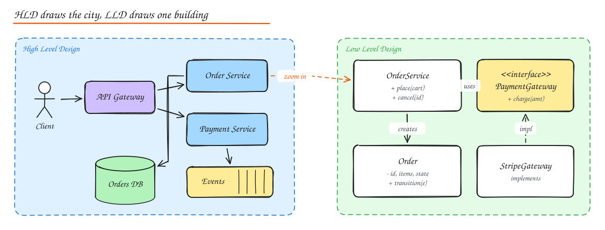

# What is System Design

> **TL;DR**
> - System design decides which components exist, how they talk, and where data lives, under real constraints.
> - HLD draws the city (services, stores, queues); LLD draws one building (classes, schemas, code).
> - Functional requirements say what the system does; non-functional requirements (latency, scale, availability, consistency) shape how it is built.
> - Every choice buys something and costs something; name both halves.

System design is the process of deciding **which components a system needs, how they talk to each other, and where the data lives**, so the system meets its functional goals under real constraints: scale, latency, cost, failures, team size and time.

In interviews it splits into two related skills:

## HLD vs LLD

| | High Level Design (HLD) | Low Level Design (LLD) |
|---|---|---|
| Question | What are the big pieces and how do they connect? | How is one piece built internally? |
| Artifacts | Architecture diagram, data flow, API contracts, storage choice, scaling plan | Class diagrams, interfaces, design patterns, DB schema, sequence diagrams, code |
| Concerns | Scalability, availability, consistency, latency, cost, failure domains | Correctness, extensibility, readability, testability, concurrency |
| Unit | Services, databases, queues, caches, regions | Classes, modules, functions, tables |
| Typical interview | "Design YouTube" | "Design a parking lot", "Design an LRU cache", "Design Splitwise" |
| Audience | Architects, leads, multiple teams | The team that writes the code |

They meet in the middle: the HLD says "Order Service owns orders and publishes `OrderPlaced` events"; the LLD decides the `Order` state machine, the repository interface, and how retries stay idempotent.

## Requirements

### Functional requirements

What the system **does**. Phrase them as user visible capabilities:

- Users can upload a video up to 10 GB.
- Viewers can stream a video at a quality that adapts to their network.
- Creators can see view counts that are at most a few minutes stale.

Keep the list short, prioritized and explicitly scoped. Saying "out of scope: comments, live streaming" is a strength, not a weakness.

### Non functional requirements

How well the system does it. These are the **architecture drivers**.

| Category | Example statement | Architectural consequence |
|---|---|---|
| Performance | p99 read latency < 100 ms | Caching, precomputation, data near users |
| Scalability | 10x traffic in 2 years without redesign | Stateless tiers, partitionable data |
| Availability | 99.99% for reads | Redundancy across AZs, no single points of failure |
| Consistency | A user always sees their own writes | Read your writes routing, session stickiness, or strong reads |
| Durability | Zero data loss after a write is acknowledged | Synchronous replication, WAL, backups |
| Security | PII encrypted, audit every access | KMS, field level encryption, audit log |
| Cost | Under $X per 1M requests | Tiered storage, spot instances, right sizing |
| Operability | Deploy 20 times a day safely | CI/CD, feature flags, canaries, observability |

### Constraints and assumptions

Things you cannot change or are choosing to assume: "Must run on AWS", "team of 6", "existing MySQL", "launch in 3 months", "mobile clients on flaky networks". Constraints often rule out the theoretically best option, and saying so shows maturity.

### Performance and scalability requirements, precisely

Avoid "fast" and "scalable". Use numbers and percentiles:

- **Throughput**: 50k reads/s and 2k writes/s at peak.
- **Latency**: p50 < 30 ms, p99 < 150 ms, measured at the load balancer.
- **Data growth**: 5 TB/year.
- **Elasticity**: handle 5x spikes within 2 minutes (or queue them).

## The trade-off mindset

Every design decision buys something and pays for it somewhere else. Interviews reward people who **say both halves**.

| You gain | You pay with |
|---|---|
| Lower read latency (cache, denormalize) | Staleness, invalidation complexity, more memory |
| Higher availability (replicas, AP store) | Weaker consistency, conflict resolution |
| Strong consistency (consensus, sync replication) | Higher write latency, lower availability under partitions |
| Horizontal scale (sharding) | Cross shard queries and transactions get hard |
| Decoupling (queues, events) | Eventual consistency, harder debugging, duplicate handling |
| Microservices (team autonomy) | Network calls, distributed failure modes, ops overhead |
| Fewer moving parts (monolith) | Coupled deploys, harder to scale parts independently |

A useful sentence template: **"I'm choosing X because requirement R matters most here; the cost is C, which I'll mitigate with M."**

## Building blocks you will reuse everywhere

Almost every design is a recombination of the same pieces. Each has its own note:

- Traffic: [DNS](../02-building-blocks/01-dns.md), [CDN](../02-building-blocks/04-cdn.md), [Load Balancer](../02-building-blocks/02-load-balancing.md), [API Gateway](../02-building-blocks/05-proxies-api-gateway.md), [Rate Limiter](../02-building-blocks/08-rate-limiting.md)
- Compute: stateless services, workers, [serverless](../05-architecture/03-architecture-styles.md)
- Data: [SQL](../03-data/01-sql-acid-transactions.md), [NoSQL](../03-data/03-nosql-choosing-a-database.md), [Cache](../02-building-blocks/03-caching.md), [Object storage and search](../02-building-blocks/10-object-storage-and-search.md)
- Async: [Queues and streams](../02-building-blocks/07-message-queues.md)
- Glue: [Consistent hashing](../02-building-blocks/06-consistent-hashing.md), [ID generation](../02-building-blocks/09-unique-id-generation.md), [Replication](../03-data/04-replication.md), [Sharding](../03-data/05-sharding-partitioning.md)

## Interview questions

Give an example where a non functional requirement completely changes the design.

A chat app with "messages delivered within 5 minutes" can use simple polling and a relational DB. With "delivered within 200 ms and presence indicators" you need persistent connections (WebSockets), a connection registry, a pub/sub fanout layer and careful ordering per conversation. Same features, very different system.

How do you decide what is in scope for a 45 minute design?

Pick the smallest set of functional requirements that still exercises the interesting part of the problem (for Twitter: post and home timeline, not DMs or search). State the deferred items explicitly and offer to come back to them if time permits.

What is the difference between scalability and performance?

Performance is how fast the system serves one unit of work at a given load (latency, throughput of one node). Scalability is how well performance holds as load or data grows when you add resources. A system can be fast for one user and collapse at 10k users (performance fine, scalability poor).

## Related

- [The Interview Framework](../00-start-here/01-interview-framework.md)
- [CAP, PACELC and Consistency](02-cap-pacelc.md)
- [LLD: OOP and SOLID](../08-lld/01-oop-solid-principles.md)
