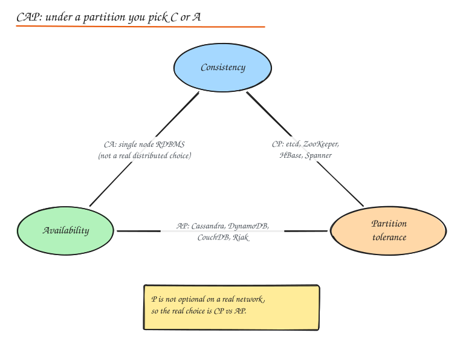
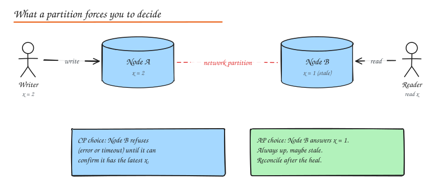
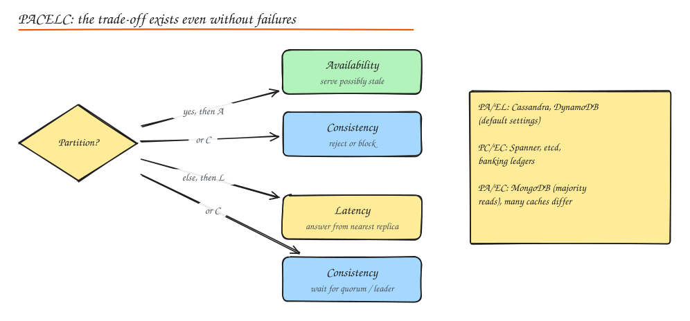

# CAP, PACELC and Consistency Models

> **TL;DR**
> - CAP: during a network partition you must choose between consistency (refuse some requests) and availability (answer, maybe stale).
> - PACELC adds the everyday case: even without partitions you trade latency for consistency.
> - Consistency is a spectrum, from linearizable to eventual, with cheap session guarantees like read-your-writes in between.
> - Use strong consistency for the few invariants that need it (money, uniqueness) and eventual consistency elsewhere.

## CAP theorem

For a distributed data store that replicates data across nodes, during a **network partition** you can guarantee at most one of:

- **Consistency (C)**: every read sees the most recent acknowledged write (formally, linearizability). The system behaves as if there is one copy of the data.
- **Availability (A)**: every request to a non failing node gets a non error response (not necessarily the latest data).
- **Partition tolerance (P)**: the system keeps operating even though messages between nodes are dropped or delayed.

### The part people get wrong

Partitions **will** happen on any real network (switch failures, GC pauses that look like partitions, misconfigured firewalls, cross region link loss). So P is not a choice. CAP really says:

> **When a partition happens, choose: refuse some requests to stay consistent (CP), or answer them and risk serving stale or conflicting data (AP).**

When there is no partition, a well built system can be both consistent and available. CAP says nothing about that normal case, which is why PACELC exists.

### CP vs AP in practice

| | CP systems | AP systems |
|---|---|---|
| Behaviour under partition | Minority side rejects writes (and maybe reads) | All sides accept reads/writes |
| After heal | Nothing to reconcile | Must merge conflicts (LWW, vector clocks, CRDTs) |
| Examples | etcd, ZooKeeper, Consul, HBase, Spanner, CockroachDB, MongoDB with majority concerns | Cassandra, DynamoDB (default), Riak, CouchDB, DNS |
| Good for | Leader election, locks, config, money, inventory counts, unique usernames | Shopping carts, likes, feeds, presence, session data, metrics |

Many stores are **tunable**. Cassandra with `QUORUM` reads and writes behaves much closer to CP for a single key; with `ONE` it is clearly AP.

## PACELC

PACELC extends CAP: **if Partition, choose A or C; Else, choose Latency or Consistency.**

The "else" half matters more in daily life, because partitions are rare but every single request pays the latency cost of consistency. A strongly consistent write must wait for a quorum or a leader, possibly in another region (tens to hundreds of ms). An eventually consistent write can return after one local replica acknowledges.

| System | Partition | Else | Notes |
|---|---|---|---|
| DynamoDB, Cassandra | PA | EL | Tunable per request; strong reads cost more |
| Spanner, CockroachDB, etcd | PC | EC | Consensus on every write |
| MongoDB | PA or PC | EC | Depends on read/write concern |
| MySQL async replicas | PA | EL | Replica reads can be stale |

## The consistency spectrum

From strongest to weakest. Stronger models are easier to program against but cost latency and availability.

| Model | Guarantee | Typical implementation |
|---|---|---|
| **Linearizable (strong)** | Operations appear to happen atomically at one point between call and return, in real time order. A read after a completed write always sees it. | Single leader with synchronous replication, consensus (Raft/Paxos), Spanner TrueTime |
| **Sequential** | All nodes see operations in the same order, consistent with each client's program order, but not necessarily real time. | Total order broadcast |
| **Causal** | If A could have caused B (B saw A), everyone sees A before B. Concurrent writes can appear in different orders. | Vector clocks, causal metadata, COPS style systems |
| **Read your writes** | A client always sees its own writes. | Route the user's reads to the leader for a short window, or carry a write version token |
| **Monotonic reads** | A client never sees data go backwards in time. | Pin a user to one replica, or track last seen version |
| **Monotonic writes** | A client's writes apply in the order issued. | Per session sequence numbers |
| **Consistent prefix** | Readers see writes in an order that makes sense (no answer before the question). | Ordering within a partition |
| **Eventual** | If writes stop, all replicas eventually converge. No timing bound. | Async replication, anti entropy, gossip |

The middle four are **session guarantees**. Interviewers love them because they are cheap and solve real UX bugs:

- User edits their profile, refreshes, sees the old name: violates **read your writes**.
- User sees a comment, refreshes, comment is gone, refreshes again, it is back: violates **monotonic reads**.

### Strong vs eventual: how to choose

Ask: **what is the cost of a user (or system) acting on stale data?**

- Double spending money, overselling the last seat, two users getting the same username: high cost, use strong consistency for that specific operation.
- Like count off by 3 for a few seconds, a feed missing the latest post for 2 seconds: low cost, use eventual consistency and enjoy the latency and availability.

A real system mixes them: **strong for the small set of invariants, eventual for everything else.**

## ACID vs BASE

| ACID (traditional RDBMS) | BASE (many NoSQL stores) |
|---|---|
| **A**tomicity: all or nothing | **B**asically **A**vailable: the system answers even during failures |
| **C**onsistency: invariants hold after each transaction | **S**oft state: state may change without input as replicas converge |
| **I**solation: concurrent transactions do not interfere | **E**ventual consistency: replicas converge over time |
| **D**urability: committed data survives crashes | |

Note: the C in ACID (application invariants) is **not** the C in CAP (linearizability). Say this in an interview and you will stand out.

## Quorums in one paragraph

With **N** replicas, a write waits for **W** acknowledgements and a read queries **R** replicas. If **R + W > N**, every read set overlaps every write set in at least one node, so a read can see the latest write (given versioning to pick the newest). Common setting: N=3, W=2, R=2. Lower W for faster writes, lower R for faster reads, at the cost of the overlap guarantee. See [Replication](../03-data/04-replication.md) and the **Quorum Explorer** lab.

## Interview questions

Is a single node Postgres "CA"?

In a trivial sense yes, because there is no network between replicas to partition. But it is not a distributed system, and the moment you add a replica you are back to choosing behaviour under partition (for example, synchronous replication that blocks writes when the replica is unreachable is CP like; async replication with failover can lose acknowledged writes).

Design choice: a global username registry must never assign the same username twice. CP or AP?

CP. Uniqueness is an invariant that cannot be repaired after the fact without hurting a user. Use a strongly consistent store (single leader DB with a unique constraint, or a consensus backed store). Accept that during a partition, the minority side cannot register new usernames.

How would you give "read your writes" on top of async replicas?

Options: (1) after a user writes, route their reads to the leader for N seconds; (2) return a write timestamp or LSN to the client, and have replicas serve reads only once they have replayed past that position (otherwise forward to the leader); (3) read user owned data (their own profile) from the leader always, other data from replicas.

Explain PACELC with an example of choosing L over C.

A global social app stores likes in a multi region DynamoDB table. A like written in Mumbai is acknowledged locally in a few ms and replicates to Virginia within a second. Readers in Virginia may briefly see the old count. The app picked low latency (L) over consistency (C) in the normal, partition free case, because a stale like count costs nothing.

## Related

- [Replication](../03-data/04-replication.md)
- [Consensus and Clocks](../10-advanced/01-consensus-and-clocks.md)
- [SQL, ACID and Transactions](../03-data/01-sql-acid-transactions.md)
