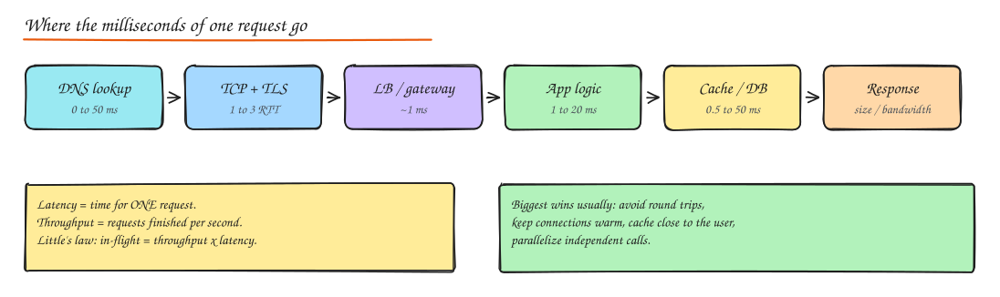
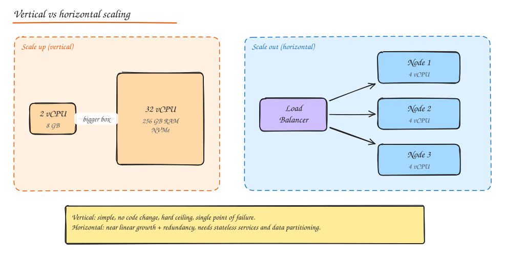

# Scalability, Latency and Throughput

## Latency vs throughput

- **Latency**: how long one operation takes, from the caller's perspective. Measured in ms.
- **Throughput**: how many operations complete per unit time. Measured in requests/s, MB/s, messages/s.
- **Bandwidth**: the maximum throughput a link or resource can carry. Throughput is what you actually get.

They are related but not the same. A cargo ship has terrible latency and enormous throughput; a motorbike courier has great latency and tiny throughput. Batching usually **increases throughput and increases latency**; parallelism can improve both until you hit a shared bottleneck.

### Little's law

**L = λ x W**: the average number of requests in the system (concurrency) equals arrival rate times average time in system.

Use it constantly:

- A service handles 2,000 req/s with 50 ms average latency, so about **100 requests are in flight** at any moment. If each needs a DB connection for its whole life, you need around 100 connections (plus headroom).
- A thread pool of 200 threads with 100 ms latency caps throughput at **2,000 req/s**. To go higher: more threads, lower latency, or async IO.
- If latency doubles (slow dependency), concurrency doubles at the same traffic. That is how a slow downstream exhausts upstream thread pools and connection pools, turning slowness into an outage.

### Percentiles and tail latency

Averages hide pain. Report percentiles:

- **p50 (median)**: the typical experience.
- **p95 / p99**: the experience of your unluckiest 5% / 1% of requests. For a user who makes 100 requests per session, p99 happens to them every session.
- **p99.9**: matters for high fanout systems and your most valuable users (who often have the most data and hit slow paths).

**Tail latency amplification**: if one page load fans out to 100 backend calls in parallel and each backend has a 1% chance of being slow, then `1 - 0.99^100 ≈ 63%` of page loads hit at least one slow call. The page's p50 inherits the backends' p99.

Mitigations:

- **Hedged requests**: send a second copy of the request to another replica if the first has not answered within the p95 time; take whichever returns first.
- **Tied requests**: send to two replicas, and the one that starts processing cancels the other.
- Reduce fanout, set **per call timeouts** and return partial results.
- Remove sources of variance: GC pauses, noisy neighbours, background compaction, cold caches.

Never average percentiles across hosts (the mean of p99s is not the p99). Merge histograms or sketches instead (see [Probabilistic Data Structures](../10-advanced/03-probabilistic-data-structures.md)).

## Vertical vs horizontal scaling

| | Vertical (scale up) | Horizontal (scale out) |
|---|---|---|
| How | Bigger CPU, more RAM, faster disks | More machines behind a load balancer |
| Code changes | None | Services must be stateless or partitioned |
| Ceiling | Largest instance available, price grows super linearly | Practically unbounded |
| Failure | Single point of failure | Survives node loss |
| Ops complexity | Low | Higher: discovery, balancing, consistency |
| Best for | Databases early on, quick wins, licenses priced per node | Stateless web tiers, caches, partitioned stores |

Practical advice: **scale up first, out when you must**. A single modern box with 64 cores and 512 GB RAM handles more than most startups ever need. But design the stateless tiers for scale out from day one, because it is cheap to do early.

## Stateless services: the key to scaling out

A service is stateless when any instance can serve any request because no request depends on memory local to a previous request. Move state out to:

- **Session data**: Redis, a signed cookie, or a JWT.
- **Uploaded files**: object storage (S3), not the local disk.
- **In memory caches**: a shared cache tier, or accept per instance caches as an optimization only.
- **Background jobs**: a queue, not an in process timer.

Once stateless, an instance can be killed at any time and autoscaling becomes trivial.

## Scaling the data tier (summary)

Stateless tiers are easy. Data is where scaling gets hard. The usual progression:

1. Single DB, tuned (indexes, query fixes, connection pooling).
2. **Vertical scaling** of the DB.
3. **Cache** hot reads (Redis/Memcached).
4. **Read replicas** for read heavy traffic.
5. **Functional partitioning**: split by domain (users DB, orders DB).
6. **Sharding**: split one table across many DBs by key.
7. Purpose built stores: search index, wide column store, time series DB, object storage.

Each step is covered in [Data](../03-data/05-sharding-partitioning.md).

## Finding bottlenecks

Use the **USE method** for resources (Utilization, Saturation, Errors) and the **RED method** for services (Rate, Errors, Duration).

Common bottlenecks and fixes:

| Symptom | Likely bottleneck | Fix |
|---|---|---|
| CPU at 90% on app servers | Compute | Scale out, profile hot code, cache results |
| DB CPU high, many identical queries | Read load | Cache, replicas, fix N+1 queries |
| DB write latency climbing | Write IOPS or locks | Batch writes, shard, async via queue, reduce indexes |
| p99 high, p50 fine | Variance (GC, hot shard, slow dependency) | Hedging, isolate noisy work, fix hot keys |
| Errors when traffic spikes | Pools exhausted | Timeouts, bulkheads, queue based load leveling, autoscale |
| Throughput flat while adding servers | Shared resource (DB, lock, single partition) | Remove the shared resource from the hot path |

**Amdahl's law** reminds you that the part of the work that cannot be parallelized caps the speedup. If 10% of each request is a serialized lock, you can never go more than 10x faster no matter how many machines you add.

## Trade-offs worth naming

- **Performance vs scalability**: a design tuned for one node (in memory locks, local caches) may not scale out.
- **Latency vs throughput**: batching, buffering and compression trade one for the other.
- **Consistency vs latency**: see [PACELC](02-cap-pacelc.md).
- **Cost vs headroom**: running at 40% utilization buys you spike tolerance and costs 2x.

## Interview questions

Your service's p50 is 20 ms but p99 is 900 ms. How do you investigate?

Check whether slow requests share a property: one endpoint, one tenant, one host, one shard, or a time pattern (GC, compaction, cron). Look at distributed traces of slow requests to see which span dominates. Typical culprits: a hot partition, lock contention, garbage collection, cold cache misses falling through to disk, retries with long timeouts, or a fanout that waits for the slowest backend.

Use Little's law: 5,000 req/s, 40 ms latency, each request holds a DB connection for 10 ms. How big should the pool be?

Only the DB time matters for the pool: 5,000 x 0.010 s = 50 connections busy on average. Add headroom for bursts and variance, so around 75 to 100 total across the fleet (then divide by number of app instances). Note it is total concurrency, so 20 instances need only about 4 to 5 connections each.

Why do people say "make it work, then make it scale"? When is that bad advice?

Premature scaling adds complexity that slows a product that may never get traffic. It is bad advice for decisions that are expensive to reverse: choice of primary key and partition key, ID format, tenancy model, public API contracts, and data formats. Get those right early, keep everything else simple.

## Related

- [Availability and Reliability](04-availability-reliability.md)
- [Load Balancing](../02-building-blocks/02-load-balancing.md)
- [Caching](../02-building-blocks/03-caching.md)
