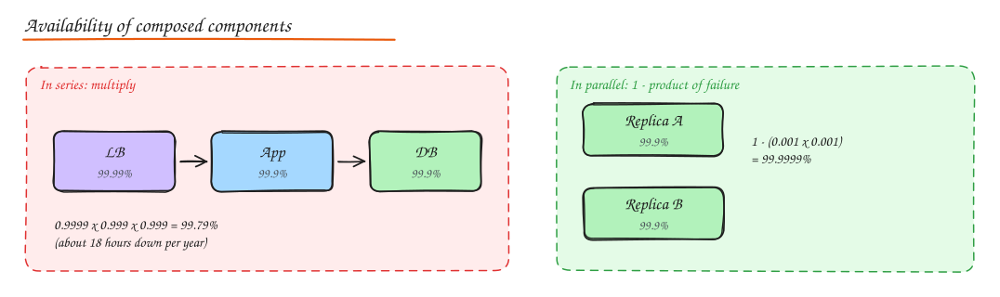

# Availability, Reliability and SLOs

> **TL;DR**
> - Each extra nine costs about 10x more effort: 99.9% allows ~43 minutes of downtime a month, 99.99% ~4 minutes.
> - Components in series multiply availability (lower); redundant copies in parallel raise it, if their failures are independent.
> - SLIs measure, SLOs set targets, SLAs are contracts; the error budget decides when to slow down and fix reliability.
> - Reducing time to recover is usually cheaper than preventing every failure.

- **Availability**: fraction of time (or of requests) the system serves correctly. `uptime / (uptime + downtime)` or `good requests / total requests`.
- **Reliability**: probability the system works correctly over a period. Related, but a system can be "up" and still return wrong results.
- **Durability**: probability that stored data is not lost. S3 advertises 11 nines of durability but only 99.99% availability. Different things.
- **Fault tolerance**: keeps working when components fail. **High availability** is usually achieved through fault tolerance plus fast recovery.

## The nines

| Target | Downtime / year | Downtime / month | What it usually takes |
|---|---|---|---|
| 99% | 3.65 days | 7.3 h | One server, manual recovery |
| 99.9% | 8.8 h | 43 min | Redundant instances, automated restarts, decent on call |
| 99.99% | 53 min | 4.4 min | Multi AZ, automatic failover, no manual steps in recovery, careful deploys |
| 99.999% | 5.3 min | 26 s | Multi region active-active, cell architecture, extreme change discipline |

Each extra nine costs roughly 10x more effort. Ask whether the business really needs it: an internal reporting tool does not need four nines; a payment authorization path probably does.

## Composing availability

**In series** (request needs all components): multiply.

`A_total = A1 x A2 x ... x An`

Ten dependencies at 99.9% each gives 99.0%. **Every synchronous dependency lowers your ceiling.** This is a strong argument for fewer hops in the critical path and for making non critical dependencies asynchronous or optional.

**In parallel** (request succeeds if any one works): multiply the failure probabilities.

`A_total = 1 - (1 - A1) x (1 - A2) x ...`

Two independent 99% replicas give 99.99%. The catch is the word **independent**: two replicas in the same rack, same AZ, same deploy, or same bad config fail together. Correlated failure is the real enemy.

## SLI, SLO, SLA and error budgets

| Term | Meaning | Example |
|---|---|---|
| **SLI** (indicator) | A measured metric of user experience | % of HTTP requests that return 2xx/3xx/4xx (non 5xx) in under 300 ms |
| **SLO** (objective) | Internal target for an SLI over a window | 99.9% of requests good over a rolling 28 days |
| **SLA** (agreement) | External contract with penalties | 99.5% monthly or customer gets credits |
| **Error budget** | `1 - SLO`, the unreliability you may spend | 0.1% of 28 days ≈ 40 min of full outage, or equivalent partial errors |

Set SLA looser than SLO, so you breach internally before you owe money. Error budgets turn reliability into a product decision: if the budget is burning fast, freeze risky launches and fix reliability; if it is healthy, ship faster.

Good SLIs are measured **as close to the user as possible** (load balancer or client), and cover availability, latency, and for data systems, freshness and correctness.

## Failure metrics

- **MTBF** (mean time between failures): how often things break.
- **MTTR** (mean time to recovery): how long until service is restored. Availability ≈ `MTBF / (MTBF + MTTR)`.
- **MTTD** (detect) is part of MTTR. You cannot fix what you have not noticed.

Usually, **reducing MTTR is cheaper than increasing MTBF**: fast detection (alerts on SLO burn), fast rollback, automated failover, feature flags to turn things off.

## Redundancy patterns

| Pattern | How it works | Failover time | Cost |
|---|---|---|---|
| **Active-passive (hot standby)** | Standby receives replicated state, takes over on failure | Seconds to a minute | Standby mostly idle |
| **Active-passive (warm/cold)** | Standby provisioned but not serving, or built on demand | Minutes to hours | Cheaper |
| **Active-active** | All nodes serve traffic, any can absorb a peer's load | Near zero, just stop routing | Must handle concurrent writes; each node needs headroom |
| **N+1 / N+2** | Capacity for peak plus one or two spare nodes | Instant | Spare capacity |

Failover itself is risky: **split brain** (two nodes both believe they are leader) can corrupt data. Use fencing tokens, leases with a consensus service, or STONITH style fencing.

## Removing single points of failure (SPOFs)

Walk the request path and ask "what if this dies?" for each hop:

1. **DNS**: use a managed provider with anycast, multiple NS records, sensible TTLs.
2. **Load balancer**: managed LBs are redundant; self hosted needs a pair with VRRP/keepalived or anycast.
3. **App servers**: at least 2 per AZ across 2 to 3 AZs, stateless, autoscaled.
4. **Database**: primary with synchronous or semi synchronous standby in another AZ, automated failover.
5. **Cache**: replicas plus the ability to survive a cold cache (protect the DB from stampedes).
6. **Queues**: replicated brokers (Kafka RF=3, min.insync.replicas=2).
7. **Config and secrets**: replicated stores; cache last known good config locally.
8. **People and process**: a single person who knows how to fail over is also a SPOF. Runbooks and drills.

## Graceful degradation

Design so that losing a non critical dependency degrades a feature instead of the whole page. If recommendations are down, show popular items. If the like counter service is slow, render the post without counts. Combine with [timeouts, circuit breakers and fallbacks](../06-reliability-ops/01-resilience-patterns.md).

## Interview questions

Your service calls 5 downstream services synchronously, each 99.95% available. What is your best case availability, and how do you improve it?

0.9995^5 ≈ 99.75%, before counting your own failures. Improve by: removing dependencies from the critical path (async via queues), caching responses so a downstream outage can be served from stale data, adding fallbacks for non critical calls, and calling independent services in parallel with timeouts so one slow service does not block the page.

What is an error budget and how does it change team behaviour?

It is the allowed amount of unreliability implied by the SLO (for 99.9% over 30 days, about 43 minutes). While budget remains, the team can take risks and ship. When it is exhausted, the policy says to pause feature launches and prioritize reliability work. It aligns product and SRE on one number instead of arguing about "is it stable enough".

Two DB replicas give "99.99%" on paper but you saw a 2 hour outage. Why might the math have lied?

The failures were not independent: both replicas shared something (a bad schema migration, a config push, the same AZ power event, a bug triggered by the same query, a full disk from the same runaway job). The parallel formula assumes independence. Real availability engineering is mostly about removing correlated failure modes: staggered deploys, separate failure domains, and cells.

## Related

- [Resilience Patterns](../06-reliability-ops/01-resilience-patterns.md)
- [Disaster Recovery and Multi Region](../06-reliability-ops/03-disaster-recovery-multi-region.md)
- [Observability](../06-reliability-ops/02-observability.md)
