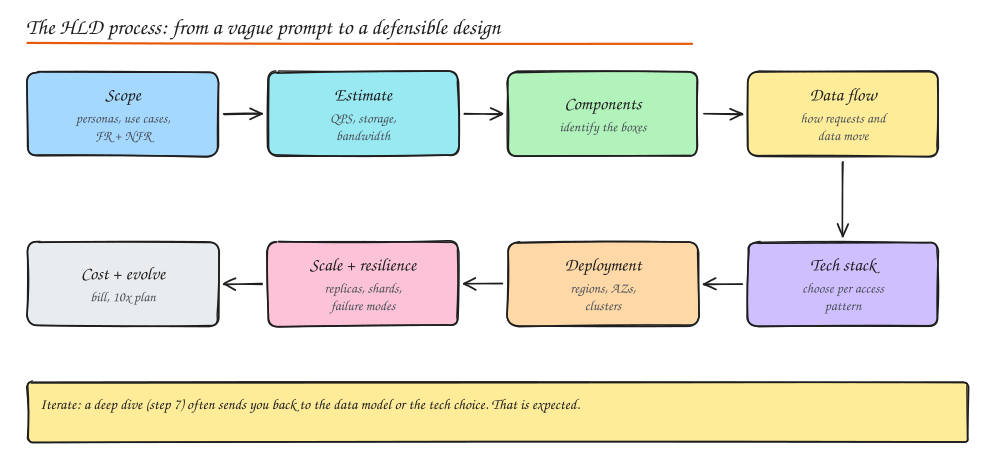
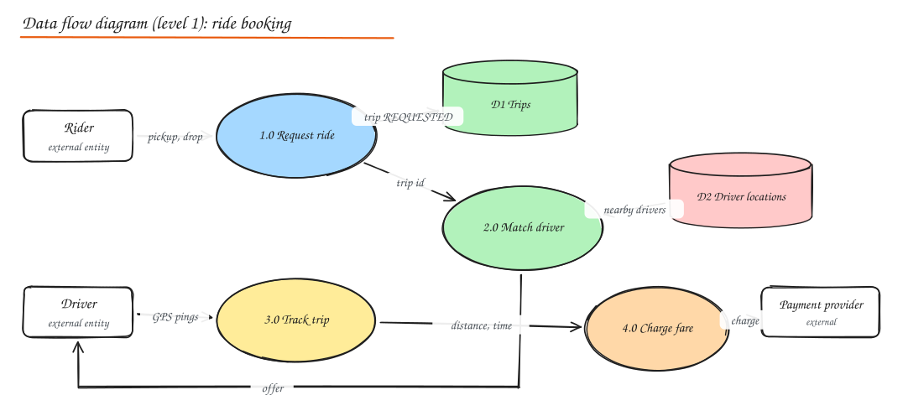
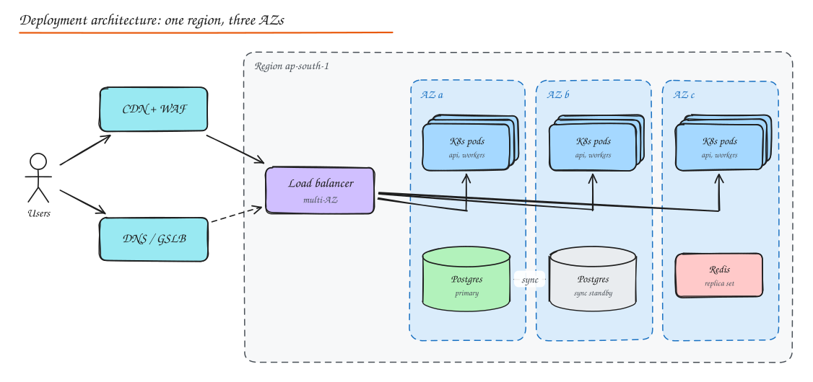

# The HLD Process (From Prompt to Architecture)

> **TL;DR**
> - High-level design is a repeatable process, not inspiration: scope, estimate, list components, trace the data flow, choose technology, place it on infrastructure, then stress it.
> - Every box you draw must trace back to a requirement. If you cannot say which requirement a box serves, delete it.
> - Pick storage per **access pattern**, not per entity, and say the trade-off out loud.
> - Finish with failure modes, scaling plan and a rough monthly bill. That is what separates senior answers.



The [interview framework](../00-start-here/01-interview-framework.md) tells you how to *run* the 45 minutes. This note is the engineering method underneath it, the same one you would use to write a real design document at work.

## Step 1: Scope with personas, use cases and workflows

**System boundaries and scope.** Decide what is inside your system and what is an external dependency. For a ride hailing app, maps and payment networks are external; matching and trips are inside.

**User personas.** Who uses the system and what do they care about?

| Persona | Goal | What it implies |
|---|---|---|
| Rider | Get a car in under a minute | Low latency matching, live tracking |
| Driver | Steady stream of good trips | Fair dispatch, offline tolerance on bad networks |
| Ops analyst | Understand supply and demand | Event pipeline into analytics |
| Admin / support | Refunds, fraud review | Audit logs, internal tools, strict access control |

**Use cases and workflows.** Turn personas into verbs and walk each one end to end:

1. Rider requests a ride (pickup, drop, car type), sees a price.
2. System matches a driver, driver accepts.
3. Both see live location until pickup; trip runs; fare is charged.

**Functional vs non-functional requirements** come from these workflows. See [What is System Design](01-what-is-system-design.md) for how to phrase them with numbers. **Constraints and assumptions** (cloud provider, team size, deadlines, existing systems) belong here too.

## Step 2: Estimate the load

Only the numbers that change a decision: peak QPS per workflow, storage growth, bandwidth, and hot spots. See [Back of the Envelope](../00-start-here/02-back-of-envelope.md).

## Step 3: Identify components

A checklist that covers almost every product system. Walk it in request order and keep only what the requirements need:

| Component | Add it when | Note |
|---|---|---|
| **Frontend** (web, mobile) | Always | Mobile clients are on flaky networks: retries, offline caching |
| **CDN** | Static assets, media, global users | [CDN](../02-building-blocks/04-cdn.md) |
| **Load balancer** | More than one server | [Load Balancing](../02-building-blocks/02-load-balancing.md) |
| **API gateway** | External APIs, auth, rate limits, many services | [API Gateway](../02-building-blocks/05-proxies-api-gateway.md) |
| **Services** | One per bounded context | Keep the count small at first |
| **Databases** | Durable state | One per service if microservices |
| **Cache** | Read heavy, latency sensitive | [Caching](../02-building-blocks/03-caching.md) |
| **Message queue / stream** | Async work, fanout, decoupling | [Queues](../02-building-blocks/07-message-queues.md) |
| **Search engine** | Text search, facets | [Search](../02-building-blocks/10-object-storage-and-search.md) |
| **Object storage** | Files, images, video, backups | Presigned URLs |
| **Workers / schedulers** | Background jobs, cron | Idempotent, retryable |
| **Analytics pipeline** | Metrics, reporting, ML | CDC or events into a warehouse |

## Step 4: Draw the data flow

A **data flow diagram (DFD)** shows how data moves between external entities, processes and data stores, independent of technology. It is the quickest way to check that every requirement is served and every store has a writer and a reader.



DFD notation:

- **External entities** (rectangles): people or systems outside your boundary.
- **Processes** (circles, numbered 1.0, 2.0): things that transform data.
- **Data stores** (cylinders or open boxes, D1, D2): data at rest.
- **Flows** (labelled arrows): the data that moves, named as nouns ("trip id", "GPS pings").

Level 0 is one bubble (the whole system); level 1 splits it into major processes (above); level 2 zooms into one process.

**Component interactions** then add the protocol for each arrow: synchronous REST/gRPC, async event, stream, batch file. See [Communication Patterns](../04-networking-apis/06-communication-patterns.md).

## Step 5: Select the technology stack

Choose per job, justify in one sentence, and prefer boring, managed technology unless a requirement forces otherwise.

| Layer | Default choices | Choose differently when |
|---|---|---|
| **Programming language** | Java/Kotlin, Go, Python, TypeScript/Node | Latency-critical and CPU bound: Go, Rust, C++; ML-heavy: Python; team skills often decide |
| **Frameworks** | Spring Boot, Go net/http + gRPC, FastAPI/Django, NestJS | Use what the team operates well |
| **Relational DB** | PostgreSQL, MySQL (managed: RDS, Cloud SQL, Aurora) | Global strong consistency at scale: Spanner, CockroachDB |
| **Key-value / wide column** | DynamoDB, Cassandra/ScyllaDB, Bigtable | Massive writes with simple access patterns |
| **Cache** | Redis (ElastiCache/Memorystore), Memcached | |
| **Search** | Elasticsearch/OpenSearch | Small scale: Postgres full text |
| **Message brokers** | Kafka (streams, replay), SQS/SNS or RabbitMQ (job queues), Pub/Sub | Simple jobs: a DB-backed queue is fine |
| **Object storage** | S3, GCS, Azure Blob | |
| **Infrastructure** | Containers on Kubernetes (EKS/GKE/AKS) or ECS/Cloud Run; serverless for spiky glue | Very small team: PaaS (Render, Fly, App Engine) |
| **Observability** | OpenTelemetry + Prometheus/Grafana, or Datadog | |

Say the trade-off: "Postgres because orders need transactions and the volume (2k writes/s) fits one primary; Cassandra for the location history because it is 1M writes/s of append-only data queried by driver and time."

## Step 6: Deployment architecture

Place the components on real infrastructure: regions, availability zones, clusters, networks.



- **Containerization (Docker)**: one immutable image per service.
- **Orchestration (Kubernetes)**: deployments spread across AZs with pod anti-affinity, HPA for scaling, PodDisruptionBudgets for safe maintenance. See [Deployment and Cost](../06-reliability-ops/04-deployment-and-cost.md).
- **Cloud providers (AWS, GCP, Azure)**: managed databases with a standby in another AZ, managed load balancers, private subnets for data.
- Decide single region vs multi-region from the availability and latency requirements. See [Disaster Recovery and Multi-Region](../06-reliability-ops/03-disaster-recovery-multi-region.md).

## Step 7: Scalability planning

Go tier by tier and state how each grows:

| Tier | Horizontal scaling strategy | Vertical scaling strategy |
|---|---|---|
| Stateless services | Add instances behind the LB, autoscale on CPU/RPS | Bigger instances for memory-heavy services |
| Cache | Add shards (consistent hashing / slots), replicas for hot reads | Larger memory nodes |
| Relational DB | Read replicas, then functional split, then sharding | Larger instance first (cheapest early win) |
| Wide-column / KV | Add nodes, the partitioner rebalances | Rarely needed |
| Queues | More partitions and consumers | |

**Database scaling**: replicas, sharding and partitioning ([Sharding](../03-data/05-sharding-partitioning.md)). **Caching strategy**: what is cached, where, TTL, invalidation ([Caching](../02-building-blocks/03-caching.md)). **Content delivery strategy**: what the CDN serves and how it is invalidated ([CDN](../02-building-blocks/04-cdn.md)).

## Step 8: Resilience, observability, cost

- **Resilience**: redundancy per tier, failover, timeouts, retries, circuit breakers, bulkheads, graceful degradation. Walk "what if X dies?" for each box. See [Resilience Patterns](../06-reliability-ops/01-resilience-patterns.md).
- **Monitoring and observability**: golden signals per service, SLOs, tracing. See [Observability](../06-reliability-ops/02-observability.md).
- **Cost estimation**: compute, storage, data transfer, licensing. See [Cost Estimation and Optimization](../06-reliability-ops/05-cost-optimization.md).

## A design document template

Use this outline for real design docs; it mirrors the steps above.

```text
1. Context and goals          (problem, personas, scope, non-goals)
2. Requirements               (functional, non-functional with numbers, constraints)
3. Estimates                  (QPS, storage, bandwidth)
4. High-level design          (component diagram, data flow, APIs)
5. Data model                 (entities, stores, partition keys, access patterns)
6. Detailed design            (the 2 or 3 hard parts)
7. Deployment and scaling     (regions, AZs, scaling per tier)
8. Reliability and security   (failure modes, SLOs, threat model)
9. Cost                       (monthly estimate, biggest drivers)
10. Alternatives considered   (and why not)
11. Rollout and migration     (phases, flags, backfill, rollback)
```

## Interview questions

<details>
<summary>What is the difference between a component diagram and a data flow diagram?</summary>

A component diagram shows *what* the system is made of (services, databases, queues) and how they connect. A data flow diagram shows *what data moves where* between external entities, processes and data stores, independent of technology. DFDs are great for checking completeness (every store is written and read, every requirement has a flow); component diagrams are what you implement and deploy.

</details>

<details>
<summary>How do you justify a technology choice in an interview?</summary>

Tie it to an access pattern and a number, then name the trade-off: "Messages are written 1M times a second and read by conversation in time order, so a wide-column store partitioned by conversation id fits; we give up ad-hoc queries and joins, which this feature does not need." Avoid naming technology without a reason.

</details>

<details>
<summary>When would you choose vertical scaling over horizontal scaling for a database?</summary>

Early and often: a bigger instance is a config change, keeps transactions and joins simple, and modern machines handle very large workloads. Move to horizontal (replicas, then sharding) when you approach the largest instance, need more write throughput than one node offers, or need fault isolation beyond a primary and standby.

</details>

## Related

- [Interview Framework](../00-start-here/01-interview-framework.md)
- [What is System Design](01-what-is-system-design.md)
- [Communication Patterns](../04-networking-apis/06-communication-patterns.md)
- [Cost Estimation and Optimization](../06-reliability-ops/05-cost-optimization.md)
