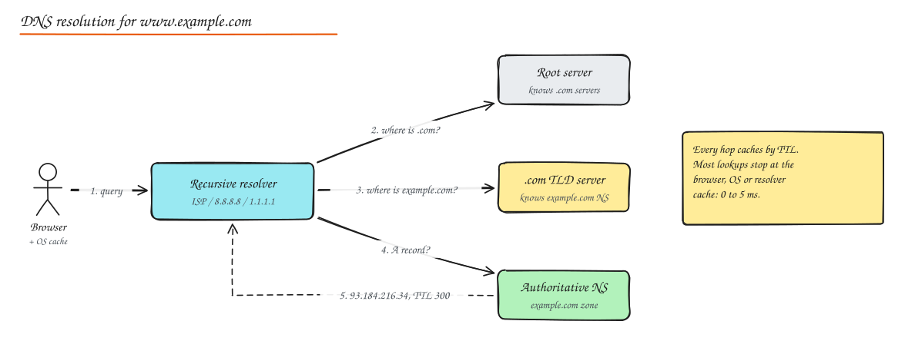
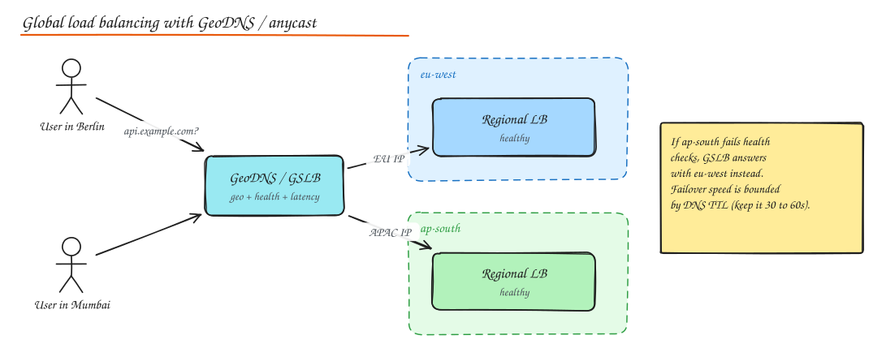

# DNS (Domain Name System)

> **TL;DR**
> - DNS is the internet's phone book: a resolver walks root, TLD and authoritative servers and caches the answer for its TTL.
> - Low TTLs mean fast failover but more lookups; high TTLs mean speed and resilience but slow changes.
> - DNS also routes traffic: weighted, latency-based, geo and health-checked answers; anycast complements it.
> - Inside data centers, DNS and registries (Consul, Eureka, Kubernetes DNS) handle service discovery.

DNS is the internet's distributed, hierarchical, heavily cached phone book. It maps names (`api.example.com`) to records (IP addresses, aliases, mail servers, text). It is the first hop of almost every request, and a surprisingly powerful traffic management tool.

## Resolution step by step

1. Browser checks its own cache, then the OS cache (and `/etc/hosts`).
2. Query goes to a **recursive resolver** (ISP, corporate, or public like 8.8.8.8 / 1.1.1.1).
3. If not cached, the resolver asks a **root server**: "who handles `.com`?" Root replies with TLD nameservers (a **referral**).
4. Resolver asks the **TLD server**: "who handles `example.com`?" Reply: the domain's authoritative nameservers.
5. Resolver asks the **authoritative nameserver**: "A record for `www.example.com`?" Reply: the IP plus a **TTL**.
6. Resolver caches the answer for TTL seconds and returns it.

- **Recursive query**: client asks the resolver to do all the work and return a final answer.
- **Iterative query**: the resolver asks each server, which answers with the best referral it has.

There are 13 root server *names* (a to m), but each is served by hundreds of anycast instances worldwide.

## Record types you should know

| Record | Maps | Example / use |
|---|---|---|
| **A** | name to IPv4 | `api.example.com A 203.0.113.10` |
| **AAAA** | name to IPv6 | `api.example.com AAAA 2001:db8::10` |
| **CNAME** | name to another name (alias) | `www CNAME example.cdn.net` (cannot be at the zone apex) |
| **ALIAS / ANAME** | apex alias (provider feature) | `example.com ALIAS lb-123.elb.amazonaws.com` |
| **MX** | mail servers with priority | `MX 10 mail1.example.com` |
| **NS** | authoritative nameservers for a zone | delegation |
| **SOA** | zone metadata: primary NS, serial, refresh, negative cache TTL | one per zone |
| **TXT** | arbitrary text | SPF, DKIM, domain verification |
| **SRV** | service location: host + port + priority + weight | `_sip._tcp`, used by some service discovery |
| **PTR** | IP to name (reverse DNS) | mail server reputation |
| **CAA** | which CAs may issue certificates | security hardening |

## TTL and caching trade-offs

| Low TTL (30 to 60 s) | High TTL (hours to days) |
|---|---|
| Fast failover and traffic shifts | Slow to change, stale answers linger |
| More queries to authoritative servers, slightly slower first lookups | Fewer lookups, better latency, resilience if the authoritative server is down |

Practical pattern: keep TTL high for stable records; **lower it a day before a planned migration**, migrate, then raise it again. Remember some clients and resolvers ignore TTLs (notably long lived JVM processes that cache forever unless configured).

**Negative caching**: NXDOMAIN answers are cached too (based on SOA minimum). Creating a record right after someone looked it up can take a while to appear.

**"Propagation"** is not an active push. It is simply old cached answers expiring around the world according to their TTLs.

## DNS as a load balancing and routing tool

- **Round robin DNS**: return several A records; clients pick one. Cheap, but no health awareness and clients cache, so uneven load.
- **Weighted records**: 90% to `v1`, 10% to `v2` for coarse canaries or migrations.
- **Latency based routing**: answer with the region that has the lowest measured latency to the resolver.
- **GeoDNS / geo steering**: answer based on the resolver's (or client subnet's, via EDNS Client Subnet) location. Used for data residency and latency.
- **Health checked failover**: the DNS provider probes endpoints and stops returning unhealthy ones. Failover time ≈ detection time + TTL.

**Anycast** is the complement: the same IP is announced from many locations via BGP and the network routes each client to the nearest one. Public resolvers, root servers, CDNs and DDoS protection all use anycast. DNS gives you per answer control; anycast gives you instant network level failover without waiting for TTLs.

## Reliability and security

- Use at least two authoritative providers or one provider with anycast and a strong SLA. The 2016 Dyn DDoS took down large parts of the web for sites with a single DNS provider.
- **DNSSEC** signs records so resolvers can verify they were not forged (protects against cache poisoning). It does not encrypt.
- **DNS over HTTPS / TLS (DoH / DoT)** encrypts the client to resolver hop for privacy.
- Watch for **dangling CNAMEs** (pointing at a deprovisioned cloud resource) which enable subdomain takeover.

## Advanced DNS

### Query types

- **Recursive query**: "give me the final answer" (client to resolver).
- **Iterative query**: "give me the best referral you have" (resolver to root, TLD and authoritative servers).
- **Record type queries**: A, AAAA, CNAME, MX, TXT, SRV, NS, SOA, CAA, PTR (reverse lookups via `in-addr.arpa`). `ANY` queries are deprecated and often refused.
- **Negative answers**: NXDOMAIN (name does not exist) and NODATA (name exists, no record of that type), both cached using the SOA minimum TTL.

### Zone transfers

Secondary nameservers copy a zone from the primary: **AXFR** transfers the full zone, **IXFR** only changes since a serial number; **NOTIFY** tells secondaries a new serial exists. Restrict transfers to known secondaries (open AXFR leaks every hostname you have). Managed DNS providers replicate zones internally instead.

### Weighted, latency and failover routing

- **Weighted DNS**: return records in proportion to weights (90/10 canary, gradual migration between providers).
- **Latency-based**: answer with the region that has the lowest measured latency to the resolver.
- **Failover**: health-checked primary and secondary records.
- **GeoDNS**: answer by geography (data residency, local edges).

## Service discovery and naming inside a datacenter

DNS is also how services find each other internally, alongside dedicated discovery systems:

| Mechanism | How it works | Typical use |
|---|---|---|
| **Kubernetes DNS** | `my-svc.my-ns.svc.cluster.local` resolves to a Service virtual IP (or pod IPs for headless services) | Default inside Kubernetes |
| **Consul** | Service registry with health checks; DNS interface (`orders.service.consul`) and HTTP API; KV store | VMs and mixed environments, service mesh |
| **Eureka** | Netflix's registry: services register and heartbeat, clients cache the registry and load balance themselves | Spring Cloud / JVM microservices |
| **etcd / ZooKeeper** | Consistent stores where services register ephemeral entries | Infrastructure, coordination |
| **mDNS (multicast DNS)** | Hosts answer `.local` name queries over multicast on the local network, no DNS server needed | Printers, smart devices, local development |
| **Zeroconf** (Bonjour/Avahi) | mDNS + DNS-SD (service discovery) + link-local addressing: devices find each other with zero configuration | Home and office networks, IoT |
| **xDS (Envoy)** | Control plane pushes endpoint lists to proxies via API | Service meshes (Istio) |

Short TTLs and client-side caching matter: DNS-based discovery updates slowly; API-based discovery (Consul, Eureka, xDS) reacts in seconds. See [Microservices](../05-architecture/01-monolith-vs-microservices.md#service-discovery).

## Interview questions

What happens, at the DNS level, when you type a URL and hit enter?

Browser cache, OS cache and hosts file are checked. On a miss the stub resolver asks the configured recursive resolver, which (if it has nothing cached) walks root, TLD, and authoritative servers using referrals, caches each answer by TTL, and returns the final A/AAAA record. Often a CNAME chain is followed (for example to a CDN hostname), and the CDN's DNS returns an edge IP close to the user.

Why not use DNS round robin as your only load balancer?

DNS has no knowledge of server health or load, answers are cached by resolvers and clients for the TTL (some ignore TTL), and clients may always pick the first IP. Removing a dead server takes at least a TTL. It is fine for spreading across regional load balancers, not for balancing individual app servers.

You must fail over from us-east to us-west within 1 minute. What DNS settings matter?

TTL on the record (30 to 60 s), health check interval and failure threshold at the DNS provider (for example 10 s x 3), and making sure clients honour TTL. Even then some clients will lag, so combine DNS failover with anycast or a global load balancer in front, and keep the old region able to proxy or reject cleanly.

Why can't a CNAME be at the zone apex (example.com)?

A CNAME must be the only record at a name, but the apex must also have SOA and NS records. Providers work around it with ALIAS/ANAME records or CNAME flattening, resolving the target server side and returning A records.

## Related

- [Load Balancing](02-load-balancing.md)
- [CDN](04-cdn.md)
- [Networking Fundamentals](../04-networking-apis/01-networking-fundamentals.md)
