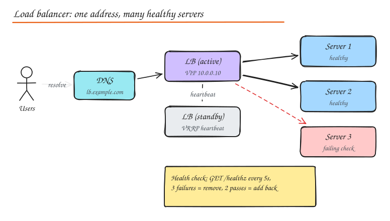
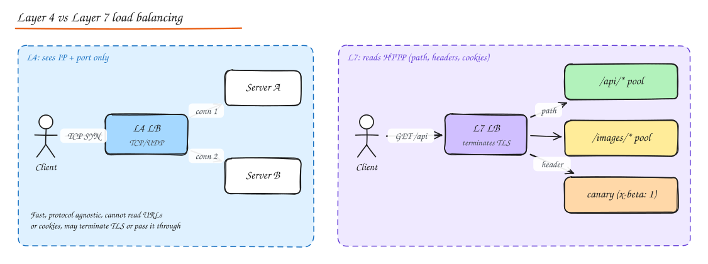

# Load Balancing

> **TL;DR**
> - A load balancer gives clients one address in front of many healthy servers, enabling scaling, failover and zero-downtime deploys.
> - L4 balances connections (fast, protocol-agnostic); L7 understands HTTP and can route by path, header or cookie.
> - Algorithms matter: round robin ignores load; least connections and power of two choices adapt to slow servers.
> - Health checks remove bad servers, but a shared-dependency check can remove all of them; keep liveness shallow.

A load balancer (LB) spreads incoming requests across a pool of backends so that no single server is overwhelmed, and hides failed servers from clients. It gives you **one stable address** in front of a **changing set of healthy servers**, which is what makes horizontal scaling and zero downtime deploys possible.

What an LB buys you:

- **Scalability**: add servers without clients noticing.
- **Availability**: unhealthy servers are removed automatically.
- **Zero downtime deploys**: drain a server, upgrade it, put it back.
- **Security and offload**: TLS termination, DDoS absorption, WAF, hiding backend IPs.
- **Traffic control**: canaries, blue/green, A/B, routing by path or header.

LBs appear at many tiers: in front of web servers, between services, in front of databases (ProxySQL, PgBouncer), and globally across regions.

## Hardware vs software load balancers

| | Hardware appliances | Software load balancers | Managed cloud LBs |
|---|---|---|---|
| Examples | F5 BIG-IP, Citrix ADC (NetScaler) | NGINX, HAProxy, Envoy, Traefik | AWS ALB/NLB, GCP Cloud Load Balancing, Azure LB |
| Performance | Very high, dedicated ASICs | High on commodity servers, scale horizontally | Scales automatically |
| Cost model | Large upfront cost, licenses | Free/open source plus servers | Pay per hour and per traffic unit |
| Flexibility | Vendor features, slower to change | Fully programmable, config as code, runs anywhere (including Kubernetes) | Integrated with cloud services, less control |
| Where you see them | Traditional data centers, banks | Everywhere, including inside service meshes | Default choice in the cloud |

Modern systems mostly use managed cloud LBs at the edge and software proxies (Envoy, NGINX) inside. Hyperscalers build their own software L4 balancers on commodity hardware (Google Maglev, Meta Katran).

## Layer 4 vs Layer 7

| | Layer 4 (transport) | Layer 7 (application) |
|---|---|---|
| Sees | IPs, ports, TCP/UDP | Full HTTP: method, path, headers, cookies, body |
| Decision unit | Per connection | Per request (multiple requests on one connection can go to different backends) |
| Features | Very fast, protocol agnostic, can pass TLS through | Path/host/header routing, retries, auth, rate limiting, caching, compression, gRPC aware |
| Cost | Cheap, millions of connections | More CPU (parses and often terminates TLS) |
| Examples | AWS NLB, Maglev, LVS/IPVS, HAProxy in TCP mode | AWS ALB, NGINX, Envoy, HAProxy HTTP mode, Traefik, Cloudflare |

A common combo is **L4 at the edge** (fast, absorbs floods, anycast) feeding **L7 proxies** that do the smart routing.

Important gotcha for **gRPC and HTTP/2**: they multiplex many requests over one long lived connection. An L4 balancer pins all of them to one backend, causing severe imbalance. Use an L7 (HTTP/2 aware) balancer or client side balancing.

## Algorithms

| Algorithm | How | Good for | Watch out for |
|---|---|---|---|
| **Round robin** | Rotate through servers | Homogeneous servers, similar request cost | Ignores load; slow requests pile up on one server |
| **Weighted round robin** | Rotate in proportion to weights | Mixed instance sizes, canaries (weight 5%) | Static weights go stale |
| **Least connections** | Pick the server with fewest active connections | Long or variable request durations (websockets, uploads) | Needs shared state across LB nodes; new servers get flooded |
| **Least response time / latency (EWMA)** | Pick lowest recent latency x active requests | Heterogeneous performance | Feedback oscillations, needs smoothing |
| **Random** | Pick at random | Simple, stateless, many LB nodes | Uneven at small scale |
| **Power of two choices** | Pick 2 random servers, send to the less loaded | Excellent balance with no global state (Envoy, NGINX `random two`) | Small overhead |
| **IP hash** | `hash(client IP) % N` | Crude stickiness | Remaps almost everyone when N changes; NAT makes many users one IP |
| **Consistent hashing** | Hash on a ring (or Maglev / rendezvous) | Cache affinity: same key goes to same server | Hot keys overload one node; use bounded load variants |

**Slow start**: a freshly added server gets a gradually increasing share so it can warm caches and JIT before full load. Least connections without slow start will flood a new node.

Try them in the **Load Balancer Simulator** lab to see how round robin piles up slow requests while least connections and P2C adapt.

## Health checks

- **Active**: the LB probes each backend (TCP connect, `HTTP GET /healthz`, gRPC health protocol) every few seconds. Typical config: interval 5 s, timeout 2 s, unhealthy after 3 failures, healthy after 2 passes.
- **Passive (outlier detection)**: the LB watches real traffic and ejects a backend that returns too many 5xx or timeouts (Envoy outlier detection).

Design your health endpoint carefully:

- **Liveness** ("process is alive, restart me if not") should not depend on downstream services.
- **Readiness** ("I can take traffic now") can check critical dependencies and warmup.
- If every instance's health check fails because a shared DB is down, the LB may remove **all** instances and turn a partial degradation into a total outage. Many LBs "fail open" when all backends are unhealthy for this reason.

**Connection draining** (deregistration delay): when removing a server, stop sending new requests but let in-flight ones finish (30 to 300 s).

## Sticky sessions (session affinity and session persistence)

**Session persistence** (also called sticky sessions or session affinity) routes a given client to the same backend every time, via a cookie inserted by the LB or a hash of IP / header.

- Pros: works with legacy apps that keep session state in memory; improves local cache hit rates.
- Cons: uneven load, lost sessions when a server dies, harder scaling down and deploys.

Prefer **stateless services with external session storage** (Redis, signed cookies, JWT). Use stickiness only where it is fundamental, for example WebSocket connections (which are naturally sticky for their lifetime) or when routing to the shard that holds a user's data.

## High availability of the load balancer itself

The LB must not be the single point of failure.

- **Managed LBs** (ALB, NLB, GCP LB) are internally redundant across AZs.
- **Self hosted**: active-passive pair sharing a virtual IP via VRRP (keepalived); the standby takes the VIP on heartbeat loss. Or active-active with **ECMP** routing / anycast spreading traffic over multiple LB nodes.
- At the very large scale (Google Maglev, Facebook Katran) software L4 LBs run on many commodity machines behind ECMP, using consistent hashing so a connection keeps hitting the same backend even if the LB node changes.

## Global load balancing

Across regions, you balance with **GeoDNS / latency based DNS** or **anycast** to a global edge (Cloudflare, AWS Global Accelerator, GCP global LB). The edge picks the closest healthy region, and fails over when a region is unhealthy. See [DNS](01-dns.md) and [Disaster Recovery](../06-reliability-ops/03-disaster-recovery-multi-region.md).

## Software you should name

| Tool | Notes |
|---|---|
| **NGINX** | Web server + reverse proxy, very common L7, simple config |
| **HAProxy** | High performance L4/L7, rich health checks and stats |
| **Envoy** | Modern L7 proxy, dynamic config via xDS APIs, the data plane of Istio, first class gRPC, outlier detection, retries, circuit breaking |
| **AWS ALB / NLB** | Managed L7 / L4 |
| **Kubernetes Service / Ingress** | kube-proxy (iptables/IPVS) does L4; Ingress controllers do L7 |

## Interview questions

Requests to your service vary from 5 ms to 5 s. Which algorithm, and why not round robin?

Least outstanding requests (least connections) or power of two choices on in-flight requests. Round robin ignores the fact that some servers are stuck on several 5 s requests and keeps sending them more, creating queueing and tail latency. Least-loaded style algorithms naturally route around busy servers.

Why does an L4 load balancer do a poor job with gRPC traffic?

gRPC uses HTTP/2, which multiplexes many requests over a single long lived TCP connection. An L4 LB balances connections, not requests, so each client's entire stream lands on one backend. Fix with an L7 LB that understands HTTP/2 streams, client side load balancing (gRPC's built in balancer with service discovery), or a service mesh sidecar.

All your health checks started failing at once and the LB removed every instance. What went wrong and how do you prevent it?

The health check probably depended on a shared dependency (DB, cache) that went down, so a partial outage became a total one. Keep liveness checks shallow, make readiness checks tolerant (or exclude non critical dependencies), and enable "fail open" or panic thresholds (Envoy's panic threshold routes to all hosts if too many are unhealthy).

How would you implement a canary release with a load balancer?

Run the new version as a separate target group, then shift weight: 1%, 5%, 25%, 50%, 100%, watching error rate and latency SLOs at each step and rolling back automatically if they regress. For user consistency, pin canary membership by a hash of user ID (header or cookie based routing at L7) so the same user does not flip between versions.

## Related

- [DNS](01-dns.md)
- [Proxies and API Gateway](05-proxies-api-gateway.md)
- [Consistent Hashing](06-consistent-hashing.md)
- Build it: [Load Balancer from scratch](../11-builds/06-load-balancer.md)
