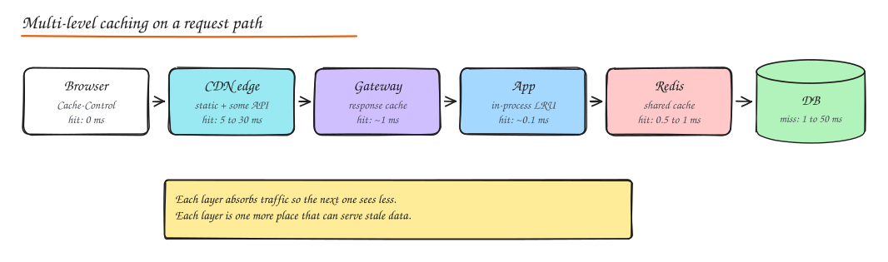
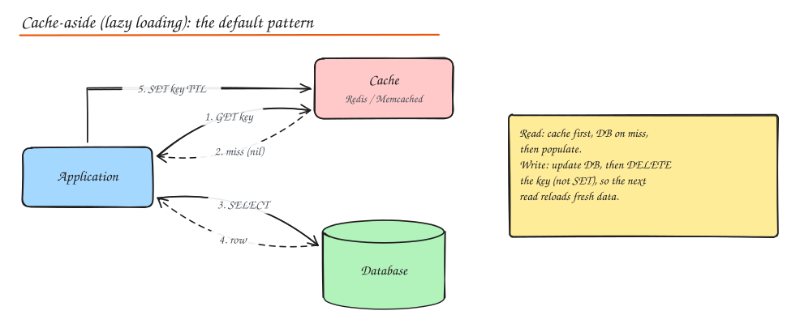
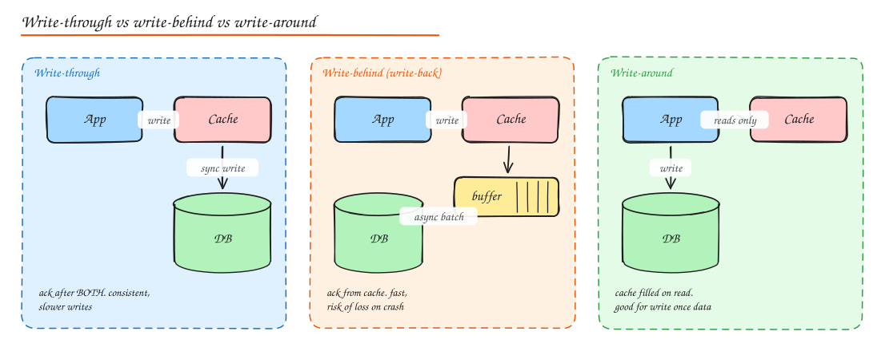
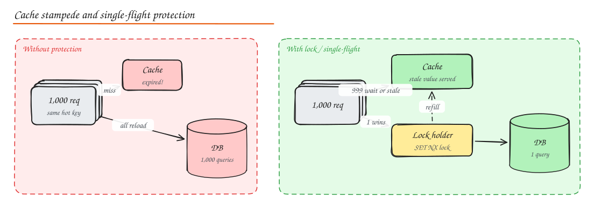

# Caching

A cache stores the result of expensive work (a DB query, a computation, a remote call, a rendered page) in faster storage so the next request can skip that work. Caching is the single highest leverage tool for read latency and for protecting databases, and also the most common source of subtle bugs.

> "There are only two hard things in Computer Science: cache invalidation and naming things." (Phil Karlton)

## Where caches live



| Layer | Examples | Caches | Controlled by |
|---|---|---|---|
| Client | Browser HTTP cache, mobile app storage | Static assets, API responses | `Cache-Control`, `ETag` |
| Edge | CDN (Cloudflare, CloudFront, Akamai) | Static files, images, video segments, some API responses | Cache headers, CDN rules, purge API |
| Gateway / reverse proxy | NGINX, Varnish, API gateway | Whole HTTP responses | Proxy config |
| Application (local) | In process LRU (Caffeine, Guava, lru-cache) | Hot config, small lookup tables | Code |
| Distributed cache | Redis, Memcached, Hazelcast | Objects, sessions, computed results, counters | Code |
| Database | Buffer pool, query cache, materialized views | Pages, query results | DB engine |
| OS / hardware | Page cache, CPU caches | Disk blocks, memory lines | Kernel / CPU |

**Local vs distributed cache**: local is fastest (no network) but each instance has its own copy (N copies, inconsistent, cold after deploy). Distributed is shared and consistent across instances but costs a network hop (~0.5 ms). A common pattern is a small local cache with a short TTL in front of Redis for the hottest keys.

## Read and write strategies

### Cache-aside (lazy loading): the default



```python
def get_user(user_id):
    key = f"user:{user_id}"
    user = cache.get(key)
    if user is None:                       # miss
        user = db.query("SELECT * FROM users WHERE id = %s", user_id)
        cache.set(key, user, ttl=300)      # populate
    return user

def update_user(user_id, fields):
    db.update("users", user_id, fields)    # 1. write the source of truth
    cache.delete(f"user:{user_id}")        # 2. invalidate, do not SET
```

- Only requested data is cached. Cache failure degrades to DB reads, not an outage (if the DB can take it).
- First request after expiry or eviction is slow (miss penalty).
- **Delete, do not update**, on writes. Two concurrent writers doing `SET` can leave the older value in cache permanently; deleting forces a fresh load.

### Read-through

Same as cache-aside but the cache library/provider loads from the DB itself on a miss. Cleaner application code; the cache must know how to load.

### Write-through, write-behind, write-around



| Strategy | Write path | Pros | Cons | Use when |
|---|---|---|---|---|
| **Write-through** | Write cache and DB synchronously | Cache always fresh, reads after writes hit | Slower writes, caches data that may never be read | Read-after-write heavy, small datasets |
| **Write-behind (write-back)** | Write cache, flush to DB asynchronously in batches | Very fast writes, absorbs bursts, coalesces updates | Data loss if cache dies before flush, complex ordering | Counters, metrics, view counts, gaming scores |
| **Write-around** | Write DB only, cache filled on read | No cache pollution from write-once data | First read is a miss | Logs, uploads, data rarely re-read |
| **Refresh-ahead** | Proactively refresh hot keys before they expire | No miss latency for hot keys | Wasted refreshes if prediction is wrong | Predictable hot sets (home page, config) |

## Eviction policies

When the cache is full, something must go.

| Policy | Evicts | Notes |
|---|---|---|
| **LRU** (least recently used) | Item not accessed for longest | Great default. O(1) with hash map + doubly linked list. Scan pollution: one big scan flushes hot items. |
| **LFU** (least frequently used) | Item with fewest accesses | Keeps long term popular items; needs aging so old popularity decays. Redis `allkeys-lfu`. |
| **FIFO** | Oldest inserted | Simple, usually worse hit rate. |
| **Random** | Random item | Surprisingly OK, cheap. |
| **TTL based** | Expired items | Not a policy for full caches, but combined with others. |
| **W-TinyLFU / ARC / 2Q / SLRU** | Hybrids of recency and frequency | Better hit rates, resist scans (Caffeine uses W-TinyLFU). |

Redis `maxmemory-policy` options: `noeviction`, `allkeys-lru`, `volatile-lru` (only keys with TTL), `allkeys-lfu`, `volatile-ttl`, `allkeys-random`. For a pure cache use `allkeys-lru` or `allkeys-lfu`.

Build one: [LRU Cache from scratch](../11-builds/01-lru-cache.md). Compare policies in the **Cache Simulator** lab.

## Invalidation

1. **TTL (time based)**: every entry expires after N seconds. Simple and self healing; bounds staleness. Add **jitter** (TTL ± 10%) so keys written together do not expire together.
2. **Explicit invalidation on write**: delete the key when the source changes. Fresh, but every writer must remember every affected key (and derived keys like lists).
3. **Event based invalidation**: consume a change stream (CDC via Debezium, or domain events) and delete/update affected keys. Decouples writers from cache knowledge; small lag.
4. **Versioned keys**: embed a version in the key (`user:42:v7`, or `catalog:{build_hash}`). Changing the version makes old entries unreachable; they age out. Perfect for static assets (cache busting with content hashed filenames like `app.3f9a2c.js`).

### The classic race (and the fix)

Cache-aside with delete on write can still serve stale data:

1. Reader misses cache, reads **old** value from DB (replica lag or just slow).
2. Writer updates DB, deletes cache key.
3. Reader (slow) now `SET`s the **old** value into cache. Stale until TTL.

Mitigations: keep a TTL as a safety net; **delayed double delete** (delete again a few hundred ms after the write); use `SET` only if version is newer (store a version or timestamp and compare with a Lua script); or invalidate from the DB change stream, which is ordered.

## Cache stampede (thundering herd / dogpile)

A hot key expires and thousands of concurrent requests all miss and hammer the DB at once.



Fixes:

- **Request coalescing / single-flight**: only one request per key recomputes; the others wait for its result (Go `singleflight`, in process futures).
- **Distributed lock**: `SET lock:key token NX PX 5000`; the winner reloads, losers wait briefly or serve stale.
- **Serve stale while revalidate**: store a soft expiry inside the value; after it passes, one request refreshes in the background while others get the stale value (HTTP `stale-while-revalidate`).
- **Probabilistic early expiration (XFetch)**: each reader refreshes early with a probability that increases as expiry approaches, so refreshes spread out.
- **TTL jitter** to avoid mass expiry.
- **Warm the cache** before cutover (after deploys, failovers, or launching a new region).

## Hot keys

One key gets a huge share of traffic (celebrity profile, flash sale item). A single Redis shard holding it melts.

- **Local cache** in front of the distributed cache for the hottest keys (short TTL, e.g. 1 to 5 s).
- **Replicate the key**: store `item:123#1 ... item:123#N` and read a random copy; writes update all copies.
- **Read replicas** for the cache cluster.
- Detect hot keys (Redis `--hotkeys`, client side sampling) and handle them specially.

## Other failure modes

- **Cache penetration**: requests for keys that do not exist (often malicious) always miss and hit the DB. Fix: cache negative results (`user:999 -> NULL` with short TTL) and/or a **Bloom filter** of valid keys in front.
- **Cache avalanche**: many keys expire at once, or the cache cluster restarts cold. Fix: jittered TTLs, persistence or replicas, gradual warm up, rate limit DB access, circuit breaker on the DB path.
- **Big values**: multi MB values block Redis (single threaded command execution) and saturate network. Compress, split, or store in object storage and cache a pointer.

## Distributed cache design notes

- **Partitioning**: client side consistent hashing (Memcached style) or server side slots (Redis Cluster uses 16,384 hash slots).
- **Replication**: Redis primary/replica with Sentinel or Cluster failover; replication is async, so a failover can lose recent writes. Fine for a cache, dangerous if Redis is your source of truth.
- **Capacity**: memory = number of hot keys x (key + value + ~50 to 100 bytes overhead).

## Redis vs Memcached

| | Redis | Memcached |
|---|---|---|
| Data types | Strings, hashes, lists, sets, sorted sets, streams, bitmaps, HyperLogLog, geo | Strings (blobs) only |
| Persistence | RDB snapshots, AOF | None |
| Replication / HA | Built in replicas, Sentinel, Cluster | None built in (client side) |
| Threads | Mostly single threaded command execution (IO threads optional) | Multi threaded |
| Extras | Lua scripts, transactions, pub/sub, TTL per key | Simple, very predictable |
| Pick when | You need data structures (leaderboards, rate limit counters, queues, sessions) | Pure, simple, huge, multi threaded object cache |

## What not to cache

- Data that must be strongly consistent and is read right after write (account balances during a transaction).
- Highly personalized, rarely reused responses (low hit rate, wasted memory).
- Anything where a stale answer causes harm and you cannot bound staleness.

Measure **hit ratio**, **p99 latency**, **evictions/s** and **memory**. A cache with a 30% hit ratio may be adding latency on average rather than removing it.

## Interview questions

<details>
<summary>Why delete the cache entry on write instead of updating it?</summary>

Updating requires the writer to compute the cached representation and races with other writers: two concurrent updates can leave the older one in cache indefinitely. Deleting is idempotent and order insensitive for concurrent writers; the next reader reloads from the source of truth. It also avoids caching values that are never read.

</details>

<details>
<summary>Your DB falls over every time the cache cluster restarts. How do you fix it?</summary>

That is a cold cache avalanche. Options: replicas and persistence so the cache survives restarts warm; rolling restarts one shard at a time; cache warming from a snapshot or access logs before taking traffic; request coalescing so each key loads once; rate limiting or a circuit breaker on DB access with graceful degradation; and capacity planning so the DB can survive a partial cold cache.

</details>

<details>
<summary>How do you size a cache for a service with 50k reads/s?</summary>

Find the working set: how many distinct keys account for most reads (from access logs or by assumption, e.g. 20% of items get 80% of reads). Memory = hot keys x (average value size + overhead). Then validate with a hit ratio curve (simulate the access log against different cache sizes) and choose the knee of the curve. Add headroom for replicas and fragmentation.

</details>

<details>
<summary>How would you cache a paginated, personalized feed?</summary>

Cache the list of item IDs per user (for example a Redis list or sorted set capped at a few hundred), and cache item bodies separately by ID (shared across users). Page by cursor over the ID list, then multi-get the bodies. Updates to an item touch one key; new items are pushed into followers' ID lists (fanout) or merged at read time.

</details>

## Related

- [CDN](04-cdn.md)
- [Case study: Distributed Cache](../09-case-studies/13-distributed-cache.md)
- [Probabilistic Data Structures (Bloom filters)](../10-advanced/03-probabilistic-data-structures.md)
- Build it: [LRU Cache](../11-builds/01-lru-cache.md)
