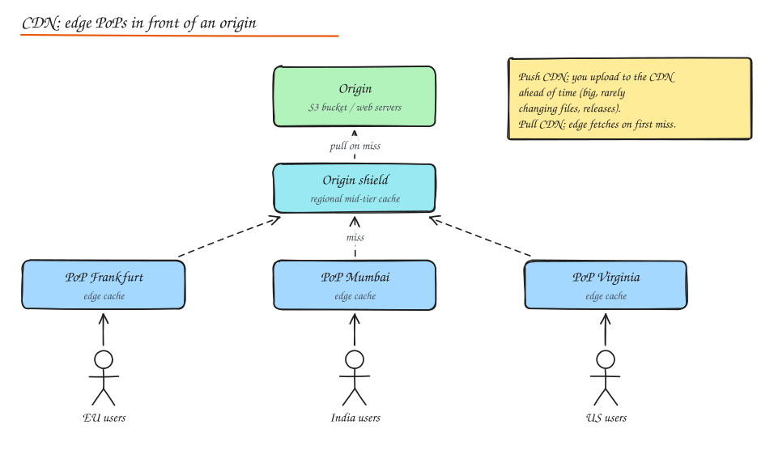

# Content Delivery Networks (CDN)

> **TL;DR**
> - A CDN is a global network of caches near users: lower latency, less origin load, cheaper egress, DDoS absorption.
> - Pull CDNs fetch on the first miss; push CDNs are loaded ahead of time for large, predictable content.
> - Version asset URLs (content hashes) and cache them forever; keep the HTML entry point short-lived.
> - Video and images are where CDNs earn the most: adaptive bitrate segments and right-sized modern formats.

A CDN is a globally distributed network of caching proxy servers (**edge servers**) grouped into **Points of Presence (PoPs)**, placed close to users. Users fetch content from a nearby PoP instead of your **origin**. Benefits:

- **Latency**: 10 to 30 ms to a nearby PoP instead of 150+ ms across an ocean, and TLS handshakes terminate close to the user.
- **Origin offload**: a 95% cache hit ratio means the origin serves 1 in 20 requests.
- **Bandwidth cost**: CDN egress is usually cheaper than cloud egress at scale.
- **Resilience**: absorbs traffic spikes and DDoS, can serve stale content if the origin is down.

## Push vs pull

| | Pull CDN | Push CDN |
|---|---|---|
| How content arrives | Edge fetches from origin on first miss, caches per headers | You upload content to the CDN storage ahead of time |
| Effort | Minimal: point a CNAME at the CDN | You manage uploads and versions |
| First request | Slow (miss goes to origin) | Fast |
| Storage | Only what is requested | Everything you push |
| Best for | Websites, APIs, user generated content with long tail | Large, predictable, rarely changing files: software releases, video libraries, game patches |

Most setups are pull. Netflix's Open Connect is effectively push: popular titles are pre-positioned on appliances inside ISPs during off-peak hours.

## Origin shielding and tiered caching

Without a shield, every PoP that misses goes to the origin: with 200 PoPs, a new popular file can cause 200 origin fetches. An **origin shield** (mid-tier cache) collapses those into one. Tiered caching also improves hit ratio for long tail content.

## Cache keys and headers

The **cache key** decides what counts as "the same" object. Default is usually scheme + host + path + query string. Trim it: remove tracking params (`utm_*`), normalize query order, and only vary on headers you truly need (`Accept-Encoding`, maybe `Accept` for image format negotiation). Every extra dimension fragments the cache.

Key HTTP headers:

| Header | Meaning |
|---|---|
| `Cache-Control: public, max-age=31536000, immutable` | Cache for a year everywhere, never revalidate. For content-hashed assets. |
| `Cache-Control: s-maxage=60` | Shared caches (CDN) keep 60 s, browsers use `max-age`. |
| `Cache-Control: no-cache` | May store, but must revalidate before each use. |
| `Cache-Control: no-store` | Never store (sensitive data). |
| `Cache-Control: private` | Only the browser may cache (user specific). |
| `stale-while-revalidate=30` | Serve stale for 30 s while fetching fresh in background. |
| `stale-if-error=86400` | Serve stale for a day if origin errors. Great resilience win. |
| `ETag` / `If-None-Match` | Revalidation by content fingerprint, 304 Not Modified if unchanged. |
| `Last-Modified` / `If-Modified-Since` | Revalidation by timestamp. |
| `Vary: Accept-Encoding` | Store separate variants per encoding. |
| `Surrogate-Key` / `Cache-Tag` | Tag objects so you can purge groups (all pages for product 42). |

## Invalidation

1. **Versioned URLs** (best): `app.3f9a2c.js`, `/v2/logo.png`. New content gets a new URL; old one simply ages out. Instant and free.
2. **Purge by URL or tag**: API call to the CDN. Takes seconds to minutes to propagate globally; rate limited; costs money at scale.
3. **Short TTLs** for content that changes often, combined with `stale-while-revalidate`.

## Static vs dynamic content

- **Static** (JS, CSS, images, video segments, downloads): cache aggressively with long TTLs and versioned URLs.
- **Dynamic but shared** (product page, news article, public API GET): short TTL (1 to 60 s) "micro caching" still offloads huge traffic during spikes.
- **Personalized** (cart, feed): usually not cacheable at the edge, but the CDN still helps through TLS termination near the user, connection reuse to origin over a warm, optimized backbone, and edge compute for auth and routing.

## Video delivery and adaptive bitrate (ABR)

Video is transcoded into multiple **renditions** (240p to 4K at several bitrates) and split into small **segments** (2 to 6 s). A **manifest** (HLS `.m3u8`, DASH `.mpd`) lists them. The player measures bandwidth and buffer level and switches rendition segment by segment. Segments are plain static files, so the CDN caches them perfectly. See [YouTube / Netflix case study](../09-case-studies/05-youtube-netflix.md).

## Image optimization at the edge

- **Format negotiation**: serve AVIF/WebP to browsers that accept them, JPEG otherwise (`Vary: Accept` or the CDN's image service).
- **Resizing on the fly**: `/img/42.jpg?w=400` produces and caches each size once. Constrain allowed sizes to prevent cache fragmentation and abuse.
- **Responsive images**: `srcset` / `sizes` so phones download small images.
- **Compression**: lossy quality 70 to 80 is usually indistinguishable; strip metadata.
- **Progressive loading / lazy loading**: blurred placeholders (LQIP), `loading="lazy"` below the fold.

## Edge compute

Cloudflare Workers, Lambda@Edge / CloudFront Functions, Fastly Compute, Akamai EdgeWorkers run code at the PoP: auth token validation, A/B assignment, redirects, header rewrites, geo-blocking, simple personalization, bot detection. Keep it small, fast, and mostly stateless (edge KV stores are eventually consistent).

## Interview questions

You deploy a new frontend and some users see a broken mix of old and new JS. Why, and how do you prevent it?

The HTML references unversioned asset URLs that were cached at different times at different layers (browser, CDN). Fix: content-hashed filenames for all assets with long immutable caching, and a short TTL (or no-cache) on the HTML entry point that references them. Keep old assets available for a while so cached HTML still works.

How would you reduce origin load for a viral news article that changes every few minutes?

Micro cache it at the CDN with `s-maxage` of 10 to 60 s plus `stale-while-revalidate`, enable origin shielding and request collapsing so only one request per PoP tier goes to origin per TTL, and purge by surrogate key when editors publish an update.

When would you not put something behind a CDN cache?

Per user sensitive responses (account data, payment pages) should not be cached at shared layers (`Cache-Control: private` or `no-store`). Very low traffic, long tail content gains little. Content that must change instantly everywhere without versioning is a poor fit. You may still route those through the CDN for TLS, DDoS protection and a faster backbone.

## Related

- [Caching](03-caching.md)
- [HTTP and TLS](../04-networking-apis/02-http-tls.md)
- [Case study: YouTube / Netflix](../09-case-studies/05-youtube-netflix.md)
