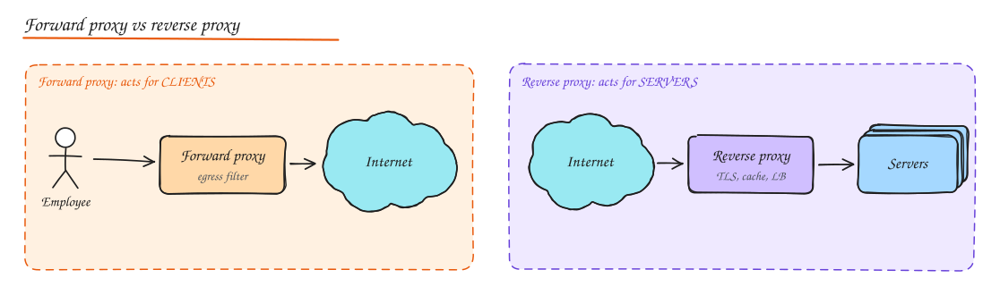
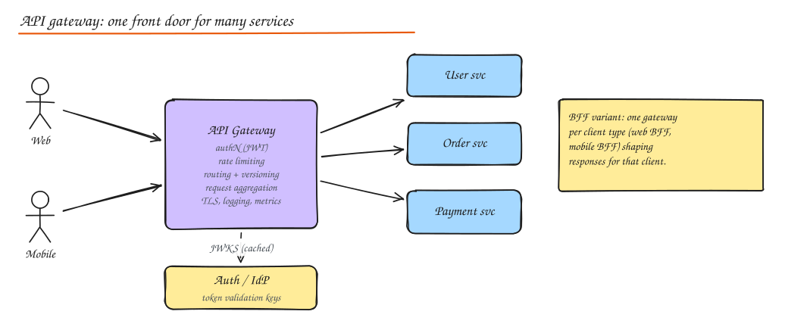

# Proxies, API Gateway and BFF

## Forward vs reverse proxy

| | Forward proxy | Reverse proxy |
|---|---|---|
| Acts on behalf of | Clients | Servers |
| Who configures it | The client side (browser, OS, corporate network) | The service owner |
| Hides | Client identity from servers | Server topology from clients |
| Uses | Corporate egress filtering, caching, anonymity, bypassing geo restrictions, egress allowlists for servers | TLS termination, load balancing, caching, compression, WAF, routing, rate limiting |
| Examples | Squid, corporate proxies, egress gateways | NGINX, HAProxy, Envoy, Traefik, Cloudflare |

A load balancer is a specialized reverse proxy whose main job is spreading load. In practice the same software (NGINX, Envoy) plays both roles.

## API gateway

An API gateway is a reverse proxy that is the **single entry point for external clients** into a set of backend services, and centralizes cross cutting concerns.

Typical responsibilities:

- **Routing**: `/users/*` to user service, `/orders/*` to order service; versioned routes (`/v1`, `/v2`).
- **Authentication**: validate JWTs or API keys once at the edge, pass identity downstream in headers.
- **Rate limiting and quotas** per API key, user, IP or plan.
- **Request/response transformation**: protocol translation (REST to gRPC), header injection, payload shaping.
- **Aggregation / composition**: one client call fans out to several services and merges results (keep this thin).
- **Observability**: access logs, metrics, trace IDs injected at the edge.
- **Security**: TLS termination, WAF integration, CORS, request size limits, schema validation.
- **Caching** of public GET responses.

Products: Kong, AWS API Gateway, Apigee, Azure APIM, Tyk, Envoy based gateways (Ambassador/Emissary, Gloo), Spring Cloud Gateway, NGINX.

### What a gateway should not do

- **Business logic.** Once domain rules live in the gateway, every team needs to change it and it becomes a distributed monolith bottleneck.
- **Heavy orchestration** across many services with complex error handling (put that in a dedicated service or use a workflow engine).
- Become a **single point of failure**: run it redundantly, autoscale it, and keep it stateless.

Each gateway hop adds latency (typically 1 to 5 ms). Worth it for external traffic; for service to service calls use direct calls or a mesh.

## Backend for Frontend (BFF)

Different clients need different shapes of data: a mobile app wants fewer, smaller calls; a web dashboard wants richer responses; partners want stable versioned APIs. A **BFF** is a gateway layer per client type, owned by the frontend team:

- Mobile BFF aggregates 6 backend calls into 1, strips fields, handles mobile auth.
- Web BFF renders server side or shapes for the SPA.
- Public API gateway offers versioned, documented, rate limited partner APIs.

Trade-off: more deployables and some duplicated logic, but each client evolves independently. GraphQL is a common alternative that lets one gateway serve many client shapes (see [API Design](../04-networking-apis/03-api-design.md)).

## Gateway vs load balancer vs service mesh

| | Load balancer | API gateway | Service mesh |
|---|---|---|---|
| Traffic | North-south (and some east-west) | North-south (client to services) | East-west (service to service) |
| Focus | Spread load, health | API management: auth, quotas, versioning, transformation | mTLS, retries, timeouts, traffic shifting, telemetry between services |
| Deployed as | Central tier | Central tier (or per BFF) | Sidecar proxy per pod (or per node, ambient) + control plane |
| Examples | ALB, NLB, HAProxy | Kong, Apigee, AWS API GW | Istio, Linkerd, Consul Connect |

They often coexist: `client -> CDN -> L4 LB -> API gateway -> services (with mesh sidecars) -> databases`.

## Sidecar and ambassador patterns

- **Sidecar**: a helper process deployed next to each service instance (same pod) that handles networking concerns: Envoy for mTLS and retries, log shippers, secret fetchers. The app talks to `localhost`.
- **Ambassador**: a sidecar specifically for outbound calls to a remote service (handles retries, circuit breaking, routing for that dependency).

## Interview questions

Should the API gateway validate JWTs, or should each service?

Both, at different depths. The gateway should validate signature and expiry and reject bad tokens early (cheap, protects services). Services should still enforce authorization (does this user own this order?) because the gateway does not know domain rules, and because zero trust says internal traffic can be spoofed. Services can trust identity headers only if they come over mTLS from the gateway.

Your gateway does request aggregation for the mobile home screen and its latency is now the p99 of 8 services. How do you improve it?

Call independent services in parallel, set per call timeouts and return partial responses with fallbacks for non critical sections, cache slow but shareable pieces, and consider precomputing the home screen asynchronously. Also question whether every section must load in the first request (lazy load below the fold).

## Related

- [Load Balancing](02-load-balancing.md)
- [Rate Limiting](08-rate-limiting.md)
- [Microservices](../05-architecture/01-monolith-vs-microservices.md)
- [Authentication and Authorization](../07-security/01-authn-authz.md)
