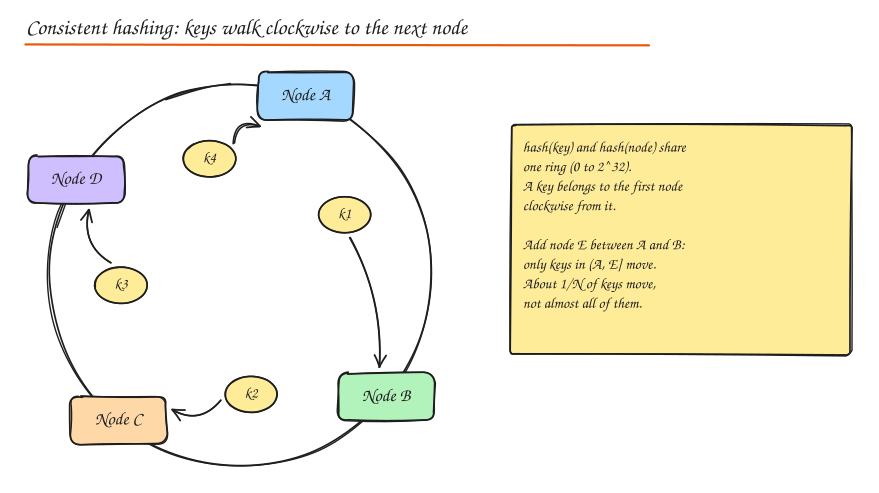
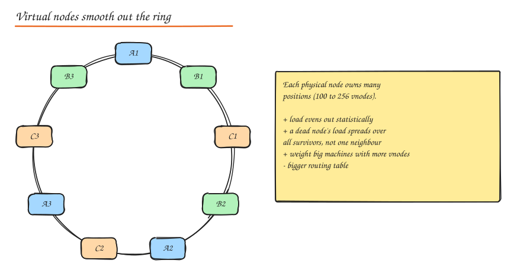

# Consistent Hashing

## The problem with `hash(key) % N`

Simple modulo hashing spreads keys evenly across N servers. But when N changes (a node dies or you add one) almost **every key maps to a different server**:

- With `N = 4 -> 5`, a key stays put only if `h % 4 == h % 5`, which is true for about 1 in 5 keys. **80% of keys move.**
- For a cache, that is a near total miss storm. For a database, it is a massive data migration.

## The hash ring



1. Hash both **nodes** (by name/IP) and **keys** into the same space, say `0 .. 2^32 - 1`, arranged as a circle.
2. A key is owned by the **first node clockwise** from the key's position.
3. Adding a node only takes over keys between it and its predecessor. Removing a node hands its keys to its successor.

**Only about K/N keys move** when one node is added or removed (K keys, N nodes) instead of almost all of them.

Lookup is a binary search over sorted node positions: `O(log V)` where V is the number of positions on the ring.

## Virtual nodes

With few nodes, random positions give very uneven arcs: one node might own 40% of the ring. And when a node dies, all of its load falls on a single neighbour.



**Virtual nodes (vnodes)**: each physical node is placed at many positions (`hash("nodeA#1")`, `hash("nodeA#2")`, ... typically 100 to 256).

- Load balances statistically (standard deviation drops roughly with `1/sqrt(vnodes)`).
- A failed node's load is spread across **all** remaining nodes.
- **Heterogeneous hardware**: give a bigger machine more vnodes (weighting).
- Cost: larger routing table, and more, smaller ranges to move or repair.

## Replication on the ring

Dynamo style systems (DynamoDB's ancestor, Cassandra, Riak) store each key on the owner **and the next R-1 distinct physical nodes clockwise** (skipping vnodes of a physical node already chosen). This list is the key's **preference list**. Rack and AZ awareness picks successors in different failure domains.

## Where it is used

- **Distributed caches**: Memcached client libraries (ketama), Redis client side sharding.
- **Databases**: Cassandra (token ring), DynamoDB, Riak, ScyllaDB.
- **Load balancers**: route requests for the same key (user, session, object) to the same backend for cache affinity (Envoy ring hash, NGINX `hash ... consistent`).
- **CDNs**: choose which edge server in a PoP caches a URL.
- **Messaging and sharded services**: assign partitions to workers.

## Alternatives worth naming

| Algorithm | Idea | Pros | Cons |
|---|---|---|---|
| **Rendezvous (HRW) hashing** | For each key, score every node `hash(key, node)`; pick the highest | Simple, perfectly even, no ring, easy top-k for replicas | `O(N)` per lookup (fine for tens to hundreds of nodes) |
| **Jump consistent hash** (Google) | Tiny arithmetic function maps key to bucket `0..N-1` | No memory, perfectly even, very fast | Buckets must be numbered; only add/remove at the end |
| **Maglev hashing** (Google LB) | Build a fixed size lookup table filled by node permutations | `O(1)` lookup, near even, minimal disruption | Table rebuild on change |
| **Range partitioning with a directory** | Explicit map of key ranges to nodes, managed by a coordinator | Supports range scans, precise rebalancing | Needs a metadata service (HBase, Bigtable, Spanner) |
| **Fixed slots** | `hash % 16384` slots, slots assigned to nodes (Redis Cluster) | Simple rebalancing by moving slots | Fixed maximum granularity |

## Hot spots remain

Consistent hashing balances **keys**, not **load**. A single very hot key still lands on one node. Mitigate with key splitting (append a random suffix and fan reads out), caching, or **consistent hashing with bounded loads** (if a node exceeds `(1 + ε) x average` load, overflow to the next node clockwise; used by Vimeo and in Google Cloud Pub/Sub).

## Implementation sketch

```python
import bisect, hashlib

class HashRing:
    def __init__(self, vnodes=150):
        self.vnodes, self.ring, self.owners = vnodes, [], {}

    def _h(self, s):
        return int(hashlib.md5(s.encode()).hexdigest()[:8], 16)

    def add(self, node):
        for i in range(self.vnodes):
            h = self._h(f"{node}#{i}")
            bisect.insort(self.ring, h)
            self.owners[h] = node

    def remove(self, node):
        for i in range(self.vnodes):
            h = self._h(f"{node}#{i}")
            self.ring.remove(h)
            del self.owners[h]

    def get(self, key):
        i = bisect.bisect(self.ring, self._h(key)) % len(self.ring)
        return self.owners[self.ring[i]]
```

Full version with replicas and a key movement test: [Consistent Hash Ring build](../11-builds/03-consistent-hash-ring.md). Play with nodes and vnodes in the **Hash Ring** lab.

## Interview questions

<details>
<summary>With 10 cache nodes using modulo hashing, one node dies. What happens, and how does consistent hashing help?</summary>

With `% 10 -> % 9` about 90% of keys remap, so the cache hit ratio collapses and the DB gets flooded. With consistent hashing only the dead node's keys (about 10%) move, to its successors (or, with vnodes, spread across all survivors). Hit ratio drops by about 10% instead of 90%.

</details>

<details>
<summary>Why do we need virtual nodes?</summary>

With one position per node the arcs are uneven, so load is uneven, and a node's failure dumps all of its keys on one neighbour, which may then fail too (cascading). Vnodes make each node own many small arcs, which evens out load and spreads a failed node's keys across all survivors. They also allow weighting by capacity.

</details>

<details>
<summary>Consistent hashing vs range partitioning: when would you choose each?</summary>

Hash based (consistent hashing) spreads load evenly and avoids hot ranges from sequential keys, but destroys key order, so range scans hit every node. Range partitioning keeps order (great for time ranges and prefix scans) but sequential writes (timestamps, auto increment IDs) hammer the last range, and it needs a split/merge mechanism plus a directory. Choose by access pattern.

</details>

## Related

- [Sharding and Partitioning](../03-data/05-sharding-partitioning.md)
- [Replication](../03-data/04-replication.md)
- [Case study: Distributed Cache](../09-case-studies/13-distributed-cache.md)
