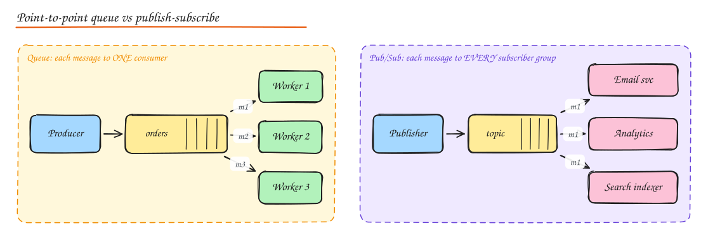
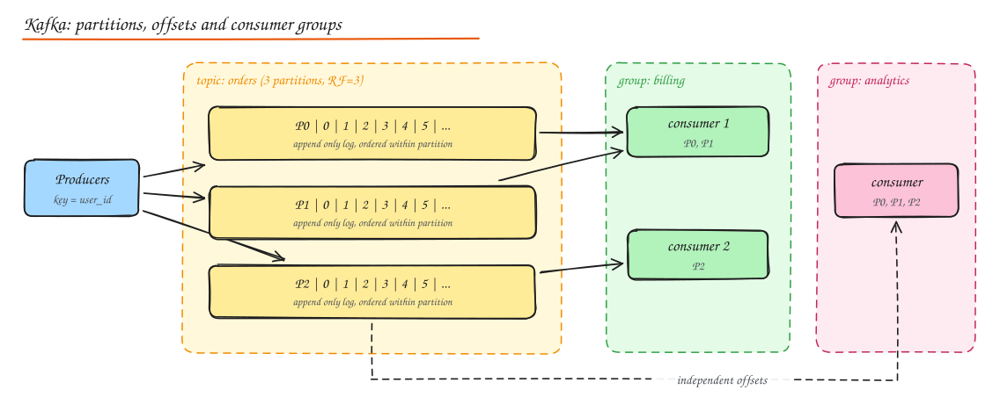

# Message Queues, Pub/Sub and Event Streams

> **TL;DR**
> - Queues let a producer hand off work and move on: decoupling, spike absorption and independent scaling.
> - Work queues give each message to one consumer; pub/sub gives every subscriber a copy; logs like Kafka keep messages for replay.
> - Delivery is at-least-once in practice, so consumers must be idempotent; ordering is per partition (per key).
> - Use the transactional outbox to update a database and publish an event atomically, and dead letter queues for poison messages.

## Why go asynchronous

In a synchronous call the caller waits, and the caller's availability and latency now include the callee's. A message broker sits in between and lets the producer hand off work and move on.

- **Decoupling**: producer does not know who consumes, or how many consumers there are.
- **Load leveling**: absorb spikes in the queue and let consumers drain at their own pace (queue based load leveling).
- **Resilience**: if consumers are down, messages wait instead of failing user requests.
- **Scalability**: add consumers to increase throughput (competing consumers).
- **Fanout**: one event triggers many independent reactions (email, analytics, search indexing).

Costs: eventual consistency, duplicate and out of order messages, harder debugging (no single stack trace), one more system to operate, and the need for idempotent consumers.

Rule of thumb: **use sync calls when the user needs the answer now; use async when the work can finish later** (sending emails, transcoding video, updating search indexes, fanout to followers, billing aggregation).

## Three models

| | Work queue (point to point) | Pub/Sub (fanout) | Log / stream |
|---|---|---|---|
| Delivery | Each message to one consumer among many | Each message to every subscription | Every consumer group reads the whole log at its own offset |
| After consumption | Message deleted (acked) | Deleted per subscription | Retained for a period (days, forever), replayable |
| Ordering | Usually best effort (FIFO variants exist) | Best effort | Strict within a partition |
| Examples | SQS, RabbitMQ queues, Celery, Sidekiq | SNS, Google Pub/Sub, RabbitMQ fanout exchange, Redis pub/sub | Kafka, Kinesis, Pulsar, Redpanda, Redis Streams |
| Best for | Background jobs, task distribution | Notifying many services of an event | Event sourcing, CDC, analytics pipelines, replay, high throughput |

## Kafka in depth

- A **topic** is split into **partitions**. Each partition is an append only, ordered, immutable log on disk. Each message has an **offset**.
- Producers choose a partition by **key hash** (all events for `user_42` go to the same partition, so they stay in order) or round robin when no key.
- Each partition has a **leader** broker and **followers** (replication factor, typically 3). The **ISR** (in-sync replicas) set is the followers that are caught up.
- With `acks=all` and `min.insync.replicas=2`, a write is acknowledged only after at least 2 replicas have it: survives a broker loss without data loss.
- **Consumer groups**: within a group, each partition is consumed by exactly one consumer, so **max parallelism = number of partitions**. Different groups read independently (that is pub/sub with replay).
- Consumers **commit offsets**. If a consumer crashes, another one in the group resumes from the last committed offset (rebalance).
- **Retention** by time or size, or **log compaction** (keep the latest value per key, great for changelog topics and rebuilding state).

Why Kafka is fast: sequential disk writes, OS page cache, zero copy `sendfile` to consumers, batching and compression, and partitions spread across brokers.

Choosing partition count: enough for peak consumer parallelism and throughput (e.g. target 10 MB/s per partition); more partitions cost more open files, longer leader elections, and longer rebalances. You can add partitions later, but that changes key to partition mapping (breaks per key ordering for existing keys).

## Delivery semantics

| Guarantee | How it happens | Consequence |
|---|---|---|
| **At most once** | Ack/commit before processing | Crash after commit loses the message. OK for metrics sampling. |
| **At least once** | Process, then ack/commit | Crash after processing but before ack causes redelivery. **Duplicates.** The common default. |
| **Exactly once** | At least once + idempotence or transactions | Duplicates are delivered but have no extra effect. |

"Exactly once delivery" across a network is impossible in general; what systems provide is **exactly once processing (effectively once)**:

- **Idempotent consumer**: record processed message IDs (in the same DB transaction as the side effect) and skip repeats, or design operations to be naturally idempotent (`SET balance = X` with a version check, upserts, `INSERT ... ON CONFLICT DO NOTHING`).
- **Kafka transactions**: idempotent producer (dedupes retries per partition with sequence numbers) plus transactional writes of output messages and consumer offsets together. Works for Kafka to Kafka pipelines (Kafka Streams, Flink).
- **Transactional outbox** for DB + message consistency (see below).

## Ordering

- Global ordering across a whole topic requires a single partition, which kills parallelism. You almost never need it.
- What you need is **per entity ordering**: all events for one order, one account, one chat. Use the entity ID as the partition key.
- Retries can reorder: if message 1 fails and goes to a retry queue while message 2 succeeds, order breaks. Options: block the partition on failure (head of line blocking), or include a version/sequence number and have consumers discard stale updates.
- SQS FIFO queues use **message group IDs** for the same idea.

## The dual write problem and the transactional outbox

A service must update its DB **and** publish an event. Doing both separately is unsafe: the DB commit can succeed and the publish fail (or the reverse), leaving the system inconsistent.

**Transactional outbox**:

1. In the same DB transaction as the business change, insert the event into an `outbox` table.
2. A relay process (polling, or CDC with Debezium reading the DB log) publishes outbox rows to the broker and marks them sent.
3. Consumers are idempotent because the relay may publish twice.

This gives atomicity between state change and event without distributed transactions. See [Distributed Transactions](../03-data/06-distributed-transactions.md).

## Failure handling

- **Retries with backoff**: transient failures should retry with exponential backoff and jitter. Use delay queues or retry topics (`orders.retry.1m`, `orders.retry.10m`) so one bad message does not block the partition.
- **Dead letter queue (DLQ)**: after N failed attempts, move the message aside with error metadata for inspection and replay. Alert on DLQ depth. A DLQ nobody looks at is data loss with extra steps.
- **Poison messages**: messages that always crash the consumer (bad schema). Validate early, catch deserialization errors, send to DLQ.
- **Visibility timeout** (SQS): a received message is hidden for N seconds; if not deleted in time it reappears. Set it longer than worst case processing time, or extend it while working.

## Backpressure

When consumers cannot keep up, lag grows. Options:

- **Scale consumers** (up to partition count for Kafka), autoscale on queue depth or consumer lag.
- **Bounded queues** that reject or block producers when full, pushing back up the chain instead of growing until memory runs out.
- **Shed load**: drop low priority messages, sample, or degrade.
- **Priority queues**: separate queues for high and low priority so a backlog of bulk jobs does not delay urgent ones.
- Monitor **consumer lag** (Kafka) or **age of oldest message** (SQS): these are your key SLIs.

## Choosing a broker

| Need | Pick |
|---|---|
| Simple managed job queue on AWS | **SQS** (standard for throughput, FIFO for ordering + dedupe) |
| Fanout notifications on AWS | **SNS -> SQS** per subscriber |
| Complex routing (topic/header exchanges), per message acks, priorities, RPC | **RabbitMQ** |
| High throughput event streaming, replay, CDC, stream processing | **Kafka** (or managed: MSK, Confluent; Redpanda as a compatible alternative) |
| Multi tenant, geo replication, tiered storage built in | **Pulsar** |
| Lightweight, low latency, at most once, ephemeral | **NATS**, **Redis pub/sub** |
| Small scale streams with Redis already present | **Redis Streams** |
| GCP managed pub/sub with push or pull | **Google Pub/Sub** |

## Message design tips

- Include an **event ID** (for dedupe), **timestamp**, **type** and **schema version**.
- Prefer **events** ("OrderPlaced") over **commands** ("SendEmail") for loose coupling; use commands when exactly one handler should act.
- **Thin vs fat events**: thin events (just IDs) force consumers to call back for data (coupling and load); fat events carry the state needed (larger, but self contained). A common middle ground: include the changed fields and an entity version.
- Use a **schema registry** (Avro / Protobuf) with compatibility rules to evolve messages safely.
- For large payloads, use the **claim check** pattern: put the blob in object storage and send a reference.

## Interview questions

How do you guarantee an email is sent exactly once when the queue is at least once?

You cannot make the email provider and the queue atomic, so make the effect idempotent: generate a deterministic idempotency key (for example `order_id + template`), record "sent" in a DB table with a unique constraint before or atomically with calling the provider, and pass the key to the provider if it supports idempotency. Duplicates find the key already present and skip. There is still a tiny window (crash after provider call, before recording), which you close with the provider's idempotency key or accept as rare.

Kafka consumer lag is growing steadily. What do you check and do?

Check whether producer rate increased, consumer processing time per message increased (slow downstream DB?), rebalances are happening repeatedly (consumers timing out on `max.poll.interval.ms`), or one partition is hot (skewed key). Fixes: scale consumers up to the partition count, increase partitions if needed, batch downstream writes, fix the slow dependency, rebalance hot keys, and tune poll/batch sizes.

Why not just call the email, analytics and search services directly from the order service?

Then placing an order depends on the availability and latency of three unrelated services, a failure in any of them fails or slows checkout, and the order service must change every time a new consumer appears. Publishing an `OrderPlaced` event decouples them: checkout succeeds once the order is durable, and each consumer processes at its own pace with its own retries.

How do you preserve ordering for events of the same order while still processing in parallel?

Partition by order ID so all events for one order land in one partition and are processed sequentially by one consumer, while different orders are processed in parallel across partitions. Make handlers check entity versions so a late or duplicate event cannot overwrite newer state.

## Related

- [Event-Driven Architecture, CQRS and Event Sourcing](../05-architecture/02-event-driven-cqrs-event-sourcing.md)
- [Distributed Transactions](../03-data/06-distributed-transactions.md)
- [Stream and Batch Processing](../10-advanced/02-stream-batch-processing.md)
- [Case study: Notification System](../09-case-studies/08-notification-system.md)
