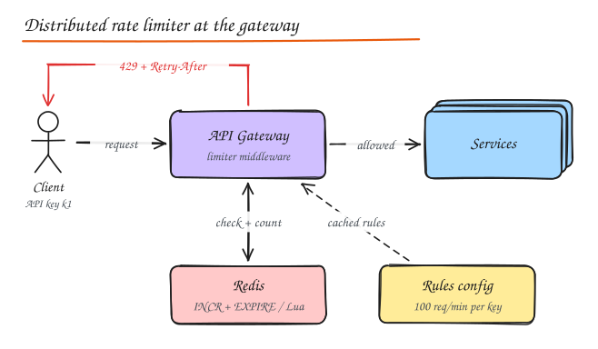
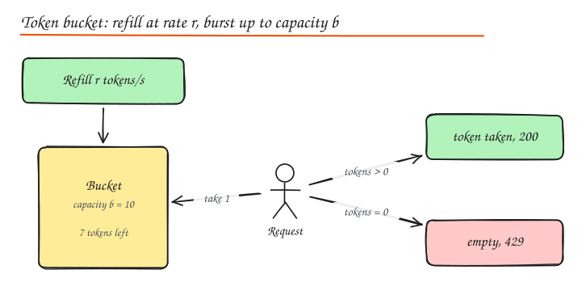

# Rate Limiting and Throttling

> **TL;DR**
> - Rate limiting caps how often a client can call you, protecting capacity, fairness and cost; excess gets HTTP 429.
> - Token bucket allows bursts with a steady average; sliding window counter is accurate and cheap; fixed windows allow edge bursts.
> - In a distributed system, counters live in a shared store (Redis) and must be updated atomically (Lua or INCR).
> - Decide in advance whether to fail open or closed when the limiter's store is down.

A rate limiter caps how many requests a client (user, API key, IP, tenant) can make in a period. It protects services from abuse and overload, enforces fairness and pricing tiers, and controls cost (for example, calls to a paid third party API).

- **Rate limiting**: reject excess requests (HTTP **429 Too Many Requests**).
- **Throttling**: often used to mean slowing down (queueing or delaying) instead of rejecting. In practice the terms are used loosely.
- **Load shedding**: rejecting requests based on the **server's** health rather than the client's quota.

## Where to put it



- **Client side**: polite, but cannot be trusted.
- **Edge / API gateway / middleware**: the usual place. One implementation for all services, rejects early and cheaply.
- **In each service**: for limits only the service understands (per tenant write quotas, expensive endpoints).
- **In front of dependencies**: limit your own calls to a fragile downstream or a third party API.

Limit at several granularities: per IP (anonymous abuse), per user/API key (fairness, plans), per endpoint (expensive search vs cheap GET), global (protect the system).

## Algorithms

### Token bucket



A bucket holds up to `b` tokens and refills at `r` tokens per second. Each request takes a token; no token, no entry.

- Allows **bursts** up to `b` while enforcing an average rate `r`.
- Tiny state: `(tokens, last_refill_ts)` per key. Refill lazily on each request: `tokens = min(b, tokens + (now - last) * r)`.
- Used by AWS API Gateway, Stripe, most cloud APIs.

### Leaky bucket

Requests enter a FIFO queue of size `b` that drains at a constant rate `r`. Overflow is rejected.

- **Smooths** output to a steady rate (good for protecting a downstream that hates bursts, like an SMS provider).
- Adds queueing latency; bursts are delayed rather than served.
- As a meter (without a real queue) it is equivalent to token bucket.

### Fixed window counter

Count requests in the current window (`key = user:minute`), reject above the limit.

- Simplest: one `INCR` + `EXPIRE` in Redis.
- **Boundary burst**: a client can send the full limit at 12:00:59 and again at 12:01:00, so 2x the limit in 2 seconds.

### Sliding window log

Store a timestamp per request (Redis sorted set); on each request remove timestamps older than the window, count the rest.

- **Exact**, no boundary burst.
- Memory heavy: O(limit) per key. Fine for low limits (login attempts), not for 10k/min.

### Sliding window counter

Keep counters for the current and previous fixed windows and weight the previous by overlap:

```text
estimate = current_count + previous_count * (1 - elapsed_in_current / window)
```

- Close to exact (Cloudflare measured about 0.003% error on real traffic), O(1) memory.
- The best general purpose choice for API limits.

| Algorithm | Burst handling | Memory | Accuracy | Notes |
|---|---|---|---|---|
| Token bucket | Allows bursts up to b | O(1) | Good | Most popular, easy to explain |
| Leaky bucket | Smooths bursts | O(b) queue | Good | Constant outflow |
| Fixed window | 2x burst at edges | O(1) | Poor at edges | Simplest |
| Sliding log | No bursts | O(limit) | Exact | Expensive |
| Sliding window counter | Minimal | O(1) | Very good | Best default |

Try them side by side in the **Rate Limiter Playground** lab, and see code in [Rate Limiters from scratch](../11-builds/02-rate-limiters.md).

## Distributed rate limiting

With 50 gateway instances, each must see the same count. Options:

1. **Central store (Redis)**: all instances update counters in Redis.
   - Make check-and-increment **atomic**: a Lua script or `INCR` then compare (a `GET` followed by `SET` races).
   - Adds ~0.5 to 1 ms per request; Redis becomes a critical dependency. Decide **fail open** (allow traffic if Redis is down, usual for availability) or **fail closed** (for security sensitive limits like login).
   - Shard by key in Redis Cluster for scale; keep each key's counters on one shard.
2. **Local limits with sync**: each instance enforces `limit / N` locally and periodically reconciles. Fast, approximate, breaks when traffic is unevenly balanced.
3. **Sticky routing**: route each key to one limiter instance via consistent hashing so counts are local (Envoy global rate limit service, or sharded limiter services).

Token bucket in Redis with Lua:

```lua
-- KEYS[1] = bucket key, ARGV = capacity, refill_per_sec, now_ms, cost
local cap, rate, now, cost = tonumber(ARGV[1]), tonumber(ARGV[2]), tonumber(ARGV[3]), tonumber(ARGV[4])
local b = redis.call('HMGET', KEYS[1], 'tokens', 'ts')
local tokens = tonumber(b[1]) or cap
local ts = tonumber(b[2]) or now
tokens = math.min(cap, tokens + (now - ts) / 1000 * rate)
local allowed = tokens >= cost
if allowed then tokens = tokens - cost end
redis.call('HSET', KEYS[1], 'tokens', tokens, 'ts', now)
redis.call('PEXPIRE', KEYS[1], math.ceil(cap / rate * 1000) + 1000)
return { allowed and 1 or 0, tokens }
```

## Client communication

Return useful headers so well behaved clients can adapt:

```http
HTTP/1.1 429 Too Many Requests
Retry-After: 12
X-RateLimit-Limit: 100
X-RateLimit-Remaining: 0
X-RateLimit-Reset: 1735689600
```

(The IETF `RateLimit` / `RateLimit-Policy` headers are the emerging standard.) Clients should back off exponentially with jitter.

## Design a rate limiter (interview walkthrough)

**Requirements**: limit per API key and per IP with configurable rules per endpoint; low added latency (< 2 ms); distributed across many gateway nodes; accurate enough (small overshoot fine); highly available (fail open); return 429 with headers; rules change without deploy.

**High level**: limiter middleware in the gateway, rules stored in a config service and cached in memory, counters in a Redis cluster sharded by key, sliding window counter or token bucket via a Lua script, metrics on allowed/rejected per rule.

**Deep dives**:

- Race conditions: atomic Lua scripts.
- Redis latency/outage: local in memory fallback limiter with conservative limits, circuit breaker on Redis, fail open.
- Hot keys (one huge customer): local pre-aggregation (batch decrements of tokens, for example take 10 tokens at a time per node), or a dedicated shard.
- Multi region: per region limits (simple, slight overshoot) vs global counters (cross region latency); usually per region with the limit divided by region share.
- Soft vs hard limits, burst allowances, and priority (never rate limit health checks or internal admin).

## Interview questions

<details>
<summary>Token bucket vs leaky bucket: when would you pick each?</summary>

Token bucket when you want to allow short bursts but cap the average (typical public APIs: users click fast then pause). Leaky bucket (as a queue) when the downstream needs a smooth, constant rate and you can tolerate added latency (sending SMS via a provider limited to 100/s, writing to a fragile legacy system).

</details>

<details>
<summary>Why is GET then SET in Redis a bug for rate limiting?</summary>

Two gateway nodes can both GET count = 99, both decide it is under 100, and both SET 100, allowing 101+ requests. The check and the increment must be atomic: INCR (which returns the new value), MULTI/EXEC, or a Lua script that reads, decides and writes in one step.

</details>

<details>
<summary>Your limiter's Redis cluster goes down. What should happen?</summary>

Usually fail open with a degraded local limiter (per node in memory limits set conservatively at roughly limit / node count), plus alerts, because blocking all API traffic is worse than briefly over-admitting. For security sensitive limits (login attempts, OTP sends, payment attempts) fail closed or use a separate highly available store.

</details>

## Related

- [API Gateway](05-proxies-api-gateway.md)
- [Resilience Patterns (load shedding)](../06-reliability-ops/01-resilience-patterns.md)
- Build it: [Rate Limiters](../11-builds/02-rate-limiters.md)
