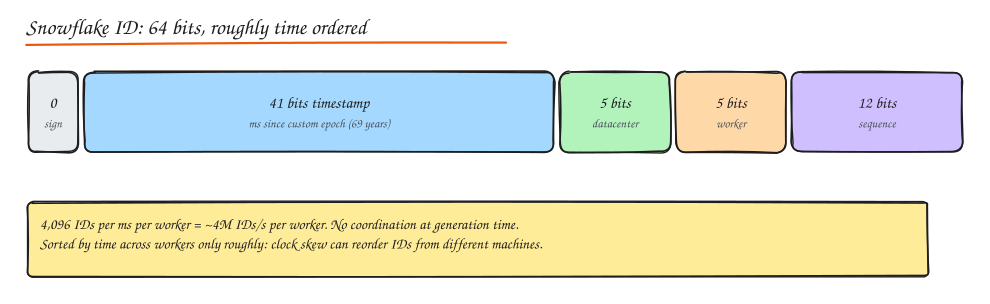

# Unique ID Generation

> **TL;DR**
> - Distributed IDs must be unique without a central bottleneck; you also choose size, ordering and guessability.
> - Snowflake: 41-bit time + machine id + sequence in 64 bits, roughly time-ordered, no coordination per ID.
> - UUIDv7/ULID are sortable 128-bit IDs; UUIDv4 is random and hurts B-tree insert locality.
> - Time-based IDs are only roughly ordered across machines because clocks drift.

Every entity needs an ID. On one database, `AUTO_INCREMENT` is fine. Across shards, regions and offline clients, generating IDs becomes a design problem.

## What do you need from an ID?

| Property | Why it matters |
|---|---|
| **Unique** | Obviously; collisions corrupt data |
| **Size** | 64-bit fits a `BIGINT` and is cheap in indexes; 128-bit is larger in every index and foreign key |
| **Sortable by time** | Feeds, pagination by ID, "newest first" without an extra index; B-tree insert locality |
| **No coordination** | Generating without a network call keeps latency low and avoids a SPOF |
| **Not guessable** | Public IDs that are sequential leak business volume and enable enumeration (`/invoice/1001`, `/invoice/1002`) |
| **Generated offline / client side** | Mobile apps creating records before sync |

## Options

### Database auto increment

- Simple, compact, ordered.
- Single point of write and of failure; does not work across shards without tricks.
- Trick: **step and offset** (MySQL `auto_increment_increment = N`, `auto_increment_offset = k`): server 1 issues 1, 3, 5; server 2 issues 2, 4, 6. Hard to add servers later.

### Ticket server (Flickr)

A dedicated DB whose only job is `REPLACE INTO tickets (stub) VALUES ('a'); SELECT LAST_INSERT_ID();`. Run two with odd/even offsets for availability. Simple but a central dependency with a round trip per ID.

### Range / block allocation

A coordinator (DB row, ZooKeeper, etcd) hands out **blocks** of IDs (`1..10000` to server A, `10001..20000` to server B). Servers issue from memory and fetch a new block when nearly empty.

- One coordination call per block, so it scales well.
- Gaps when servers die with unused IDs (usually fine).
- Order is only per server.

### UUID

| Version | Content | Sortable | Notes |
|---|---|---|---|
| **v4** | 122 random bits | No | Default everywhere. Random inserts scatter across B-tree pages: page splits, poor cache locality, write amplification on big tables. |
| **v1** | Timestamp + MAC | Not lexically | Leaks MAC address and time |
| **v7** (RFC 9562, 2024) | 48-bit Unix ms timestamp + random | **Yes** | Time ordered, index friendly, no coordination. Best default for new systems needing UUIDs. |

Collision odds for v4: you would need to generate about 2.7 x 10^18 IDs for a 50% chance of a single collision. Not a practical concern.

### ULID / KSUID

- **ULID**: 48-bit ms timestamp + 80 random bits, encoded as 26 Crockford base32 chars. Lexicographically sortable, URL safe. Very similar to UUIDv7.
- **KSUID**: 32-bit seconds timestamp + 128 random bits, 27 chars base62.

### Snowflake (Twitter)



64 bits: `1 sign | 41 timestamp ms (custom epoch) | 10 machine (5 DC + 5 worker) | 12 sequence`.

- 41 bits of milliseconds covers about 69 years from your chosen epoch.
- 4,096 IDs per ms per worker; if exhausted, wait for the next ms.
- Fits in a `BIGINT`, roughly time ordered, no coordination per ID.
- Worker IDs must be unique: assign via config, ZooKeeper/etcd leases, or derive from the pod ordinal.
- **Clock going backwards** (NTP adjustment) can produce duplicates: refuse to generate (or wait) until the clock passes the last timestamp used, and alert.

Variants: Instagram used `41 bits time | 13 bits shard id | 10 bits per-shard sequence` generated **inside Postgres** with a PL/pgSQL function, so the shard is encoded in the ID (you can route by ID without a lookup). Discord, Mastodon, Sony's Sonyflake (39 bits of 10 ms units, 16-bit machine) use similar layouts.

```python
import threading, time

class Snowflake:
    EPOCH = 1_704_067_200_000  # 2024-01-01 in ms

    def __init__(self, worker_id: int):
        assert 0 <= worker_id < 1024
        self.worker_id, self.seq, self.last_ms = worker_id, 0, -1
        self.lock = threading.Lock()

    def next_id(self) -> int:
        with self.lock:
            now = int(time.time() * 1000)
            if now < self.last_ms:
                raise RuntimeError("clock moved backwards; refusing to generate")
            if now == self.last_ms:
                self.seq = (self.seq + 1) & 0xFFF
                if self.seq == 0:                    # 4096 used this ms, spin to next ms
                    while now <= self.last_ms:
                        now = int(time.time() * 1000)
            else:
                self.seq = 0
            self.last_ms = now
            return ((now - self.EPOCH) << 22) | (self.worker_id << 12) | self.seq
```

## Ordering caveat

Snowflake, UUIDv7 and ULID are only **roughly** ordered across machines: clocks differ by milliseconds or more. Two events on different machines can get IDs in the opposite order of real time. If you need a true order (bank ledger, chat message sequence in a conversation), use a per entity sequence assigned by a single writer (the partition leader for that conversation), or logical clocks. See [Consensus and Clocks](../10-advanced/01-consensus-and-clocks.md).

## Decision table

| Situation | Choose |
|---|---|
| Single DB, internal IDs | Auto increment `BIGINT` |
| Distributed, need 64-bit, time ordered, high throughput | Snowflake style |
| Distributed, 128-bit OK, zero infrastructure | UUIDv7 (or ULID) |
| Must not leak volume / be guessable in URLs | Random (UUIDv4) public ID, or encrypt/obfuscate internal IDs (e.g. Hashids), separate from the internal key |
| Short URLs | Counter or range allocation encoded in base62 (see URL shortener) |
| IDs encode routing | Embed shard ID in the ID (Instagram style) |

## Interview questions

<details>
<summary>Why can UUIDv4 primary keys hurt write performance in MySQL/InnoDB?</summary>

InnoDB clusters rows by primary key in a B+ tree. Random keys insert into random leaf pages, causing page splits, fragmentation, and a working set that no longer fits in the buffer pool, so inserts become random disk IO. Secondary indexes also store the 16-byte PK. Time ordered IDs (auto increment, Snowflake, UUIDv7) append near the right edge of the tree and keep hot pages in memory.

</details>

<details>
<summary>How do you assign unique worker IDs to Snowflake generators in Kubernetes?</summary>

Options: StatefulSet ordinal as the worker ID; lease a worker ID from etcd/ZooKeeper/Redis with a TTL and renew it (and stop generating if the lease is lost); or derive from a registry table with heartbeats. The key requirement is that two live processes never share an ID, so leases plus fencing on expiry are the robust choice.

</details>

<details>
<summary>What happens if the clock jumps back 50 ms on a Snowflake node?</summary>

New timestamps would be lower than the last one used, risking duplicate IDs (same timestamp, worker and sequence). The generator must detect `now < last_ms` and either wait until the clock catches up (fine for small jumps) or refuse and alert for large ones. Running NTP in slew mode (gradual adjustment, no steps) reduces the chance.

</details>

## Related

- [Case study: URL Shortener](../09-case-studies/01-url-shortener.md)
- [Indexes and Storage Engines](../03-data/02-indexes-storage-engines.md)
- [Sharding and Partitioning](../03-data/05-sharding-partitioning.md)
