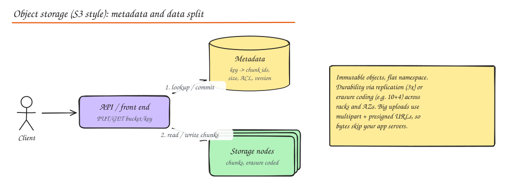
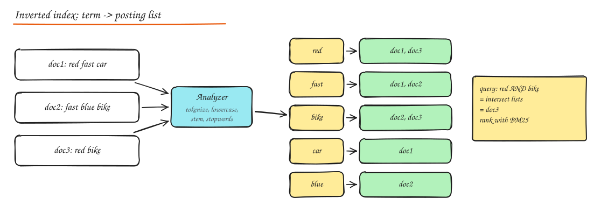

# Object Storage and Search Engines

> **TL;DR**
> - Object storage (S3) holds files cheaply and durably; keep searchable metadata in a database.
> - Upload and download directly with presigned URLs and multipart uploads, not through your app servers.
> - Search engines use inverted indexes (word to documents) and relevance ranking (BM25 and more).
> - The database stays the source of truth; keep the search index in sync with change data capture.

Two building blocks that show up in almost every product design: somewhere to put large files, and a way to search text.

## Storage types

| Type | Unit | Access | Examples | Use for |
|---|---|---|---|---|
| **Block** | Fixed size blocks on a volume | Mounted as a disk by one machine | AWS EBS, local NVMe, SAN | Databases, OS disks |
| **File** | Files in a hierarchy | NFS / SMB, shared by many machines | EFS, NFS, CephFS | Shared configs, legacy apps, ML datasets |
| **Object** | Immutable objects addressed by key + metadata | HTTP API (PUT/GET/DELETE) | S3, GCS, Azure Blob, MinIO, Ceph RGW | Images, video, backups, logs, data lakes, static sites |

## Object storage

Properties:

- **Flat namespace**: `bucket/key`. "Folders" are just key prefixes.
- **Immutable objects**: you replace whole objects, not edit bytes in place (append is limited or absent).
- **Massive scale and durability**: S3 is designed for 99.999999999% (11 nines) durability by spreading data across AZs, via replication or **erasure coding** (split into k data + m parity fragments; any k reconstruct the object. 10+4 tolerates 4 lost fragments with 1.4x overhead instead of 3x for triple replication).
- **Cheap per GB**, higher latency than block storage (tens of ms to first byte), very high aggregate throughput with parallel requests.
- **Consistency**: S3 is strongly read-after-write consistent for PUTs and DELETEs (since 2020). Listing is consistent too. Older docs saying "eventually consistent" are outdated.
- **Storage classes / tiers**: hot (Standard), infrequent access, archive (Glacier) with lifecycle rules that move objects as they age.

Internally, a front end handles HTTP, a **metadata service** maps keys to data locations (a sharded, strongly consistent key value store), and **storage nodes** hold the chunks.

### Upload and download patterns

- **Presigned URLs**: your API authenticates the user and returns a time limited signed URL; the client uploads/downloads **directly** to object storage. Your servers never touch the bytes, which saves bandwidth and CPU.
- **Multipart upload**: split big files into parts (5 MB to 5 GB each), upload in parallel, retry individual parts, then complete. Required above 5 GB, recommended above ~100 MB.
- **Resumable uploads** for mobile: track uploaded parts and resume after network loss.
- **Serve through a CDN** with the bucket as origin, and keep the bucket private (origin access control).
- **Event notifications**: "object created" events trigger processing (thumbnailing, virus scanning, transcoding) via a queue or function.

### Metadata lives elsewhere

Object stores are not databases. Store searchable metadata (owner, title, upload time, status, object key) in a database; store bytes in object storage. Never list a bucket to answer user queries.

## Search engines

Databases are bad at "find documents containing these words, ranked by relevance, with typos, filters and facets, in 50 ms". Search engines are built for exactly that.

### Inverted index

- An **analyzer** turns text into terms: tokenize, lowercase, remove stop words, stem (`running -> run`), maybe synonyms and n-grams.
- The **inverted index** maps each term to a **posting list** of documents (with positions and frequencies).
- A query is analyzed the same way; posting lists are intersected (AND) or unioned (OR) and scored.
- **Ranking**: TF-IDF / **BM25** (term frequency, inverse document frequency, length normalization) plus business signals (popularity, recency, personalization) and increasingly vector similarity for semantic search (hybrid search).

### Elasticsearch / OpenSearch architecture

- Built on **Lucene**. An index is split into **primary shards** (fixed at creation) with **replica shards** for HA and read throughput.
- Each shard is a Lucene index made of immutable **segments**. New docs go to an in memory buffer, become searchable on **refresh** (default 1 s, hence "near real time"), and segments are merged in the background.
- A query goes to a coordinating node, fans out to one copy of every shard (scatter), and results are merged (gather). More shards = more parallelism but more fanout overhead.
- Also strong at **aggregations** (facets, histograms) and log analytics (the ELK stack).

### Keeping search in sync with the database

The database stays the source of truth; the search index is a **derived view**.

1. **Dual write from the app**: simple but inconsistent on partial failure. Avoid.
2. **Change data capture**: Debezium reads the DB log -> Kafka -> indexer service -> Elasticsearch. Ordered, reliable, replayable. The standard answer.
3. **Outbox events** -> queue -> indexer.
4. **Periodic full reindex** into a new index, then atomically swap an **alias**. Needed for mapping changes anyway.

Expect a lag of about a second. Show the user their own new item from the DB if read-after-write matters.

### When not to use a search engine

- Exact lookups by key or simple filters: the DB is fine.
- As a primary data store: weaker durability and transactional guarantees, painful reindexing.
- Small datasets: Postgres full text search (`tsvector`, GIN indexes) or `pg_trgm` may be enough.

## Interview questions

Users upload 2 GB videos. Why should the bytes not flow through your API servers?

It ties up app server bandwidth, memory and connections for minutes per upload, makes scaling the API tier expensive, and makes retries painful. Instead the API issues presigned multipart upload URLs; the client uploads parts directly to object storage in parallel with per part retries, and the API is notified (callback or storage event) when complete.

How would you add search to an existing product catalog in Postgres?

Start by checking if Postgres full text search meets needs. If not, stand up Elasticsearch/OpenSearch, stream changes from Postgres via CDC (Debezium -> Kafka -> indexer) with an idempotent upsert by product ID and version, bulk backfill once with a reindex job, query through an alias so you can rebuild indexes with zero downtime, and keep the DB as the source of truth for details pages.

Explain erasure coding vs replication in one minute.

Replication stores full copies (3x storage, simple, fast reads and repairs). Erasure coding splits data into k fragments plus m parity fragments using Reed-Solomon style math; any k of the k+m fragments rebuild the data. 10+4 gives tolerance of 4 failures at 1.4x storage, but reads may need several nodes and repair costs more network and CPU. Object stores use EC for cold and large data, replication for hot or small data.

## Related

- [Case study: Dropbox / Google Drive](../09-case-studies/07-dropbox-google-drive.md)
- [Case study: Typeahead](../09-case-studies/12-typeahead-autocomplete.md)
- [Replication (CDC)](../03-data/04-replication.md)
