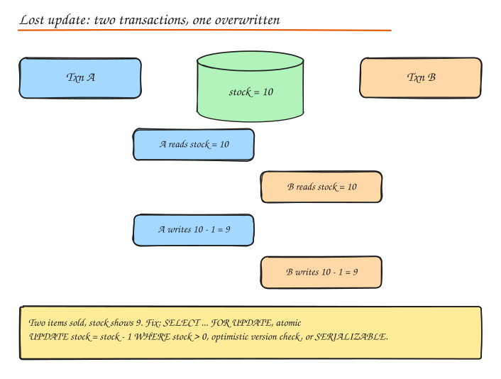

# Relational Databases, ACID and Transactions

Relational databases (PostgreSQL, MySQL, SQL Server, Oracle) store data in tables with a fixed schema, enforce constraints, support joins and ad hoc SQL, and give you **transactions**. They remain the right default for most product data. Choose something else only when a specific requirement (scale pattern, data shape, latency) demands it.

## ACID

| Property | Meaning | How engines do it |
|---|---|---|
| **Atomicity** | All statements in a transaction take effect, or none do | Undo logs / rollback segments; WAL records transaction boundaries |
| **Consistency** | Each transaction moves the DB from one valid state to another (constraints, FKs, checks, triggers hold) | Constraint checks; mostly the application's job |
| **Isolation** | Concurrent transactions do not see each other's partial work (to a configurable degree) | Locks and/or MVCC snapshots |
| **Durability** | Once committed, data survives crashes | **Write-ahead log (WAL / redo log)** fsynced at commit, plus replication |

**WAL in one line**: before changing data pages, append the change to a sequential log and flush it; on crash, replay the log. Sequential appends are fast, and pages can be flushed lazily. Group commit batches many transactions' fsyncs together.

## Isolation levels and anomalies

| Anomaly | What happens |
|---|---|
| **Dirty read** | Read data written by a transaction that has not committed (and may roll back) |
| **Non-repeatable read** | Read the same row twice in one transaction and get different values |
| **Phantom read** | Re-run a range query and new rows appear (inserted by others) |
| **Lost update** | Two read-modify-write cycles race; one overwrites the other |
| **Write skew** | Two transactions read overlapping data, make disjoint writes based on it, and together break an invariant (two doctors both go off call because each saw the other on call) |

| Level | Dirty read | Non-repeatable | Phantom | Lost update / write skew | Notes |
|---|---|---|---|---|---|
| Read uncommitted | possible | possible | possible | possible | Rarely used |
| **Read committed** | no | possible | possible | possible | **Postgres, Oracle, SQL Server default** |
| **Repeatable read** | no | no | possible per SQL standard (Postgres and InnoDB mostly prevent) | lost update prevented in Postgres; write skew possible | **MySQL InnoDB default**; Postgres RR is snapshot isolation |
| Snapshot isolation | no | no | no | write skew possible | Consistent snapshot per transaction |
| **Serializable** | no | no | no | no | As if transactions ran one by one. Postgres uses SSI (aborts on conflict); others use strict 2PL |

Practical guidance:

- Read committed is fine for most CRUD **if** you write updates atomically: `UPDATE accounts SET balance = balance - 100 WHERE id = 1 AND balance >= 100`.
- For read-modify-write logic in application code, either lock (`SELECT ... FOR UPDATE`), use optimistic concurrency (version column), or run at serializable and **retry on serialization failures**.

## MVCC (multi-version concurrency control)

Instead of overwriting a row, the DB keeps multiple versions tagged with transaction IDs. Each transaction reads the snapshot that was committed when it started (or when each statement started, under read committed).

- **Readers never block writers and writers never block readers.**
- Writers still conflict with writers on the same row.
- Cost: old versions must be cleaned up (Postgres `VACUUM`, InnoDB purge of undo logs). Long running transactions prevent cleanup and cause bloat.

## Locking

- **Row locks**: shared (read) and exclusive (write). `SELECT ... FOR UPDATE` takes exclusive row locks; `FOR SHARE` takes shared locks.
- **Gap / next-key locks** (InnoDB): lock ranges to prevent phantoms.
- **Table locks**: taken by some DDL; watch out for migrations that lock big tables.
- **Advisory locks**: application defined named locks (`pg_advisory_lock`), handy for "only one job runs at a time".
- `SKIP LOCKED`: build a job queue on a table: `SELECT ... FOR UPDATE SKIP LOCKED LIMIT 10`.
- `NOWAIT`: fail instead of waiting.

### Deadlocks

Txn A locks row 1 then wants row 2; Txn B locks row 2 then wants row 1. Both wait forever. Databases detect the cycle and abort one (the victim gets an error).

Prevention:

- Acquire locks in a **consistent order** (for example, always lock the lower account ID first in a transfer).
- Keep transactions **short**; never wait for user input or network calls inside a transaction.
- Use lower lock granularity, and retry the aborted transaction.

## Optimistic vs pessimistic concurrency

| | Pessimistic | Optimistic |
|---|---|---|
| Idea | Lock first, then work | Work, then check nobody changed it |
| SQL | `SELECT ... FOR UPDATE` | `UPDATE ... SET v = v + 1 WHERE id = ? AND v = ?` and check affected rows |
| Best when | Contention is high, conflicts are costly | Contention is low, reads dominate |
| Risk | Lock waits, deadlocks, reduced throughput | Many retries under contention |
| Example | Seat booking during a hot sale with short transactions | Editing a profile, wiki page, product details |

HTTP equivalent of optimistic concurrency: `ETag` + `If-Match`, returning `412 Precondition Failed` on conflict.

## Schema design

### Normalization

Organize data so each fact is stored once.

- **1NF**: atomic columns, no repeating groups.
- **2NF**: no partial dependency on part of a composite key.
- **3NF**: no transitive dependency (non-key columns depend only on the key).
- **BCNF**: every determinant is a candidate key.

Benefits: no update anomalies, less storage, integrity via constraints. Cost: more joins at read time.

### Denormalization

Deliberately duplicate data to make reads cheap: store `author_name` on posts, keep a `comment_count` column, precompute a materialized view, or keep a read model. Pay with write complexity and possible inconsistency (keep it in sync with triggers, the same transaction, or async events). Rule: **normalize the write model, denormalize read models where measurements say reads hurt.**

### Keys and constraints

- Primary key: surrogate (`BIGINT` / UUIDv7) vs natural (email). Prefer surrogate keys; natural keys change.
- Foreign keys enforce integrity but add write cost and complicate sharding; many large systems enforce relationships in application code across shards while keeping FKs within a shard.
- Use `NOT NULL`, `CHECK`, and `UNIQUE` liberally. They are the cheapest correctness tooling you have.

### Schema evolution (migrations without downtime)

Use **expand and contract**:

1. Expand: add new column/table (nullable or with default), deploy code that writes both old and new.
2. Backfill in batches.
3. Switch reads to the new column.
4. Contract: stop writing the old column, then drop it later.

Avoid long table locks: add indexes `CONCURRENTLY` (Postgres), use online schema change tools (gh-ost, pt-online-schema-change) for MySQL.

## Connection pooling

Opening a DB connection costs a TCP + TLS + auth handshake and server memory (Postgres forks a process per connection, several MB each). Pool them:

- App side pools (HikariCP, pgx pool, SQLAlchemy pool).
- External poolers (**PgBouncer** in transaction mode, RDS Proxy, ProxySQL) to multiplex thousands of client connections onto a few hundred server connections, essential with serverless or many app instances.
- Size with Little's law: pool ≈ throughput x DB time per request, plus headroom. Bigger is not better; too many concurrent queries thrash the DB.

## When SQL is the right choice

- Data with relationships and integrity constraints (users, orders, payments, inventory).
- Need for multi-row transactions.
- Ad hoc queries and reporting.
- Moderate scale (single primary handles thousands of writes/s; with replicas, many reads).

Modern options blur the line: **distributed SQL** (Spanner, CockroachDB, YugabyteDB, TiDB) gives SQL + transactions with horizontal scaling at the cost of higher write latency; **Vitess** and **Citus** shard MySQL and Postgres.

## Interview questions

Two users buy the last item at the same time. How do you prevent overselling?

Make the decrement conditional and atomic: `UPDATE inventory SET qty = qty - 1 WHERE sku = ? AND qty > 0` and check affected rows = 1. Alternatively lock the row with `SELECT ... FOR UPDATE` inside a short transaction, or use optimistic versioning with retries. At very high contention (flash sales) move the hot counter to Redis with an atomic Lua decrement or pre-allocate stock tokens, then reconcile with the DB.

What is write skew and which isolation level prevents it?

Two transactions read the same set of rows, each decides based on what it read, and each writes different rows, so neither sees a direct write conflict but together they violate an invariant (both on-call doctors go off duty). Snapshot isolation / repeatable read allows it. Serializable prevents it; alternatively materialize the conflict by locking the rows read (`SELECT ... FOR UPDATE`) or adding a constraint.

Why do long running transactions hurt Postgres even if they only read?

MVCC keeps old row versions until no transaction might need them. A long open transaction pins the oldest visible snapshot, so VACUUM cannot remove dead tuples anywhere, which causes table and index bloat, slower scans, and eventually transaction ID wraparound pressure. Keep transactions short and use replicas for long analytical queries.

Explain how a database guarantees durability.

At commit, the transaction's changes are written to the write-ahead log and the log is flushed to stable storage (fsync) before the commit is acknowledged. Data pages are updated in memory and flushed later. After a crash, the DB replays the WAL from the last checkpoint to redo committed changes and undo uncommitted ones. Replication to another machine (synchronous for zero loss) protects against losing the whole disk or host.

## Related

- [Indexes and Storage Engines](02-indexes-storage-engines.md)
- [Replication](04-replication.md)
- [Distributed Transactions](06-distributed-transactions.md)
- [CAP and Consistency](../01-fundamentals/02-cap-pacelc.md)
