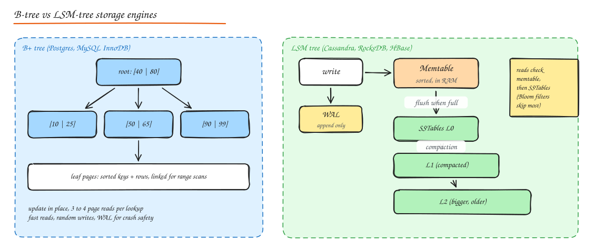

# Indexes, Storage Engines and Query Optimization

## Storage engines: B-tree vs LSM-tree



### B+ tree (read optimized)

- Data organized in fixed size **pages** (8 KB in Postgres, 16 KB in InnoDB) forming a balanced tree. Internal pages hold keys and child pointers; leaf pages hold keys plus rows (InnoDB clustered index) or pointers to rows (Postgres heap). Leaves are linked for range scans.
- High fanout (hundreds of keys per page) means 3 to 4 levels hold billions of rows. A lookup is 3 to 4 page reads, mostly from cache.
- **Updates in place**, so random writes and page splits; WAL for crash safety.
- Used by: Postgres, MySQL InnoDB, SQL Server, Oracle, SQLite, most RDBMS.

### LSM tree (write optimized)

- Writes go to an append only **WAL** and an in memory sorted **memtable**. When full, the memtable is flushed as an immutable sorted file, an **SSTable**.
- Background **compaction** merges SSTables, discarding overwritten and deleted (tombstoned) keys.
- Reads check the memtable, then SSTables from newest to oldest. **Bloom filters** per SSTable skip files that cannot contain the key, and sparse indexes find the block.
- Very high write throughput (sequential IO only), good compression.
- Costs: **read amplification** (many files to check), **write amplification** (data rewritten during compaction), compaction can cause latency spikes and needs spare disk.
- Compaction strategies: **size tiered** (write friendly, more space amplification), **leveled** (read friendly, more write amplification), time window (time series).
- Used by: Cassandra, ScyllaDB, HBase, Bigtable, RocksDB (inside many systems: MyRocks, CockroachDB's Pebble, TiKV, Kafka Streams state), LevelDB, InfluxDB.

| | B+ tree | LSM tree |
|---|---|---|
| Writes | Random IO, in place | Sequential appends, very fast |
| Reads | Predictable, fast | Can touch several files; Bloom filters help |
| Space | Fragmentation from page splits | Better compression, temporary space for compaction |
| Latency | Stable | Compaction jitter |
| Best for | OLTP mixed read/write, range queries | Write heavy ingest, time series, logs, key value at scale |

Build a toy LSM store: [LSM Key Value Store from scratch](../11-builds/05-lsm-kv-store.md).

## Index types

| Index | Good for | Notes |
|---|---|---|
| **B-tree** (default) | Equality, ranges, sorting, prefix `LIKE 'abc%'` | Works for most cases |
| **Hash** | Equality only | Postgres hash indexes; in memory hash in Redis/Memcached. No ranges. |
| **Composite** `(a, b, c)` | Queries filtering on `a`, `a,b`, or `a,b,c` (leftmost prefix rule) | Order columns: equality filters first, then range, then sort |
| **Covering** (index only scan) | Queries answerable from the index alone | `INCLUDE (col)` in Postgres; avoids heap lookups |
| **Partial** | Index a subset: `WHERE status = 'pending'` | Small and fast for hot subsets |
| **Expression / functional** | `lower(email)` | Matches queries using the same expression |
| **Unique** | Enforce uniqueness | Also used for lookups |
| **GIN** (inverted) | Arrays, JSONB, full text (`tsvector`) | Postgres; slow to update |
| **GiST / SP-GiST / BRIN** | Geometry, ranges, very large naturally ordered tables (BRIN) | Specialized |
| **Full text** | Word search | DB built-in or a search engine |
| **Geospatial** | Nearby queries | PostGIS (GiST), geohash, R-trees |
| **Clustered** | Physically orders the table by the key | InnoDB PK is always clustered; Postgres `CLUSTER` is one off |

### The cost of indexes

Every index:

- Slows every `INSERT`, `DELETE`, and `UPDATE` touching its columns (another tree to modify, more WAL).
- Uses disk and buffer cache memory.
- Can mislead the planner if statistics are stale.

So: index for your real query patterns, drop unused ones (`pg_stat_user_indexes`), and avoid indexing low selectivity columns alone (a boolean column on a big table rarely helps, except as a partial index).

### Composite index example

Query: `SELECT * FROM orders WHERE user_id = ? AND status = 'shipped' ORDER BY created_at DESC LIMIT 20`

Best index: `(user_id, status, created_at DESC)`. The DB seeks to `(user_id, status)` and reads the first 20 entries already in order, with no sort. `(created_at, user_id)` would be nearly useless for this query.

## Reading EXPLAIN

`EXPLAIN ANALYZE` (Postgres) / `EXPLAIN` (MySQL) shows the plan the optimizer chose:

```sql
EXPLAIN ANALYZE
SELECT o.id, o.total FROM orders o
JOIN users u ON u.id = o.user_id
WHERE u.country = 'IN' AND o.created_at > now() - interval '7 days';
```

Look for:

- **Seq Scan** on a large table where you expected an index (missing index, function on the column, type mismatch, low selectivity, stale stats).
- **Estimated vs actual rows** far apart: run `ANALYZE`, increase statistics targets, or rewrite.
- Join strategy: **nested loop** (great for small outer sets with an index on the inner), **hash join** (large unsorted sets, memory heavy), **merge join** (both sides sorted).
- **Sort** or **Hash** spilling to disk (`external merge`): raise `work_mem` or add an index that provides order.
- **Rows Removed by Filter** large: the index is not selective for that predicate.

## Slow query workflow

1. Turn on slow query logging (`log_min_duration_statement`, MySQL slow log) and `pg_stat_statements`.
2. Rank by **total time** (calls x mean), not just the slowest single query.
3. `EXPLAIN ANALYZE` the top offenders.
4. Fix: add or adjust an index, rewrite the query (avoid `SELECT *`, avoid functions on indexed columns, replace `OFFSET` pagination with keyset), batch N+1 queries, add caching, or denormalize.
5. Verify with production like data volume. Plans change with table size.

Common anti-patterns:

- **N+1 queries**: loading a list then querying per item. Use joins or `WHERE id IN (...)` batching (DataLoader pattern).
- **`OFFSET 100000`**: the DB still walks 100k rows. Use keyset pagination: `WHERE (created_at, id) < (?, ?) ORDER BY created_at DESC, id DESC LIMIT 20`.
- `WHERE lower(email) = ?` without an expression index.
- Implicit casts (`varchar` column compared to a number) disabling indexes.
- `LIKE '%term%'`: cannot use a B-tree; use trigram (`pg_trgm`) or full text search.

## Interview questions

<details>
<summary>Why are LSM trees faster for writes than B-trees?</summary>

An LSM write is an append to the WAL plus an insert into an in-memory sorted structure, so disk IO is sequential and batched. A B-tree must find the right page and modify it in place (random IO, page splits), plus write WAL. The LSM pays later with compaction and with reads that may consult several files.

</details>

<details>
<summary>You have an index on (a, b). Which of these use it: WHERE a = 1; WHERE b = 2; WHERE a = 1 AND b > 5; ORDER BY a, b?</summary>

`WHERE a = 1`: yes (leftmost prefix). `WHERE b = 2`: generally no (some engines can do a skip scan, but do not count on it). `WHERE a = 1 AND b > 5`: yes, seek on a then range on b. `ORDER BY a, b`: yes, the index provides the order (useful with LIMIT).

</details>

<details>
<summary>A query was fast last month and is slow now with no code change. What happened?</summary>

Likely data growth or distribution change made the planner switch plans (stale statistics, a parameter that is now unselective, a table that no longer fits in memory), or bloat from MVCC dead tuples, or lock contention from new workloads. Check `EXPLAIN ANALYZE` now vs before, run `ANALYZE`, check bloat and vacuum activity, and check for blocking locks.

</details>

## Related

- [SQL, ACID and Transactions](01-sql-acid-transactions.md)
- [NoSQL and Choosing a Database](03-nosql-choosing-a-database.md)
- [Probabilistic Data Structures (Bloom filters)](../10-advanced/03-probabilistic-data-structures.md)
