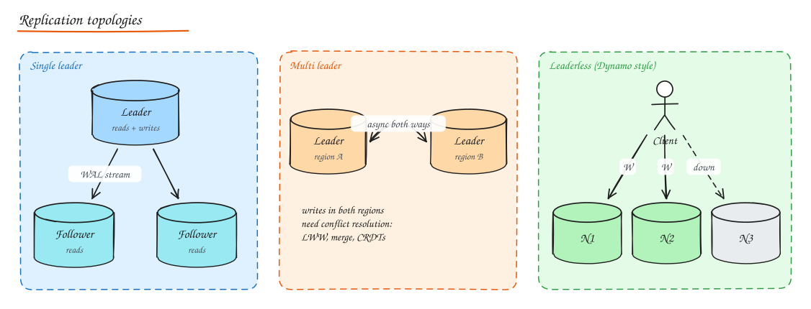
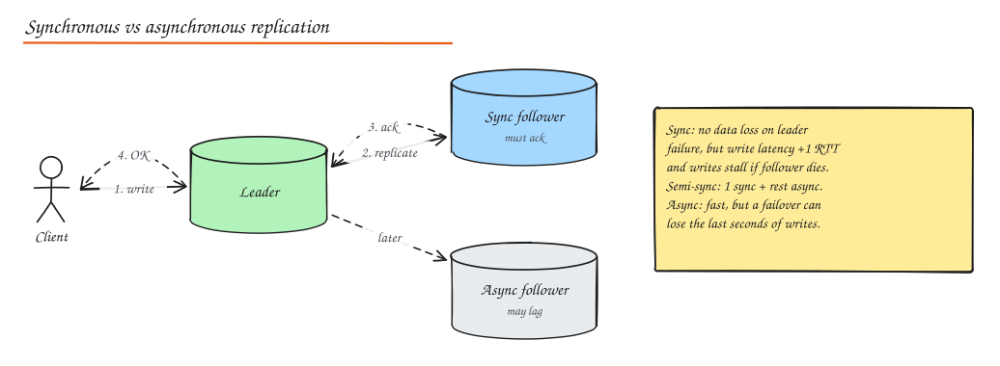
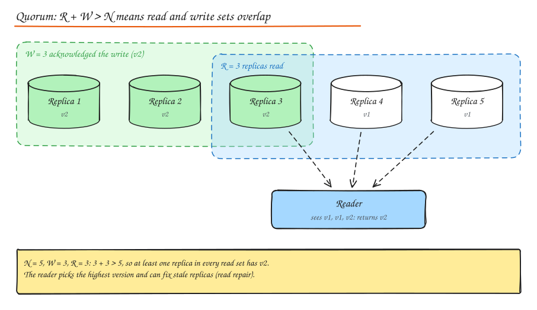

# Replication

> **TL;DR**
> - Replication keeps copies for availability, read scaling, latency and durability.
> - Single leader is simplest; multi-leader and leaderless allow writes anywhere but need conflict resolution.
> - Async replicas lag, which breaks read-your-writes and monotonic reads unless you route carefully.
> - Quorums (R + W > N) make reads see the latest write; change data capture streams the DB log to other systems.

Replication keeps copies of the same data on multiple machines to get:

- **Availability**: keep serving if a node dies.
- **Read scalability**: spread reads across replicas.
- **Latency**: place copies near users.
- **Durability**: survive disk and machine loss.

The hard part is **changes**: how writes propagate, and what readers see while they propagate.

## Single leader (primary/replica, master/slave)

All writes go to the leader; it streams changes (WAL / binlog) to followers; reads can go to any.

- Simple, no write conflicts, the default for Postgres, MySQL, MongoDB replica sets, Redis, Kafka partitions.
- Leader is a write bottleneck and a failover risk.

### Synchronous vs asynchronous

| | Synchronous | Asynchronous | Semi-synchronous |
|---|---|---|---|
| Commit acknowledged when | Follower(s) confirmed | Leader wrote locally | At least one follower confirmed |
| Data loss on leader crash | None | Recent writes may be lost | None if the sync follower survives |
| Write latency | + network RTT | Lowest | + one RTT |
| If follower is down | Writes block (unless you degrade) | Unaffected | Switch another follower to sync |

Most production setups: one synchronous (or quorum) follower in another AZ for zero data loss, others async for reads and DR.

### Replication lag and the bugs it causes

Async followers can be milliseconds to minutes behind. Classic symptoms:

| Bug | Scenario | Fix |
|---|---|---|
| **Read your writes** violated | User updates profile, refresh reads a lagging replica, old data shows | Read own data from leader for a window after writes; track the user's last write LSN and wait for replicas to catch up or route to leader |
| **Monotonic reads** violated | Two refreshes hit different replicas, data appears then disappears | Pin a user's reads to one replica (hash user ID) |
| **Consistent prefix** violated | A reply visible before the question in a partitioned system | Keep causally related writes in one partition, or track causal dependencies |

Monitor lag (`pg_stat_replication`, `Seconds_Behind_Source`) and remove badly lagging replicas from the read pool.

### Failover

When the leader dies:

1. **Detect** (heartbeats, timeouts; too short causes false failovers, too long causes downtime).
2. **Elect** a new leader (most up to date follower; consensus via etcd/ZooKeeper/Raft, or a tool like Patroni, Orchestrator, RDS Multi-AZ).
3. **Reconfigure** clients and other followers to use the new leader.

Risks:

- **Lost writes**: async writes the old leader acknowledged but never shipped. (GitHub's 2012 MySQL incident: a promoted, lagging replica reused auto-increment IDs that collided with Redis keys.)
- **Split brain**: the old leader comes back (or was only partitioned) and still accepts writes. Prevent with **fencing**: leases with epochs/terms, fencing tokens checked by storage, STONITH (power off the old node).

## Multi-leader

Several nodes accept writes (often one per region) and replicate to each other asynchronously.

- Pros: local write latency in each region, tolerance of inter-region outages, offline clients (each phone is a "leader": calendar apps, CouchDB/PouchDB sync, collaborative editors).
- Cons: **write conflicts**. Two regions update the same row concurrently.

### Conflict resolution strategies

| Strategy | How | Trade-off |
|---|---|---|
| **Avoid conflicts** | Route all writes for a record to one "home" leader | Simplest; loses local writes for travelling users |
| **Last write wins (LWW)** | Highest timestamp wins | Silently loses data; clock skew makes it arbitrary. Fine for caches, presence. |
| **Merge in application** | Custom logic (union of cart items) | Correct for your domain, more code |
| **Version vectors / vector clocks** | Detect concurrent writes, keep siblings, let reader or app merge | Precise detection; app must resolve (Dynamo shopping cart) |
| **CRDTs** | Data types whose merges are commutative, associative, idempotent (G-Counter, PN-Counter, OR-Set, LWW-Register, RGA/sequence CRDTs for text) | Automatic convergence; limited operations, metadata overhead (Riak, Redis Enterprise active-active, Figma-like and local first apps) |
| **Operational transformation (OT)** | Transform concurrent edit operations against each other | Classic Google Docs approach; needs a central server in practice |

## Leaderless (Dynamo style)

Any replica accepts reads and writes; the client (or a coordinator node) sends each request to several replicas. Used by Cassandra, ScyllaDB, Riak, DynamoDB's internals, Voldemort.

### Quorums

N replicas per key, write waits for W acks, read queries R replicas.

- **R + W > N** gives overlap: some replica in every read set saw the latest acknowledged write (with versions to pick the newest).
- Typical: N=3, W=2, R=2 (tolerates 1 node down for both reads and writes).
- W=1 / R=1: fastest, eventual consistency. W=N: slow writes, any node down blocks writes.
- Even with R + W > N, edge cases exist (sloppy quorums, concurrent writes, partial failed writes), so it is not linearizable by default.

Play with N, R, W in the **Quorum Explorer** lab.

### Catching up stale replicas

- **Read repair**: when a read sees stale versions, write the newest back to stale replicas.
- **Anti-entropy**: background process compares replicas using **Merkle trees** (hash trees over key ranges) and syncs only differing ranges.
- **Hinted handoff**: if a target replica is down, another node stores the write with a "hint" and forwards it when the target recovers. With **sloppy quorums**, writes succeed on any N healthy nodes (higher availability, weaker guarantee).

## Replication in other systems

- **Kafka**: per partition leader, ISR set, `acks=all` + `min.insync.replicas`.
- **Redis**: async replicas; Sentinel or Cluster for failover; `WAIT` command for synchronous acks.
- **Consensus based** (etcd, ZooKeeper, CockroachDB, Spanner, TiKV): Raft/Paxos replicate a log to a majority before commit; linearizable, survives minority failures, costs a majority round trip per write. See [Consensus and Clocks](../10-advanced/01-consensus-and-clocks.md).

## Change data capture (CDC)

CDC turns a database's replication log into a stream of change events (insert/update/delete with before/after images), so other systems can follow the DB.

- **Tools**: Debezium (Postgres logical decoding, MySQL binlog, MongoDB oplog) to Kafka; AWS DMS; DynamoDB Streams; Postgres logical replication.
- **Uses**: keep search indexes, caches and analytics warehouses in sync; implement the transactional outbox; migrate databases with zero downtime; build event driven integrations from legacy systems.
- **Why it beats dual writes**: the log is ordered and contains exactly what committed. No partial failure gap.
- Watch out: schema changes, initial snapshot + streaming handoff, large transactions, and consumers needing idempotency.

## Master-slave vs master-master summary

| | Master-slave (single leader) | Master-master (multi leader) |
|---|---|---|
| Writes | One node | Many nodes |
| Conflicts | None | Must resolve |
| Read scaling | Yes | Yes |
| Write scaling | No | Some (but conflicts limit it) |
| Typical use | Almost all OLTP | Multi-region active-active, offline clients |

## Interview questions

After a user posts a comment, they sometimes don't see it on refresh. Why and how do you fix it?

Reads are served by async replicas that lag the leader, violating read your writes. Fix by routing that user's reads to the leader for a short time after a write (store "last write at" in the session), or by passing the write's LSN/version and having the read path wait for a replica that has replayed it (or fall back to the leader). The client can also optimistically render its own new comment.

N = 3. What are the trade-offs of W = 1, R = 3 vs W = 3, R = 1 vs W = 2, R = 2?

W=1, R=3: fastest writes, any single node accepts writes, but reads are slow and fail if any replica is down. W=3, R=1: fast reads, but writes fail if any replica is down. W=2, R=2: balanced latency and tolerates one node down for both reads and writes. All three satisfy R + W > N.

What is split brain and how do you prevent it?

Two nodes simultaneously act as leader and accept conflicting writes, typically after a network partition or a falsely detected failure. Prevent with majority based leader election (a leader needs a quorum), leases that expire, monotonically increasing epochs/terms with **fencing tokens** that storage checks (reject writes from older epochs), and STONITH to power off a deposed leader.

How would you migrate a 2 TB table from MySQL to Postgres with no downtime?

Snapshot and bulk load into Postgres while capturing changes from the MySQL binlog via CDC (Debezium). Replay changes continuously until lag is near zero. Run shadow reads and compare results. Then switch writes (brief write freeze or dual-writing with verification), keep reverse replication for rollback, and decommission after confidence.

## Related

- [CAP, PACELC and Consistency](../01-fundamentals/02-cap-pacelc.md)
- [Sharding and Partitioning](05-sharding-partitioning.md)
- [Consensus and Clocks](../10-advanced/01-consensus-and-clocks.md)
- [Case study: Google Docs (OT and CRDTs)](../09-case-studies/09-google-docs.md)
