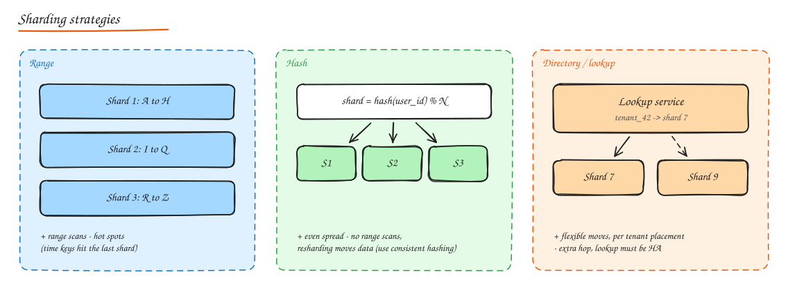

# Sharding and Partitioning

When one database node cannot hold the data or handle the write load, split the data across nodes. Each piece is a **partition** (Cassandra, Kafka, DynamoDB), **shard** (MongoDB, Elasticsearch, MySQL), **region** (HBase), **tablet** (Bigtable), or **vnode**. Usually combined with replication: each shard is itself replicated.

## Do you actually need to shard?

Sharding is expensive in complexity. Before it, try:

1. Query and index optimization.
2. Vertical scaling (big instances go a long way).
3. Caching and read replicas for read load.
4. Archiving cold data (move old rows to cheaper storage).
5. **Functional partitioning**: split by domain into separate databases (users, orders, catalog). Each DB is smaller and independently scalable.

Shard when **write throughput** or **data size** of a single logical dataset exceeds one node.

## Vertical vs horizontal partitioning

- **Vertical partitioning**: split columns or tables. Put rarely used big columns (`bio`, `settings_json`) in a separate table; or move whole tables to a different DB (functional partitioning).
- **Horizontal partitioning (sharding)**: split rows. Each shard has the same schema and a subset of rows.
- Also: **table partitioning inside one DB** (Postgres declarative partitioning by range/list/hash) for manageability: drop old partitions instantly, prune scans. Not the same as distributing across nodes.

## Strategies

| Strategy | Mapping | Pros | Cons | Seen in |
|---|---|---|---|---|
| **Range** | Key ranges (`A..H`, dates) to shards | Range scans, easy to reason about, splits as ranges grow | Hot spots for sequential keys (latest time range takes all writes) | HBase, Bigtable, Spanner, MongoDB ranged, CockroachDB |
| **Hash** | `hash(key)` to shard (mod N or consistent hashing) | Even distribution | No efficient range queries across keys, resharding moves data | Cassandra, DynamoDB, Redis Cluster, MongoDB hashed |
| **Directory (lookup)** | A lookup table maps key (or tenant) to shard | Total flexibility, move individual tenants | Extra lookup hop (cache it), the directory must be HA | Many SaaS multi-tenant systems, Vitess vindexes |
| **Geo / entity based** | By region or tenant | Data residency, locality | Uneven sizes | Global apps, B2B SaaS |

A common hybrid: **hash on the partition key, sort by a clustering key inside the partition** (Cassandra, DynamoDB): even distribution plus efficient range reads within one entity.

## Choosing a shard key

The most important (and hardest to change) decision. A good key:

1. **High cardinality**: many distinct values so data can spread.
2. **Even load**: values receive similar traffic (not just similar row counts).
3. **Query locality**: the most frequent queries include the key, so they hit one shard.
4. **Transaction locality**: data that must change together lives on the same shard.

Examples:

| System | Good key | Why | Bad key |
|---|---|---|---|
| Multi-tenant SaaS | `tenant_id` | All tenant queries local, transactions within tenant | `created_at` |
| Social posts | `user_id` (author) | User's posts together | `post_id` if you mostly query by user |
| Chat | `conversation_id` | Messages of a chat together, ordered | `sender_id` (conversation split across shards) |
| Orders | `customer_id` | "My orders" local | `order_date` (hot today shard) |
| Metrics | `(metric_id, time_bucket)` | Spreads writes, keeps ranges | `timestamp` |

## Hot spots and celebrities

Even with a good key, some values are much hotter (a celebrity's posts, a huge tenant, a viral product).

- **Split hot keys**: append a suffix (`user_42#0..9`) to spread writes over 10 partitions; reads fan out and merge.
- **Dedicated shards** for whale tenants (directory based sharding makes this easy).
- **Caching** for read hot spots.
- **Write buffering / aggregation** for counters (accumulate in memory or Redis, flush periodically).
- Monitor per shard load, not just averages.

## Cross-shard operations

What gets harder once data is split:

- **Joins across shards**: do them in the application (scatter-gather), denormalize so you do not need them, or replicate small reference tables to every shard.
- **Queries without the shard key**: must hit every shard (scatter-gather): latency is the slowest shard, load multiplies by shard count. Avoid on hot paths.
- **Transactions across shards**: need 2PC or sagas (see [Distributed Transactions](06-distributed-transactions.md)), or design so transactions stay within a shard.
- **Unique constraints** across shards (e.g. unique email): a separate global lookup table keyed by email, sharded by email hash.
- **Auto increment IDs**: no longer unique. Use [distributed ID generation](../02-building-blocks/09-unique-id-generation.md).
- **Aggregations** (counts, top-k across all data): pre-aggregate via streams, or query an analytics store.

### Secondary indexes in a sharded system

- **Local (document partitioned) index**: each shard indexes its own data. Writes are cheap; reads by the indexed field must scatter to all shards. (MongoDB, Cassandra secondary indexes, Elasticsearch.)
- **Global (term partitioned) index**: the index itself is partitioned by the indexed value. Reads go to one index shard; writes must update a possibly remote index shard, usually asynchronously. (DynamoDB GSIs, eventually consistent.)

## Rebalancing and resharding

Data grows unevenly; you will need to add shards. Approaches:

- **Fixed number of logical partitions** much larger than node count (e.g. 1,024 or 16,384 slots), mapped to physical nodes. Adding a node moves whole partitions, not individual keys. (Redis Cluster, Couchbase vBuckets, Elasticsearch shards, Vitess.)
- **Consistent hashing with vnodes**: adding a node takes small ranges from many nodes.
- **Dynamic splitting** (range based): split a range when it grows past a size threshold, move halves to other nodes (HBase, Bigtable, CockroachDB, MongoDB chunks).

Zero downtime resharding recipe (manual sharding):

1. Create new shards, start **double writing** (or CDC replicate) affected key ranges.
2. **Backfill** historical data in batches.
3. **Verify** with checksums and shadow reads.
4. **Cut over reads**, then writes, per range, with a quick rollback path.
5. Clean up old data.

Never use `hash(key) % N` with a raw N for physical placement: changing N moves almost everything. Use logical partitions or consistent hashing.

## Routing

How does a request find its shard?

- **Client side routing**: the client library knows the map (Cassandra drivers, Redis Cluster clients with `MOVED` redirects).
- **Proxy / router**: a routing tier (Vitess VTGate, MongoDB mongos, Citus coordinator, Envoy) hides the topology.
- **Any node forwards**: contact any node; it forwards to the owner (Cassandra coordinator).
- The map lives in a coordination service (ZooKeeper, etcd, config servers) and is cached by routers.

## Tools

- **Vitess**: sharding middleware for MySQL (YouTube, Slack, GitHub, Shopify). VTGate routes, VReplication reshards online.
- **Citus**: Postgres extension for distributed tables and reference tables.
- **ProxySQL**, application level sharding libraries, **Spanner/CockroachDB/YugabyteDB/TiDB** for automatic sharding with SQL.

## Interview questions

You shard users by user_id. How do you support login by email?

Create a separate lookup table `email -> user_id` sharded by hash(email) (or a small global table with a cache). Login hashes the email, reads the lookup shard to get `user_id`, then goes to the user's shard. Updating email must update both, ideally via a transactional outbox or a short saga, with a unique constraint enforced on the lookup table.

Your time series table is range partitioned by timestamp and the newest shard is melting. Fix?

All writes hit the latest range. Change the key to spread writes: prefix with a hash of the series/device ID (`(device_id_hash, time)`), or use a composite partition key `(metric_id, day)` so different series write to different partitions, while range scans for one series stay local. Old partitions can still be dropped by time.

What breaks when you move from one database to 16 shards?

Joins and foreign keys across shards, global unique constraints, auto increment IDs, transactions spanning shards, queries without the shard key (scatter-gather), aggregate queries and reports, schema migrations (now 16 times), backups and consistent snapshots, and operational tooling. Each needs a plan: denormalize, global lookup tables, distributed IDs, sagas, analytics replicas, and automation.

How many shards should you create up front?

Create many more logical partitions than physical nodes (for example 1,024 or 4,096 logical shards on 8 machines). Moving logical shards between machines is cheap later, and you avoid splitting keys. Size so each logical shard stays well under a node's capacity even with 5 to 10x growth.

## Related

- [Consistent Hashing](../02-building-blocks/06-consistent-hashing.md)
- [Replication](04-replication.md)
- [Distributed Transactions](06-distributed-transactions.md)
- [Case study: Twitter News Feed](../09-case-studies/02-twitter-news-feed.md)
