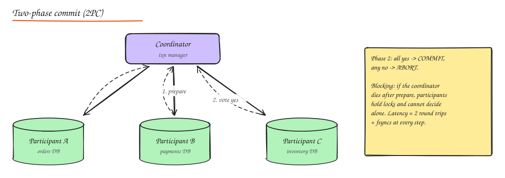
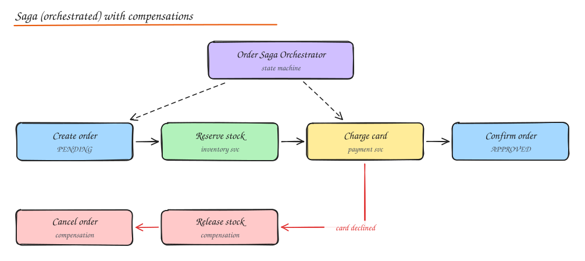
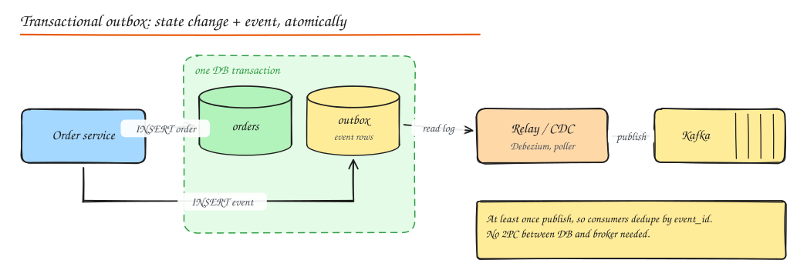

# Distributed Transactions, Sagas and Idempotency

> **TL;DR**
> - Two-phase commit gives atomicity across databases but blocks on coordinator failure and adds latency.
> - Sagas split a business transaction into local steps with compensations; choreography for short flows, orchestration for long ones.
> - The transactional outbox makes "update the DB and publish an event" atomic.
> - Retries are inevitable, so every step must be idempotent (idempotency keys, conditional writes, dedup tables).

Inside one database, a transaction gives you atomicity for free. Once a business operation touches **several services or databases** (orders, payments, inventory), you need a strategy to keep them consistent when some steps fail.

## Two-phase commit (2PC)



1. **Prepare**: the coordinator asks each participant to prepare. Each writes the changes durably, holds locks, and votes yes or no.
2. **Commit/abort**: if all voted yes, the coordinator logs the decision and tells everyone to commit; otherwise abort.

Properties:

- Atomic across participants (all commit or all abort).
- **Blocking**: if the coordinator crashes after participants voted yes, they must hold locks until it recovers; they cannot safely decide alone.
- **Latency**: two round trips plus several fsyncs; the slowest participant sets the pace.
- **Availability**: any participant down blocks the transaction.
- Implemented by XA transactions, some databases internally (Spanner and CockroachDB run 2PC over Paxos/Raft groups, so the coordinator is itself replicated and not a single point of failure).

**3PC** adds a pre-commit phase to reduce blocking but assumes bounded network delays, so it is rarely used. In practice, 2PC across independent microservices is avoided; inside a distributed database it is fine.

## Sagas

A saga is a sequence of **local transactions**, each in one service. If a step fails, previously completed steps are undone by **compensating transactions**.



Example: place order.

| Step | Action | Compensation |
|---|---|---|
| 1 | Order service: create order `PENDING` | Mark order `CANCELLED` |
| 2 | Inventory: reserve stock | Release reservation |
| 3 | Payment: charge card | Refund |
| 4 | Order: mark `CONFIRMED` | (end) |

### Choreography vs orchestration

| | Choreography | Orchestration |
|---|---|---|
| How | Each service reacts to events and emits new ones (`OrderCreated` -> inventory reserves -> `StockReserved` -> payment charges...) | A central orchestrator (state machine) tells each service what to do and tracks progress |
| Coupling | Loose, no central brain | Services coupled to orchestrator's commands |
| Visibility | Hard to see the whole flow; cyclic event dependencies creep in | Flow is explicit in one place, easy to monitor |
| Best for | Simple flows with 2 to 4 steps | Complex flows, many steps, timeouts, human steps |
| Tools | Kafka, SNS/SQS | Temporal, AWS Step Functions, Netflix Conductor, Camunda, Cadence |

### Saga design rules

- **Compensations are semantic, not rollbacks**: you cannot un-send an email; you send a correction. A refund is not the same as never charging.
- Order steps so the hard to compensate ones come last (charge the card after reserving stock).
- Use **pivot transactions**: after the point of no return, only retry forward.
- Every step and compensation must be **idempotent** and **retryable**.
- Sagas lack isolation: other transactions can see intermediate states (`PENDING`). Use semantic locks (status flags), commutative updates, or re-read values before acting.

## Transactional outbox

Most saga steps need "update my DB **and** publish an event" atomically.



Write the event to an `outbox` table in the same local transaction as the state change; a relay (poller or CDC) publishes it. At-least-once delivery, so consumers deduplicate. The mirror pattern on the consumer side is the **inbox** table: record processed message IDs in the same transaction as applying the change.

## Idempotency

An operation is idempotent if doing it twice has the same effect as doing it once. In distributed systems you **will** retry (timeouts, at-least-once queues, user double clicks), so non-idempotent operations become double charges, duplicate orders, double emails.

Techniques:

1. **Idempotency keys** (Stripe style): the client generates a unique key per logical operation and sends it with the request.

```http
POST /v1/payments
Idempotency-Key: 7f3c2a10-4b8e-4d7f-9c55-2b1e0f6a9d21
```

Server flow:

```text
BEGIN
  INSERT INTO idempotency (key, request_hash, status) VALUES (?, ?, 'IN_PROGRESS')
  -- unique violation => existing key:
  --   same request_hash and COMPLETED -> return stored response
  --   IN_PROGRESS -> 409 Conflict (retry later)
  --   different request_hash -> 422 (key reused for a different request)
  ... perform the operation ...
  UPDATE idempotency SET status = 'COMPLETED', response = ? WHERE key = ?
COMMIT
```

Keep keys for a retention window (Stripe uses 24 hours).

2. **Natural idempotency**: `PUT /users/42 {name}` (set, not increment), `UPSERT`, `INSERT ... ON CONFLICT DO NOTHING`, `DELETE` of a specific ID.
3. **Conditional writes**: version checks (`WHERE version = 7`), DynamoDB condition expressions.
4. **Dedup tables** for consumers: processed `event_id`s with a unique constraint.
5. **Deterministic IDs**: derive the order ID from the cart ID + attempt, so retries collide on a unique key.

HTTP method idempotency: GET, PUT, DELETE, HEAD, OPTIONS are idempotent by spec; **POST and PATCH are not** (add idempotency keys).

## Exactly-once, honestly

- Networks give **at-least-once** (with retries) or **at-most-once** (without).
- Exactly-once **effect** = at-least-once delivery + idempotent processing, or a transactional boundary that covers both the read position and the output (Kafka transactions, Flink checkpoints with transactional sinks).
- Across an external side effect you do not control (an email provider, a bank API without idempotency), there is always a small window. Narrow it with idempotency keys on the provider, reconciliation jobs, and alerts.

## Choosing an approach

| Situation | Approach |
|---|---|
| Data in one DB | Local ACID transaction. Prefer to design for this. |
| Multiple shards of one distributed SQL DB | Let the DB do 2PC (Spanner, CockroachDB) |
| Multiple microservices, short flow | Choreographed saga + outbox + idempotent consumers |
| Multiple microservices, long or complex flow with timeouts | Orchestrated saga on a workflow engine (Temporal, Step Functions) |
| Money movement | Ledger with double entry, idempotency keys, sagas, and daily reconciliation |

## Interview questions

<details>
<summary>Why not use 2PC across microservices?</summary>

It couples services' availability (any participant down blocks the transaction), holds locks across network round trips (throughput collapse), blocks if the coordinator fails at the wrong time, and many modern stores and brokers do not support XA. Sagas with local transactions, compensations and idempotency give better availability at the cost of temporary inconsistency.

</details>

<details>
<summary>The payment succeeded but the order service crashed before recording it. What happens in your design?</summary>

The payment service records the charge with the order's idempotency key and emits `PaymentSucceeded` via its outbox. When the order service recovers, it consumes the event (or the orchestrator retries the step, which returns the stored result thanks to the idempotency key) and moves the order forward. A periodic reconciliation job compares payments and orders to catch anything that slipped through.

</details>

<details>
<summary>How do you make "send welcome email" idempotent?</summary>

Store a record keyed by `(user_id, 'welcome_email')` with a unique constraint, inserted in the same transaction as marking the intent, and have the sender check/claim it before calling the provider; pass an idempotency key to the provider if it supports one. Duplicates hit the unique constraint and skip.

</details>

## Related

- [SQL, ACID and Transactions](01-sql-acid-transactions.md)
- [Message Queues](../02-building-blocks/07-message-queues.md)
- [Event-Driven Architecture](../05-architecture/02-event-driven-cqrs-event-sourcing.md)
- [Case study: Payment System](../09-case-studies/10-payment-system.md)
