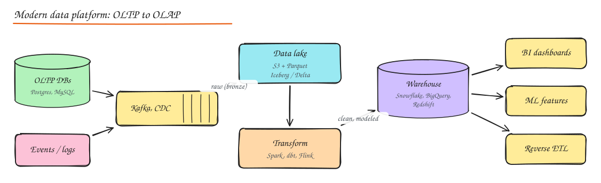
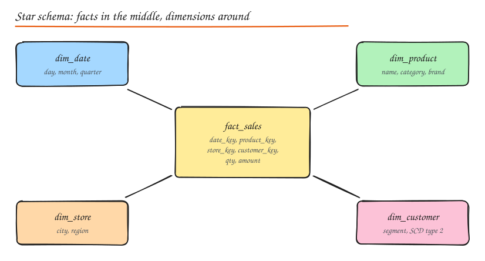

# Data Warehousing and Analytics

Product databases are built to serve users. Analytics needs a different system: scanning billions of rows to answer "revenue by region by week for the last 2 years". Running that on your production Postgres hurts users and is slow anyway.

## OLTP vs OLAP

| | OLTP | OLAP |
|---|---|---|
| Purpose | Run the business (orders, payments) | Understand the business (reports, ML features) |
| Queries | Many small reads/writes by key | Few huge scans and aggregations |
| Latency | ms | seconds to minutes acceptable |
| Data | Current state, normalized | History, denormalized, append mostly |
| Storage layout | Row oriented | **Column oriented** |
| Users | Applications, end users | Analysts, data scientists, dashboards |
| Examples | Postgres, MySQL, DynamoDB | Snowflake, BigQuery, Redshift, ClickHouse, Druid, Pinot, DuckDB |

### Why columnar storage wins for analytics

A query like `SELECT region, SUM(amount) FROM sales WHERE date >= '2024-01-01' GROUP BY region` touches 3 columns of maybe 50. A column store:

- Reads only those 3 columns from disk (10 to 100x less IO).
- Compresses each column extremely well (similar values together: dictionary, run length, delta encoding).
- Processes values in vectorized batches (SIMD).
- Skips blocks using min/max metadata (zone maps) for the `date` filter.

Formats: **Parquet** and **ORC** on disk in data lakes; proprietary formats inside warehouses.

## Pipeline: ETL vs ELT

- **ETL** (extract, transform, load): transform in a separate engine before loading into the warehouse. Classic when warehouse compute was expensive.
- **ELT** (extract, load, transform): load raw data first, transform **inside** the warehouse with SQL (dbt). The modern default because cloud warehouses scale compute elastically, and keeping raw data allows re-transforming later.

Ingestion options: batch exports, **CDC** from OLTP databases (Debezium, Fivetran, Airbyte), event streams from apps (Kafka, Segment), and file drops.

## Warehouse architecture layers

| Layer | Also called | Contents |
|---|---|---|
| **Staging / raw** | Landing, bronze | Data as extracted, minimal changes, used for replay |
| **Integration / cleaned** | Silver, core | Deduplicated, typed, conformed keys, joined across sources |
| **Presentation / marts** | Gold, data marts | Business ready star schemas per domain (finance mart, marketing mart), metrics |

**Data marts** are subject specific subsets (sales, finance) optimized for a team's questions.

## Dimensional modeling

- **Fact tables**: measurable events at a declared **grain** (one row per order line, per page view). Numeric measures (quantity, amount) + foreign keys to dimensions. Very long.
- **Dimension tables**: descriptive context (date, product, customer, store). Wide and relatively short.
- **Star schema**: facts join directly to denormalized dimensions. Simple, fast queries. The default.
- **Snowflake schema**: dimensions normalized into sub-dimensions (product -> category -> department). Less redundancy, more joins. Less common now that storage is cheap.

### Slowly changing dimensions (SCD)

What happens when a customer moves from Mumbai to Bangalore? Do past sales count for Mumbai or Bangalore?

| Type | Approach | History |
|---|---|---|
| **SCD 0** | Never change | Original value only |
| **SCD 1** | Overwrite | No history; past facts now show Bangalore |
| **SCD 2** | Add a new row with `valid_from`, `valid_to`, `is_current`, new surrogate key | Full history; past facts keep pointing to the Mumbai row |
| **SCD 3** | Add a `previous_city` column | One level of history |
| **SCD 4** | Separate history table | Current table stays small |
| **SCD 6** | Hybrid of 1 + 2 + 3 | Current and historical views |

SCD 2 is the one interviewers expect you to explain.

## Data lakes and lakehouses

- **Data lake**: cheap object storage holding raw and processed files in open formats (Parquet, JSON, images). Schema on read. Flexible, but without discipline becomes a "data swamp" (no quality, no discoverability, no transactions).
- **Lakehouse**: open **table formats** add warehouse features on top of lake files: ACID transactions, schema evolution, time travel, upserts/deletes (needed for GDPR), partition evolution.
  - **Apache Iceberg** (Netflix; broad engine support: Spark, Trino, Flink, Snowflake, BigQuery)
  - **Delta Lake** (Databricks)
  - **Apache Hudi** (Uber; strong upsert/CDC focus)
- Query engines: Spark, Trino/Presto, Athena, DuckDB, Flink.

## Modern data stack (names to know)

| Need | Tools |
|---|---|
| Ingestion / CDC | Fivetran, Airbyte, Debezium, Kafka Connect |
| Storage + compute | Snowflake (separate storage and compute, virtual warehouses), BigQuery (serverless, pay per scanned byte), Redshift, Databricks |
| Transformation | dbt (SQL models, tests, lineage), Spark |
| Orchestration | Airflow, Dagster, Prefect |
| Real time OLAP | ClickHouse, Apache Druid, Apache Pinot, StarRocks |
| BI | Looker, Tableau, Superset, Metabase, Power BI |
| Quality and catalog | Great Expectations, Monte Carlo, DataHub, Amundsen |
| Reverse ETL | Hightouch, Census (push warehouse data back into SaaS tools) |

## Real time analytics

When dashboards must be seconds fresh (ad click dashboards, live leaderboards, fraud monitoring), use streaming ingestion into a real time OLAP store (Pinot, Druid, ClickHouse) fed from Kafka, possibly with Flink doing pre-aggregation. See [Stream and Batch Processing](../10-advanced/02-stream-batch-processing.md).

## Interview questions

Why not run analytics queries on a read replica of the production DB?

It works at small scale, but row stores scan whole rows (slow for aggregations), long queries hold back MVCC cleanup and replication on the replica, history is limited to current state (no SCD), and joining data from many sources (payments provider, CRM, events) is impossible. A columnar warehouse fed by CDC and events is the scalable answer.

Explain SCD Type 2 with an example.

`dim_customer` gets a new row whenever tracked attributes change: customer 42 has a row (sk=1001, city=Mumbai, valid_from=2021-01-01, valid_to=2024-03-31, is_current=false) and a new row (sk=1002, city=Bangalore, valid_from=2024-04-01, valid_to=null, is_current=true). Facts store the surrogate key active at event time, so 2023 sales stay attributed to Mumbai while new sales go to Bangalore.

ETL or ELT for a startup on BigQuery?

ELT. Load raw data via managed connectors or CDC into raw datasets, transform with dbt inside BigQuery, and keep raw data for reprocessing. Compute scales on demand, transformations are versioned SQL, and you avoid running a separate transform cluster.

## Related

- [Stream and Batch Processing](../10-advanced/02-stream-batch-processing.md)
- [Replication (CDC)](04-replication.md)
- [ML System Design (feature stores)](../10-advanced/05-ml-system-design.md)
