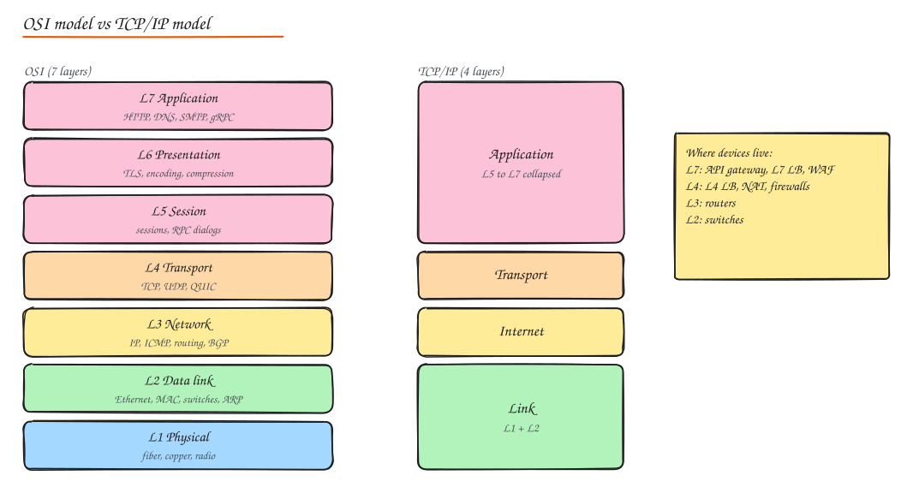
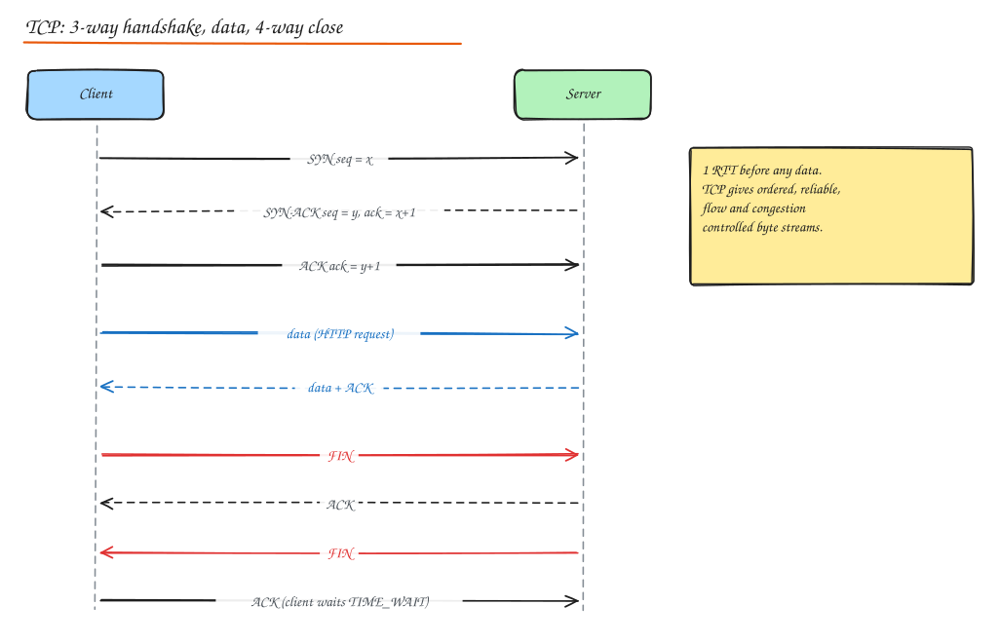

# Networking Fundamentals

> **TL;DR**
> - Know the layers: application (HTTP), transport (TCP/UDP/QUIC), network (IP), link (Ethernet).
> - TCP gives a reliable ordered stream but costs a handshake round trip and slow start; reuse connections.
> - UDP and QUIC avoid head-of-line blocking; QUIC powers HTTP/3 and survives network changes.
> - Debug with ping, mtr, dig, curl -w, ss and tcpdump.

You do not need to be a network engineer for system design, but you must reason about round trips, connection costs, packet loss and what each layer of infrastructure can see.

## OSI vs TCP/IP

| OSI layer | Unit | Examples | Why you care |
|---|---|---|---|
| 7 Application | message | HTTP, DNS, SMTP, gRPC, WebSocket | API design, L7 LBs, WAFs see this |
| 6 Presentation | | TLS, encoding (UTF-8, JSON), compression | Encryption, serialization |
| 5 Session | | Session setup/teardown, RPC dialogs | Mostly folded into apps/TLS today |
| 4 Transport | segment / datagram | TCP, UDP, QUIC | Reliability, ports, L4 LBs, NAT |
| 3 Network | packet | IPv4, IPv6, ICMP, routing (BGP, OSPF) | Addressing, routing, VPCs, subnets |
| 2 Data link | frame | Ethernet, Wi-Fi, MAC addresses, ARP, VLANs, switches | Local delivery |
| 1 Physical | bits | Fiber, copper, radio | Bandwidth, latency floor |

TCP/IP collapses this into 4: **Application, Transport, Internet, Link**. Mnemonic for OSI (top to bottom): "All People Seem To Need Data Processing".

## IP addressing

- **IPv4**: 32 bits, dotted decimal `203.0.113.10`. About 4.3 billion addresses, exhausted, hence NAT.
- **IPv6**: 128 bits, hex `2001:db8::10`. Huge space, no NAT needed, simpler headers, built in autoconfiguration (SLAAC). Adoption challenges: legacy equipment, dual stack complexity, operational familiarity.
- **CIDR**: `10.0.0.0/16` means the first 16 bits are the network, leaving 2^16 = 65,536 addresses.

| CIDR | Addresses | Typical use |
|---|---|---|
| /8 | 16.7M | Huge private networks |
| /16 | 65,536 | A VPC |
| /20 | 4,096 | A large subnet / Kubernetes pod range per node group |
| /24 | 256 | A subnet (one AZ tier) |
| /32 | 1 | A single host in a firewall rule |

- **Private ranges (RFC 1918)**: `10.0.0.0/8`, `172.16.0.0/12`, `192.168.0.0/16`. Not routable on the internet.
- **Special**: `127.0.0.1` loopback, `0.0.0.0` "any", `169.254.0.0/16` link-local (cloud metadata service lives at 169.254.169.254), `255.255.255.255` broadcast, `224.0.0.0/4` multicast.

### Subnetting

Splitting a network into smaller ones. A `/24` split into four `/26` gives 64 addresses each (62 usable hosts; network and broadcast addresses are reserved, and clouds reserve a few more). **VLSM** lets you use different sizes in the same network. In cloud VPC design: one subnet per AZ per tier (public for load balancers, private for apps, isolated for databases), and leave room to grow (Kubernetes eats IPs fast).

### NAT

Network Address Translation rewrites addresses at a boundary.

- **SNAT / PAT (masquerade)**: many private hosts share one public IP, distinguished by source port. Home routers, cloud NAT gateways for private subnets to reach the internet.
- **Static NAT**: one-to-one mapping.
- **DNAT / port forwarding**: public `IP:443` forwarded to a private server.
- Consequences: peers cannot initiate connections to NATed hosts (problem for P2P and WebRTC, solved with STUN/TURN), NAT gateways have connection limits and cost, and many users share one IP (bad for IP based rate limits).

### DHCP and ARP

- **DHCP** assigns IP, gateway and DNS to hosts on boot (Discover, Offer, Request, Ack).
- **ARP** maps an IPv4 address to a MAC address on the local network. **Gratuitous ARP** announces an IP move (used in failover with virtual IPs). **ARP spoofing** is a local attack.

## Routing basics

- Each host/router has a **routing table**: destination prefix -> next hop. **Longest prefix match** wins. A **default route** (`0.0.0.0/0`) catches everything else.
- Interior protocols (inside one organization): **OSPF**, IS-IS (link state), RIP (old, distance vector).
- **BGP** connects **autonomous systems** (ASes, each with an ASN) across the internet. Routes are chosen by policy and attributes (local preference, AS path length, MED, communities). BGP mistakes cause global outages (Facebook 2021 withdrew its own routes, taking DNS and everything else offline).
- **Anycast**: announce the same prefix from many locations; BGP sends users to the nearest. Powers CDNs, DNS, DDoS scrubbing.

## TCP

Reliable, ordered, connection oriented byte stream.

- **3-way handshake**: SYN, SYN-ACK, ACK. Costs **1 RTT** before sending data (plus TLS on top).
- **Sequence numbers and ACKs** give ordering and reliability; lost segments are retransmitted after a **retransmission timeout (RTO)** or 3 duplicate ACKs (fast retransmit).
- **Flags**: SYN (open), ACK, FIN (graceful close), RST (abort), PSH, URG.
- **4-way close**: FIN/ACK each direction. The side that closes first sits in **TIME_WAIT** (2 x MSL, often 60 s) to absorb late packets. Servers making many short outbound connections can exhaust ephemeral ports; use connection pooling and keep-alive.

### Flow control vs congestion control

- **Flow control** protects the **receiver**: the receiver advertises a window (how much buffer it has). **Window scaling** allows windows above 64 KB, needed for high bandwidth x delay paths.
- **Congestion control** protects the **network**: the sender keeps a congestion window (cwnd).
  - **Slow start**: cwnd starts small (~10 segments) and doubles each RTT until loss or threshold. New connections are slow; reuse them.
  - **Congestion avoidance**: grow linearly after the threshold.
  - **Fast retransmit / fast recovery**: on duplicate ACKs, retransmit and halve cwnd rather than restarting.
  - Algorithms: Reno/NewReno (loss based), **CUBIC** (Linux default, loss based, good for high bandwidth), **BBR** (Google; models bandwidth and RTT, far better on lossy or long links).
- **Bandwidth-delay product** = bandwidth x RTT: the amount of data "in flight" needed to fill a pipe. 1 Gbps x 100 ms = 12.5 MB. Small windows cap throughput on long links.
- **Nagle's algorithm** batches small writes; combined with **delayed ACK** it can add 40 to 200 ms latency for chatty protocols. Latency sensitive apps set `TCP_NODELAY`.
- **Head of line blocking**: TCP delivers bytes in order, so one lost packet stalls everything behind it, even unrelated HTTP/2 streams.

## UDP

Connectionless datagrams: no handshake, no ordering, no retransmission, no congestion control (unless the app adds it). 8 byte header, optional checksum in IPv4.

Use when timeliness beats completeness or the app does its own reliability: **DNS**, VoIP and video calls (WebRTC), live game state, metrics (StatsD), and as the base for **QUIC**.

## QUIC

A transport built on UDP (standardized 2021, the basis of HTTP/3):

- **Combined transport + TLS 1.3 handshake**: 1 RTT for new connections, **0-RTT** for resumed ones (with replay caveats for non-idempotent requests).
- **Independent streams**: loss on one stream does not block others (no TCP head of line blocking).
- **Connection migration**: connection IDs survive IP changes (Wi-Fi to cellular).
- Runs in user space, so it evolves faster than kernel TCP. Costs more CPU; some networks block or throttle UDP.

## Performance terms

| Term | Meaning |
|---|---|
| **Bandwidth** | Max data rate of a link (bits/s) |
| **Throughput** | Achieved data rate |
| **Latency** | Time for a packet to travel (one way) or round trip (RTT) |
| **Network latency** vs **application latency** vs **perceived latency** | Time on the wire vs time in your code vs what the user feels (rendering, spinners, optimistic UI) |
| **Jitter** | Variation in latency; matters for voice/video (use jitter buffers) |
| **Packet loss** | % of packets dropped; even 1% badly hurts TCP throughput |
| **MTU** | Max packet size on a link (1500 bytes Ethernet; jumbo frames 9000). Mismatches cause fragmentation or black holes (fix with MSS clamping, path MTU discovery) |
| **Congestion** | Queues fill, latency rises (bufferbloat), then loss |

### QoS

Classify and prioritize traffic: **traffic shaping** (delay excess to smooth rate), **policing** (drop excess), priority queues (voice before bulk backups), DSCP markings.

## VPNs and tunneling

- **Site-to-site VPN**: connects networks (office to VPC) via IPsec tunnels between gateways.
- **Client-to-site (remote access)**: a laptop joins the corporate network (OpenVPN, WireGuard, IPsec IKEv2).
- **IPsec**: network layer, widely supported, complex. **WireGuard**: modern, small codebase, fast, simple key model. **OpenVPN**: TLS based, flexible, slower.
- Cloud alternatives: VPC peering, Transit Gateway, PrivateLink, and increasingly **zero trust** access proxies instead of flat VPN access (see [Security](../07-security/02-encryption-data-network-security.md)).

## Tools you should know

| Tool | Use |
|---|---|
| `ping` | ICMP echo: reachability and RTT |
| `traceroute` / `mtr` | Path and per hop latency/loss |
| `dig` / `nslookup` | DNS queries (`dig +trace` shows the resolution chain) |
| `curl -w` | HTTP timing breakdown (DNS, connect, TLS, TTFB) |
| `netstat` / `ss` | Sockets, states (count TIME_WAIT, listen queues) |
| `tcpdump` / Wireshark | Packet capture and analysis |
| `iperf` | Measure throughput between hosts |
| `iftop`, `nload` | Live bandwidth per connection/interface |

Troubleshooting order: DNS resolves? Port reachable (`nc -vz host 443`)? TLS OK (`openssl s_client`)? Then app level timing with `curl -w`, then packet capture if needed.

## Wireless and mobile considerations

- Mobile networks have high and variable latency (50 to 500 ms), frequent handoffs and loss. Design APIs with **fewer round trips**, **request batching**, **compression**, **retries with backoff**, and **offline support**.
- Radio state: waking the cellular radio costs battery and latency; batch background requests.
- Wi-Fi standards (802.11n/ac/ax = Wi-Fi 4/5/6), WPA2/WPA3 security; 5G brings lower latency but coverage varies.

## Interview questions

Why are new connections slow even on a fast network?

Each new connection pays DNS lookup, the TCP handshake (1 RTT), the TLS handshake (1 RTT for TLS 1.3, 2 for 1.2), and then TCP slow start, which begins with a small congestion window and needs several RTTs to reach full speed. Keep-alive, connection pooling, HTTP/2 multiplexing, TLS session resumption, and QUIC 0-RTT all amortize or remove these costs.

TCP vs UDP for a multiplayer game's position updates?

UDP (or QUIC unreliable datagrams). Position updates are superseded every few ms, so retransmitting an old position is useless and TCP's head of line blocking would delay newer updates behind a lost one. Use sequence numbers to drop stale packets, and send critical events (purchases, chat) over a reliable channel.

What does HTTP/3 fix compared to HTTP/2?

HTTP/2 multiplexes streams over one TCP connection, so a single lost packet blocks all streams until it is retransmitted (TCP head of line blocking). HTTP/3 runs over QUIC on UDP, where streams are independent at the transport layer, the transport and TLS handshakes are combined (1 RTT, 0-RTT on resume), and connections survive IP changes.

Your service in a private subnet cannot reach a third party API. What do you check?

Route table has a default route to a NAT gateway; the NAT gateway is in a public subnet with an internet gateway route; security groups and NACLs allow outbound 443 and return traffic; DNS resolves the API hostname from inside the VPC; the third party has not IP-allowlisted a different egress IP; and no egress proxy or firewall policy blocks the destination.

## Related

- [HTTP and TLS](02-http-tls.md)
- [DNS](../02-building-blocks/01-dns.md)
- [Load Balancing (L4 vs L7)](../02-building-blocks/02-load-balancing.md)
