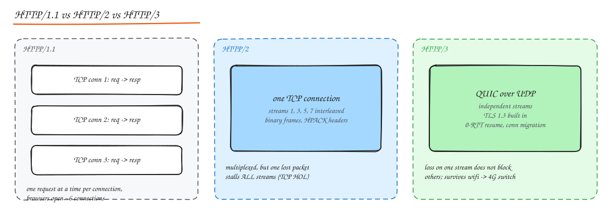
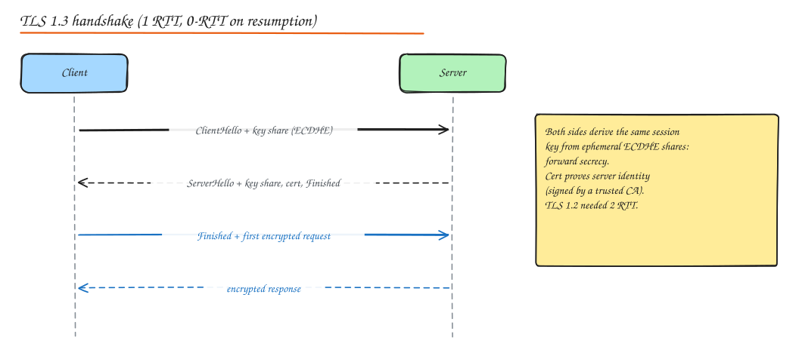

# HTTP, HTTPS and TLS

> **TL;DR**
> - HTTP/1.1 does one request at a time per connection; HTTP/2 multiplexes over TCP; HTTP/3 multiplexes over QUIC without head-of-line blocking.
> - Use methods and status codes correctly: 4xx means the client must change something, 5xx means the server failed.
> - Caching headers (Cache-Control, ETag) and CORS are everyday design tools.
> - TLS 1.3 encrypts and authenticates in one round trip using ephemeral keys (forward secrecy).

## HTTP versions

| | HTTP/1.1 (1997) | HTTP/2 (2015) | HTTP/3 (2022) |
|---|---|---|---|
| Transport | TCP | TCP | QUIC over UDP |
| Format | Text | Binary frames | Binary frames |
| Concurrency | One in-flight request per connection (pipelining exists but is broken in practice) | Many **multiplexed streams** on one connection | Multiplexed, **independent** streams |
| Headers | Repeated plain text | **HPACK** compression | **QPACK** compression |
| Head of line blocking | Per connection (application level) | At TCP level (one loss stalls all streams) | None across streams |
| Handshake | TCP + TLS (2 to 3 RTT) | Same | 1 RTT, 0-RTT on resume |
| Notable | Keep-alive (persistent connections), chunked encoding | Stream priorities, server push (deprecated in practice) | Connection migration |

HTTP/1.1 limitations led to hacks: domain sharding, sprite sheets, inlining, concatenation. HTTP/2 made most of them unnecessary (or harmful).

## Methods

| Method | Semantics | Safe | Idempotent | Body |
|---|---|---|---|---|
| GET | Read a resource | yes | yes | no |
| HEAD | GET without body | yes | yes | no |
| POST | Create / process (non-idempotent) | no | **no** | yes |
| PUT | Replace a resource entirely | no | yes | yes |
| PATCH | Partial update | no | not guaranteed | yes |
| DELETE | Remove | no | yes | optional |
| OPTIONS | Capabilities, CORS preflight | yes | yes | no |

## Status codes that matter

| Code | Meaning | When |
|---|---|---|
| 200 OK | Success with body | |
| 201 Created | Resource created | Include `Location` header |
| 202 Accepted | Accepted for async processing | Return a job/status URL |
| 204 No Content | Success, no body | DELETE, some PUTs |
| 301 / 308 | Permanent redirect (308 keeps method) | Moved URLs, URL shorteners (301 is cached by browsers) |
| 302 / 307 | Temporary redirect (307 keeps method) | URL shorteners that need analytics on every click |
| 304 Not Modified | Cached copy still valid | Conditional GET |
| 400 Bad Request | Malformed input | Validation errors |
| 401 Unauthorized | Not authenticated | Missing/invalid token |
| 403 Forbidden | Authenticated but not allowed | Authorization failure |
| 404 Not Found | No such resource | Also used to hide existence |
| 409 Conflict | State conflict | Duplicate, version conflict, idempotency in progress |
| 412 Precondition Failed | `If-Match` failed | Optimistic concurrency |
| 422 Unprocessable Entity | Semantically invalid | Business rule violations |
| 429 Too Many Requests | Rate limited | With `Retry-After` |
| 500 | Server bug | |
| 502 Bad Gateway | Upstream returned garbage / refused | Proxy cannot reach a healthy backend |
| 503 Service Unavailable | Overloaded or in maintenance | Load shedding, with `Retry-After` |
| 504 Gateway Timeout | Upstream too slow | Timeout at proxy |

Rule: **4xx means the client should change something; 5xx means the server failed**. Retry 5xx/429 (with backoff), do not blindly retry 4xx.

## Headers worth knowing

- **Content negotiation**: `Accept`, `Content-Type`, `Accept-Encoding` (gzip, br, zstd), `Accept-Language`.
- **Auth**: `Authorization: Bearer <token>`, `Cookie` / `Set-Cookie` (with `HttpOnly`, `Secure`, `SameSite`).
- **Caching**: `Cache-Control`, `ETag`, `If-None-Match`, `Last-Modified`, `If-Modified-Since`, `Vary`, `Age`, `Expires` (legacy).
- **Concurrency**: `If-Match` with an ETag for optimistic locking.
- **Tracing**: `traceparent` (W3C Trace Context), `X-Request-ID`.
- **Proxies**: `X-Forwarded-For`, `X-Forwarded-Proto`, `Forwarded`.
- **Security**: `Strict-Transport-Security` (HSTS), `Content-Security-Policy`, `X-Content-Type-Options: nosniff`, `X-Frame-Options` / CSP `frame-ancestors`.
- **Idempotency**: `Idempotency-Key` (convention).

### Caching headers in practice

- Content-hashed static assets: `Cache-Control: public, max-age=31536000, immutable`.
- HTML entry pages: `Cache-Control: no-cache` + `ETag` (revalidate every time, cheap 304s).
- Private API data: `Cache-Control: private, no-store` for sensitive data.
- Shared API responses: `Cache-Control: public, s-maxage=30, stale-while-revalidate=60`.

**ETag flow**: server returns `ETag: "v42"`; next request sends `If-None-Match: "v42"`; server replies `304 Not Modified` with no body if unchanged.

## CORS (Cross-Origin Resource Sharing)

Browsers block JavaScript on `https://app.example.com` from reading responses from `https://api.other.com` unless the API opts in. The **same-origin policy** compares scheme + host + port.

- **Simple requests** (GET/POST with simple headers): sent directly; the browser checks `Access-Control-Allow-Origin` on the response.
- **Preflighted requests** (PUT/DELETE, JSON content type, custom headers): the browser first sends `OPTIONS` with `Access-Control-Request-Method/Headers`; the server answers with `Access-Control-Allow-Origin`, `-Methods`, `-Headers`, `-Max-Age` (cache the preflight).
- With cookies: `Access-Control-Allow-Credentials: true` and a **specific** origin (not `*`).
- CORS is a browser protection for users, **not** API security: curl ignores it. Never reflect arbitrary `Origin` values with credentials.

## TLS (HTTPS)

TLS gives **confidentiality** (encryption), **integrity** (tamper detection) and **authentication** (you are talking to the real server).

How it works (TLS 1.3):

1. **ClientHello**: supported cipher suites and a key share (ephemeral ECDHE public key), SNI (server name).
2. **ServerHello**: chosen cipher and its key share. Both sides now compute the same shared secret via Diffie-Hellman and derive session keys. The server sends its **certificate** and a signature proving it holds the private key, then Finished.
3. Client verifies the certificate chain up to a trusted **Certificate Authority** (CA) root, checks hostname and validity, sends Finished and can immediately send encrypted data.

Key concepts:

- **Asymmetric crypto** (RSA, ECDSA) authenticates and establishes keys; **symmetric crypto** (AES-GCM, ChaCha20-Poly1305) encrypts bulk data because it is far faster.
- **Perfect forward secrecy (PFS)**: ephemeral (EC)DHE keys mean that stealing the server's private key later does not decrypt past recorded traffic. Mandatory in TLS 1.3.
- **Certificates**: X.509, issued by CAs, short lived now (90 days with Let's Encrypt, automated via ACME). Revocation via OCSP/CRLs (unreliable), so short lifetimes are the practical fix. **Certificate Transparency** logs make mis-issuance detectable.
- **Session resumption** (PSK/tickets) and **0-RTT** reduce handshakes; 0-RTT data can be replayed, so only allow idempotent requests.
- **TLS termination**: where TLS is decrypted (CDN, LB, gateway). Re-encrypt to backends for zero trust, or use **mTLS** internally.
- **mTLS**: both sides present certificates. Standard for service-to-service auth in meshes (Istio/Linkerd issue and rotate certs automatically, SPIFFE identities).
- **HSTS** tells browsers to always use HTTPS for a domain (prevents SSL stripping).

## Interview questions

What happens when you type https://example.com and press enter?

DNS resolves the name (cache, resolver, root, TLD, authoritative). The browser opens a TCP connection (or QUIC) to the IP, performs the TLS handshake (verifying the certificate chain and hostname, establishing session keys via ECDHE), sends an HTTP GET with headers and cookies, the request passes CDN/LB/gateway to an app server that reads data (cache/DB), and the response streams back. The browser parses HTML, fetches CSS/JS/images (many from a CDN, multiplexed over HTTP/2 or 3), builds the DOM and CSSOM, runs JS and paints.

401 vs 403?

401 means "I don't know who you are" (missing or invalid credentials; include `WWW-Authenticate`). 403 means "I know who you are and you're not allowed". Some APIs return 404 instead of 403 to avoid revealing that a resource exists.

Why is TLS 1.3 faster and safer than TLS 1.2?

It removes a round trip (1 RTT instead of 2, plus 0-RTT resumption), removes legacy insecure options (static RSA key exchange, CBC ciphers, SHA-1, compression), makes forward secrecy mandatory, and encrypts more of the handshake (including the server certificate).

## Related

- [Networking Fundamentals](01-networking-fundamentals.md)
- [API Design](03-api-design.md)
- [CDN](../02-building-blocks/04-cdn.md)
- [Security: Encryption](../07-security/02-encryption-data-network-security.md)
