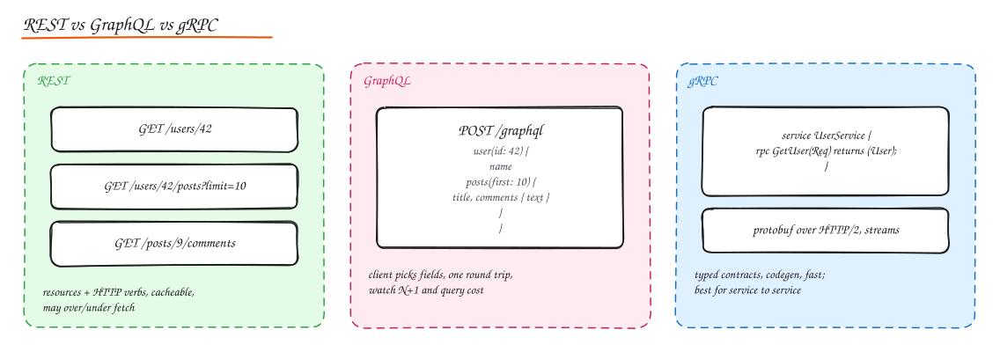

# API Design (REST, GraphQL, gRPC)

> **TL;DR**
> - REST models resources with HTTP verbs; GraphQL lets clients choose fields; gRPC gives typed, fast service-to-service calls.
> - Use cursor pagination for growing lists, idempotency keys for writes, and one consistent error format.
> - Evolve APIs additively; version only for breaking changes, with deprecation periods.
> - Authorize every object access, validate every input, and rate limit every client.

An API is a contract. Good APIs are **predictable, hard to misuse, evolvable without breaking clients, and efficient for the common case**. In interviews, writing 3 to 5 clean endpoints early anchors the whole design.



## REST

Representational State Transfer: model the domain as **resources** (nouns) identified by URLs, manipulated with **HTTP methods** (verbs), using standard **status codes**, stateless requests, and cacheable responses.

### Resource modeling

```http
GET    /v1/users/42                    # read
PATCH  /v1/users/42                    # partial update
GET    /v1/users/42/orders?status=shipped&limit=20
POST   /v1/orders                      # create, returns 201 + Location
GET    /v1/orders/9001
POST   /v1/orders/9001/cancel          # action that is not CRUD: sub-resource verb is OK
DELETE /v1/orders/9001/items/3
```

Guidelines:

- Plural nouns, lowercase, hyphens: `/payment-methods`.
- Nest only one level for ownership (`/users/42/orders`); deep nesting gets brittle.
- Non-CRUD actions: model as a sub-resource (`/orders/9001/cancellation`) or a clear action endpoint (`POST /orders/9001/cancel`). Be consistent.
- Use **HTTP semantics**: GET must be safe; PUT and DELETE idempotent; POST for creation and non-idempotent actions.
- Return the created/updated resource (saves a round trip).

### Idempotency

POST is not idempotent, but clients retry. Accept an `Idempotency-Key` header and store the response per key (see [Distributed Transactions](../03-data/06-distributed-transactions.md)). Crucial for payments, orders, messaging.

### Pagination

| Type | Request | Pros | Cons |
|---|---|---|---|
| **Offset** | `?limit=20&offset=40` | Simple, jump to page N | Slow for large offsets (DB scans skipped rows); unstable when items are inserted (duplicates/skips) |
| **Cursor** (opaque) | `?limit=20&cursor=eyJpZCI6...` | Stable, fast, hides implementation | No random page jumps |
| **Keyset / seek** | `?limit=20&after_created=...&after_id=...` | Uses the index directly: `WHERE (created_at, id) < (?, ?)` | Needs a unique, ordered sort key |

Use **cursor/keyset for feeds and large or changing lists**, offset only for small admin tables. Return:

```json
{
  "data": [ ... ],
  "next_cursor": "eyJjcmVhdGVkX2F0IjoiMjAyNC0wNi0wMVQxMDowMDowMFoiLCJpZCI6OTAwMX0",
  "has_more": true
}
```

The cursor is usually base64 of the last item's sort key (optionally signed so clients cannot tamper).

### Filtering, sorting, field selection

- Filtering: `?status=shipped&created_after=2024-01-01` or a structured `filter[status]=shipped`.
- Sorting: `?sort=-created_at,price` (minus for descending). Only allow sorts backed by indexes.
- Sparse fields: `?fields=id,name,price` to cut payload.
- Expansion: `?expand=customer` to embed related resources and avoid extra calls.

### Versioning

| Approach | Example | Notes |
|---|---|---|
| URL path | `/v1/orders` | Most common, explicit, easy to route and cache |
| Header | `Accept: application/vnd.example.v2+json` or `API-Version: 2024-06-01` | Clean URLs; Stripe uses dated versions pinned per account |
| Query | `?version=2` | Easy but messy |

Prefer **additive, backward compatible changes** (new optional fields, new endpoints) that need no new version. Breaking changes (renaming/removing fields, changing types or semantics) require a new version plus a deprecation period (`Deprecation` and `Sunset` headers), usage monitoring, and migration guides. Clients must **ignore unknown fields**.

### Error format

Consistent machine readable errors, e.g. RFC 9457 Problem Details:

```json
{
  "type": "https://api.example.com/errors/insufficient-funds",
  "title": "Insufficient funds",
  "status": 422,
  "detail": "Balance 30.00 is less than the charge amount 50.00",
  "instance": "/v1/payments/req_8f2a",
  "request_id": "req_8f2a",
  "errors": [{ "field": "amount", "code": "too_large" }]
}
```

### HATEOAS

"Hypermedia as the engine of application state": responses include links to possible next actions (`"links": {"cancel": "/orders/9001/cancel"}`). Rare in practice for internal APIs; useful for public APIs with discoverable workflows. Worth knowing the term.

### Long running operations

Return `202 Accepted` with a status resource:

```http
POST /v1/videos/123/transcode  ->  202 Accepted
Location: /v1/operations/op_77

GET /v1/operations/op_77  ->  { "status": "running", "progress": 0.4 }
```

Or let clients register a **webhook** callback (sign payloads with HMAC, retry with backoff, include an event ID for dedupe).

### Documentation and contracts

- **OpenAPI (Swagger)** spec as the source of truth; generate docs, client SDKs, server stubs, and contract tests.
- Validate requests against the schema at the edge.

## GraphQL

A query language where the client specifies exactly the shape of data it needs, served from a single endpoint against a typed **schema**.

```graphql
type User { id: ID!  name: String!  posts(first: Int, after: String): PostConnection! }
type Post { id: ID!  title: String!  comments: [Comment!]! }
type Query { user(id: ID!): User }
type Mutation { createPost(input: CreatePostInput!): Post! }
type Subscription { commentAdded(postId: ID!): Comment! }
```

- **Queries** read, **mutations** write, **subscriptions** push updates (usually over WebSockets).
- Pros: no over/under fetching, one round trip for nested data (great for mobile), strong typing and introspection, schema evolution by adding fields and deprecating old ones.
- Cons: harder HTTP caching (POST to one URL; use persisted queries with GET + CDN), complex authorization per field, expensive queries possible (limit depth and complexity, timeouts), error handling inside 200 responses.

### The N+1 problem

Resolving `posts { author { name } }` naively runs 1 query for posts and N queries for authors.

Fix with **DataLoader**: within a request tick, collect all requested author IDs, issue one batched query (`WHERE id IN (...)`), and cache per request.

### Federation

Large organizations split the graph across teams: each service owns a **subgraph**, and a **gateway/router** (Apollo Federation, GraphQL Mesh, Hive) composes them into one supergraph and plans queries across services. Query planning, caching (per field `@cacheControl`, persisted queries, response caching at the router) and complexity limits live at the gateway.

## gRPC

RPC framework using **Protocol Buffers** for schema and binary serialization over **HTTP/2**.

```protobuf
syntax = "proto3";
service OrderService {
  rpc GetOrder (GetOrderRequest) returns (Order);
  rpc StreamOrderUpdates (OrderFilter) returns (stream OrderEvent);   // server streaming
  rpc UploadItems (stream Item) returns (UploadSummary);              // client streaming
  rpc Chat (stream ChatMessage) returns (stream ChatMessage);         // bidirectional
}
message Order { int64 id = 1; string status = 2; repeated Item items = 3; }
```

- Pros: compact and fast (binary, HTTP/2 multiplexing), strict contracts with codegen in many languages, four streaming modes, deadlines and cancellation propagate across calls.
- Cons: not browser native (needs gRPC-Web or a proxy), binary payloads are harder to debug, L4 load balancers balance badly (long lived connections; see [Load Balancing](../02-building-blocks/02-load-balancing.md)).
- Protobuf evolution rules: never reuse or renumber field tags, add new fields as optional, use `reserved` for removed ones.

## Choosing

| Situation | Choose |
|---|---|
| Public API for third parties | REST (with OpenAPI), possibly GraphQL in addition |
| Many client types needing different shapes, rapid frontend iteration | GraphQL (or BFFs) |
| Internal service to service, low latency, polyglot | gRPC |
| Streaming between services | gRPC streams, or a message broker |
| Browser real time push | WebSocket / SSE (see [Real Time Communication](04-realtime-communication.md)) |
| Simple CRUD app | REST |

## Security essentials for APIs

- Authenticate every request (OAuth 2.0 access tokens / JWT, API keys for server-to-server identification, mTLS internally).
- Authorize at the object level: check that user 42 owns order 9001 (Broken Object Level Authorization is OWASP API risk #1).
- Validate input (types, ranges, sizes), encode output, limit payload sizes.
- Rate limit per key and per IP; return 429.
- Never put secrets or tokens in URLs (they end up in logs).
- See [Authentication and Authorization](../07-security/01-authn-authz.md).

## Interview questions

<details>
<summary>Design the API for a Twitter-like home timeline. Which pagination and why?</summary>

`GET /v1/timeline?limit=20&cursor=...` with cursor based (keyset) pagination on `(created_at, tweet_id)` or a ranked position. Offsets break because new tweets keep arriving at the top (users see duplicates) and large offsets are slow. Return `next_cursor`; for refresh, support `?since_cursor=` to fetch newer items.

</details>

<details>
<summary>How do you evolve an API without breaking mobile apps that never update?</summary>

Only make additive changes in place (new optional fields, new endpoints), never change meaning or remove fields within a version, have clients ignore unknown fields, use feature flags server side, version breaking changes (`/v2` or dated versions), keep old versions running with monitoring of their usage, and use minimum supported app versions with forced upgrade prompts as a last resort.

</details>

<details>
<summary>What is the N+1 problem in GraphQL and how do you fix it?</summary>

Field resolvers run per object, so resolving a list of N posts and each post's author triggers 1 + N database queries. DataLoader batches the author lookups within a request into one `IN` query and caches them; alternatively, the parent resolver can join and pre-populate children, or query planning can be pushed to a data layer that supports batching.

</details>

<details>
<summary>PUT vs PATCH?</summary>

PUT replaces the whole resource with the provided representation (idempotent; missing fields are reset). PATCH applies a partial modification (JSON Merge Patch or JSON Patch); it may or may not be idempotent depending on the operation (setting a field is, appending to a list is not).

</details>

## Related

- [HTTP and TLS](02-http-tls.md)
- [Serialization and Compression](05-serialization-compression.md)
- [API Gateway](../02-building-blocks/05-proxies-api-gateway.md)
- [Rate Limiting](../02-building-blocks/08-rate-limiting.md)
