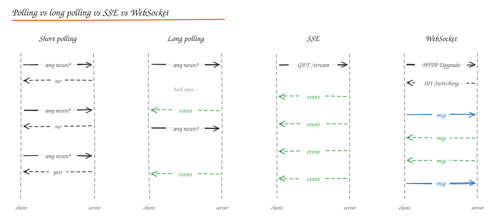
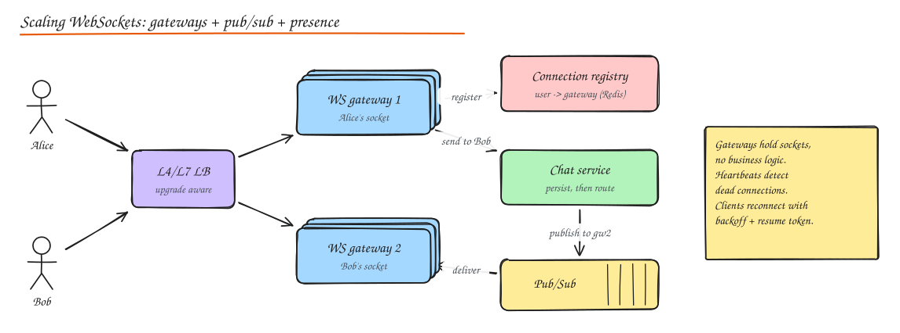

# Real Time Communication

HTTP is request/response: the client asks, the server answers. Real time features (chat, notifications, live scores, collaborative editing, ride tracking) need the **server to push** data as soon as it exists.



## The options

| Technique | How | Latency | Overhead | Direction | Good for |
|---|---|---|---|---|---|
| **Short polling** | Client asks every N seconds | Up to N s | High: mostly empty responses, headers each time | Client pull | Dashboards refreshing every 30 s, simple status checks |
| **Long polling** | Server holds the request open until data arrives or timeout (~30 s), client immediately re-requests | Low | Medium: one request per event, reconnect churn | Server to client (emulated) | Fallback where WebSockets are blocked; low event rates |
| **Server-Sent Events (SSE)** | One long lived HTTP response streaming `text/event-stream` events | Low | Low | **Server to client only** | Notifications, live feeds, stock tickers, LLM token streaming |
| **WebSocket** | HTTP Upgrade to a persistent full duplex TCP channel with lightweight frames | Lowest | Lowest per message | **Bidirectional** | Chat, multiplayer, collaborative editing, live trading |
| **WebRTC** | Peer-to-peer UDP media/data channels (with STUN/TURN for NAT) | Lowest, peer to peer | Complex setup | P2P | Video/voice calls, P2P file transfer |

### SSE details

```http
GET /events HTTP/1.1
Accept: text/event-stream

HTTP/1.1 200 OK
Content-Type: text/event-stream

id: 101
event: order_status
data: {"order_id": 9001, "status": "shipped"}

```

- Built-in browser API (`EventSource`) with **automatic reconnect** and `Last-Event-ID` resume.
- Plain HTTP: works through most proxies, HTTP/2 multiplexes many streams on one connection.
- Text only, one direction (send client messages with normal POSTs).

### WebSocket details

- Starts as `GET` with `Upgrade: websocket`, server answers `101 Switching Protocols`; after that, framed messages flow both ways over the same TCP connection.
- Low per message overhead (2 to 14 byte frames) vs full HTTP headers.
- You must build: heartbeats (ping/pong), reconnection with backoff, message acknowledgements, resume after reconnect, auth (token in the first message or on the upgrade request; cookies need CSRF consideration).
- Some corporate proxies break long lived connections; Socket.IO and similar libraries fall back to long polling.

**Socket.IO vs native WebSocket**: Socket.IO adds rooms, namespaces, automatic reconnection, acknowledgements, and fallbacks, but uses its own protocol (clients must use Socket.IO). Native WebSocket is a standard, lighter, and interoperable; you build those features yourself.

## Scaling persistent connections

A single well tuned server can hold **hundreds of thousands to ~1M idle connections** (memory per connection, file descriptors, kernel tuning). The challenge is not one server: it is **routing a message to the server that holds the recipient's connection**.



Architecture:

1. **Connection gateways**: stateless apart from sockets. They authenticate, hold connections, and forward messages. No business logic, so they can be deployed rarely and drained gracefully.
2. **Connection registry / presence**: `user_id -> {gateway_id, connection_id}` in Redis (with TTL refreshed by heartbeats).
3. **Routing**: when a message for Bob arrives, look up Bob's gateway and publish to that gateway's channel (Redis pub/sub, Kafka, NATS), or broadcast to a **room/topic** channel that every gateway with a subscriber listens to.
4. **Business services** persist messages first (durability), then route for delivery.
5. **Offline users**: if no connection, deliver via push notification; on reconnect, the client syncs missed messages using its last seen sequence/cursor.

Other concerns:

- **Load balancing**: L4 or WebSocket aware L7. Connections are naturally sticky for their lifetime. Use least connections so new gateways fill up.
- **Deploys and rebalancing**: when a gateway restarts, thousands of clients reconnect at once (thundering herd). Drain gradually and make clients reconnect with **jittered exponential backoff**.
- **Heartbeats**: detect dead connections (mobile networks drop silently); typical 20 to 60 s interval. NAT/firewalls kill idle connections after a few minutes, so heartbeats also keep them alive.
- **Backpressure**: slow clients accumulate outgoing buffers. Cap per connection queues; drop or coalesce updates (send only the latest presence state).
- **Fanout to big rooms** (a live stream chat with 1M viewers): hierarchical fanout, sampling, or batching messages per interval.
- **Presence** ("online", "typing"): ephemeral, high churn, eventually consistent; keep it in memory/Redis with TTLs, publish only changes, throttle "typing" events, and for large contact lists fetch presence on demand rather than broadcasting.

## Choosing in an interview

- Server to client only, modest rate (notifications, progress, LLM streaming): **SSE**.
- Bidirectional, frequent (chat, games, collaboration): **WebSocket**.
- Rare updates, simplicity first: **polling** (or long polling).
- Media between users: **WebRTC** (with an SFU for group calls).
- Mobile apps in the background: **push notifications** (APNs/FCM), since sockets die when the app sleeps.

## Interview questions

<details>
<summary>How do you deliver a chat message to a user connected to a different server?</summary>

Gateways register each user's connection in a registry (user -> gateway). The chat service persists the message, looks up the recipient's gateway(s) (a user may have several devices), and publishes to those gateways' channels via pub/sub. The gateway writes the frame to the socket and the client acks. If the user is offline, enqueue a push notification; the client fetches missed messages on reconnect.

</details>

<details>
<summary>Why might you choose SSE over WebSockets for streaming LLM responses?</summary>

The data flows one way (server to client), SSE is plain HTTP so it works with existing auth, proxies, CDNs and HTTP/2, it has built-in reconnect and event IDs, and there is no need for a full duplex protocol. Client input is just a normal POST that starts the stream.

</details>

<details>
<summary>A gateway node with 500k connections dies. What happens and how do you limit the damage?</summary>

500k clients reconnect simultaneously, hitting the LB, auth service and registry. Mitigate with client side jittered exponential backoff, connection rate limits at the LB, spare gateway capacity (N+1), cheap token based reauth (signed resume tokens), registry TTLs that expire stale entries, and clients syncing missed messages by cursor instead of full reloads.

</details>

## Related

- [Case study: WhatsApp / Chat](../09-case-studies/04-whatsapp-chat.md)
- [Message Queues and Pub/Sub](../02-building-blocks/07-message-queues.md)
- [Case study: Notification System](../09-case-studies/08-notification-system.md)
