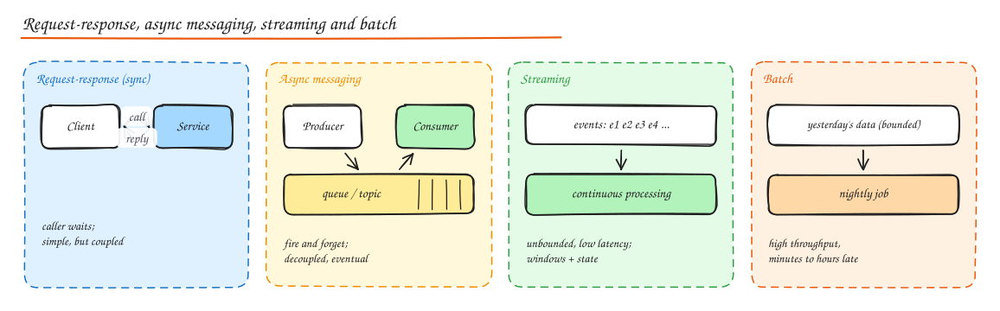

# Communication Patterns (Sync, Async, Streaming, Batch)

> **TL;DR**
> - **Synchronous** (request-response): the caller waits. Simple and immediate, but availability and latency of every hop add up.
> - **Asynchronous** (queues, pub/sub, events): the caller hands off work and moves on. Decoupled and resilient, but eventually consistent.
> - **Streaming** processes an endless flow of events continuously; **batch** processes a bounded pile of data on a schedule.
> - Real systems mix them: sync for "the user needs the answer now", async for "it can finish a moment later".

## Synchronous communication (request-response)

The client sends a request and blocks (or awaits) until a response or a timeout. HTTP/REST, gRPC unary calls, database queries.

**Use when** the user is waiting for the result: reading a profile, validating a coupon, checking inventory before showing "in stock".

**Costs**

- **Temporal coupling**: both sides must be up at the same moment. Availability multiplies: three 99.9% services in a chain give 99.7%.
- **Latency adds up** along the chain, and the slowest dependency sets your p99.
- **Cascading failure**: a slow dependency ties up caller threads.

**Make it safe** with timeouts, retries with backoff and jitter (only for idempotent calls), circuit breakers, and parallel fan-out instead of long chains. See [Resilience Patterns](../06-reliability-ops/01-resilience-patterns.md).

### The request-response pattern over messaging

Sometimes you need a reply but want a broker in the middle (load leveling, routing). The requester sends a message with a `reply_to` queue and a `correlation_id`; the responder publishes the answer there. RabbitMQ RPC and NATS request-reply work like this. You get decoupling at the cost of more moving parts.

## Asynchronous communication

The sender publishes a message or event and does not wait for the work to finish.

| Style | Delivery | Example |
|---|---|---|
| **Point-to-point queue** | Each message to one consumer | Thumbnail jobs, emails to send |
| **Publish-subscribe** | Each message to every subscriber | `OrderPlaced` to billing, email, analytics |
| **Event-driven architecture** | Services react to facts emitted by others | Saga steps, read model updates |

**Use when**: work can complete later, multiple systems react to one fact, you need to absorb spikes, or a dependency is slow or flaky.

**Costs**: eventual consistency (the user may not see the result instantly), duplicate and out-of-order messages, harder debugging, and one more system to run. Consumers must be **idempotent**. See [Message Queues](../02-building-blocks/07-message-queues.md) and [Event-Driven Architecture](../05-architecture/02-event-driven-cqrs-event-sourcing.md).

## Streaming data

A continuous, unbounded sequence of events processed as it arrives: clicks, GPS pings, payments, logs.

- Transport: Kafka, Kinesis, Pulsar, Pub/Sub.
- Processing: Flink, Kafka Streams, Spark Structured Streaming.
- Concepts: event time, windows, watermarks, state, exactly-once checkpoints. See [Stream and Batch Processing](../10-advanced/02-stream-batch-processing.md).

**Use when** you need results within seconds: fraud scoring, live dashboards, surge pricing, trending topics.

## Batch processing

Process a bounded dataset at once on a schedule: nightly ETL, monthly invoices, model training, recomputing aggregates.

- Tools: Spark, SQL in a warehouse (dbt), Airflow/Dagster for orchestration.
- Strengths: very high throughput, simple correctness (rerun the whole day), cheap (spot instances).
- Weakness: results are hours old.

Many systems use both: streaming for fresh approximate numbers, batch to recompute exact ones (see the [Ad Click Aggregator](../09-case-studies/15-ad-click-aggregator.md)).

## Choosing

| Question | Lean towards |
|---|---|
| Is a user waiting for this exact result? | Synchronous |
| Can it finish in the background? | Async queue |
| Do several systems need to react? | Pub/sub events |
| Do you need results within seconds over a continuous flow? | Streaming |
| Is it a large periodic computation where hours of delay are fine? | Batch |
| Do you need a reply but must protect the responder from spikes? | Request-reply over a queue |

### Worked example: placing an order

1. **Sync**: validate cart, reserve stock, authorize payment (the user waits for "order placed").
2. **Async events**: `OrderPlaced` to email, loyalty points, warehouse picking, search ranking signals.
3. **Streaming**: order events feed a real-time sales dashboard and fraud model.
4. **Batch**: nightly reconciliation with the payment provider and finance reports.

## Interview questions

Why not make every call asynchronous to maximize resilience?

Some operations need an immediate answer (is the seat still free, is the password correct). Making them async forces polling or callbacks, complicates the UX, and adds eventual consistency where users expect certainty. Use async for work that can complete later or fan out; keep the user's critical path synchronous but short and well protected.

What is the difference between a message queue and a pub/sub topic?

In a queue each message is processed by exactly one consumer from a pool (work distribution). In pub/sub every subscriber (or consumer group) receives its own copy of each message (fanout). Kafka supports both: consumers in the same group share partitions like a queue, while different groups each read the full stream like pub/sub.

How do you return a result to a user when the work happens asynchronously?

Return `202 Accepted` with a job id, then let the client poll a status endpoint, or push the result over WebSocket/SSE, or send a notification/webhook when done. Persist job state so the result survives restarts.

## Related

- [Message Queues](../02-building-blocks/07-message-queues.md)
- [Real Time Communication](04-realtime-communication.md)
- [Event-Driven Architecture](../05-architecture/02-event-driven-cqrs-event-sourcing.md)
- [Stream and Batch Processing](../10-advanced/02-stream-batch-processing.md)
