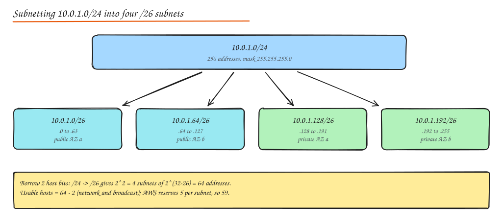
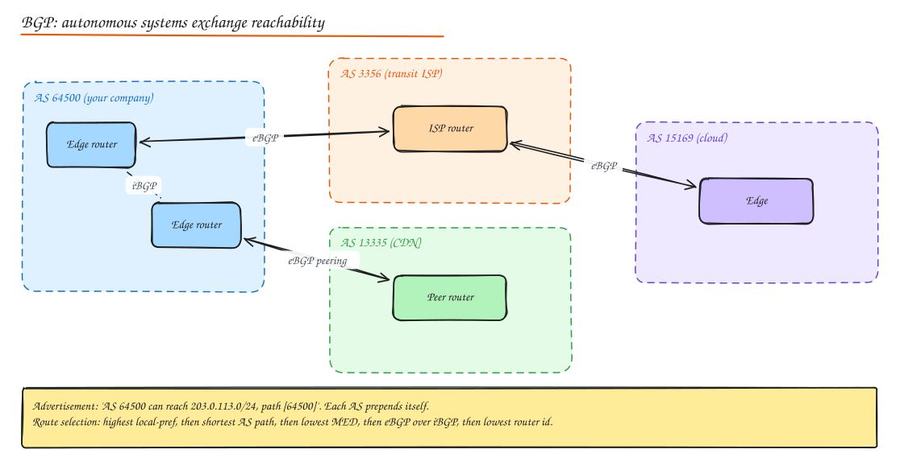

# IP Addressing, Subnetting and Routing

> **TL;DR**
> - An IP address has a **network part** and a **host part**; the CIDR suffix (`/24`) says how many bits are network.
> - Each extra network bit halves the subnet: a `/24` has 256 addresses, a `/26` has 64.
> - Routers forward packets using the **longest matching prefix** in their routing table.
> - Inside an organization, routes are learned with OSPF or IS-IS; between organizations (autonomous systems) the internet runs on **BGP**.
> - NAT lets many private hosts share one public IP; IPv6 removes the need for it.

## IPv4 addressing

An IPv4 address is 32 bits, written as four decimal octets (**dotted decimal notation**): `192.168.10.25` = `11000000.10101000.00001010.00011001`.

**CIDR notation** `192.168.10.0/24` means the first 24 bits identify the network; the remaining 8 bits identify hosts in it.

| Prefix | Subnet mask | Addresses | Typical use |
|---|---|---|---|
| /8 | 255.0.0.0 | 16,777,216 | Very large private network |
| /16 | 255.255.0.0 | 65,536 | A cloud VPC |
| /20 | 255.255.240.0 | 4,096 | A large subnet (Kubernetes pods) |
| /24 | 255.255.255.0 | 256 | A typical subnet |
| /26 | 255.255.255.192 | 64 | A small subnet per AZ |
| /28 | 255.255.255.240 | 16 | Tiny subnet (load balancer, NAT) |
| /32 | 255.255.255.255 | 1 | A single host in a firewall rule |

### Private and special ranges

| Range | Meaning |
|---|---|
| `10.0.0.0/8`, `172.16.0.0/12`, `192.168.0.0/16` | Private (RFC 1918), not routed on the internet |
| `100.64.0.0/10` | Carrier-grade NAT shared space |
| `127.0.0.0/8` | Loopback (`127.0.0.1` is "this machine") |
| `169.254.0.0/16` | Link-local (cloud metadata at `169.254.169.254`) |
| `0.0.0.0` | "Any address" when binding a server; default route as `0.0.0.0/0` |
| `255.255.255.255` | Limited broadcast |
| Network address (all host bits 0) | Names the subnet itself, not assignable |
| Broadcast address (all host bits 1) | Reaches every host on the subnet |
| `224.0.0.0/4` | Multicast |

## Subnetting



### How to calculate subnets

1. **How many subnets do you need?** Borrow `n` host bits so that `2^n >= subnets`. New prefix = old prefix + n.
2. **How many hosts per subnet?** `2^(32 - prefix) - 2` usable hosts (cloud providers reserve more, AWS reserves 5).
3. **Block size** = `256 - last non-255 octet of the mask` (for /26: 256 - 192 = 64). Subnets start at multiples of the block size.

Worked example: split `10.0.1.0/24` into 4 subnets.

- Borrow 2 bits: `/26`. Block size 64.
- Subnets: `10.0.1.0/26` (.0 to .63), `10.0.1.64/26` (.64 to .127), `10.0.1.128/26` (.128 to .191), `10.0.1.192/26` (.192 to .255).
- In each, the first address is the network, the last is broadcast, so 62 usable hosts (59 on AWS).

Quick check: does `10.0.1.77` belong to `10.0.1.64/26`? 77 is between 64 and 127, yes.

### VLSM (variable length subnet masking)

Use different prefix lengths in the same network to avoid waste: a `/28` for a NAT gateway, `/24`s for app subnets, a `/20` for Kubernetes pods. Allocate the biggest subnets first so they stay aligned.

### Cloud VPC planning tips

- Pick a VPC range that will not overlap with other VPCs, on-prem networks or partner networks you may peer with (overlaps make peering impossible).
- One subnet per AZ per tier: public (load balancers, NAT), private (apps), isolated (databases).
- Reserve room: Kubernetes with VPC-native pod IPs consumes thousands of addresses.

## IPv6

128-bit addresses written as eight groups of four **hexadecimal** digits: `2001:0db8:0000:0000:0000:ff00:0042:8329`, shortened to `2001:db8::ff00:42:8329` (drop leading zeros, replace one run of zero groups with `::`).

**Advantages**: practically unlimited addresses (no NAT needed, end-to-end connectivity), simpler fixed header, built-in autoconfiguration (SLAAC), no broadcast (multicast instead), mandatory support for IPsec in the spec.

**Adoption challenges**: legacy devices and software, dual-stack complexity (running v4 and v6 together), operational unfamiliarity, firewall rules that must be written twice, and NAT habits (people relied on NAT as a pseudo-firewall). Many mobile networks are IPv6-first; most clouds offer dual stack.

## NAT (Network Address Translation)

| Type | What it does | Example |
|---|---|---|
| **Static NAT** | One private IP to one public IP, permanently | A server that must be reachable at a fixed public IP |
| **Dynamic NAT** | Private IPs mapped to a pool of public IPs on demand | Older enterprise networks |
| **PAT / NAT overload (masquerade)** | Many private IPs share one public IP, distinguished by source port | Home routers, cloud NAT gateways |
| **Port forwarding (DNAT)** | Public `IP:port` forwarded to a private host | Exposing a service behind a router |

Consequences for system design: NATed clients cannot accept inbound connections (P2P and WebRTC need STUN/TURN), many users can share one IP (IP-based rate limits hit innocent users), NAT gateways have connection limits and per-GB cost.

## DHCP

Hosts get an IP, subnet mask, default gateway and DNS servers automatically: **Discover** (broadcast), **Offer**, **Request**, **Acknowledge** (DORA). Leases expire and renew. In clouds, the platform's DHCP hands out the VPC addresses.

## Routing basics

A **routing table** maps destination prefixes to next hops:

```text
Destination       Next hop        Interface   Metric
10.0.0.0/16       local           eth0        0
10.1.0.0/16       10.0.0.1 (VPN)  tun0        10
0.0.0.0/0         10.0.0.254      eth0        100   <- default route
```

- **Longest prefix match**: a packet to `10.1.2.3` matches both `10.1.0.0/16` and `0.0.0.0/0`; the more specific `/16` wins.
- **Default route** (`0.0.0.0/0`): where everything else goes (the internet gateway).
- **Route priority**: when two sources offer the same prefix, administrative distance (trust in the source: connected < static < OSPF < RIP) decides first, then the protocol's metric.

## Routing protocols

| Protocol | Type | How it decides | Where |
|---|---|---|---|
| **RIP** | Distance vector | Hop count (max 15) | Legacy, small networks |
| **OSPF** | Link state | Each router knows the full topology, runs Dijkstra on link costs | Enterprise and datacenter interiors |
| **IS-IS** | Link state | Like OSPF, runs directly on layer 2, scales well | Large ISP backbones, some datacenters |
| **BGP** | Path vector | Policies and AS paths | Between autonomous systems (the internet), also inside large datacenters |

**Interior gateway protocols** (OSPF, IS-IS, RIP) route within one organization. **BGP** is the exterior protocol that glues the internet together.

## BGP deep dive



- **Autonomous system (AS)**: a network under one administrative control with one routing policy, identified by an AS number (ASN). Your cloud, your ISP, Cloudflare each have ASNs.
- **BGP peers and sessions**: routers form TCP sessions (port 179). **eBGP** between different ASes, **iBGP** inside one AS to share external routes.
- **Route advertisements**: an AS announces prefixes it can reach ("203.0.113.0/24 via AS path 64500"). Each AS that propagates the route prepends its own ASN, which also prevents loops.
- **BGP attributes**: `LOCAL_PREF` (prefer this exit, set inside your AS), `AS_PATH` (list of ASes), `MED` (hint to neighbours about which entry point to use), `NEXT_HOP`, `ORIGIN`.
- **Route selection** (simplified order): highest local preference, shortest AS path, lowest origin type, lowest MED, eBGP over iBGP, lowest IGP cost to next hop, oldest route, lowest router id.
- **BGP communities**: tags attached to routes to signal policy ("do not export to peers", "prepend 3 times in Europe", "blackhole this prefix" for DDoS mitigation).

Why system designers care:

- **Anycast**: announce the same prefix from many locations; BGP sends each user to the nearest. CDNs, DNS resolvers and DDoS scrubbing rely on it.
- **Multi-homing**: announce your prefix via two ISPs for redundancy.
- **Outages**: route leaks and hijacks (a network announcing prefixes it does not own) can black-hole traffic; Facebook's 2021 outage started with withdrawn BGP routes. RPKI signs route origins to prevent hijacks.

## Multicast and IGMP

**Multicast** sends one packet to a group address (`224.0.0.0/4`) and the network replicates it to every subscribed receiver. Hosts join groups using **IGMP** (Internet Group Management Protocol); routers build distribution trees (PIM). Used inside private networks for market data feeds, IPTV and cluster discovery. It is generally not available on the public internet or in most clouds, which is why application-level fanout (pub/sub) is used instead.

## MPLS (Multiprotocol Label Switching)

Routers attach short **labels** to packets at the network edge, and the core forwards by label instead of full IP lookups. Carriers use it for traffic engineering (pin flows to paths), VPN services between branch offices, and fast reroute. In cloud-era designs it is often replaced by SD-WAN over the internet.

## Interview questions

<details>
<summary>How many usable hosts are in a /27, and what are its subnet boundaries in 192.168.5.0/24?</summary>

A /27 has 2^(32-27) = 32 addresses, 30 usable (minus network and broadcast). The block size is 32, so the /27 subnets are .0, .32, .64, .96, .128, .160, .192 and .224, each spanning 32 addresses (for example 192.168.5.32 to 192.168.5.63).

</details>

<details>
<summary>Why can't two VPCs with overlapping CIDR ranges be peered?</summary>

Routing tables match destinations by prefix. If both VPCs contain 10.0.0.0/16, a packet for 10.0.1.5 is ambiguous: it could be local or remote, so routes cannot be installed. Plan non-overlapping ranges up front or put a NAT/translation layer in between.

</details>

<details>
<summary>What is anycast and why do CDNs use it?</summary>

Anycast announces the same IP prefix from many locations via BGP; the internet routes each client to the topologically nearest announcement. CDNs and DNS providers use it to send users to a nearby PoP automatically, to spread DDoS traffic across many sites, and to fail over by simply withdrawing the route from a broken location.

</details>

<details>
<summary>OSPF vs BGP?</summary>

OSPF is a link-state interior protocol: every router knows the full topology of one organization's network and computes shortest paths by link cost. BGP is a path-vector exterior protocol between autonomous systems: it exchanges reachability with AS paths and chooses routes by policy (business relationships) rather than pure shortest path. Large networks run both: OSPF or IS-IS inside, BGP at the edges.

</details>

## Related

- [Networking Fundamentals](01-networking-fundamentals.md)
- [Protocol Deep Dives](08-protocol-deep-dives.md)
- [DNS](../02-building-blocks/01-dns.md)
- [Network Security](../07-security/02-encryption-data-network-security.md)
