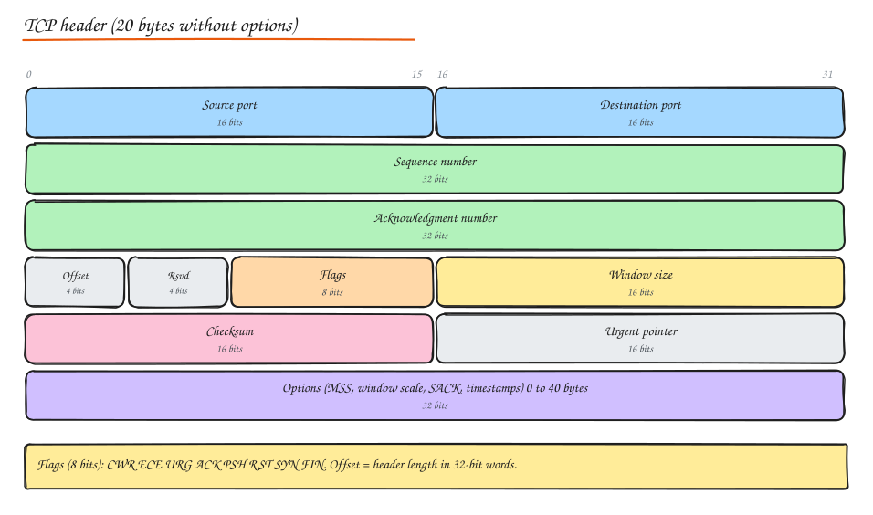
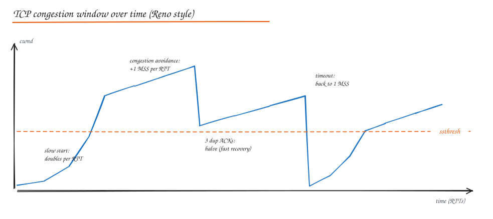
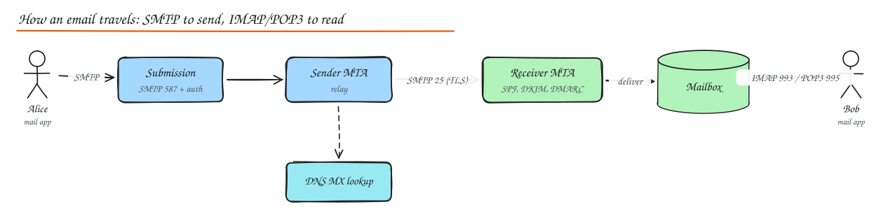

# Protocol Deep Dives

> **TL;DR**
> - **TCP** turns an unreliable network into a reliable, ordered byte stream using sequence numbers, ACKs, retransmissions, flow control and congestion control.
> - The congestion window grows exponentially in **slow start**, linearly in **congestion avoidance**, and shrinks on loss. BBR instead models bandwidth and RTT.
> - **UDP** is just ports and a checksum on top of IP: no handshake, no ordering, no retransmits. Great for DNS, voice, games and QUIC.
> - **ICMP** carries errors and diagnostics (ping, traceroute); **ARP** maps IPs to MAC addresses on a LAN.
> - Email: **SMTP** sends and relays, **IMAP/POP3** read. **SFTP** (over SSH) replaced plain FTP.

## TCP

### Header structure

| Field | Purpose |
|---|---|
| Source / destination port | Identify the sockets (with IPs, the 4-tuple identifies a connection) |
| Sequence number | Byte offset of the first data byte in this segment |
| Acknowledgment number | Next byte the receiver expects (cumulative ACK) |
| Data offset | Header length in 32-bit words (5 to 15, so 20 to 60 bytes) |
| Flags | SYN (open), ACK, FIN (graceful close), RST (abort), PSH (push now), URG, ECE/CWR (ECN congestion signals) |
| Window size | How many bytes the receiver can accept (flow control); scaled by the window scale option |
| Checksum | Detect corruption of header + data |
| Urgent pointer | Rarely used |
| Options | MSS (max segment size), window scale, SACK (selective ACK), timestamps (RTT measurement, PAWS) |

### Connection lifecycle

1. **3-way handshake**: client `SYN (seq=x)`, server `SYN-ACK (seq=y, ack=x+1)`, client `ACK (ack=y+1)`. Options like MSS and window scale are negotiated here. Costs one RTT before data.
2. **Data transmission**: the sender sends segments up to the minimum of the receiver window and the congestion window; the receiver ACKs cumulatively (and with SACK, reports holes).
3. **4-way termination**: each side sends `FIN` and gets an `ACK` (often combined as FIN-ACK). The side that closes first enters **TIME_WAIT** for 2 x MSL (commonly 60 s) to absorb delayed packets and avoid mixing old segments into a new connection with the same 4-tuple.
4. **Reset**: `RST` aborts immediately (connection to a closed port, or an application abort).

See the sequence diagram in [Networking Fundamentals](01-networking-fundamentals.md#tcp).

### Reliability: sequence numbers, ACKs, retransmission

- Every byte has a sequence number; the receiver reorders out-of-order segments and drops duplicates.
- **Retransmission timeout (RTO)** is computed from smoothed RTT and its variance (`RTO = SRTT + 4 x RTTVAR`, minimum around 200 ms to 1 s depending on the OS), doubling on each consecutive timeout (exponential backoff).
- **Fast retransmit**: three duplicate ACKs signal a lost segment, so it is resent without waiting for the RTO.
- **SACK** lets the receiver report exactly which blocks arrived, so only the missing ones are resent.

### Flow control vs congestion control

- **Flow control** protects the receiver: the advertised window shrinks when the receiver's buffer fills; a zero window pauses the sender.
- **Congestion control** protects the network: the sender keeps a **congestion window (cwnd)**.

| Phase / algorithm | Behaviour |
|---|---|
| **Slow start** | cwnd starts around 10 segments and doubles every RTT until it reaches `ssthresh` or sees loss |
| **Congestion avoidance** | Above `ssthresh`, cwnd grows by about 1 MSS per RTT (additive increase) |
| **Fast retransmit + fast recovery** | On 3 duplicate ACKs: retransmit, halve cwnd (multiplicative decrease), continue in avoidance |
| **Timeout** | Severe signal: ssthresh = cwnd / 2, cwnd back to 1 segment, slow start again |
| **Reno / NewReno** | Classic AIMD; NewReno handles multiple losses in one window better |
| **CUBIC** | Linux default; cwnd grows as a cubic function of time since the last loss, so it ramps quickly on high bandwidth-delay paths |
| **BBR** (Google) | Not loss-based: estimates bottleneck bandwidth and minimum RTT, paces sending to match. Much better on lossy or long links (YouTube saw big rebuffer reductions) |

Implication for design: short-lived connections spend most of their life in slow start, so **reuse connections** (keep-alive, pooling, HTTP/2) and keep payloads small for latency-critical APIs.

### Buffering, queueing and QoS

- Routers queue packets when links are busy. Oversized buffers cause **bufferbloat**: latency spikes under load instead of quick loss signals. Active queue management (CoDel, FQ-CoDel) drops early to keep queues short.
- **Quality of Service (QoS)**: classify traffic (DSCP markings), then **prioritize** (strict or weighted queues so voice goes before backups), **shape** (delay excess traffic to smooth bursts) or **police** (drop or remark traffic above a rate).

## UDP

8-byte header: source port, destination port, length, checksum (optional in IPv4, mandatory in IPv6).

**Connectionless communication**: no handshake, no state, no ordering, no retransmission, no congestion control. The application decides what to do with loss.

| Use case | Why UDP |
|---|---|
| DNS | One small request, one small response; retry is cheap |
| VoIP, video calls (RTP/WebRTC) | Late audio is useless; prefer skipping to waiting |
| Online games | Newest state supersedes old; avoid head-of-line blocking |
| Metrics (StatsD), syslog | Fire and forget, losing a few points is fine |
| QUIC / HTTP/3 | Builds its own reliability and congestion control in user space |
| Multicast streaming | TCP cannot multicast |

## ICMP

Control and error messages for IP:

| Message | Meaning / tool |
|---|---|
| Echo request / reply (type 8 / 0) | `ping` reachability and RTT |
| Destination unreachable (type 3) | Host, network, port unreachable; code 4 "fragmentation needed" drives path MTU discovery |
| Time exceeded (type 11) | TTL hit zero; `traceroute` sends packets with increasing TTL to map each hop |
| Redirect (type 5) | Router suggests a better next hop on the same network |

Blocking all ICMP breaks path MTU discovery and makes debugging hard; allow the essential types.

## ARP

The **Address Resolution Protocol** finds the MAC address for an IPv4 address on the local network: "who has 10.0.0.5? tell 10.0.0.1" (broadcast **request**), "10.0.0.5 is at aa:bb:cc:..." (unicast **reply**). Results are cached.

- **Gratuitous ARP**: a host announces its own IP to MAC mapping, used when a virtual IP fails over to a standby (keepalived) so switches update quickly.
- **ARP spoofing**: an attacker on the LAN answers for another IP to intercept traffic; mitigated with dynamic ARP inspection and encrypted protocols.
- IPv6 replaces ARP with Neighbor Discovery.

## IGMP

Hosts use IGMP to join and leave IPv4 multicast groups so routers forward group traffic only where receivers exist. See [IP Addressing and Routing](07-ip-addressing-routing.md#multicast-and-igmp).

## Email: SMTP, POP3, IMAP

| Protocol | Role | Ports |
|---|---|---|
| **SMTP** | Submit mail (client to server) and relay between servers | 587 submission with STARTTLS + auth, 465 implicit TLS, 25 server-to-server |
| **POP3** | Download mail to one device, usually deleting from the server | 995 (TLS) |
| **IMAP** | Read and manage mail kept on the server, synced across devices | 993 (TLS) |

Deliverability for systems that send email (notifications, receipts): publish **SPF** (which servers may send for your domain), sign with **DKIM**, set a **DMARC** policy, warm up IPs, handle bounces and complaints, and use a provider (SES, SendGrid) rather than raw SMTP from app servers.

## FTP and SFTP

- **FTP**: old file transfer protocol with separate control (21) and data connections (active or passive mode), credentials in plain text. Painful through firewalls and NAT. Avoid.
- **FTPS**: FTP over TLS.
- **SFTP**: a different protocol that runs over **SSH** (port 22): one encrypted connection, key-based auth. The common choice for B2B batch file exchange (bank statements, partner feeds).
- Modern alternative: presigned HTTPS uploads to object storage.

## Interview questions

Why does a new TCP connection transfer data slowly at first?

Slow start: the congestion window begins small (around 10 segments, about 14 KB) and doubles each RTT, so it takes several round trips to reach the link's capacity. On top of that come the handshake RTTs (TCP, TLS). Connection reuse, larger initial windows, HTTP/2 multiplexing and QUIC 0-RTT reduce the cost.

What does a TCP RST tell you when debugging?

The other side (or a middlebox) aborted the connection: nothing listening on the port, a firewall or load balancer rejecting or timing out an idle connection, the application closing a socket with unread data, or a proxy killing a long request. Correlate timing with idle timeouts and check which hop sent it with a packet capture.

Why do services accumulate TIME_WAIT sockets, and is it a problem?

The side that actively closes a TCP connection keeps it in TIME_WAIT for twice the maximum segment lifetime. Services that open many short outbound connections (to a database or API without pooling) can accumulate tens of thousands and exhaust ephemeral ports. Fix with connection pooling and keep-alive rather than kernel hacks.

When is BBR better than CUBIC?

On paths with random loss or large buffers (mobile networks, long-distance links), loss-based CUBIC backs off on every loss or fills buffers until loss, causing low throughput or bufferbloat. BBR paces sending to the measured bottleneck bandwidth and minimum RTT, so it keeps throughput high and queues short.

## Related

- [Networking Fundamentals](01-networking-fundamentals.md)
- [HTTP and TLS](02-http-tls.md)
- [Network Troubleshooting](09-network-troubleshooting.md)
- [Notification System (email delivery)](../09-case-studies/08-notification-system.md)
