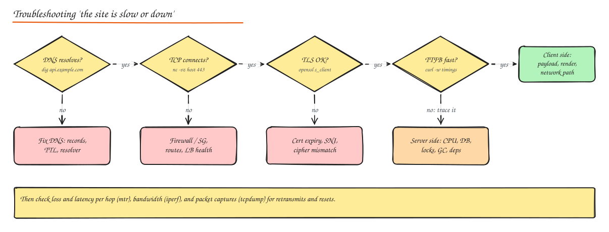

# Network Performance, Monitoring and Troubleshooting

> **TL;DR**
> - Five numbers describe a network path: **bandwidth** (capacity), **throughput** (what you get), **latency** (delay), **jitter** (variation in delay) and **packet loss**.
> - Troubleshoot bottom up: does DNS resolve, does TCP connect, does TLS succeed, is the server fast, is the response big?
> - `dig`, `nc`, `curl -w`, `mtr`, `ss`, `tcpdump` and `iperf3` answer 90% of questions.
> - Most "network" slowness is really too many round trips, no connection reuse, oversized payloads, or a slow server.

## Performance metrics

| Metric | Meaning | Typical cause when bad |
|---|---|---|
| **Bandwidth** | Maximum rate a link can carry (bits/s) | Undersized link, noisy neighbour |
| **Bandwidth utilization** | % of capacity in use | Above ~70 to 80%, queues and latency grow fast |
| **Throughput** | Achieved data rate | Window limits, loss, CPU, small requests |
| **Latency** (RTT) | Round trip time | Distance (light in fiber ~200 km/ms), queueing, extra hops |
| **Jitter** | Variation in latency | Congestion, Wi-Fi contention; hurts voice/video |
| **Packet loss** | % of packets dropped | Congestion, bad cables, Wi-Fi interference, policing |
| **Network congestion** | Demand above capacity on some link | Bursts, elephant flows, bufferbloat |

**Three kinds of latency** to separate in any investigation:

- **Network latency**: time on the wire (RTT x number of round trips).
- **Application latency**: time spent in your code, database and dependencies.
- **Perceived latency**: what the user feels, including rendering and UI tricks (skeleton screens, optimistic updates, progressive loading).

Rule of thumb: on high-latency links, **round trips matter more than bandwidth**. A page needing 30 sequential requests at 200 ms RTT takes 6 s even on gigabit fiber.

## TCP tuning

- **Window scaling**: the window field is 16 bits (64 KB max) without the scale option. Throughput is capped at `window / RTT`, so 64 KB at 100 ms is only 5 Mbps. Enable window scaling (on by default in modern OSes) and size socket buffers to the **bandwidth-delay product** (BDP = bandwidth x RTT; 1 Gbps x 100 ms = 12.5 MB).
- **Slow start**: new connections start small. Reuse connections (keep-alive, pools, HTTP/2), avoid slow start after idle (`tcp_slow_start_after_idle=0` on long-lived server-to-server links), consider a larger initial window on CDN edges.
- **MTU size**: Ethernet MTU is 1500 bytes; jumbo frames (9000) inside a datacenter cut per-packet overhead. Tunnels (VPN, VXLAN) reduce the effective MTU; if ICMP "fragmentation needed" is blocked, large packets silently disappear (**PMTU black hole**): small requests work, big responses hang. Fix with MSS clamping or allowing ICMP.
- **Congestion control**: BBR for lossy or long paths, CUBIC as a sane default. See [Protocol Deep Dives](08-protocol-deep-dives.md).
- **Nagle and delayed ACK**: disable Nagle (`TCP_NODELAY`) for chatty request/response protocols.
- **Keep-alives**: application or TCP keep-alives stop NATs and load balancers from silently dropping idle connections.

## Tools

| Tool | What it answers | Example |
|---|---|---|
| `ping` | Is the host reachable, what is RTT and loss? | `ping -c 20 api.example.com` |
| `traceroute` / `mtr` | Which hop adds latency or loss? | `mtr -rwc 100 api.example.com` |
| `dig` / `nslookup` | What does DNS return, from where, with what TTL? | `dig +trace api.example.com`, `dig @1.1.1.1 api.example.com AAAA` |
| `nc` (netcat) | Can I open a TCP connection to this port? | `nc -vz db.internal 5432` |
| `curl -w` | Where does HTTP time go? | `curl -o /dev/null -s -w 'dns %{time_namelookup} connect %{time_connect} tls %{time_appconnect} ttfb %{time_starttransfer} total %{time_total}\n' https://api.example.com/health` |
| `openssl s_client` | TLS handshake, certificate chain, expiry | `openssl s_client -connect api.example.com:443 -servername api.example.com` |
| `ss` / `netstat` | Socket states, queues, retransmits | `ss -tanp`, `ss -ti dst 10.0.0.5` (shows cwnd, rtt, retrans) |
| `tcpdump` | Capture packets for analysis | `tcpdump -i eth0 -w cap.pcap host 10.0.0.5 and port 443` |
| Wireshark | Analyze captures visually | Filter `tcp.analysis.retransmission`, follow TCP stream |
| `iperf3` | Maximum throughput between two hosts | `iperf3 -s` then `iperf3 -c host -P 4 -t 30` |
| `iftop` / `nload` | Live bandwidth per connection / interface | `iftop -i eth0` |

Cloud equivalents: VPC flow logs, load balancer access logs, CloudWatch/Stackdriver network metrics, Reachability Analyzer.

## A layered troubleshooting method

1. **Scope it.** Who is affected (all users, one region, one ISP, one client version)? Since when (deploy, config change, certificate expiry)?
2. **DNS**: does the name resolve to the expected address from the client's network? Stale TTLs after a migration are common.
3. **TCP connect**: firewall rules, security groups, NACLs, route tables, load balancer target health, port exhaustion.
4. **TLS**: expired or wrong certificate, missing intermediate, SNI mismatch, protocol or cipher mismatch.
5. **Server time (TTFB)**: if connect is fast but first byte is slow, it is the application: check traces, DB, locks, GC, dependencies.
6. **Transfer time**: large payloads, missing compression, low throughput from loss (look for retransmits) or small windows.
7. **Client**: rendering, slow devices, extensions, captive portals.

## Packet analysis basics

In a capture, look for:

- **Retransmissions and duplicate ACKs**: packet loss on the path.
- **Zero window**: the receiver cannot keep up (slow consumer).
- **RSTs**: something actively refusing or killing connections (idle timeouts, closed ports).
- **Long gaps** between request and response: server think time, not the network.
- **SYN without SYN-ACK**: blocked by a firewall or the server's backlog is full.

## Bottleneck identification

Use the USE method per resource (utilization, saturation, errors) along the path: client, Wi-Fi/mobile, ISP, CDN edge, load balancer, NAT gateway, instance NIC, application, database. Common culprits:

| Symptom | Likely bottleneck |
|---|---|
| Throughput plateaus at a round number (1 Gbps, 5 Gbps) | Instance or NIC bandwidth cap |
| Connections fail under load, `ss` shows SYN backlog drops | Listen backlog / accept queue too small |
| Many TIME_WAIT, "cannot assign requested address" | Ephemeral port exhaustion (no pooling) |
| NAT gateway errors at peak | NAT connection limits; use VPC endpoints for cloud services |
| p99 spikes with retransmits | Loss or bufferbloat on a link |

## Interview questions

A user in Sydney says your US-hosted site is slow, but it is fast for you in Virginia. What do you check?

Latency: ~200 ms RTT means every round trip is expensive. Check how many sequential requests the page makes, whether connections are reused, whether TLS 1.3 and HTTP/2 or 3 are enabled, and whether static assets and cacheable API responses come from a CDN edge near Sydney. Long-term: serve from an APAC region or edge compute. Measure with `curl -w` from a host in Australia or real user monitoring.

Small API responses work but large downloads hang through the VPN. Why?

Classic path MTU black hole: the tunnel lowers the effective MTU, large packets need fragmentation, and the ICMP "fragmentation needed" messages are blocked, so the sender never learns to send smaller packets. Fix by allowing ICMP type 3 code 4 or clamping TCP MSS on the tunnel interface.

How would you prove whether slowness is in the network or the application?

Break down request timing: DNS, connect, TLS and TTFB with `curl -w` or browser timing. If connect and TLS are quick but TTFB is long, the server is slow (confirm with traces). If connect itself is slow or variable, or captures show retransmissions, it is the network path (confirm with `mtr` loss per hop).

## Related

- [Networking Fundamentals](01-networking-fundamentals.md)
- [Protocol Deep Dives](08-protocol-deep-dives.md)
- [Observability](../06-reliability-ops/02-observability.md)
- [Practice: Networking Troubleshooting Scenarios](../12-practice/03-networking-troubleshooting-scenarios.md)
