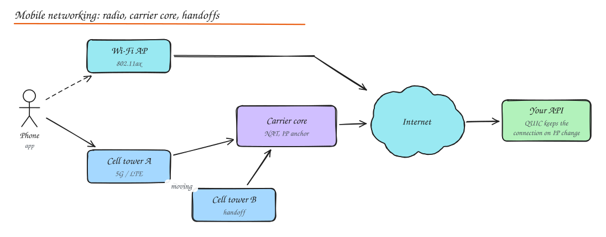

# Wireless and Mobile Networking for System Design

> **TL;DR**
> - Mobile networks have high and changing latency, frequent loss and IP changes when users move. Design as if every request might fail or be slow.
> - Fewer, bigger, compressed requests beat many small ones. Batch background work so the radio wakes up less (battery).
> - Build for offline: local storage, queued writes with idempotency keys, sync by cursor.
> - QUIC/HTTP3 keeps connections alive across Wi-Fi to cellular switches.

## Wi-Fi (IEEE 802.11)

| Standard | Name | Band | Typical real throughput |
|---|---|---|---|
| 802.11n | Wi-Fi 4 | 2.4 / 5 GHz | tens to ~150 Mbps |
| 802.11ac | Wi-Fi 5 | 5 GHz | hundreds of Mbps |
| 802.11ax | Wi-Fi 6 / 6E | 2.4 / 5 / 6 GHz | better in crowded places (OFDMA) |
| 802.11be | Wi-Fi 7 | 2.4 / 5 / 6 GHz | multi-link, very high peak |

- **Channels and frequencies**: 2.4 GHz travels further but has few non-overlapping channels (1, 6, 11) and lots of interference; 5 and 6 GHz have more, wider channels but shorter range.
- **SSID broadcasting**: the network name advertised in beacons. Hiding it is not security.
- **Security**: WEP (broken), WPA (deprecated), **WPA2** (AES, common), **WPA3** (SAE handshake resists offline password guessing; use it where possible). Enterprise mode uses 802.1X with per-user credentials.
- Wi-Fi is a **shared medium**: latency and jitter grow with the number of active clients, which is why conference Wi-Fi feels slow.

## Cellular networks

| Generation | Highlights | Typical latency |
|---|---|---|
| 2G (GSM/EDGE) | Voice, SMS, very slow data | 300 to 1000 ms |
| 3G (UMTS/HSPA) | Mobile internet | 100 to 500 ms |
| 4G LTE | All-IP, broadband speeds | 30 to 100 ms |
| 5G (NSA/SA) | Higher throughput, low-latency modes, network slicing | 10 to 50 ms (lower on mmWave) |

Real-world numbers vary a lot by coverage, load and indoor signal, so plan for the worst common case, not the advertised one.

- **Radio states**: the phone's radio sleeps to save battery; waking it (RRC state promotion) adds latency (tens to hundreds of ms) and keeps it in a high-power state for seconds after each transfer (the "tail").
- **Carrier-grade NAT**: most phones sit behind carrier NAT; many users share one public IP.
- **Mobile IP and handoff**: as users move, the phone hands off between towers (the carrier keeps your IP stable inside its core) or switches between Wi-Fi and cellular (your IP changes, TCP connections break). Mobile IP (home and foreign agents) is the textbook mechanism; in practice apps handle IP changes with reconnects or QUIC connection migration.

## Designing for mobile clients

### Network-aware API design

- **Request batching**: one `/home` call that returns everything the first screen needs (via a BFF or GraphQL), instead of 8 calls. See [API Gateway and BFF](../02-building-blocks/05-proxies-api-gateway.md).
- **Connection pooling and reuse**: one HTTP/2 or HTTP/3 connection for all requests; QUIC survives network changes and avoids head-of-line blocking on lossy links.
- **Compression**: gzip/Brotli for JSON, or protobuf; WebP/AVIF images in the size the screen needs.
- **Pagination and partial responses**: fetch what is visible; prefetch the next page in the background.
- **Caching**: HTTP caching with ETags, a local database (SQLite, Realm) for offline reads.
- **Timeouts and retries** tuned for mobile: longer connect timeouts, exponential backoff with jitter, idempotency keys on writes.

### Bandwidth adaptation

- Measure throughput and switch quality: adaptive bitrate video, lower-resolution images on slow networks, "lite" modes for 2G/3G.
- Respect metered connections and data saver settings: defer large downloads to Wi-Fi.

### Battery optimization

- Batch background syncs and analytics uploads (every few minutes or on Wi-Fi and charging) instead of trickling requests that keep the radio awake.
- Use **push notifications** (APNs/FCM) instead of polling to wake the app when new data exists.
- Use OS schedulers (WorkManager on Android, BGTaskScheduler on iOS) that coalesce work across apps.
- Avoid holding long-lived sockets in the background (the OS will kill them anyway).

### Offline first

1. Write locally first, show it immediately (optimistic UI).
2. Queue outgoing changes with idempotency keys.
3. Sync when online: push the queue, pull changes since the last cursor.
4. Resolve conflicts (last write wins for simple fields, merge or CRDTs for collaborative data). See [Replication](../03-data/04-replication.md).

## Interview questions

How would you design an app's feed API for users on slow 3G networks?

One aggregated request for the first screen with compact, paginated payloads; compressed JSON or protobuf; images requested at the device's size in WebP/AVIF with progressive placeholders; aggressive HTTP and local caching so the app opens with cached content instantly; background refresh with jittered retries; and a lite mode that skips autoplay video. Measure with real user monitoring segmented by network type.

Why does polling drain battery even when responses are tiny?

Each poll wakes the cellular radio into a high-power state and keeps it there for a tail period of several seconds after the transfer. Polling every 30 seconds keeps the radio busy almost constantly. Push notifications or batching requests into fewer, larger transfers lets the radio sleep.

What happens to a WebSocket when a phone moves from Wi-Fi to 4G, and how do you handle it?

The phone gets a new IP, so the TCP connection breaks (often silently until heartbeats fail). The client must detect it (heartbeat timeouts, OS network change callbacks), reconnect with backoff, re-authenticate with a resume token, and sync missed messages from its last cursor. QUIC-based transports can migrate the connection instead.

## Related

- [Networking Fundamentals](01-networking-fundamentals.md)
- [Real Time Communication](04-realtime-communication.md)
- [Case study: Instagram](../09-case-studies/03-instagram.md)
- [CDN (image optimization)](../02-building-blocks/04-cdn.md)
