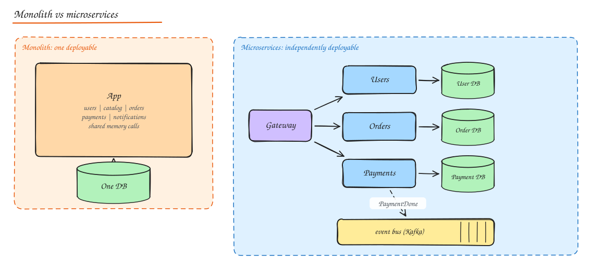
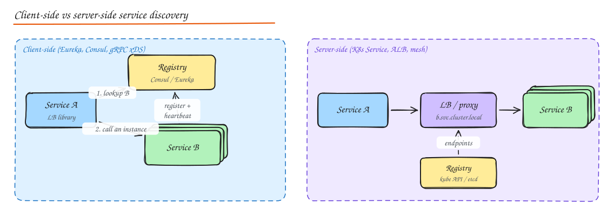
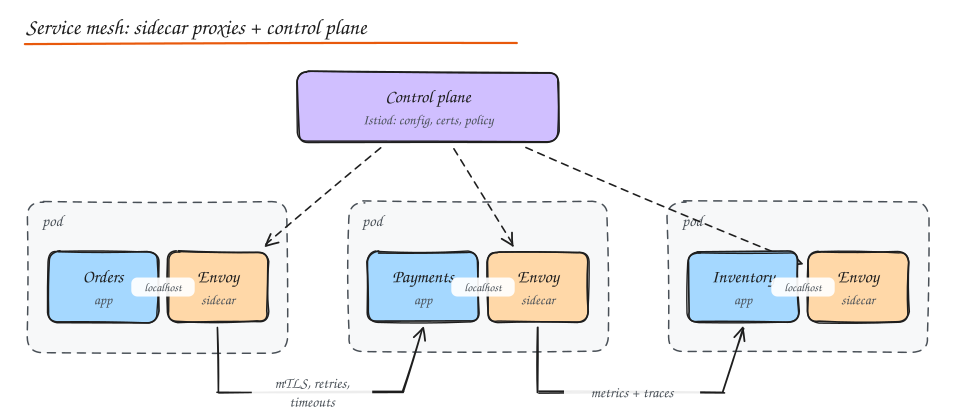
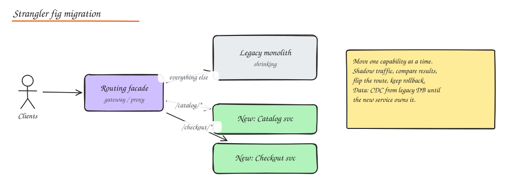

# Monolith vs Microservices

> **TL;DR**
> - Start with a modular monolith; microservices solve organizational scaling at a real operational cost.
> - Draw service boundaries around business capabilities (bounded contexts), each owning its data.
> - Prefer events for state changes across services and keep synchronous call chains short.
> - Migrate gradually with the strangler fig pattern.

## Monolith

A single deployable unit containing all modules, usually with one database.

**Characteristics**: one codebase, one build, one process (scaled by running copies), in-process function calls, shared DB transactions.

**Advantages**

- Simple to develop, test, debug and deploy early on.
- Fast in-process calls, no network failures between modules.
- ACID transactions across the whole domain.
- Easy refactoring across module boundaries (one IDE, one repo).
- Lower operational overhead: one pipeline, one thing to monitor.

**Disadvantages (as it grows)**

- Coupling creeps in; one change can break unrelated features.
- Long build/test cycles; deploy everything for any change; risky big releases.
- Scale everything together even if only one module is hot.
- One bad module (memory leak, CPU spin) takes everything down.
- Many teams in one codebase step on each other; locked into one tech stack.

**When to use**: new products, small teams (< ~20 to 30 engineers), unclear domain boundaries, need for speed. Shopify, Stack Overflow, Basecamp run large, successful monoliths.

### Modular monolith

The pragmatic middle ground: one deployable, but strict internal modules with explicit interfaces, separate schemas/tables per module, and enforced dependency rules (no reaching into another module's tables). It gives most of the design benefits of microservices without the distributed systems tax, and makes later extraction easy.

## Microservices

An application built as a suite of small services, each **owning one business capability and its data**, independently deployable, communicating over the network.

### Core concepts

- **Single responsibility around a business capability** (orders, payments, catalog), not technical layers.
- **Independent deployability**: a team can ship its service without coordinating a release train.
- **Decentralized data**: each service owns its database; no shared tables.
- **Smart endpoints, dumb pipes**: logic in services, not in the bus.
- **Design for failure**: every remote call can fail or be slow.
- **Team ownership**: "you build it, you run it". Conway's law: system structure mirrors org structure, so design teams and services together (inverse Conway maneuver).

### Drawing service boundaries

Use **Domain-Driven Design**:

- Find **bounded contexts**: areas where a term has one consistent meaning. "Product" in Catalog (descriptions, images) differs from "Product" in Inventory (stock levels) and in Billing (price, tax code).
- Each bounded context is a service candidate; contexts communicate through explicit contracts (APIs, events) and translate models at the boundary (anti-corruption layer).
- Good boundaries: high cohesion inside, low coupling outside, few synchronous calls across, transactions stay inside one service.

Smells of bad boundaries:

- A user request needs synchronous calls through 5 services in a chain.
- Two services must always be deployed together (**distributed monolith**).
- Services share a database or read each other's tables.
- Lots of cross-service transactions or sagas for simple operations.
- "Nanoservices": one service per entity or per CRUD operation.

### Communication

| Style | Examples | Use when | Watch out for |
|---|---|---|---|
| Synchronous request/response | REST, gRPC | Caller needs the answer now (query, validation) | Temporal coupling: availability multiplies, latency adds up; use timeouts, retries, circuit breakers |
| Asynchronous messaging | Kafka, SQS, RabbitMQ | Notify others of facts, long running work, decoupling | Eventual consistency, duplicates, ordering, debugging |
| Hybrid | Sync for queries, async events for state changes | Most real systems | |

Prefer **events for state changes across boundaries** ("OrderPlaced") and **synchronous calls for queries** where freshness matters. Avoid long synchronous chains.

### Database per service

Each service has its own schema or database, accessed only through its API.

- Pros: loose coupling, independent schema evolution, choose the best store per service (polyglot persistence), isolated scaling and failure.
- Cons: no cross-service joins (compose in an API layer, or replicate data via events into local read models), no cross-service ACID transactions (use **sagas** and the **outbox** pattern), harder reporting (stream everything into a warehouse).

See [Distributed Transactions](../03-data/06-distributed-transactions.md) and [CQRS](02-event-driven-cqrs-event-sourcing.md).

### API gateway

Single entry point for external clients: routing, auth, rate limiting, aggregation, protocol translation. See [Proxies and API Gateway](../02-building-blocks/05-proxies-api-gateway.md).

### Service discovery

Instances come and go (autoscaling, deploys). Callers need current addresses.

- **Client-side discovery**: the client queries a registry (Consul, Eureka, etcd) and load balances itself (Netflix Ribbon, gRPC with xDS). Fewer hops; logic in every client library.
- **Server-side discovery**: the client calls a stable name; a load balancer or proxy resolves it (Kubernetes Services + kube-proxy, AWS ALB, mesh sidecars). Simple clients; one more hop.
- **Registration**: self-registration with heartbeats/TTL, or platform registration (Kubernetes knows its pods).
- DNS based discovery is common but TTL caching slows updates.

### Service mesh

A dedicated infrastructure layer for service-to-service traffic, usually a **sidecar proxy** (Envoy) beside every service instance plus a **control plane**.

Features without app code changes: **mTLS** everywhere with automatic cert rotation, retries, timeouts, circuit breaking, outlier detection, traffic splitting (canaries), fault injection, rich metrics and traces, authorization policies.

| | Istio | Linkerd |
|---|---|---|
| Proxy | Envoy (feature rich) | linkerd2-proxy (Rust, lightweight) |
| Strength | Most features, flexible traffic management, ambient (sidecarless) mode | Simplicity, low overhead, easy ops |
| Cost | Complexity, resource use | Fewer advanced features |

Costs: added latency (~1 ms per hop), CPU/memory for sidecars, operational complexity. Worth it with many services and strict security requirements; overkill for a handful.

### Distributed tracing

A request crossing 10 services needs one view. Each service propagates a **trace context** (`traceparent` header with trace ID and parent span ID); each unit of work is a **span**. Collect with OpenTelemetry, store in Jaeger/Tempo/Zipkin/Datadog. See [Observability](../06-reliability-ops/02-observability.md).

## Challenges and solutions

| Challenge | Solutions |
|---|---|
| Distributed transactions | Sagas, outbox, idempotency, design boundaries so transactions stay local |
| Debugging across services | Distributed tracing, correlation IDs in logs, centralized logging |
| Monitoring | Golden signals per service, SLOs, dependency dashboards |
| Deployment complexity | CI/CD per service, containers + Kubernetes, GitOps, progressive delivery |
| Network failures and latency | Timeouts, retries with backoff and jitter, circuit breakers, bulkheads, caching, fewer sync hops |
| Data consistency and reporting | Events, CDC to a warehouse, CQRS read models |
| Contract changes | Versioned APIs, consumer driven contract tests (Pact), schema registry |
| Testing | Contract tests, component tests with fakes, a few end to end tests, testing in production with canaries |
| Local development | Docker Compose, dev environments, service virtualization |
| Ownership sprawl | Service catalog (Backstage), clear owners, platform team golden paths |

## When to choose what

| Signal | Favour |
|---|---|
| Small team, new product, evolving domain | Monolith (modular) |
| Many teams blocked on each other's releases | Microservices along team boundaries |
| Parts with wildly different scaling or tech needs (ML inference, video transcoding) | Extract those parts |
| Strong compliance isolation needed (payments PCI scope) | Separate service |
| No CI/CD, no observability, no on-call maturity | Not ready for microservices |

## Migrating: strangler fig

Put a routing facade in front of the monolith, build new capabilities (or extract old ones) as services one at a time, and route their paths to the new services until the monolith withers. Extract the module with the clearest boundary and the most painful change rate first. Move the data last (CDC from the legacy DB in the meantime).

## Interview questions

Your company has 8 engineers and wants microservices. What do you advise?

Start with a modular monolith: clear modules with explicit interfaces and separate schemas, one deploy pipeline, good tests and observability. Microservices solve organizational scaling problems (many teams, independent deploys) at a high operational cost that 8 engineers would pay daily. Extract a service only when there is a concrete reason: different scaling profile, isolation requirement, or a team boundary.

What is a distributed monolith and how do you recognize one?

Services that are physically separate but logically coupled: they share a database, must be deployed in lockstep, call each other synchronously in long chains, or break when another changes. You get all the costs of distribution (network failures, latency, ops) with none of the benefits (independent deploys, isolation). Fix by redrawing boundaries around business capabilities, owning data per service, and using events instead of chatty sync calls.

How do you get a customer's order history with product names when orders and catalog are separate services?

Options: (1) the API layer calls orders, then batch-fetches product names from catalog (simple, adds latency and coupling); (2) store a snapshot of the product name and price on the order line at purchase time (often correct anyway: the receipt should show what was bought); (3) maintain a local read model in the order service populated by catalog events. Option 2 is usually the best domain answer.

## Related

- [Event-Driven Architecture, CQRS, Event Sourcing](02-event-driven-cqrs-event-sourcing.md)
- [Architecture Styles](03-architecture-styles.md)
- [Resilience Patterns](../06-reliability-ops/01-resilience-patterns.md)
