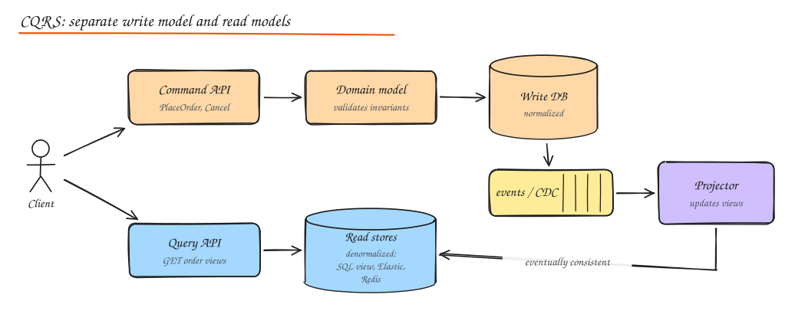
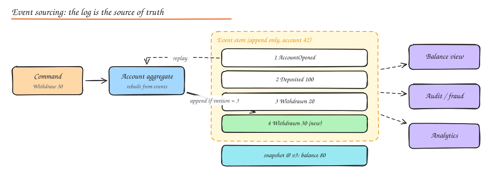

# Event-Driven Architecture, CQRS and Event Sourcing

> **TL;DR**
> - Event-driven systems communicate through facts ("OrderPlaced"), so producers and consumers stay decoupled.
> - CQRS separates the write model from read models shaped for each query; reads are eventually consistent.
> - Event sourcing stores every change as an event and rebuilds state by replaying them: full audit and time travel, at a complexity cost.
> - Most systems need events and maybe CQRS; few need full event sourcing.

## Event-driven architecture (EDA)

Components communicate by producing and reacting to **events**: immutable facts about something that happened (`OrderPlaced`, `PaymentFailed`, `UserSignedUp`).

Parts:

- **Event sources (producers)**: services, databases via CDC, IoT devices, user clicks.
- **Event brokers / channels**: Kafka, Pulsar, Kinesis, SNS/SQS, EventBridge, RabbitMQ. Durable, ordered per partition, fanout to many consumers.
- **Event processors (consumers)**: services that react: send email, update a read model, start a workflow, compute analytics.
- **Event streaming**: continuous processing of event streams (Kafka Streams, Flink) for aggregations, joins, enrichment, alerts.

Benefits: loose coupling (producers do not know consumers), easy to add new consumers, natural audit trail, absorbs load spikes, enables real time features.

Costs: eventual consistency, harder to follow a flow end to end, duplicates and ordering issues, schema evolution, and the risk of "event spaghetti" where nobody understands the chain reactions.

### Kinds of events

| Pattern | Event contains | Consumer behaviour | Trade-off |
|---|---|---|---|
| **Event notification** | Minimal: `{order_id, type}` | Calls back the source for details | Small events, but callbacks add load and coupling |
| **Event-carried state transfer** | The relevant state: `{order_id, items, total, status}` | Keeps a local copy, no callback | Bigger events, data duplication, consumers fully decoupled at runtime |
| **Event sourcing** | Every state change, as the source of truth | Rebuild state by replaying | Powerful but complex (below) |
| **Domain events vs integration events** | Internal to a bounded context vs published contracts for others | | Keep integration events stable and versioned |

### Choreography vs orchestration

Covered in depth in [Distributed Transactions](../03-data/06-distributed-transactions.md#sagas): choreography (services react to each other's events) scales organizationally for simple flows; orchestration (a workflow engine drives steps) keeps complex flows understandable.

## CQRS (Command Query Responsibility Segregation)

Use **different models** for updating data (commands) and reading data (queries).



- **Command side (write model / domain model)**: validates business rules and invariants, normalized, optimized for consistency. Commands are intentions: `PlaceOrder`, `CancelOrder`. They return success/failure, not data.
- **Query side (read models / query models)**: denormalized views shaped for each screen or API (a SQL view, an Elasticsearch index for search, a Redis hash for the dashboard). Updated from events or CDC.
- **Eventual consistency** between them: a read right after a write may not see it yet. Handle with UI tricks (optimistic display), read your own writes from the write side, or version checks.

### Why bother

- Reads and writes have very different shapes and scale (100:1 read heavy). Each side scales and is optimized independently.
- Complex domains: the write model stays clean (rich domain logic), while read models can be flattened without corrupting it.
- Multiple read representations of the same data (search, analytics, mobile summary).

### When not to

- Simple CRUD where reads match writes: CQRS adds pointless moving parts.
- When the business cannot tolerate any read lag and you cannot work around it.

### Implementation patterns

1. **Same database, separate models**: different code paths and maybe SQL views/materialized views. Cheapest step.
2. **Separate read store fed by CDC or events**: write to Postgres; Debezium streams changes; projectors update Elasticsearch/Redis.
3. **Full CQRS + event sourcing**: the write side stores events; projections build all read models.

## Event sourcing

Store the **sequence of events** that changed an entity instead of only its current state. Current state = fold over events.



```text
AccountOpened(id=42)
Deposited(100)
Withdrawn(20)
Withdrawn(30)
=> balance = 50
```

How it works:

- An **aggregate** (consistency boundary, e.g. one account) handles a command by loading its events, rebuilding state, validating, and appending new events.
- **Optimistic concurrency**: append only if the stream's version is still the one you loaded (`expected_version = 3`), otherwise retry. This replaces row locks.
- **Snapshots** every N events avoid replaying long histories.
- **Projections** subscribe to the event stream and build read models (CQRS query side).
- Stores: EventStoreDB, Kafka (with care: per aggregate reads are awkward), Postgres tables (`stream_id, version, type, payload` with a unique `(stream_id, version)`), DynamoDB, Axon.

Benefits:

- Complete **audit log** for free (finance, healthcare, legal).
- **Time travel**: reconstruct state at any past moment; debug by replaying.
- New read models can be built later by replaying history.
- Natural fit for event-driven integration.

Costs and pitfalls:

- **Schema evolution of events** is forever: you must read old event versions (upcasters, versioned event types).
- Queries need projections; ad hoc queries on current state are hard without them.
- Eventual consistency of read models.
- GDPR "right to be forgotten" conflicts with immutable logs (crypto shredding: encrypt personal data per user and delete the key).
- Steep learning curve; overkill for most CRUD domains.

Use it where history **is** the domain: ledgers, banking, order lifecycles, inventory movements, collaborative editing, workflow engines.

## Saga pattern for distributed transactions

Event-driven systems implement multi-service business transactions as sagas: a sequence of local transactions with compensations, coordinated by events (choreography) or an orchestrator. See the full treatment in [Distributed Transactions](../03-data/06-distributed-transactions.md).

## Interview questions

<details>
<summary>What is the difference between CQRS and event sourcing? Do you need both?</summary>

CQRS separates the write model from read models. Event sourcing stores state as a log of events. They pair well (events feed projections that become read models) but are independent: you can do CQRS with a normal relational write model plus CDC into read stores, and you can event source without separate read databases (querying projections in the same DB). Most systems that need CQRS do not need event sourcing.

</details>

<details>
<summary>In an event sourced system, how do you handle a bug that wrote wrong events?</summary>

Events are immutable, so you append **compensating/correcting events** (for example `BalanceCorrected`) rather than editing history. If projections were wrong due to a projector bug, fix the projector and rebuild the read model by replaying events into a fresh projection, then swap.

</details>

<details>
<summary>How do you keep event consumers from breaking when the producer adds a field or changes an event?</summary>

Treat integration events as public contracts: use a schema registry with compatibility checks, only make additive changes (optional fields with defaults), version event types for breaking changes and publish both during migration, and make consumers tolerant readers that ignore unknown fields.

</details>

## Related

- [Message Queues and Streams](../02-building-blocks/07-message-queues.md)
- [Monolith vs Microservices](01-monolith-vs-microservices.md)
- [Stream and Batch Processing](../10-advanced/02-stream-batch-processing.md)
