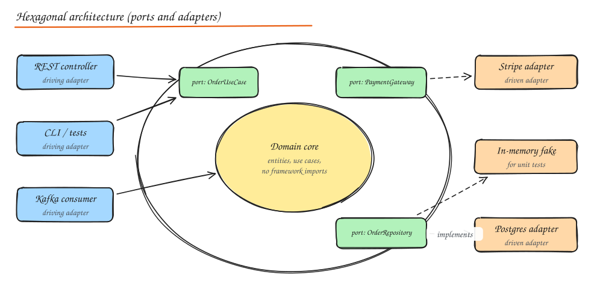
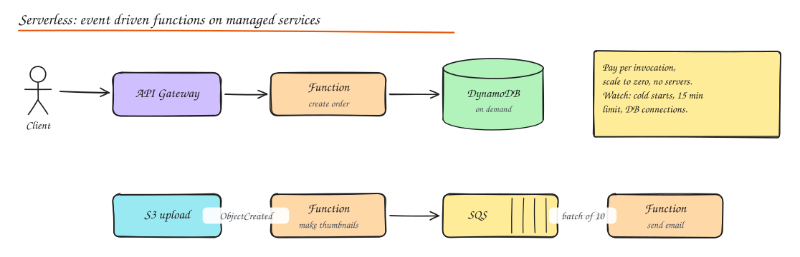

# Architecture Styles

> **TL;DR**
> - Layered, hexagonal (ports and adapters) and clean architecture organize code inside a service; dependencies point inward to the domain.
> - Hexagonal design makes business logic testable with in-memory fakes and lets you swap technology at the edges.
> - Serverless runs code without servers and scales to zero; watch cold starts, time limits and DB connections.
> - Serverless fits spiky and glue workloads; steady high-volume traffic is usually cheaper on containers.

Two different questions often get mixed up:

1. **How is the code inside one service organized?** Layered, hexagonal, clean, onion, MVC.
2. **How is the system deployed and run?** Monolith, microservices, serverless, event-driven.

## Code organization styles

### Layered (n-tier)

```text
Presentation (controllers, views)
      |
Application / service layer (use cases, transactions)
      |
Domain (entities, business rules)
      |
Infrastructure / persistence (repositories, DB, external APIs)
```

Each layer depends only on the one below. Familiar and simple. Risk: business logic leaks into controllers or SQL, and the domain ends up depending on the database (the "anemic domain model" where entities are just data bags).

### Hexagonal architecture (ports and adapters)

Put the **domain core** in the middle with no dependency on frameworks, databases or transport. The core defines **ports** (interfaces); **adapters** implement them for specific technologies.



- **Driving (primary) adapters** call into the core: REST controllers, gRPC handlers, CLI, message consumers, tests.
- **Driven (secondary) adapters** are called by the core through ports: repositories (Postgres, Mongo), payment gateways (Stripe), email senders, clocks.
- Dependency rule: **adapters depend on the core, never the other way around** (dependency inversion).

Benefits:

- **Testability**: unit test the whole domain with in-memory fakes for ports; no DB or network.
- Swap technology (Postgres to DynamoDB, REST to gRPC) by writing a new adapter.
- Business rules are readable in one place.

```python
# port (owned by the core)
class OrderRepository(Protocol):
    def get(self, order_id: str) -> Order: ...
    def save(self, order: Order) -> None: ...

# core use case: no framework imports
class CancelOrder:
    def __init__(self, repo: OrderRepository, payments: PaymentGateway):
        self.repo, self.payments = repo, payments

    def __call__(self, order_id: str) -> None:
        order = self.repo.get(order_id)
        order.cancel()                      # domain rule: only PLACED orders can be cancelled
        self.payments.refund(order.payment_id, order.total)
        self.repo.save(order)

# driven adapter
class PostgresOrderRepository(OrderRepository): ...
# test adapter
class InMemoryOrderRepository(OrderRepository): ...
```

### Clean architecture and onion architecture

Variations on the same idea, drawn as concentric circles: **Entities** (enterprise rules) inside **Use cases** (application rules) inside **Interface adapters** (controllers, presenters, gateways) inside **Frameworks and drivers** (web, DB, UI). The dependency rule points inward. Onion architecture is nearly identical in spirit (domain model at the center, domain services, application services, infrastructure outside).

**Screaming architecture**: the top level folder structure should scream the domain (`orders/`, `billing/`, `shipping/`), not the framework (`controllers/`, `models/`, `views/`).

### MVC, MVP, MVVM (UI patterns)

| Pattern | Roles | Typical place |
|---|---|---|
| **MVC** | Model (data, rules), View (render), Controller (handles input, updates model, picks view) | Server-side web frameworks (Rails, Spring MVC, Django's MTV) |
| **MVP** | Presenter holds presentation logic; passive View interface | Android (older), WinForms; very testable |
| **MVVM** | ViewModel exposes observable state; View binds to it (data binding) | WPF, SwiftUI, Jetpack Compose, Angular, Vue |

### Which to use

- Small CRUD service: layered is fine.
- Rich domain logic, long lived service, many integrations: hexagonal/clean.
- Don't add ports for things that will never change and add no test value; pragmatism beats purity.

## Serverless architecture

Run code without managing servers: the platform provisions, scales (including to zero) and bills per use.



### Function-as-a-Service (FaaS)

| Platform | Notes |
|---|---|
| **AWS Lambda** | Up to 15 min per invocation, up to 10 GB memory, many event sources (API Gateway, S3, SQS, DynamoDB Streams, EventBridge, Kinesis) |
| **Azure Functions** | Consumption, Premium (pre-warmed), Dedicated plans; Durable Functions for workflows |
| **Google Cloud Functions / Cloud Run** | Cloud Run runs any container with scale to zero and request concurrency, often a better fit than pure functions |
| **Cloudflare Workers / Vercel / Netlify functions** | Edge runtimes, V8 isolates, millisecond cold starts, tighter limits |

Serverless is broader than FaaS: managed queues (SQS), databases (DynamoDB, Aurora Serverless, Firestore), storage (S3), API gateways, and workflows (Step Functions) are all serverless building blocks.

### Cold starts

When no warm instance exists, the platform must create an environment, load the runtime and your code, and run initialization: from ~50 ms (small Node/Python, edge isolates) to several seconds (large JVM/.NET packages, functions attached to VPCs in older setups).

Warm start optimizations:

- Keep packages small; lazy load heavy dependencies; prefer lighter runtimes for latency critical paths.
- Do expensive init (SDK clients, DB connections) **outside the handler** so warm invocations reuse it.
- **Provisioned concurrency** (Lambda) or minimum instances (Cloud Run) keep instances warm, at a cost.
- SnapStart (Lambda for Java and others) snapshots an initialized environment.
- Avoid chaining many functions synchronously; each hop may cold start.

### Pricing model

Pay per request plus **GB-seconds** (memory x duration), plus data transfer and the other managed services you call. Nothing when idle.

- Excellent for spiky, low or unpredictable traffic, and for glue code.
- At sustained high throughput, containers or VMs are often much cheaper; do the math (requests/s x avg duration x memory).

### Limitations and constraints

- Max execution time (15 min Lambda), payload limits (6 MB sync Lambda), ephemeral local disk.
- **Stateless**: keep state in external stores.
- **Database connections**: thousands of concurrent functions can exhaust a relational DB. Use RDS Proxy / PgBouncer, HTTP based data APIs, or DynamoDB.
- Concurrency limits per account/region (throttling).
- Vendor lock-in through triggers and service integrations.
- Observability and local testing are harder; distributed tracing is essential.
- Not suited for long lived connections (use managed WebSocket APIs) or heavy GPU work (mostly).

### Best use cases

- Event processing: thumbnails on S3 upload, file conversions, webhook handlers.
- Spiky or low traffic APIs, internal tools, prototypes.
- Scheduled jobs (cron) and automation glue.
- Stream processing of moderate volume (Kinesis/DynamoDB Streams triggers).
- Fanout of async tasks from a queue.

## Interview questions

<details>
<summary>Why does hexagonal architecture make testing easier?</summary>

The domain core depends only on interfaces (ports) it defines. In tests you plug in in-memory adapters (fake repository, fake payment gateway, fixed clock), so business rules can be tested fast, deterministically, without databases, networks or frameworks. Integration tests then verify each real adapter against its port contract separately.

</details>

<details>
<summary>Would you build a 20k requests/s steady API on Lambda?</summary>

Probably not as the default. At sustained high load, per-invocation pricing usually exceeds the cost of containers on reserved or spot capacity, cold starts and concurrency limits add risk, and DB connection management gets hard. Lambda shines for spiky or low traffic and event glue. I would run the steady API on containers (ECS/Kubernetes/Cloud Run with min instances) and still use functions for async side tasks.

</details>

<details>
<summary>How do you mitigate cold starts for a latency sensitive serverless endpoint?</summary>

Provisioned concurrency or minimum instances for the expected baseline, smaller deployment packages and lighter runtimes, initialization outside the handler, snapshot based startup where available (SnapStart), avoiding synchronous function chains, and keeping a fallback path warm. Measure p99 including cold starts, not just warm latency.

</details>

## Related

- [Monolith vs Microservices](01-monolith-vs-microservices.md)
- [LLD: OOP and SOLID](../08-lld/01-oop-solid-principles.md)
- [Deployment and Cost](../06-reliability-ops/04-deployment-and-cost.md)
