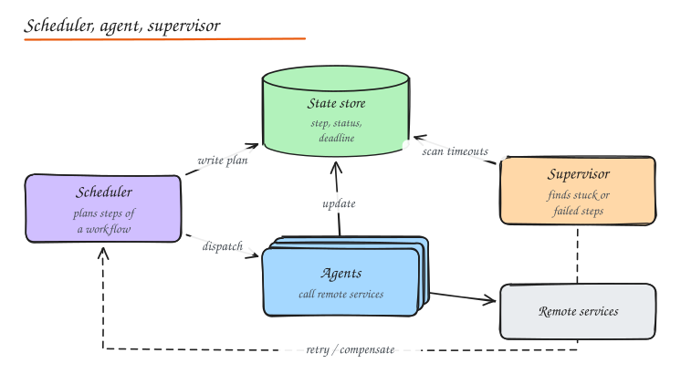
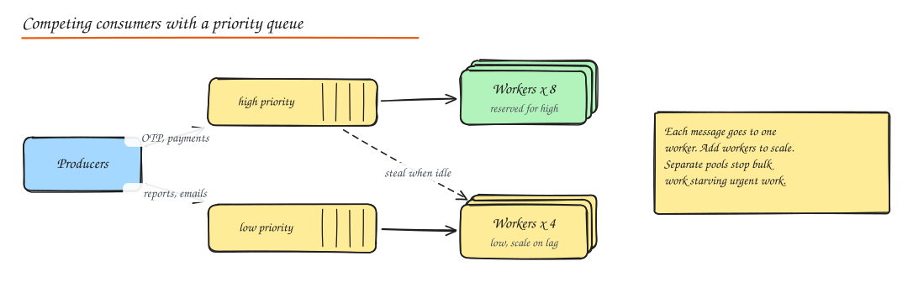
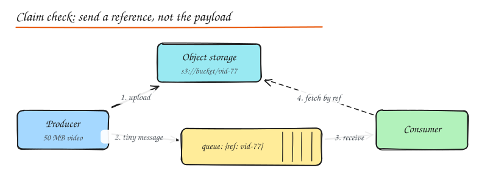

# Cloud and Integration Patterns Catalog

> **TL;DR**
> - Patterns are named solutions to recurring problems; naming them in an interview ("claim check", "competing consumers") communicates a lot in a few words.
> - **Integration patterns** connect systems: queues, pub/sub, events, sagas, gateways, adapters, facades, strangler fig.
> - **Cloud patterns** keep distributed systems alive under load and failure: timeouts, retries, circuit breakers, bulkheads, throttling, load leveling, leader election.
> - Each pattern has a cost. Use it when the problem exists, not because it sounds senior.

## Integration patterns

| Pattern | Problem it solves | How | Deep dive |
|---|---|---|---|
| **Message queue** | Hand off work, absorb spikes | Producer enqueues, one consumer processes each message | [Message Queues](../02-building-blocks/07-message-queues.md) |
| **Publish-subscribe** | Many systems react to one fact | Topic fans out a copy to each subscriber | [Message Queues](../02-building-blocks/07-message-queues.md) |
| **Event-driven** | Decouple producers from consumers entirely | Services emit facts; others react | [Event-Driven](02-event-driven-cqrs-event-sourcing.md) |
| **Saga (choreography)** | Multi-service transaction, few steps | Each service reacts to the previous event and emits the next; compensations on failure | [Distributed Transactions](../03-data/06-distributed-transactions.md) |
| **Saga (orchestration)** | Multi-service transaction, many steps, timeouts | A workflow engine drives each step and compensation | same |
| **Strangler fig** | Replace a legacy system without a big bang | Route capability by capability to the new system behind a facade | [Monolith vs Microservices](01-monolith-vs-microservices.md) |
| **API gateway** | One entry point for many services | Routing, auth, rate limits, aggregation at the edge | [API Gateway](../02-building-blocks/05-proxies-api-gateway.md) |
| **Adapter (anti-corruption layer)** | Integrate a system with an incompatible model | Translate requests and models at the boundary | [Design Patterns](../08-lld/02-design-patterns.md) |
| **Facade** | Simplify a complex subsystem for callers | One coarse-grained interface over many calls | [Design Patterns](../08-lld/02-design-patterns.md) |
| **Transactional outbox** | Update a DB and publish an event atomically | Write the event to an outbox table in the same transaction; relay publishes it | [Distributed Transactions](../03-data/06-distributed-transactions.md) |

## Cloud design patterns

### Resilience

| Pattern | When | Key settings | Pitfall |
|---|---|---|---|
| **Timeout** | Every remote call | Based on the dependency's p99.9; propagate deadlines | No timeout = one slow dependency hangs everything |
| **Retry** | Transient failures (timeouts, 503, 429) | Exponential backoff + jitter, max 3 to 5 attempts, retry budget | Retrying non-idempotent calls; retries at every layer multiply load |
| **Circuit breaker** | A dependency is failing repeatedly | Failure-rate threshold, cooldown, half-open probes | Breaker per request instead of per dependency |
| **Bulkhead** | One dependency must not exhaust shared resources | Separate pools/semaphores per dependency or tenant | Pools too small cause self-inflicted rejections |
| **Queue-based load leveling** | Bursty producers, steady consumers | Bounded queue between them, autoscale consumers on lag | Unbounded queue hides a capacity problem until memory runs out |
| **Throttling** | Protect the system or enforce fair use | Per-tenant or per-feature limits, degrade gracefully | Throttling critical traffic with the same rules as bulk |

Details: [Resilience Patterns](../06-reliability-ops/01-resilience-patterns.md), [Rate Limiting](../02-building-blocks/08-rate-limiting.md).

### Coordination

**Leader election.** Several instances run, but one must do a singleton job (a scheduler, a compaction, a partition owner). Use a lease in etcd, ZooKeeper, Consul or a Kubernetes Lease object; the holder renews it; others take over when it expires. Always pair with **fencing tokens** so a paused old leader cannot keep writing. See [Consensus and Clocks](../10-advanced/01-consensus-and-clocks.md).

**Scheduler, agent, supervisor.** Coordinate a multi-step workflow that calls remote services, and recover from failures automatically.

- The **scheduler** breaks the job into steps and records them in a durable state store.
- **Agents** execute steps against remote services and record results.
- The **supervisor** periodically scans for steps that are stuck past their deadline or failed, and retries them or triggers compensation.

Workflow engines (Temporal, AWS Step Functions, Cadence) implement this pattern for you.

### Messaging

**Competing consumers.** Many workers read from the same queue; each message is processed by one of them. Throughput scales by adding workers; a crashed worker's message becomes visible again and another worker takes it.

**Priority queue.** Separate queues (or priorities within one broker) so urgent messages are not stuck behind bulk work. Reserve consumer capacity for the high-priority queue.

**Claim check.** Message brokers are bad at large payloads (size limits, memory, cost). Store the payload in object storage and send only a reference (the "claim check").

**Dead letter queue (DLQ).** After N failed processing attempts, move the message to a separate queue with error details, so one poison message does not block or loop forever. Alert on DLQ depth and build a replay tool.

### Other patterns worth naming

| Pattern | One line |
|---|---|
| **Sidecar** | Helper process next to each service (proxy, log shipper) |
| **Ambassador** | Sidecar that handles outbound calls to one dependency |
| **Backends for Frontends** | One API layer per client type |
| **Cache-aside** | App reads cache, falls back to DB, populates cache |
| **Sharding** | Split data by key across nodes |
| **CQRS** | Separate write model and read models |
| **Event sourcing** | Store the history of changes as the source of truth |
| **Health endpoint monitoring** | Expose liveness/readiness for orchestrators and LBs |
| **Static content hosting** | Serve assets from object storage + CDN, not app servers |
| **Valet key** | Give clients a scoped, expiring token (presigned URL) to access storage directly |
| **Gateway offloading** | Move TLS, auth and compression to the gateway |
| **Compensating transaction** | Undo a completed step semantically when a later step fails |
| **Deployment stamps / cells** | Many independent copies of the full stack, each serving a subset of tenants |

## Choosing patterns in an interview

1. Name the problem first ("a slow payment provider must not take down checkout").
2. Name the pattern ("bulkhead plus circuit breaker with a fallback").
3. Give the key setting and its cost ("separate pool of 20 connections; the cost is extra configuration and possible rejections at peak").

## Interview questions

Your queue messages sometimes exceed the broker's 256 KB limit. What do you do?

Use the claim check pattern: upload the payload to object storage (or a database) and publish a small message containing the reference and metadata. Consumers fetch the payload by reference. Add lifecycle rules to delete payloads after processing, and make the consumer idempotent because the message may be redelivered.

How do you guarantee only one instance runs the nightly billing job when you have 10 replicas?

Leader election via a lease in a consensus-backed store (etcd, ZooKeeper, Kubernetes Lease, or a database row lock with expiry). The job only runs on the lease holder. Make the job idempotent and use a fencing token (or job run id with a unique constraint) so a stale leader that wakes up late cannot double-bill.

What is the difference between throttling and load shedding?

Throttling limits how much a specific client, tenant or feature may use (fairness, quotas), even when the system has spare capacity. Load shedding rejects work based on the system's own health when it is overloaded, typically starting with the least important traffic. Many systems use both.

## Related

- [Resilience Patterns](../06-reliability-ops/01-resilience-patterns.md)
- [Message Queues](../02-building-blocks/07-message-queues.md)
- [Design Patterns (GoF)](../08-lld/02-design-patterns.md)
- [Architecture Styles](03-architecture-styles.md)
