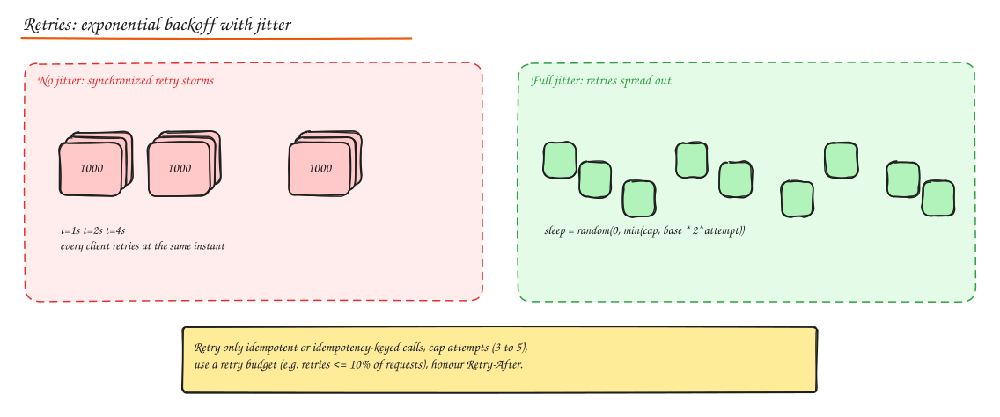
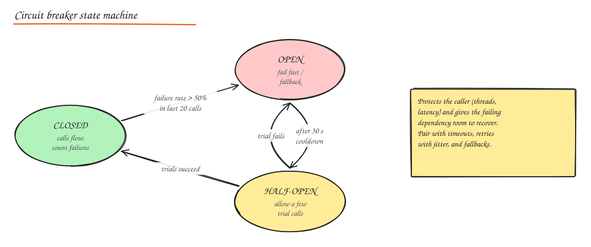
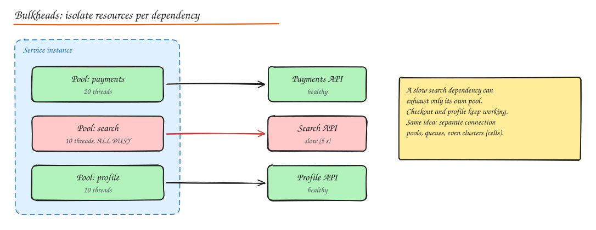

# Resilience Patterns

In a distributed system something is always failing: a slow disk, a GC pause, a bad deploy, a dropped packet, an overloaded dependency. Resilience patterns stop **local failures from becoming global outages**. The most common outage story is not "a server died"; it is "a dependency got slow, callers piled up waiting, and the whole call graph fell over" (cascading failure).

## Timeouts

Every network call needs a timeout. Without one, a hung dependency holds your threads, connections and memory forever.

- **Connect timeout** (short: 100 ms to 1 s) and **request/read timeout** (based on the dependency's p99.9 plus margin).
- **Deadline propagation**: pass the remaining time budget downstream (gRPC deadlines, a `X-Request-Deadline` header). If the caller will give up in 200 ms, the callee should not work for 2 s.
- Set timeouts from the **outside in**: the edge has the total budget (say 1 s), each layer gets less.
- Too short causes false failures and retry storms; too long ties up resources. Base on measured latency distributions.

## Retries with exponential backoff and jitter

Transient failures (a dropped connection, a 503 during a deploy) often succeed on retry.



```python
import random, time

def call_with_retries(fn, attempts=4, base=0.1, cap=2.0):
    for attempt in range(attempts):
        try:
            return fn()
        except TransientError:
            if attempt == attempts - 1:
                raise
            # "full jitter": random between 0 and the exponential ceiling
            time.sleep(random.uniform(0, min(cap, base * 2 ** attempt)))
```

Rules:

- **Only retry idempotent operations** (or ones carrying an idempotency key).
- Retry only **retryable errors**: timeouts, connection resets, 429, 502/503/504. Never retry 400/401/403/404/422.
- **Exponential backoff** spreads load over time; **jitter** prevents synchronized retry waves (thundering herd).
- **Cap attempts** (3 to 5) and the max delay.
- **Retry budgets**: limit retries to a fraction of normal traffic (for example 10%). Otherwise, during an outage, retries multiply load exactly when the dependency is weakest.
- **Retry at one layer only**. If the gateway, the service and the client library each retry 3 times, one failure becomes 27 calls (retry amplification).
- Honour `Retry-After`.

## Circuit breaker

Stop calling a dependency that is clearly failing, fail fast, and periodically probe for recovery.



- **Closed**: calls pass; track failures (error rate or slow-call rate) over a rolling window.
- **Open**: when the threshold trips (e.g. > 50% failures over the last 20 calls, with a minimum volume), calls fail immediately (or go to a fallback) for a cooldown period.
- **Half-open**: after the cooldown, allow a few trial calls. Success closes the breaker; failure reopens it.

Benefits: callers stop wasting threads on doomed calls; the struggling dependency gets breathing room; users get fast fallbacks instead of slow errors.

Libraries: Resilience4j (Java), Polly (.NET), gobreaker / hystrix-go (Go), opossum (Node), pybreaker (Python), and Envoy/Istio outlier detection at the mesh level.

Implementation sketch:

```python
import time

class CircuitBreaker:
    def __init__(self, threshold=5, cooldown=30.0):
        self.threshold, self.cooldown = threshold, cooldown
        self.failures, self.state, self.opened_at = 0, "closed", 0.0

    def call(self, fn, fallback):
        if self.state == "open":
            if time.monotonic() - self.opened_at < self.cooldown:
                return fallback()
            self.state = "half_open"
        try:
            result = fn()
        except Exception:
            self.failures += 1
            if self.state == "half_open" or self.failures >= self.threshold:
                self.state, self.opened_at = "open", time.monotonic()
            return fallback()
        self.failures, self.state = 0, "closed"
        return result
```

(Production breakers use rolling windows and failure rates, not a simple counter.)

## Bulkhead

Partition resources so one failing part cannot sink the whole ship.



- Separate thread pools / connection pools / semaphores per dependency.
- Separate queues for high and low priority work.
- Separate instances or clusters per customer tier or feature (**cell-based architecture**: independent copies of the whole stack, each serving a subset of users, so a bad deploy or poison request only hits one cell).

## Load shedding and admission control

When overloaded, it is better to **reject some requests quickly** than to serve all of them slowly (and eventually none).

- Track concurrency or queue time; reject with 503 when above limits.
- Prioritize: shed analytics, prefetches and retries before checkout and login.
- **Adaptive concurrency limits** (Netflix concurrency-limits, Envoy adaptive concurrency) find the max concurrency where latency stays healthy, using algorithms like AIMD or gradient based limits.
- Use **LIFO under overload** for queues of user requests: the oldest requests' callers probably already gave up.

## Backpressure

A slow consumer signals upstream to slow down instead of buffering infinitely.

- Bounded queues and buffers (block or reject when full).
- Reactive streams (`request(n)` demand signaling), TCP flow control, gRPC flow control.
- Consumer lag based autoscaling or throttling producers.
- Without backpressure, memory grows until the process crashes, then everything is lost.

## Queue-based load leveling

Put a queue between a bursty producer and a fixed-capacity consumer. The queue absorbs spikes; the consumer processes at a steady rate. Combine with competing consumers (scale workers with queue depth) and priority queues. The user gets "accepted" (202) instead of a timeout.

## Graceful degradation and fallbacks

Decide in advance what the product does when a dependency is unavailable:

| Feature down | Degraded behaviour |
|---|---|
| Recommendations | Show bestsellers or cached recommendations |
| Personalization | Show generic content |
| Reviews service | Hide the reviews section |
| Inventory precision | Show "in stock" from cache, verify at checkout |
| Search | Fall back to simpler DB query or a cached popular results page |
| Payments provider A | Route to provider B |

Mechanisms: **feature flags / kill switches** to turn off expensive features instantly, cached last-known-good responses (`stale-if-error`), static fallbacks, and read-only modes.

## Other useful patterns

- **Health endpoint monitoring** and synthetic checks.
- **Leader election** for singleton jobs (see [Consensus](../10-advanced/01-consensus-and-clocks.md)).
- **Scheduler-agent-supervisor**: a scheduler assigns steps, agents execute, a supervisor detects stuck or failed steps and retries or compensates.
- **Dead letter queues** for messages that keep failing.
- **Claim check**: put large payloads in storage and pass a reference.
- **Competing consumers**: many workers on one queue for throughput and resilience.
- **Throttling**: cap a tenant's or feature's resource use.
- **Chaos engineering**: deliberately inject failure (kill instances, add latency, drop an AZ) in a controlled way to verify these patterns actually work (Chaos Monkey, Gremlin, Litmus, AWS FIS).

## Putting it together

A robust client call to a dependency:

```text
deadline from caller
  -> bulkhead (semaphore for this dependency)
    -> circuit breaker (fail fast if open)
      -> timeout (per attempt)
        -> retry (max 3, backoff + jitter, idempotent only, within budget and deadline)
          -> fallback on final failure
```

## Interview questions

<details>
<summary>A downstream service's latency jumps from 50 ms to 5 s. Walk through what happens without protections and what each pattern does.</summary>

Without protections, caller threads block for 5 s each; by Little's law concurrency rises 100x, thread and connection pools exhaust, and the caller stops serving even requests that do not need the dependency; its callers then pile up too (cascade). Timeouts cap the wait; a circuit breaker opens after the slow-call rate exceeds a threshold and fails fast; a bulkhead confines the damage to that dependency's pool; fallbacks keep the page useful; load shedding protects the rest of the service; and retry budgets stop retries from multiplying load on the struggling dependency.

</details>

<details>
<summary>Why add jitter to exponential backoff?</summary>

Without jitter, all clients that failed at the same moment retry at the same moments (1 s, 2 s, 4 s), producing synchronized spikes that can knock the recovering service down again. Randomizing the delay spreads retries evenly over time.

</details>

<details>
<summary>What is the difference between a circuit breaker and a retry?</summary>

Retries assume a failure is transient and try again soon; circuit breakers assume repeated failures mean the dependency is unhealthy and stop calling it for a while. They are complementary: retry a few times for blips, but let the breaker stop retries entirely when the failure rate shows a real outage.

</details>

## Related

- [Availability and Reliability](../01-fundamentals/04-availability-reliability.md)
- [Observability](02-observability.md)
- [Rate Limiting](../02-building-blocks/08-rate-limiting.md)
- Build it: [Circuit Breaker](../11-builds/07-circuit-breaker.md)
