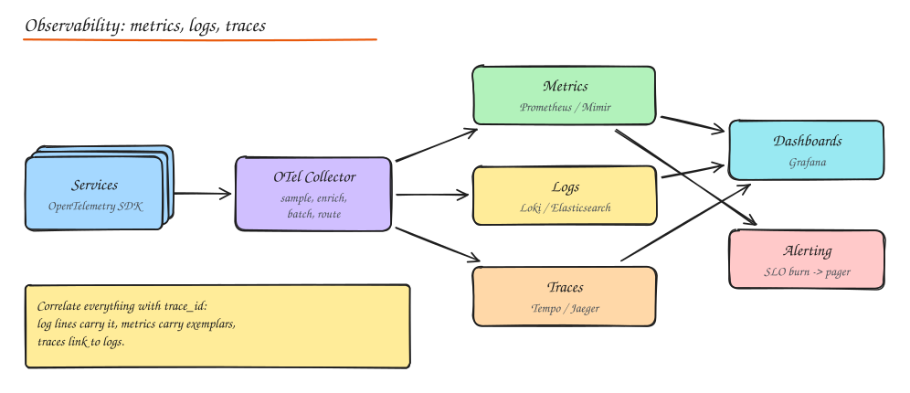
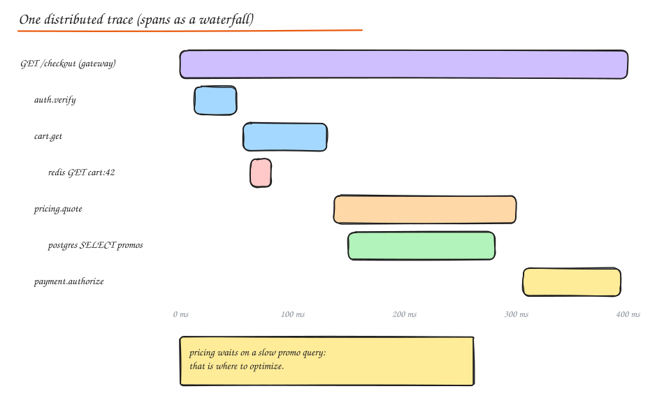

# Observability

> **TL;DR**
> - Metrics tell you something is wrong, traces tell you where, logs tell you why; correlate them with a trace id.
> - Measure the golden signals: latency, traffic, errors, saturation (RED for services, USE for resources).
> - Alert on user-facing symptoms and SLO burn rates, not on every CPU spike.
> - In incidents, mitigate first (rollback, flag, failover) and find root causes afterwards in a blameless postmortem.

**Monitoring** tells you *whether* the system is working (known failure modes, dashboards, alerts). **Observability** is the ability to ask *why* it is not working, including questions you did not anticipate, from the telemetry the system emits.



## The three pillars

| Pillar | What | Strength | Weakness | Tools |
|---|---|---|---|---|
| **Metrics** | Numeric time series with labels (`http_requests_total{route,status}`) | Cheap, fast queries, great for alerts and trends | Lose individual request detail; high cardinality labels explode cost | Prometheus, Mimir, VictoriaMetrics, Datadog, CloudWatch |
| **Logs** | Timestamped event records | Rich detail, arbitrary context | Expensive at volume, slow to search | Loki, Elasticsearch/OpenSearch, Splunk, CloudWatch Logs |
| **Traces** | The path of one request across services as a tree of spans | Shows where latency and errors come from across services | Sampling hides some requests; instrumentation effort | Jaeger, Tempo, Zipkin, Honeycomb, Datadog APM |

Plus **profiles** (continuous profiling: Pyroscope, Parca) and **events** (deploys, config changes, feature flag flips) to correlate with incidents.

**OpenTelemetry (OTel)** is the vendor-neutral standard for generating and shipping all of these: SDKs in each language, auto-instrumentation, and the **Collector** for sampling, enrichment and routing to any backend.

## Metrics collection

### What to measure

- **Four golden signals** (Google SRE): **latency** (separate successful from failed requests), **traffic** (requests/s), **errors** (rate of failures), **saturation** (how full: CPU, memory, queue depth, connection pool usage).
- **RED** for request driven services: **R**ate, **E**rrors, **D**uration.
- **USE** for resources: **U**tilization, **S**aturation, **E**rrors.
- **Business metrics**: orders/min, signups, payment success rate. Often the fastest way to detect a real problem.

### Metric types

- **Counter**: only goes up (requests, errors). Query as a rate.
- **Gauge**: goes up and down (queue depth, memory, temperature).
- **Histogram**: buckets of observations (latency). Lets you compute percentiles across instances correctly.
- **Summary**: client-side computed quantiles; cannot be aggregated across instances. Prefer histograms.

### Pull vs push

- **Pull** (Prometheus scrapes `/metrics`): central control, easy to detect dead targets, needs service discovery.
- **Push** (StatsD, OTLP push to collector): works for short-lived jobs and through firewalls.

**Cardinality** warning: every unique label combination is a separate time series. Never use user IDs, request IDs or raw URLs as metric labels; put those in logs/traces.

## Logging strategy

### Structured logging

Log JSON (or key=value), not free text, so logs are queryable:

```json
{"ts":"2026-10-15T10:42:13.120Z","level":"ERROR","service":"checkout","trace_id":"4bf92f3577b34da6",
 "user_id":"u_42","order_id":"o_9001","msg":"payment authorization failed","provider":"stripe",
 "error_code":"card_declined","latency_ms":812}
```

### Log levels

| Level | Use for |
|---|---|
| ERROR | Something failed and needs attention (a request failed, data inconsistency) |
| WARN | Unexpected but handled (retry succeeded, fallback used, deprecated API called) |
| INFO | Significant business or lifecycle events (service started, order placed) |
| DEBUG | Detailed diagnostic info, off in production or sampled |
| TRACE | Very fine grained, local debugging only |

Guidelines:

- Always include **trace_id / request_id** and key business IDs.
- Never log secrets, tokens, passwords, full card numbers or unnecessary PII (mask or hash).
- Log at boundaries (incoming request, outgoing call, errors), not every line.
- **Aggregate centrally** (Fluent Bit / Vector / OTel Collector to Loki/Elasticsearch), with retention tiers (hot 7 to 14 days, cold archive in object storage).
- **Sample** noisy success logs at high volume; keep all errors.
- Use **error tracking** (Sentry, Rollbar) for grouped exceptions with stack traces and **source maps** for minified frontend code.

## Distributed tracing



- A **trace** is one end to end request; it is a tree of **spans** (one unit of work: an HTTP handler, a DB query, a cache call) with start time, duration, attributes, status, and parent span ID.
- **Context propagation**: the W3C `traceparent` header (`00-<trace-id>-<span-id>-<flags>`) carries IDs across HTTP/gRPC calls; messaging systems carry it in message headers.
- **Sampling**:
  - **Head-based**: decide at the start (e.g. keep 1%). Cheap, but may miss rare errors.
  - **Tail-based**: buffer the whole trace in the collector and decide at the end (keep all errors and slow traces, sample the rest). Better signal, more infrastructure.
- Traces answer: which service added the latency? Is the N+1 query here? Which dependency is failing for this tenant?

## Alerting

Alert on **symptoms users feel**, not on every cause.

- Bad: "CPU > 80% on host-17" (might be fine). Good: "checkout error rate above SLO burn threshold".
- **SLO-based alerting with burn rates**: page when the error budget is burning fast (e.g. 2% of the monthly budget in 1 hour, a 14.4x burn rate) and ticket when it burns slowly (e.g. 10% in 3 days). Use multi-window checks to avoid flapping.
- Every page must be **actionable**, urgent and linked to a **runbook**.
- Route by severity: page (wake someone), ticket (fix this week), log (no alert).
- Watch alert fatigue: if on-call ignores alerts, alerts are broken.

## Dashboards

- One **service overview** per service: golden signals, SLO status, dependencies, saturation.
- **Top-level user journey** dashboards (login, search, checkout).
- Annotate deploys and flag changes on graphs.
- Keep dashboards few and curated; use ad hoc exploration for investigations.

## Incident response

1. **Detect**: alerts, user reports, synthetic checks.
2. **Triage and declare**: severity level, assign an **incident commander**, open a channel, communicate status (status page).
3. **Mitigate first, fix later**: roll back the deploy, flip the feature flag, fail over, shed load, scale up. Restoring service beats finding root cause.
4. **Resolve** and monitor for recurrence.
5. **Blameless postmortem**: timeline, impact, root causes and contributing factors, what went well, action items with owners. Focus on systems and processes, not individuals.

Metrics: MTTD (detect), MTTA (acknowledge), MTTR (recover).

## Interview questions

<details>
<summary>How would you monitor a new checkout service?</summary>

RED metrics per endpoint (rate, error rate, latency histograms), saturation (pool usage, queue depth, CPU/memory), dependency metrics (payment provider latency and error rates), business metrics (checkouts completed per minute, payment success rate), structured logs with trace and order IDs, distributed tracing across cart, pricing, inventory and payments, an SLO (e.g. 99.9% of checkouts succeed in under 2 s) with burn-rate alerts, and a dashboard annotated with deploys.

</details>

<details>
<summary>Why not alert on CPU usage?</summary>

High CPU is not necessarily user impact (batch work, efficient utilization), and low CPU does not mean healthy (deadlocks, dependency failures). Alert on symptoms tied to SLOs (errors, latency, availability as users experience them) and use resource metrics for diagnosis and capacity planning, maybe with non-paging warnings for saturation trends.

</details>

<details>
<summary>Head-based vs tail-based sampling?</summary>

Head-based decides when the trace starts, so it is cheap and simple but keeps a random subset, often missing rare errors and slow outliers. Tail-based waits until the trace completes and keeps interesting ones (errors, high latency, specific tenants) plus a baseline sample, which needs collectors that buffer complete traces (more memory, routing by trace ID).

</details>

## Related

- [Availability and SLOs](../01-fundamentals/04-availability-reliability.md)
- [Resilience Patterns](01-resilience-patterns.md)
- [Microservices (distributed tracing)](../05-architecture/01-monolith-vs-microservices.md)
