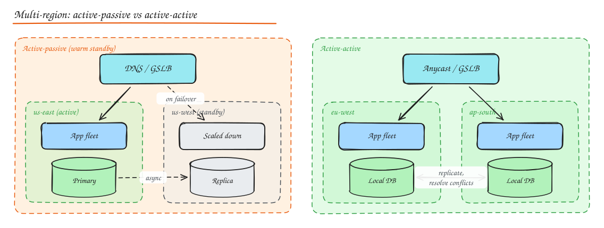

# Disaster Recovery and Multi-Region

> **TL;DR**
> - RTO is how long you can be down; RPO is how much data you can lose. Both are business decisions with cost curves.
> - Replication is not a backup: it copies mistakes too. Keep point-in-time and immutable backups and test restores.
> - DR strategies range from backup-and-restore (cheap, slow) to active-active (fast, expensive).
> - Multi-region is hard because of data: decide what needs strong consistency and how conflicts resolve.

High availability handles **routine** failures (an instance, a disk, an AZ). Disaster recovery (DR) handles **rare, large** ones: a region outage, a ransomware attack, an operator deleting a production database, a bad migration corrupting data.

## RTO and RPO

- **RTO (Recovery Time Objective)**: max acceptable time to restore service after a disaster. "We must be back within 1 hour."
- **RPO (Recovery Point Objective)**: max acceptable data loss, measured in time. "We can lose at most 5 minutes of writes."

```text
      last good backup / replication point          disaster              service restored
  ---------------|------------------------------------|------------------------|-------->
                 |<-------------- RPO --------------->|<-------- RTO --------->|
```

Both are business decisions with cost curves. Near-zero RPO and RTO require synchronous multi-region replication and active-active, which is expensive and complex. Most systems tier their data and services: payments RPO ≈ 0, analytics RPO = 24 h.

## Backups

| Type | What | Restore | Storage |
|---|---|---|---|
| **Full** | Everything | Fastest (one set) | Most |
| **Incremental** | Changes since last backup of any type | Slowest (full + every incremental) | Least |
| **Differential** | Changes since last full | Full + latest differential | Medium |
| **Continuous** | Stream WAL/binlog to storage (PITR: point in time recovery) | Restore base + replay to any second | Moderate, best RPO |
| **Snapshots** | Storage level point in time (EBS, filesystem) | Fast | Incremental at block level |

Rules:

- **3-2-1**: 3 copies, on 2 different media, 1 offsite. Modern addition: **1 immutable / air-gapped** copy (object lock, separate account) against ransomware and compromised credentials.
- **Replication is not a backup**: a `DROP TABLE` or corrupting bug replicates instantly. You need point in time backups.
- **Test restores regularly.** An untested backup is a hope, not a backup. Automate restore drills and measure the real RTO.
- Encrypt backups, control access separately from production, and monitor backup job success.
- Back up configuration, secrets (escrowed), infrastructure as code, and schemas too.

## DR strategies

| Strategy | Setup in DR region | RTO | RPO | Cost |
|---|---|---|---|---|
| **Backup and restore** | Backups only; rebuild infra on demand (IaC) | Hours to a day | Hours (backup frequency) or minutes with PITR | $ |
| **Pilot light** | Data replicated continuously; minimal core (DB replica) running, app tier off | Tens of minutes | Seconds to minutes | $$ |
| **Warm standby** | Scaled-down but fully functional copy running | Minutes | Seconds | $$$ |
| **Active-active (multi-site)** | Full capacity in 2+ regions serving traffic | Near zero | Near zero to seconds | $$$$ |



## Multi-region design

### Why

- Survive region outages (they do happen: AWS us-east-1 2017 S3, 2021 networking event, 2025 DynamoDB DNS incident).
- Lower latency for global users.
- Data residency laws (EU data stays in the EU).

### The hard part is data

| Approach | Behaviour | Example |
|---|---|---|
| **Single writer region, async replicas** | Writes go to the primary region; other regions read locally; failover promotes a replica (RPO = replication lag) | Aurora Global Database, Postgres with cross-region replicas |
| **Partitioned by home region** | Each user/tenant is "homed" in one region; writes route there | Many SaaS apps; Slack-like workspaces |
| **Multi-leader / multi-master** | Writes accepted in every region, async replication, conflict resolution | DynamoDB Global Tables (LWW), Cassandra multi-DC |
| **Globally consistent** | Consensus across regions; every write pays cross-region latency | Spanner, CockroachDB multi-region |

Design questions:

- Which data needs global strong consistency (usernames, balances)? Which can be eventually consistent (feeds, likes)?
- How are conflicts resolved (LWW, CRDTs, application merge)?
- How is traffic routed (GeoDNS, anycast, GSLB) and how fast does failover propagate (DNS TTL)?
- Avoid **cross-region calls in the request path**; each region should serve requests end to end.
- **Static stability**: the surviving region must already have the capacity (or reserved capacity) to absorb failover traffic. Do not depend on a control plane that might itself be impaired during the event.

### Failover mechanics

1. Detect region failure (health checks from multiple vantage points; avoid flapping).
2. Decide (automatic for stateless tiers, often human-approved for data promotion to avoid split brain).
3. Promote the replica DB / switch write region; fence the old primary.
4. Shift traffic (DNS/GSLB weights, anycast withdrawal).
5. Communicate; then plan **failback** (often harder: resync data the other way).

## Geographic redundancy inside a region

Multiple **Availability Zones** (separate datacenters with independent power and networking, low latency between them) give high availability without multi-region complexity: synchronous replication across AZs is affordable (1 to 2 ms). Most systems should be multi-AZ by default and multi-region only when requirements justify it.

## Testing

- **Game days**: scheduled exercises that simulate disasters (fail an AZ, restore the DB from backup, rotate a compromised credential).
- **Chaos engineering** in production with guardrails.
- **DR drills** that measure actual RTO/RPO against targets.
- Keep **runbooks** current and executable by anyone on call.

## Interview questions

<details>
<summary>RPO = 0 and RTO = 5 minutes for the payments ledger. What architecture?</summary>

Synchronous replication of the ledger to at least one other location before acknowledging writes: either a consensus-based database spanning 3 regions (Spanner/CockroachDB, majority commit) or synchronous replication to a standby in a nearby region. Automated failover with fencing, stateless services pre-deployed and warm in the secondary region, traffic switch via GSLB with low TTLs, idempotency keys so client retries during failover are safe, and regular failover drills. Accept the higher write latency.

</details>

<details>
<summary>Why is replication not a substitute for backups?</summary>

Replication faithfully copies every change, including mistakes: deleted tables, buggy migrations, ransomware encryption, and logical corruption. Backups (especially point in time and immutable ones) let you go back to a state before the mistake.

</details>

<details>
<summary>Active-active across two regions: what new problems appear?</summary>

Concurrent writes to the same data in both regions (conflicts), the need for idempotent and commutative operations, globally unique IDs, cache invalidation across regions, routing users consistently (session affinity to a home region), each region needing capacity for both regions' traffic during failover, cross-region replication lag visible to users, and doubled operational surface (deploys, config, observability per region).

</details>

## Related

- [Availability and SLOs](../01-fundamentals/04-availability-reliability.md)
- [Replication](../03-data/04-replication.md)
- [DNS and GeoDNS](../02-building-blocks/01-dns.md)
