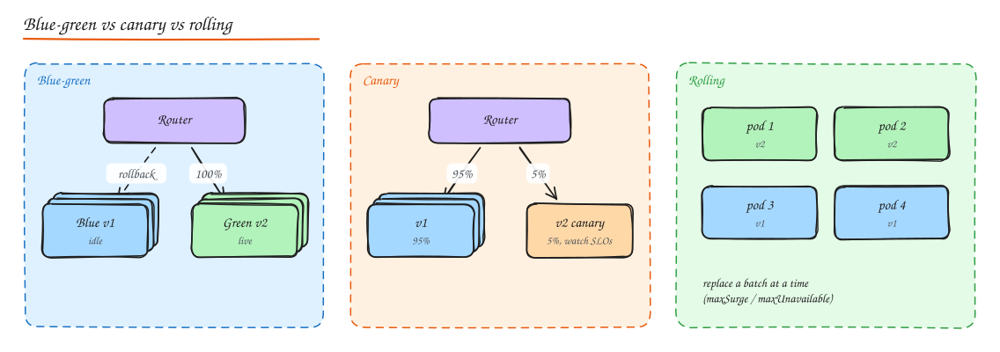

# Deployment, Infrastructure and Cost

## Containers and orchestration

- **Docker / OCI containers** package an app with its dependencies into an immutable image. Same artifact in dev, CI and prod. Lighter than VMs (shared kernel), start in seconds.
- **Kubernetes** schedules containers onto a cluster and keeps the actual state matching the desired state.

| K8s object | Purpose |
|---|---|
| **Pod** | One or more containers scheduled together (app + sidecars) |
| **Deployment** | Desired replicas of a stateless pod template, rolling updates |
| **StatefulSet** | Stable identities and storage per replica (databases, Kafka) |
| **DaemonSet** | One pod per node (log shippers, node agents) |
| **Job / CronJob** | Run to completion / on a schedule |
| **Service** | Stable virtual IP + DNS for a set of pods (L4 load balancing) |
| **Ingress / Gateway API** | L7 routing from outside into Services |
| **ConfigMap / Secret** | Configuration and sensitive values |
| **HPA / VPA / Cluster Autoscaler / Karpenter** | Scale pods horizontally, size them vertically, add/remove nodes |
| **PodDisruptionBudget** | Keep minimum replicas during voluntary disruptions |
| **Probes** | Liveness (restart), readiness (receive traffic), startup (slow boot) |

Managed options: EKS, GKE, AKS; simpler alternatives: ECS/Fargate, Cloud Run, Nomad.

## CI/CD

- **Continuous integration**: every change builds and runs tests automatically; trunk-based development with small, frequent merges.
- **Continuous delivery**: every green build is deployable; **continuous deployment**: it is deployed automatically.
- Pipeline: lint, unit tests, build image, security scan (SAST, dependency and image scanning), integration/contract tests, deploy to staging, smoke tests, progressive production rollout, automatic rollback on SLO regression.
- **GitOps** (Argo CD, Flux): the Git repo is the source of truth for cluster state; controllers reconcile.
- **Infrastructure as code**: Terraform, Pulumi, CloudFormation, CDK. Reviewable, repeatable, enables DR rebuilds.

## Deployment strategies

| Strategy | How | Pros | Cons |
|---|---|---|---|
| **Recreate** | Stop old, start new | Simple | Downtime |
| **Rolling** | Replace instances in batches | No extra capacity needed, default in K8s | Mixed versions during rollout; slower rollback |
| **Blue-green** | Run full new environment, switch router at once | Instant switch and rollback, test the new env before cutover | 2x capacity during deploy; DB schema must work for both |
| **Canary** | Send a small % of traffic to the new version, increase while watching metrics | Limits blast radius, data-driven | Needs good metrics and traffic splitting |
| **Shadow (dark launch)** | Mirror production traffic to the new version, discard responses | Real-load testing with zero user impact | Side effects must be suppressed; cost |
| **Feature flags** | Deploy code dark, enable per user/segment/percentage at runtime | Decouple deploy from release, instant kill switch, A/B tests | Flag debt; must clean up; testing combinations |

**Database changes** must be backward compatible across the rollout (expand and contract migrations). Never ship a migration that the previous app version cannot run against.

## Autoscaling

- **Horizontal pod autoscaling** on CPU, memory, or better, **custom metrics** (requests/s per pod, queue depth, consumer lag).
- **Scheduled scaling** for predictable peaks (morning traffic, sales events), and **pre-warming** before known launches.
- **Predictive scaling** from historical patterns.
- Scaling has lag (node provisioning takes minutes; JVM warmup), so keep headroom and scale out early, scale in slowly (cooldowns) to avoid flapping.
- Autoscaling does not help when the bottleneck is a shared DB; it can make it worse (more connections).

## Configuration management

- Separate config from code (12-factor). Environment specific values via env vars, ConfigMaps, or a config service.
- **Dynamic config** (feature flags, rate limits, timeouts) from a config service (LaunchDarkly, Unleash, AWS AppConfig, Consul KV, etcd) with validation, gradual rollout and audit, because config changes cause as many outages as code changes.
- **Secrets** in a secrets manager (Vault, AWS Secrets Manager, GCP Secret Manager) with rotation, never in Git or images.
- Cache the last known good config locally so a config service outage does not take you down.

## Cost estimation

In interviews, a rough cost line shows maturity: "about 40 app instances, a 3-node Postgres cluster, 2 TB in S3 and 200 TB/month CDN egress; egress dominates, so the CDN contract matters most."

Cost categories:

| Category | Drivers | Notes |
|---|---|---|
| **Compute** | vCPU-hours, memory, GPUs | Instances, containers, functions |
| **Storage** | GB-month by tier, IOPS, snapshots | Block (EBS) >> object (S3 standard) >> archive (Glacier) |
| **Data transfer** | GB out to internet, cross-AZ, cross-region | Often the surprise: egress ~$0.05 to 0.09/GB; cross-AZ traffic is charged both ways |
| **Managed services** | Per request / per hour / per GB scanned | DynamoDB, BigQuery, NAT gateways, load balancers |
| **Licensing** | Per core / per seat | Commercial DBs, observability tools (often a top-3 cost) |
| **People** | Ops burden | A cheaper self-hosted option that needs 2 engineers is not cheaper |

## Cost optimization

- **Right-size**: most instances are over-provisioned; use utilization data.
- **Commitments**: Reserved Instances / Savings Plans / committed use discounts (30 to 70% off) for steady baseline.
- **Spot / preemptible instances** (up to ~90% off) for fault-tolerant work: batch, CI, stateless workers with graceful interruption handling.
- **Autoscale** and scale to zero for idle environments (dev/staging off at night).
- **Storage lifecycle**: move old objects to infrequent access/archive; delete orphaned snapshots and volumes; compress; choose columnar formats for analytics.
- **Database**: right-size, use read replicas instead of bigger primaries, cache hot reads, archive cold rows, consider serverless/on-demand for spiky loads.
- **CDN**: maximize cache hit ratio (reduces origin egress and compute), negotiate committed rates, compress and use modern image formats.
- **Data transfer**: keep chatty services in the same AZ when safe, use VPC endpoints instead of NAT gateways for AWS service traffic, avoid cross-region replication of data nobody reads.
- **Observability**: sample traces, drop debug logs, control metric cardinality.
- **FinOps practice**: tag resources by team/service, show cost per team, set budgets and anomaly alerts, track unit economics (cost per order, per active user).

## Interview questions

Canary or blue-green for a payments service?

Usually canary (with automatic rollback on error-rate and latency SLOs) because it limits blast radius with real traffic, combined with feature flags for risky logic. Blue-green is useful when you need an atomic switch and a full pre-production validation of the new environment. Either way, schema changes must be backward compatible and idempotency must protect against duplicate processing during the switch.

Your AWS bill doubled and the biggest line is data transfer. Where do you look?

Internet egress (missing CDN caching, uncompressed responses, large images), cross-AZ traffic between services and databases or replicas, NAT gateway processing charges for traffic to S3/DynamoDB (fix with VPC endpoints), cross-region replication, and log or metric shipping to external SaaS. Use cost and usage reports plus VPC flow logs to attribute traffic.

## Related

- [Resilience Patterns](01-resilience-patterns.md)
- [Observability](02-observability.md)
- [Architecture Styles (serverless)](../05-architecture/03-architecture-styles.md)
