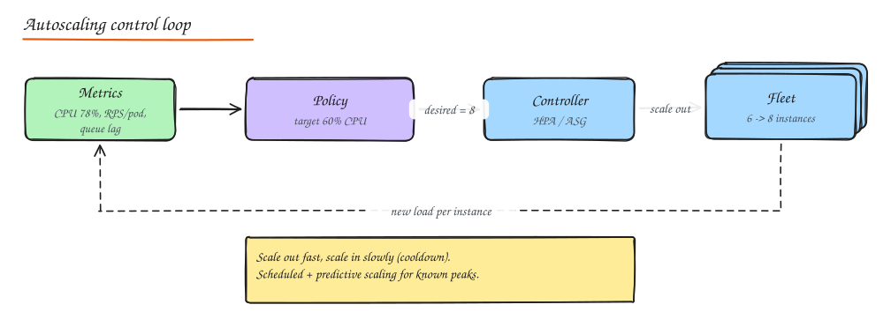

# Cost Estimation and Optimization

> **TL;DR**
> - A design is not complete without a rough monthly bill. Estimate **compute, storage, data transfer, managed services and licensing** separately; one of them usually dominates.
> - Data transfer (internet egress, cross-AZ, NAT) is the most common surprise.
> - Biggest levers: right-size, commit for the steady baseline (savings plans/reserved), use spot for fault-tolerant work, autoscale the rest, tier storage, and cache to cut egress.
> - Track **unit economics** (cost per order, per active user) so cost scales with value, not just with traffic.

Prices below are rough, illustrative public-cloud list prices to make the math concrete. They change and vary by region; always check your provider's calculator.

## Cost categories

| Category | Drivers | Rough reference |
|---|---|---|
| **Compute** | vCPU-hours, memory, GPUs, function invocations | General-purpose ~$0.04 to 0.05 per vCPU-hour on demand |
| **Storage** | GB-month by tier, IOPS, snapshots, requests | Block SSD ~$0.08/GB-mo; object standard ~$0.023/GB-mo; archive ~$0.001 to 0.004/GB-mo |
| **Data transfer** | Internet egress, cross-AZ, cross-region, NAT processing | Egress ~$0.05 to 0.09/GB; cross-AZ ~$0.01/GB each way; NAT ~$0.045/GB processed |
| **Managed services** | Per request, per hour, per GB scanned | Load balancers, managed DBs, queues, warehouses |
| **Licensing** | Per core, per seat, per host | Commercial DBs, observability, security tools |
| **People** | Operating it | Self-hosting to save $2k/month is not cheaper if it needs an engineer |

## Worked example: a Twitter-like service

Assumptions from [Back of the Envelope](../00-start-here/02-back-of-envelope.md): 150M DAU, 30k read QPS average (100k peak), 3k write QPS, 30 TB/day of new media.

| Item | Math | Monthly |
|---|---|---|
| API compute | 100k peak QPS / 1k per vCPU = 100 vCPU peak, ~60 average, x 2 for headroom = 120 vCPU x 730 h x $0.045 | ~$4k |
| Fanout workers | 1.4M timeline inserts/s, Redis pipelined, ~150 vCPU | ~$5k |
| Redis timeline cache | 2 TB RAM across memory-optimized nodes with replicas | ~$30k |
| Tweet store (Cassandra/managed KV) | ~1 PB over 5 years; first year ~200 TB with replication on SSD nodes | ~$40k |
| Media storage | 30 TB/day x 30 = 900 TB new per month, growing; object storage $0.023/GB, tier to infrequent access after 30 days | ~$20k (first month), rising |
| CDN egress | Media dominates: assume 50 PB/month served at negotiated ~$0.005 to 0.01/GB | ~$250k to 500k |
| Kafka, search, analytics, observability | Managed clusters | ~$40k |

**Insight**: CDN egress for media dwarfs everything else, so the design levers that matter are image/video compression (AVIF, modern codecs), right-sized renditions, cache hit ratio, and negotiated CDN commits. Compute is a rounding error by comparison. Saying this in an interview is a strong signal.

## Cost optimization levers

### Compute

- **Right-sizing**: most instances run at 10 to 20% CPU. Use utilization data (and memory, not just CPU) to downsize or pack more pods per node.
- **Resource utilization**: bin-pack containers (Kubernetes requests close to real usage, Karpenter/cluster autoscaler consolidation).
- **Reserved instances / savings plans / committed use**: 30 to 70% off for 1 or 3 year commitments. Cover the steady baseline only (for example the minimum of the last 30 days).
- **Spot / preemptible instances**: up to ~90% off, can be reclaimed with short notice. Use for stateless workers, batch, CI, and part of web fleets with interruption handling and diversified instance types.
- **Serverless** for spiky, low-volume workloads; containers for steady high volume.
- **ARM instances** (Graviton, Axion) often give 20 to 40% better price-performance.

### Autoscaling policies

| Policy | How it works | Use for |
|---|---|---|
| **Target tracking** | Keep a metric at a target (CPU 60%, 1,000 RPS per instance) | Default for web tiers |
| **Step scaling** | Add N instances when a metric crosses thresholds | Coarse control, legacy setups |
| **Scheduled** | Scale at known times (8 am weekdays, sale start) | Predictable peaks, pre-warming |
| **Predictive** | Forecast from history and scale ahead | Strong daily/weekly patterns |
| **Queue-based** | Scale workers on queue depth or consumer lag | Async workers (KEDA) |

Scale out quickly, scale in slowly (cooldowns), set sane min/max, and account for warm-up time (JVM, caches).

### Storage

- **Lifecycle rules**: move objects to infrequent access after 30 days and archive after 90 to 180; delete temp data automatically.
- Delete orphaned volumes, old snapshots and unattached IPs (tag everything with owner and expiry).
- **Compression and formats**: Parquet + zstd for analytics data, modern image/video codecs.
- Right-size provisioned IOPS; gp3-style volumes let you buy IOPS separately from size.

### Database cost optimization

- Right-size instances; use read replicas only where read traffic needs them.
- Cache hot reads so you can run smaller databases.
- Archive cold rows (old orders) to cheaper storage or a warehouse; partition tables to drop old partitions cheaply.
- Use on-demand/serverless capacity modes for spiky or dev workloads, provisioned with autoscaling for steady ones.
- Watch per-request pricing (DynamoDB, BigQuery bytes scanned): one bad scan query can cost more than a month of compute. Use partitioning and clustering to limit bytes scanned.

### CDN cost optimization

- Maximize **cache hit ratio** (normalize cache keys, longer TTLs with versioned URLs, origin shield) so origin egress and compute drop.
- Compress text (Brotli), serve images in modern formats and the right size.
- Negotiate committed-use pricing at high volume; compare multi-CDN.

### Data transfer optimization

- Keep chatty services and their databases in the same AZ where availability allows, or use AZ-aware routing.
- Use **VPC endpoints / private links** for cloud services (S3, DynamoDB) instead of paying NAT gateway processing.
- Avoid cross-region replication of data no one reads there.
- Compress service-to-service payloads; batch requests.
- Ship logs and metrics after filtering and sampling, not raw.

## Infrastructure cost analysis and FinOps

1. **Visibility**: tag every resource (team, service, environment); enable cost and usage reports.
2. **Allocation**: show each team its spend; shared costs split by usage.
3. **Unit economics**: cost per 1,000 requests, per active user, per order. If revenue per order is $0.50 and infra per order is $0.20, that is a product problem.
4. **Budgets and anomaly alerts**: catch a runaway job in hours, not at month end.
5. **Regular reviews**: rightsizing recommendations, commitment coverage, idle resources.

## Interview questions

Your AWS bill jumped 40% this month. How do you investigate?

Break down cost by service, account, region and tag in the cost explorer, compare with last month, and find the top movers. Typical culprits: data transfer (a new cross-AZ or cross-region flow, NAT gateway traffic), a forgotten large instance or GPU, a runaway job or retry storm, log volume, or expired reserved instance coverage. Then set anomaly alerts and tags so the next one is caught earlier.

Where would you use spot instances in a typical web architecture?

Stateless and interruption-tolerant parts: batch and data processing, CI runners, async workers that checkpoint, video transcoding, and a portion of the stateless web fleet mixed with on-demand capacity behind a load balancer. Avoid spot for databases, single-replica stateful components and anything without graceful interruption handling.

How do you decide between reserved capacity and autoscaling?

Both: commit (reserved instances or savings plans) to the steady baseline that runs 24/7, and let autoscaling with on-demand and spot handle the variable part above it. Committing to peak wastes money; committing to nothing overpays for the baseline.

## Related

- [Deployment, Infrastructure and Cost](04-deployment-and-cost.md)
- [Back of the Envelope](../00-start-here/02-back-of-envelope.md)
- [CDN](../02-building-blocks/04-cdn.md)
- [Practice: Cost Optimization Exercises](../12-practice/04-cost-optimization-exercises.md)
