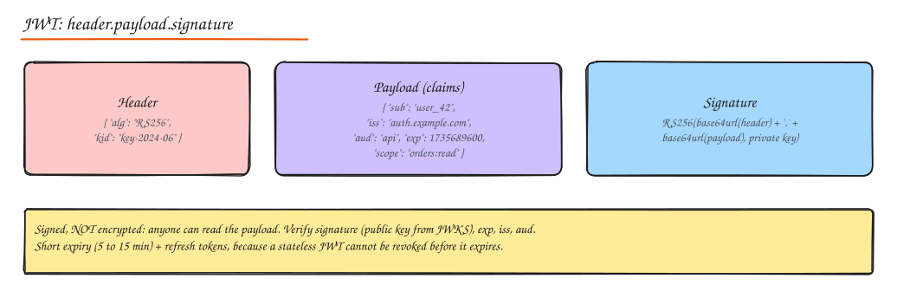
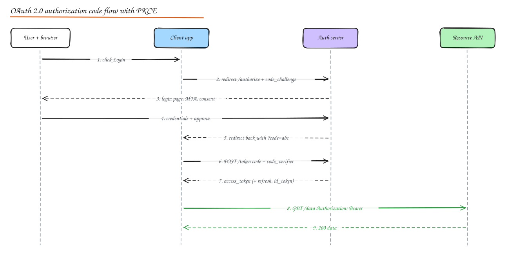

# Authentication and Authorization

> **TL;DR**
> - Authentication proves who you are; authorization decides what you may do. Check both on every request.
> - Use OAuth 2.0 authorization code with PKCE for apps, OIDC for login identity, client credentials for machine-to-machine.
> - Short-lived JWT access tokens plus rotating refresh tokens give stateless checks and practical revocation.
> - RBAC covers most apps; ABAC or relationship-based access handles contextual and sharing rules.

- **Authentication (AuthN)**: *who are you?* Proving identity.
- **Authorization (AuthZ)**: *what are you allowed to do?* Checking permissions for an action on a resource.

Mixing them up is a classic bug: a valid login does not mean the user may read order 9001.

## Authentication methods

| Method | Notes |
|---|---|
| **Username + password** | Store only slow salted hashes (argon2id, bcrypt, scrypt; PBKDF2 for FIPS). Rate limit and lock out, check against breached password lists, never log passwords. |
| **MFA** | Something you know + have + are: TOTP apps, push approvals, SMS (weakest, SIM swap), **hardware keys / passkeys (FIDO2/WebAuthn)**, phishing resistant and the strongest option |
| **Passkeys / WebAuthn** | Public key credentials bound to the site origin; no shared secret to steal or phish |
| **Biometric** | Usually unlocks a local key (Face ID unlocks a passkey); biometrics themselves should not leave the device |
| **Magic links / OTP email** | Convenient, security depends on email account |
| **Social / enterprise login** | Delegate to an identity provider via OIDC or SAML |
| **API keys** | Identify a calling application/project; long lived secrets, scope them, rotate them, send in headers only |
| **mTLS / client certificates** | Machine to machine identity (service mesh, B2B APIs) |

## Session management

### Cookie-based (stateful) sessions

Server creates a random session ID, stores session data server-side (Redis/DB), and sets a cookie:

```http
Set-Cookie: sid=8f1c...; HttpOnly; Secure; SameSite=Lax; Path=/; Max-Age=86400
```

- `HttpOnly` blocks JS access (XSS theft), `Secure` sends only over HTTPS, `SameSite` mitigates CSRF.
- Easy revocation (delete the session), small cookie, but needs a shared session store for scale.

### Token-based (stateless) sessions

The client holds a signed token (often a JWT) containing claims; servers verify the signature without a lookup.

| | Stateful session | Stateless token (JWT) |
|---|---|---|
| Server storage | Session store | None (or a revocation list) |
| Revocation | Immediate | Hard until expiry (keep access tokens short) |
| Scaling | Needs shared store | Any server can verify |
| Size | Tiny cookie | Larger header |
| Best for | Browser web apps | APIs, mobile, service-to-service, federated systems |

Common hybrid: short-lived access token (5 to 15 min) + long-lived **refresh token** stored securely (HttpOnly cookie or secure device storage), with **refresh token rotation** (each use issues a new one; reuse of an old one revokes the family, detecting theft).

## JWT (JSON Web Token)



`base64url(header).base64url(payload).base64url(signature)`

- **Header**: algorithm (`RS256`, `ES256`, `HS256`) and key ID (`kid`).
- **Payload** (claims): `sub` (subject), `iss` (issuer), `aud` (audience), `exp` (expiry), `iat`, `nbf`, `jti` (unique ID), custom claims like `scope`, `roles`, `tenant_id`.
- **Signature**: HMAC with a shared secret (HS256) or asymmetric signature (RS256/ES256) so verifiers only need the public key, published at a **JWKS** endpoint.

Verification checklist: signature with an **allowlisted algorithm** (reject `alg: none` and algorithm confusion), `exp`/`nbf`, `iss`, `aud`, and key rotation via `kid`.

Pitfalls:

- JWTs are **signed, not encrypted**: anyone can read the payload. Do not put secrets or sensitive PII in it (use JWE if you must encrypt).
- Do not store long-lived JWTs in `localStorage` (XSS can steal them); prefer HttpOnly cookies for browsers.
- Revocation: short expiry + refresh tokens, or a denylist of `jti` for emergencies.
- Big tokens (many roles) bloat every request; keep claims minimal and look up fine-grained permissions server side.

## OAuth 2.0

OAuth 2.0 is a framework for **delegated authorization**: a user lets an application access their resources on another service without sharing their password. It issues **access tokens** with **scopes**.

Roles: **resource owner** (user), **client** (the app), **authorization server** (issues tokens: Auth0, Okta, Keycloak, Cognito, Google), **resource server** (the API).

### Authorization code flow with PKCE (the default)



1. Client creates a random `code_verifier` and sends `code_challenge = SHA256(code_verifier)` with the redirect to `/authorize`.
2. User authenticates and consents at the authorization server.
3. Authorization server redirects back with a short-lived **authorization code**.
4. Client exchanges code + `code_verifier` at `/token` (server checks the hash) for tokens.
5. Client calls the API with `Authorization: Bearer <access_token>`.

PKCE prevents an attacker who intercepts the code from redeeming it. Required for mobile and SPAs (public clients), recommended for all clients (OAuth 2.1).

### Other flows

| Flow | Use | Status |
|---|---|---|
| **Authorization code + PKCE** | Web apps, SPAs, mobile, anything with a user | Recommended |
| **Client credentials** | Machine to machine (no user): a backend job calling an API with its own identity | Recommended for M2M |
| **Device authorization** | TVs, CLIs, IoT: show a code, approve on another device | Recommended for input-constrained devices |
| **Refresh token** | Get new access tokens without re-login | Use with rotation |
| **Implicit** | Old SPA flow returning tokens in the URL fragment | **Deprecated** (token leakage) |
| **Resource owner password credentials** | App collects the user's password directly | **Deprecated** (defeats the purpose of OAuth) |

## OpenID Connect (OIDC)

OAuth 2.0 is about authorization, not identity. **OIDC** adds an identity layer on top:

- An **ID token** (a JWT) describing the authenticated user (`sub`, `email`, `name`, `auth_time`), meant for the client, not for calling APIs.
- `/userinfo` endpoint, standard scopes (`openid profile email`), discovery document (`/.well-known/openid-configuration`) and JWKS.
- "Login with Google" is OIDC.

Rule: **ID token proves who logged in (for the client); access token grants API access (for the resource server).**

## SAML and SSO

- **SAML 2.0**: XML-based federation standard, common in enterprises. The **Identity Provider** (Okta, Azure AD/Entra ID, ADFS) issues signed XML **assertions** to **Service Providers** via browser redirects/POSTs.
- **Single Sign-On (SSO)**: authenticate once with the IdP, access many apps. Implemented with SAML or OIDC. Pair with **SCIM** for automated user provisioning and deprovisioning.

| | SAML | OIDC |
|---|---|---|
| Format | XML assertions | JSON / JWT |
| Era | 2005, enterprise web SSO | 2014, web + mobile + APIs |
| Mobile/SPA friendliness | Poor | Good |
| Typical use | B2B enterprise SSO | Consumer login, modern apps, also enterprise |

## Authorization patterns

| Model | Idea | Example | Good for | Limits |
|---|---|---|---|---|
| **ACL** (access control list) | Per resource list of who can do what | File: alice=rw, bob=r | File systems, object storage | Hard to manage at scale |
| **RBAC** (role-based) | Users get roles; roles have permissions | `admin`, `editor`, `viewer` | Most business apps | Role explosion for fine-grained or contextual rules |
| **ABAC** (attribute-based) | Policies over attributes of user, resource, action, environment | "Doctors can read records of patients in their department during their shift" | Complex, contextual rules, compliance | Harder to audit and reason about |
| **ReBAC** (relationship-based) | Permissions derived from relationships in a graph | "Can view doc if member of a group that owns the folder containing it" (Google Zanzibar) | Sharing, collaboration, nested orgs | Needs a dedicated authorization service at scale |

Implementation tips:

- Enforce authorization **server-side on every request**, at the object level (BOLA/IDOR is the top API vulnerability).
- Centralize policy logic (OPA/Rego, Cedar, Casbin, OpenFGA/SpiceDB for ReBAC), decentralize enforcement (each service calls the policy engine or library).
- **Least privilege** and **deny by default**.
- Multi-tenant SaaS: every query filtered by `tenant_id` (row-level security in Postgres helps).
- Audit log every authorization decision for sensitive resources.

## Interview questions

<details>
<summary>Design authentication for a web app plus mobile app plus public API.</summary>

Use an identity provider supporting OIDC (managed or Keycloak). Web and mobile use authorization code + PKCE; web keeps tokens in HttpOnly cookies via a BFF, mobile stores refresh tokens in the secure keystore. Access tokens are short-lived JWTs verified by the API gateway via JWKS; refresh tokens rotate. Third-party developers use OAuth with scoped consent; server-to-server integrations use client credentials. Add MFA/passkeys, rate limits on login, breach detection, and session/device management for users to revoke access.

</details>

<details>
<summary>How do you revoke a JWT before it expires?</summary>

You cannot invalidate a self-contained token by itself. Options: keep access tokens short-lived (minutes) and revoke the refresh token; maintain a denylist of revoked `jti` or a per-user "tokens issued before T are invalid" timestamp checked at the gateway (reintroduces a lookup, cacheable); or use opaque tokens with introspection for high-security APIs.

</details>

<details>
<summary>RBAC vs ABAC: when does RBAC break down?</summary>

When permissions depend on context or relationships rather than job function: "managers can approve expenses of their own reports under $5k", "users can edit documents shared with them". Encoding that as roles leads to role explosion (one role per team per resource). ABAC policies or ReBAC (relationship graphs) express these directly.

</details>

## Related

- [Encryption, Data and Network Security](02-encryption-data-network-security.md)
- [API Gateway](../02-building-blocks/05-proxies-api-gateway.md)
- [HTTP and TLS](../04-networking-apis/02-http-tls.md)
