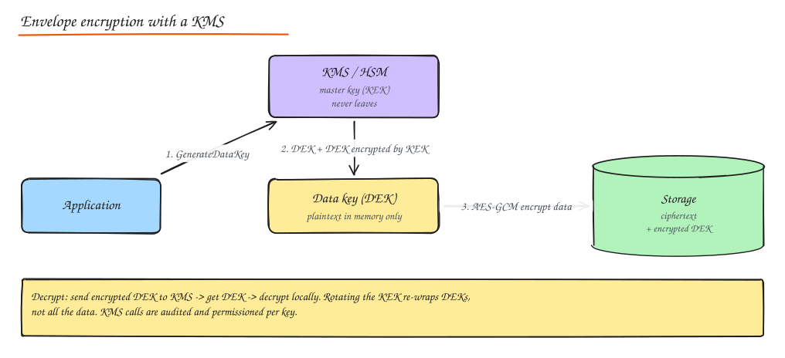
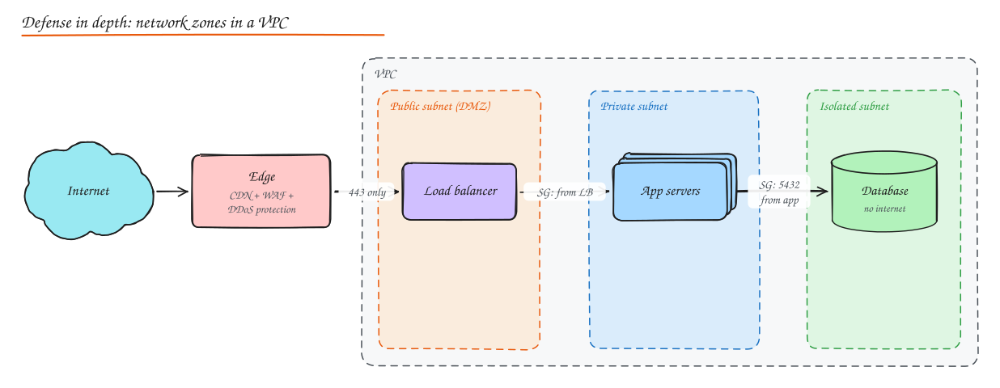

# Encryption, Data, API and Network Security, Compliance

> **TL;DR**
> - Encrypt in transit (TLS everywhere) and at rest; use envelope encryption with keys in a KMS or HSM.
> - Store passwords with slow, salted hashes (argon2id, bcrypt), never plain SHA.
> - Defend in depth: WAF and DDoS protection at the edge, private subnets, least-privilege access, zero trust inside.
> - Compliance (GDPR, PCI, HIPAA, SOC 2) shapes design: data minimization, deletion, audit logs, scope reduction.

## Cryptography essentials

### Symmetric encryption

One shared key encrypts and decrypts. Fast; used for bulk data.

| Algorithm | Status |
|---|---|
| **AES-256-GCM / AES-128-GCM** | Standard choice: authenticated encryption (confidentiality + integrity), hardware accelerated (AES-NI) |
| **ChaCha20-Poly1305** | Fast on devices without AES hardware (mobile); used in TLS and WireGuard |
| DES | Broken (56-bit key) |
| 3DES | Deprecated (slow, 64-bit block, Sweet32 attacks) |

Always use an **authenticated mode** (GCM, Poly1305). Never reuse a nonce with the same key in GCM. Never use ECB.

### Asymmetric encryption

A key pair: public key (shareable) and private key (secret).

- **RSA**: encryption and signatures; 2048-bit minimum, 3072+ for longer horizons. Slow; keys are large.
- **ECC** (ECDSA, Ed25519 for signatures; ECDH/X25519 for key exchange): same security with much smaller keys and faster operations (256-bit ECC ≈ 3072-bit RSA).
- Uses: TLS handshakes, digital signatures (code signing, JWT RS256/ES256), key exchange, SSH, PGP.
- In practice you never encrypt bulk data with RSA: you use asymmetric crypto to agree on or wrap a **symmetric** key (hybrid encryption).
- Post-quantum: hybrid key exchange (X25519 + ML-KEM/Kyber) is being rolled out in TLS; plan for crypto agility.

### Hashing

One-way functions mapping data to a fixed-size digest.

| Function | Use | Status |
|---|---|---|
| MD5 | Non-security checksums only | **Broken** for security (collisions) |
| SHA-1 | Legacy | **Deprecated** (practical collisions since 2017) |
| **SHA-256 / SHA-512** (SHA-2) | Integrity, signatures, content addressing, HMAC | Standard |
| **SHA-3**, BLAKE2/3 | Alternatives; BLAKE3 is very fast | Good |
| **bcrypt**, **scrypt**, **argon2id**, **PBKDF2** | **Password hashing** | Use these, never plain SHA for passwords |

Password storage: a fast hash (SHA-256) lets attackers try billions of guesses per second on a GPU. Password hashing functions are deliberately **slow and salted** (argon2id and scrypt are also memory-hard, which defeats GPU/ASIC cracking). Each password gets a unique random **salt** (defeats rainbow tables); an optional server-side **pepper** stored in a KMS adds defense if the DB leaks. Tune cost so a hash takes roughly 100 to 500 ms on your servers.

**HMAC** (hash-based MAC, e.g. HMAC-SHA256) proves integrity and authenticity with a shared secret: webhook signatures, signed URLs, API request signing (AWS SigV4).

### Key management

The hard part of encryption is protecting the keys.

- **KMS** (AWS KMS, GCP KMS, Azure Key Vault, HashiCorp Vault): stores master keys, performs crypto operations, enforces IAM policies, audits every use.
- **HSM** (hardware security module): tamper-resistant hardware where keys are generated and never leave in plaintext; required for some compliance (PCI, payments, CAs). Cloud HSM services exist.
- **Envelope encryption**: data is encrypted with a **data encryption key (DEK)**; the DEK is encrypted with a **key encryption key (KEK)** in the KMS. Store the encrypted DEK next to the data. Benefits: bulk crypto is local and fast, the KEK never leaves the KMS, rotation re-wraps small DEKs instead of re-encrypting terabytes.
- **Key rotation**: rotate KEKs periodically (new versions encrypt new data; old versions decrypt old data), rotate immediately on suspected compromise.
- **Key escrow**: a trusted third party or split-key scheme holds copies for recovery or legal access. Controversial for user data; used internally for disaster recovery of critical keys (with Shamir's secret sharing and quorum approval).
- **Crypto shredding**: delete the key to make data unrecoverable (useful for GDPR erasure in immutable logs and backups).

### End-to-end encryption (E2EE)

Only the communicating endpoints hold the keys; the server relays ciphertext it cannot read.

- **Signal Protocol** (WhatsApp, Signal): X3DH key agreement using identity keys and pre-keys published to the server, then the **Double Ratchet** that derives new keys per message (forward secrecy and post-compromise security).
- Group chats: sender keys or MLS (Messaging Layer Security, IETF standard for large groups).
- Trade-offs: server-side features (search, spam filtering, backups, multi-device sync) become hard; key verification (safety numbers) and key backup (encrypted with user secrets) need careful UX.

### TLS deep dive

See [HTTP and TLS](../04-networking-apis/02-http-tls.md): TLS 1.3, ECDHE forward secrecy, certificates and CAs, mTLS, HSTS, certificate automation and pinning (pinning is risky and mostly discouraged for web; sometimes used in mobile apps).

## Data security

- **Data classification**: public, internal, confidential, restricted (PII, PHI, payment data, secrets). Controls follow classification.
- **Encryption at rest**: disk/volume encryption (default in clouds), database TDE, object storage SSE-KMS; **application-level / field-level encryption** for the most sensitive fields (SSNs, card data) so DB admins and backups see ciphertext.
- **Encryption in transit**: TLS everywhere, including internal traffic (mTLS), and to databases.
- **Database security**: least-privilege DB users per service, no shared admin creds, network isolation (private subnets), encryption, **audit logging** of access, parameterized queries.
- **PII protection**: minimize collection, separate PII into a dedicated vault/service, **tokenization** (replace sensitive values with tokens; the mapping lives in a secured vault; standard for card numbers), access logging.
- **Masking and anonymization**: masking (show `**** 4242`), pseudonymization (replace identifiers with consistent tokens, still personal data under GDPR), anonymization (irreversible, e.g. aggregation, k-anonymity, differential privacy) for analytics.
- **Retention and deletion**: define retention per data type; automate deletion (TTL, lifecycle rules); propagate deletes to replicas, caches, search indexes, warehouses and backups (or crypto shred).
- **Backups**: encrypted, access-controlled separately, immutable copies, tested restores (see [DR](../06-reliability-ops/03-disaster-recovery-multi-region.md)).
- **Secrets management**: Vault / cloud secret managers, short-lived dynamic credentials, never in code, images or logs; scan repos for leaked secrets.

## API security

OWASP API Security Top 10 highlights:

1. **Broken object level authorization (BOLA/IDOR)**: check ownership on every object access.
2. **Broken authentication**: weak token validation, no rate limiting on login.
3. **Broken object property level authorization**: mass assignment (client sets `is_admin`), excessive data exposure (returning fields the client should not see). Use explicit allowlists for input and output.
4. **Unrestricted resource consumption**: no pagination limits, no rate limits, huge payloads.
5. **Broken function level authorization**: admin endpoints reachable by normal users.
6. Server-side request forgery (SSRF), security misconfiguration, improper inventory (forgotten old API versions), unsafe consumption of third-party APIs.

Controls:

- **Authentication** (OAuth/OIDC tokens, API keys for identification, mTLS) and **authorization** at object level.
- **Rate limiting and quotas** per key/user/IP.
- **Input validation**: schema validation at the edge, types, ranges, lengths, allowlists; parameterized queries against SQL injection.
- **Output encoding**: context-aware encoding to prevent XSS when data reaches HTML; set `Content-Type` correctly.
- **CORS configuration**: specific allowed origins, never reflect arbitrary origins with credentials.
- **Versioning for security**: retire vulnerable old versions; inventory all exposed endpoints.
- **API key management**: hashed at rest (store a hash, show once), prefixed for secret scanning (`sk_live_...`), scoped, rotatable, with last-used tracking.
- **Webhooks**: sign payloads (HMAC with timestamp to prevent replay), verify on receipt.

## Network security

- **Firewalls**:
  - **Stateless** (packet filtering, e.g. AWS NACLs): each packet checked against rules; must allow return traffic explicitly.
  - **Stateful** (security groups, most host firewalls): track connections; return traffic allowed automatically.
  - **Application proxy / next-generation firewalls (NGFW)**: inspect application protocols, user identity, intrusion prevention.
  - **Web Application Firewall (WAF)**: L7 rules against SQL injection, XSS, bad bots, known exploit signatures (AWS WAF, Cloudflare, ModSecurity with OWASP CRS).
- **Network segmentation**: public subnets only for load balancers and NAT, private subnets for apps, isolated subnets for databases; **DMZ** pattern; security groups referencing other security groups; separate VPCs/accounts per environment.
- **DDoS protection**:
  - Volumetric (L3/L4 floods): absorbed by **anycast** networks and **scrubbing centers** (Cloudflare, AWS Shield, Akamai).
  - Protocol attacks (SYN floods): SYN cookies, connection limits.
  - Application layer (L7 floods): rate limiting, IP reputation, **behavioral analysis**, CAPTCHAs/challenges, caching, autoscaling with cost limits.
- **IDS / IPS**: intrusion detection (alerts on suspicious traffic or host activity: Suricata, Zeek, GuardDuty) vs prevention (blocks inline).
- **VPN security**: strong auth (certificates + MFA), split tunneling decisions, least-privilege network access; increasingly replaced by zero trust access.
- **Zero trust architecture**: "never trust, always verify". No implicit trust based on network location. Every request is authenticated and authorized using identity (user + device posture), with least privilege, micro-segmentation, mTLS between services, and continuous verification (Google BeyondCorp). Identity-aware proxies replace flat VPN access.

## Compliance and regulations

| Regime | Scope | Key system design implications |
|---|---|---|
| **GDPR** (EU) | Personal data of people in the EU | Lawful basis and consent, data minimization, **right to access/erasure/portability**, breach notification in 72 h, data residency and transfer rules, DPO, privacy by design |
| **CCPA / CPRA** (California) | Personal information of California residents | Right to know, delete, opt out of sale/sharing |
| **HIPAA** (US healthcare) | Protected health information (PHI) | Access controls, audit logs, encryption, BAAs with vendors, minimum necessary access |
| **PCI DSS** | Cardholder data | Minimize scope (tokenize via a payment provider so card data never touches your servers), network segmentation, encryption, quarterly scans, strict access and logging |
| **SOC 2** | Service organizations (security, availability, confidentiality, processing integrity, privacy) | Documented controls and evidence: access reviews, change management, monitoring, incident response, vendor management (Type I point in time, Type II over a period) |
| **ISO 27001** | Information security management system (ISMS) | Risk assessment and a catalog of controls, continuous improvement, certification audits |
| **NIST Cybersecurity Framework** | Voluntary framework | Govern, Identify, Protect, Detect, Respond, Recover |

**Audit trails and logging**: append-only, tamper-evident (write-once storage, hash chaining), time-synchronized logs of who did what, when, from where, on which resource; retained per policy; access to audit logs itself restricted and logged.

## Interview questions

How should passwords be stored and why not SHA-256?

With a slow, salted, memory-hard password hashing function (argon2id, or bcrypt/scrypt), each with a unique random salt and a tuned cost factor, optionally with a pepper held in a KMS. SHA-256 is designed to be fast, so a GPU can test billions of guesses per second against leaked hashes; password hashing functions make each guess expensive.

How do you reduce PCI DSS scope for an e-commerce site?

Never let raw card data touch your servers: use the payment provider's hosted fields or redirect/iframe (Stripe Elements, Adyen), which return a token you store instead. Your systems handle only tokens, so the cardholder data environment shrinks to almost nothing (often SAQ A). Segment any remaining in-scope systems and keep logs free of card data.

A user asks to be deleted under GDPR. What has to happen technically?

Identify all personal data for that user across services (requires a data map keyed by user ID), delete or anonymize it in primary databases, caches, search indexes, analytics warehouses, logs (or let them expire within the retention period), and third-party processors via their APIs. For immutable stores and backups, use crypto shredding (per-user keys) or document retention-based expiry. Keep a minimal record that the deletion happened, and complete within the legal deadline (one month).

What does zero trust change compared with a VPN-based perimeter?

A VPN grants broad network access once you are "inside", so a single compromised laptop can reach many systems. Zero trust authenticates and authorizes every request based on user identity, device health and context, grants access per application (not per network), encrypts and authenticates service-to-service traffic (mTLS), and continuously re-evaluates. Lateral movement becomes much harder.

## Related

- [Authentication and Authorization](01-authn-authz.md)
- [HTTP and TLS](../04-networking-apis/02-http-tls.md)
- [Rate Limiting](../02-building-blocks/08-rate-limiting.md)
- [Case study: Payment System](../09-case-studies/10-payment-system.md)
