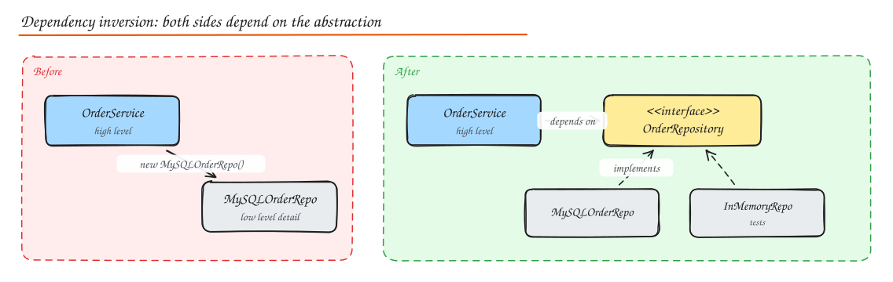

# OOP, SOLID and Design Principles

> **TL;DR**
> - SOLID keeps code easy to change: one reason to change per class, extend without modifying, substitutable subtypes, small interfaces, depend on abstractions.
> - Prefer composition over deep inheritance; inject dependencies through constructors.
> - DRY, KISS and YAGNI keep designs lean, applied with judgment.
> - Separate expected business errors from unexpected failures and translate errors at layer boundaries.

LLD interviews ("design a parking lot", "design Splitwise", "design a rate limiter class") test whether your code would survive real change: new requirements, new teammates, new edge cases. Principles are the vocabulary for explaining why your design is easy to change.

## OOP pillars (quick refresher)

| Pillar | Meaning | Example |
|---|---|---|
| **Encapsulation** | Hide internal state; expose behaviour | `account.withdraw(30)` instead of `account.balance -= 30` |
| **Abstraction** | Expose what, hide how | `PaymentGateway.charge()` hides Stripe vs Razorpay details |
| **Inheritance** | Reuse and specialize through "is-a" | `Car extends Vehicle` (use sparingly) |
| **Polymorphism** | One interface, many implementations | `for shape in shapes: shape.area()` |

## SOLID

### S: Single Responsibility Principle

*A class should have one reason to change* (one actor it serves).

```python
# Before: report generation, formatting and emailing all in one class
class SalesReport:
    def compute(self): ...
    def to_pdf(self): ...
    def email_to_finance(self): ...

# After: each class changes for one reason
class SalesReportCalculator:   def compute(self, orders) -> Report: ...
class PdfRenderer:             def render(self, report: Report) -> bytes: ...
class ReportMailer:            def send(self, pdf: bytes, to: str) -> None: ...
```

### O: Open/Closed Principle

*Open for extension, closed for modification.* Add behaviour by adding code, not editing tested code.

```python
# Before: every new discount edits this function
def price(order, kind):
    if kind == "festive": return order.total * 0.8
    elif kind == "student": return order.total * 0.9
    ...

# After: strategy objects; a new discount is a new class
class Discount(Protocol):
    def apply(self, total: float) -> float: ...

class Festive:  def apply(self, t): return t * 0.8
class Student:  def apply(self, t): return t * 0.9

def price(order, discount: Discount): return discount.apply(order.total)
```

### L: Liskov Substitution Principle

*Subtypes must be usable wherever the base type is expected without breaking correctness.* Subclasses must not strengthen preconditions, weaken postconditions, or throw unexpected exceptions.

Classic violation: `Square extends Rectangle`. Setting width on a square also changes height, breaking code that assumes independent width and height. Another: a `ReadOnlyList` subclass of `List` that throws on `add()`. Fix by modeling capabilities separately (`ReadableList`, `WritableList`) or composition.

### I: Interface Segregation Principle

*Clients should not depend on methods they do not use.* Prefer several small, role-specific interfaces over one fat one.

```python
# Before
class Machine(Protocol):
    def print(self, doc): ...
    def scan(self, doc): ...
    def fax(self, doc): ...       # a basic printer must stub these out

# After
class Printer(Protocol):  def print(self, doc): ...
class Scanner(Protocol):  def scan(self, doc): ...
class Fax(Protocol):      def fax(self, doc): ...
class OfficeMachine(Printer, Scanner, Fax): ...
```

### D: Dependency Inversion Principle

*High-level modules should not depend on low-level modules; both should depend on abstractions.* Abstractions are owned by the high-level policy, and details implement them.



```python
class OrderService:
    def __init__(self, repo: OrderRepository, notifier: Notifier):   # injected abstractions
        self.repo, self.notifier = repo, notifier
```

**Dependency injection** (constructor injection preferred) is the technique that applies DIP: objects receive their collaborators instead of constructing them. It makes testing with fakes trivial. DI containers (Spring, Guice, Dagger, .NET DI) automate wiring but are optional.

## Other principles

| Principle | Meaning | Watch out |
|---|---|---|
| **DRY** (Don't Repeat Yourself) | Each piece of *knowledge* has one authoritative representation | Not all similar-looking code is duplicated knowledge; premature DRY couples unrelated things ("wrong abstraction") |
| **KISS** (Keep It Simple) | Prefer the simplest design that works | Simple is not easy; it takes iteration |
| **YAGNI** (You Aren't Gonna Need It) | Don't build for speculative requirements | But do keep things easy to change (that is not speculation) |
| **POLA** (Principle of Least Astonishment) | APIs and behaviour should match user expectations | `getUser()` should not create a user |
| **Composition over inheritance** | Build behaviour by combining objects ("has-a") rather than deep class hierarchies | Inheritance is fine for genuine, stable "is-a" with substitutability |
| **High cohesion, low coupling** | Things that change together live together; modules know little about each other | Measure by how many places a change touches |
| **Law of Demeter** | Talk to friends, not strangers: avoid `order.getCustomer().getAddress().getCity()` | Add intention-revealing methods |
| **Convention over configuration** | Sensible defaults reduce boilerplate (Rails, Spring Boot) | Magic can surprise; document conventions |
| **Explicit is better than implicit** | Make dependencies, side effects and errors visible | From the Zen of Python |
| **Tell, don't ask** | Ask objects to do things rather than pulling their data and deciding outside | Keeps logic with data |

## Package, class and method design

- **Package by feature** (`orders/`, `payments/`), not by layer only; keep internal classes non-public.
- **Classes**: small, cohesive, with invariants enforced in constructors (an `Order` cannot exist without items). Prefer immutable value objects (`Money`, `Email`, `DateRange`) for domain concepts instead of primitives (avoid primitive obsession).
- **Methods**: do one thing, at one level of abstraction; few parameters (introduce a parameter object); command-query separation (a method either changes state or returns data, not both, where practical).
- **Naming**: intention-revealing names beat comments.

## Error handling and exception propagation

- Distinguish **expected business outcomes** (insufficient funds, item out of stock) from **unexpected failures** (DB down, bug). Model the first as return types/result objects or domain exceptions; let the second propagate to a boundary.
- **Fail fast** on invalid input at the boundary (validation), so the core can trust its data.
- **Don't swallow exceptions**; if you catch, add context or handle meaningfully.
- **Translate exceptions at layer boundaries**: a repository converts `SQLIntegrityError` into `DuplicateOrderError`; the API layer maps domain errors to HTTP status codes in one place.
- Keep error types stable and documented for API clients (see [API error format](../04-networking-apis/03-api-design.md#error-format)).
- Use **finally / context managers / try-with-resources** to release resources.
- Make operations retryable and idempotent where failures are transient.

## How to approach an LLD interview

1. **Clarify requirements and scope** (actors, core use cases, constraints like concurrency).
2. **Identify entities** (nouns) and their responsibilities and relationships.
3. **Define interfaces** for behaviours that vary (pricing, notification channel, payment).
4. **Draw a class diagram** (or list classes with key fields/methods).
5. **Walk through main flows** with sequence-style narration.
6. **Write core code** for the trickiest parts (state transitions, allocation logic, concurrency).
7. **Discuss extensibility**: "to add EV charging spots, add a new `SpotType` and a strategy, no changes to `ParkingLot`".
8. **Handle concurrency and edge cases**: two cars taking the same spot, payment failures, invalid transitions.

Worked example: [LLD: Parking Lot](04-lld-parking-lot.md).

## Interview questions

<details>
<summary>Explain the Open/Closed principle with an example from a real system.</summary>

A notification service that sends via email, SMS and push: instead of a switch on channel type inside `send()`, define a `NotificationChannel` interface with `send(message)`, implement `EmailChannel`, `SmsChannel`, `PushChannel`, and register them in a map. Adding WhatsApp means adding a new class and registering it, without modifying the tested dispatch code.

</details>

<details>
<summary>When is inheritance the right choice over composition?</summary>

When there is a true, stable "is-a" relationship where every subclass can substitute for the base (LSP holds) and you want to share both interface and core behaviour, like framework template classes or a small closed hierarchy of shapes. When behaviour varies independently along several dimensions, or you mainly want code reuse, composition (strategies, decorators) avoids fragile deep hierarchies.

</details>

<details>
<summary>What is the difference between dependency inversion and dependency injection?</summary>

Dependency inversion is a design principle about the direction of dependencies: high-level policy depends on abstractions it owns, and low-level details implement them. Dependency injection is a technique for supplying an object's dependencies from outside (constructor, setter, framework container). DI is the usual way to realize DIP, but you can inject concrete classes (DI without DIP).

</details>

## Related

- [Design Patterns](02-design-patterns.md)
- [Concurrency](03-concurrency.md)
- [Architecture Styles (hexagonal)](../05-architecture/03-architecture-styles.md)
