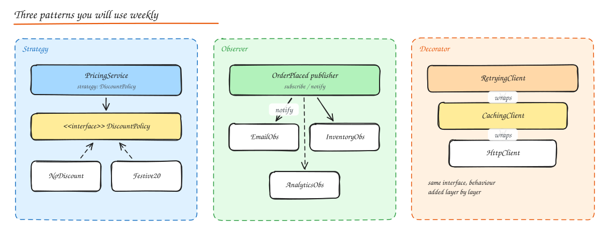

# Design Patterns

> **TL;DR**
> - Patterns are a shared vocabulary: name one and you describe a whole design in a sentence.
> - Most used: Strategy (swap algorithms), Observer (react to events), Factory and Builder (create objects), Decorator and Adapter (wrap and translate), State (lifecycles).
> - Match patterns to problems: State for vending machines and orders, Command for undo, Strategy for pricing.
> - Do not force patterns where a simple function works.

A design pattern is a named, reusable solution to a recurring design problem. The value in interviews is the **vocabulary**: saying "I'll use a strategy for pricing and an observer for order events" communicates a whole design in one sentence. Do not force patterns where a plain function would do.



## Creational patterns

### Singleton

**Intent**: exactly one instance, globally accessible.

```python
class Config:
    _instance = None
    _lock = threading.Lock()

    def __new__(cls):
        if cls._instance is None:
            with cls._lock:                    # double-checked locking
                if cls._instance is None:
                    cls._instance = super().__new__(cls)
                    cls._instance._load()
        return cls._instance
```

Uses: configuration, logger, connection pool manager. **Cautions**: hidden global state, hard to test, concurrency in lazy initialization. Prefer creating one instance at startup and injecting it (DI container "singleton scope").

### Factory Method / Simple Factory

**Intent**: create objects without the caller knowing the concrete class.

```python
def notifier_for(channel: str) -> Notifier:
    return {"email": EmailNotifier, "sms": SmsNotifier, "push": PushNotifier}[channel]()
```

Uses: choosing a payment gateway by country, parsers by file type, vehicles by type.

### Abstract Factory

**Intent**: create **families** of related objects that must be used together.

Example: `UIFactory` with `create_button()`, `create_checkbox()`; `DarkThemeFactory` and `LightThemeFactory` produce matching sets. Or a `CloudFactory` producing a storage client, queue client and KMS client for AWS vs GCP.

### Builder

**Intent**: construct complex objects step by step, especially with many optional parameters, and validate before building.

```java
HttpRequest req = HttpRequest.newBuilder()
    .uri(URI.create("https://api.example.com/orders"))
    .timeout(Duration.ofSeconds(2))
    .header("Idempotency-Key", key)
    .POST(BodyPublishers.ofString(json))
    .build();
```

Uses: request objects, query builders, test data builders, immutable objects with many fields.

### Prototype

**Intent**: create new objects by cloning an existing configured instance. Uses: game entities, document templates, expensive-to-initialize objects. Mind deep vs shallow copies.

### Object Pool

**Intent**: reuse expensive objects (DB connections, threads, buffers) instead of creating/destroying them. Uses: connection pools (HikariCP), thread pools, byte buffer pools. Must handle validation, max size, timeouts and leaks.

## Structural patterns

### Adapter

**Intent**: make an incompatible interface fit the one your code expects.

```python
class RazorpayAdapter(PaymentGateway):           # our interface
    def __init__(self, client): self.client = client
    def charge(self, amount: Money, token: str) -> ChargeResult:
        r = self.client.payments.create({"amount": amount.paise, "source": token})
        return ChargeResult(id=r["id"], ok=r["status"] == "captured")
```

Uses: third-party SDKs, legacy systems, hexagonal "driven adapters".

### Decorator

**Intent**: add behaviour to an object dynamically by wrapping it with the same interface.

```python
class CachingRepo(ProductRepo):
    def __init__(self, inner: ProductRepo, cache): self.inner, self.cache = inner, cache
    def get(self, pid):
        return self.cache.get(pid) or self.cache.set(pid, self.inner.get(pid))

repo = MetricsRepo(CachingRepo(PostgresRepo(db), redis))   # stack behaviours
```

Uses: caching, retries, logging, metrics, auth around clients; Java IO streams; middleware chains.

### Facade

**Intent**: a simple interface over a complex subsystem. Example: `CheckoutFacade.place_order(cart)` orchestrating inventory, pricing, payment and notifications. Uses: SDKs, API gateways/BFFs at the system level.

### Proxy

**Intent**: a stand-in that controls access to another object: lazy loading (virtual proxy), access control (protection proxy), remote calls (remote proxy / RPC stubs), caching proxy. Same interface as the real subject.

### Flyweight

**Intent**: share common intrinsic state among many fine-grained objects to save memory. Uses: characters/glyphs in a text editor, tree types in a game forest, interned strings.

### Bridge

**Intent**: decouple an abstraction from its implementation so both vary independently. Example: `Notification` (Alert, Reminder) x `Sender` (Email, SMS): 2 + 2 classes instead of 4 subclasses.

### Composite

**Intent**: treat individual objects and compositions uniformly in a tree. Uses: file system (File and Folder share `size()`), UI component trees, org charts, menu items.

## Behavioral patterns

### Strategy

**Intent**: define a family of interchangeable algorithms behind one interface; choose at runtime.

Uses: pricing/discount policies, parking fee calculation, load balancing algorithms, rate limiting algorithms, sorting comparators, route planning modes.

### Observer (publish-subscribe in-process)

**Intent**: when one object changes, notify all dependents.

```python
class EventBus:
    def __init__(self): self.subs = defaultdict(list)
    def subscribe(self, event_type, handler): self.subs[event_type].append(handler)
    def publish(self, event):
        for h in self.subs[type(event)]:
            h(event)

bus.subscribe(OrderPlaced, send_confirmation_email)
bus.subscribe(OrderPlaced, reserve_inventory)
```

Uses: UI event listeners, domain events, reactive streams. At system scale this becomes pub/sub messaging.

### Command

**Intent**: encapsulate a request as an object, enabling queuing, logging, undo/redo and retries. Uses: undo stacks in editors, job queues, transaction scripts, CQRS commands.

### State

**Intent**: an object changes behaviour when its internal state changes; each state is a class handling allowed transitions. Uses: order lifecycle (`Placed -> Paid -> Shipped -> Delivered`, `Cancelled`), vending machine, elevator, TCP connection, document approval.

```python
class OrderState(ABC):
    def pay(self, order): raise InvalidTransition("pay", self)
    def ship(self, order): raise InvalidTransition("ship", self)
    def cancel(self, order): raise InvalidTransition("cancel", self)

class Placed(OrderState):
    def pay(self, order): order.state = Paid()
    def cancel(self, order): order.state = Cancelled()

class Paid(OrderState):
    def ship(self, order): order.state = Shipped()
    def cancel(self, order): order.refund(); order.state = Cancelled()
```

### Template Method

**Intent**: define the skeleton of an algorithm in a base class and let subclasses override steps. Uses: data import pipelines (`read -> validate -> transform -> write`), test fixtures, framework hooks.

### Iterator

**Intent**: traverse a collection without exposing its structure. Built into most languages (`__iter__`, generators). Uses: paginated API clients that yield items lazily.

### Mediator

**Intent**: centralize complex communication between objects so they don't reference each other directly. Uses: chat room, air traffic control, UI dialog coordinating widgets, orchestrators.

### Chain of Responsibility

**Intent**: pass a request along a chain of handlers until one handles it (or each processes and forwards). Uses: HTTP middleware (auth -> rate limit -> logging -> handler), support ticket escalation, validation pipelines, logging levels.

### Visitor

**Intent**: add operations to a stable object structure without changing its classes (double dispatch). Uses: compilers (AST visitors for type checking, code generation), exporting a document tree to multiple formats.

### Null Object

**Intent**: a do-nothing implementation instead of `None` checks (`NoDiscount`, `NullLogger`).

## Which pattern for which interview problem

| Problem | Patterns |
|---|---|
| Parking lot | Strategy (fees, spot allocation), Factory (vehicles/spots), Singleton (lot), Observer (display boards) |
| Vending machine, elevator, ATM | State, Command |
| Splitwise | Strategy (split types: equal, exact, percent), Observer (notifications) |
| Logger | Singleton, Chain of Responsibility (levels), Strategy (appenders), Decorator (formatting) |
| Notification system | Strategy/Factory per channel, Observer, Template Method for message rendering |
| Rate limiter | Strategy (algorithms), Factory (per rule), Decorator (wrap handlers) |
| Text editor | Command (undo/redo), Flyweight (glyphs), Composite (document tree), Memento |
| Cache | Strategy (eviction policy), Decorator (stats), Proxy |
| Payment integration | Adapter (providers), Strategy (routing), Facade (checkout) |

## Anti-patterns to avoid

- **God object**: one class knows and does everything.
- **Singleton abuse**: global mutable state everywhere.
- **Anemic domain model**: entities are data bags, all logic in "service" classes.
- **Premature abstraction**: interfaces with one implementation "just in case".
- **Pattern soup**: patterns applied for their own sake.

## Interview questions

<details>
<summary>Strategy vs State: they look the same. What is the difference?</summary>

Both delegate behaviour to interchangeable objects. In Strategy the client chooses the algorithm and strategies are independent of each other. In State the object transitions itself between states as events happen; states know about the next valid states and the set of allowed operations changes with the state.

</details>

<details>
<summary>Decorator vs Proxy?</summary>

Both wrap an object with the same interface. A decorator adds responsibilities (caching, logging, retries) and decorators are designed to be stacked. A proxy controls access to the subject (lazy creation, remote access, permissions) and usually manages the subject's lifecycle; it does not mean to change behaviour from the client's perspective.

</details>

<details>
<summary>How would you make a thread-safe lazy singleton in Java?</summary>

Simplest: an `enum` singleton or the initialization-on-demand holder idiom (`private static class Holder { static final Config INSTANCE = new Config(); }`), which the JVM initializes lazily and thread-safely. Double-checked locking also works with a `volatile` field. Better still, avoid global singletons and inject a single instance created at startup.

</details>

## Related

- [OOP and SOLID](01-oop-solid-principles.md)
- [LLD: Parking Lot](04-lld-parking-lot.md)
- [Concurrency](03-concurrency.md)
