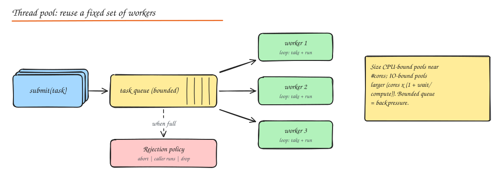
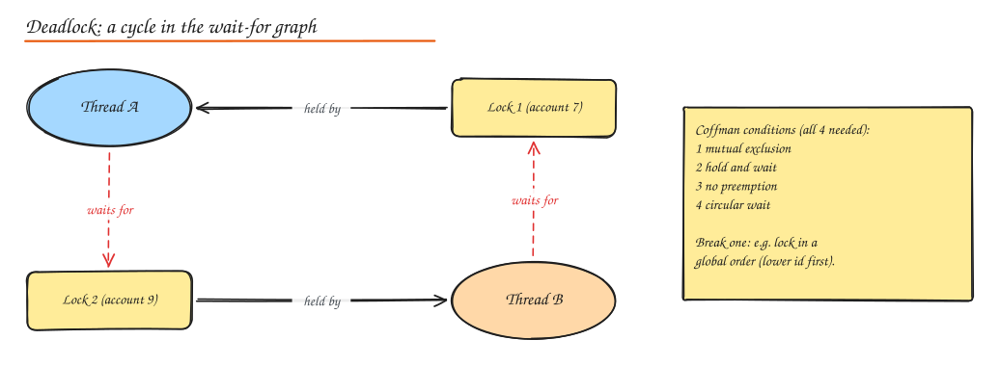
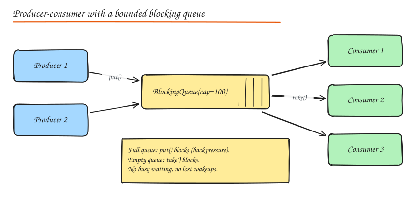

# Concurrency and Parallelism

> **TL;DR**
> - Concurrency is structuring many tasks at once; parallelism is running them simultaneously on multiple cores.
> - Race conditions come from unsynchronized read-modify-write and check-then-act; fix with locks, atomics or a single owner.
> - Deadlocks need four conditions; break circular wait by locking in a global order.
> - Bounded queues and thread pools provide backpressure instead of unbounded memory growth.

- **Concurrency**: dealing with many things at once (structuring a program as independently progressing tasks; they may interleave on one core).
- **Parallelism**: doing many things at once (tasks literally run simultaneously on multiple cores).

A web server handling 10k connections on 8 cores is concurrent and partly parallel.

## Threads vs processes

| | Process | Thread |
|---|---|---|
| Memory | Own address space | Shares the process's memory |
| Creation / switch cost | Higher | Lower |
| Communication | IPC: pipes, sockets, shared memory | Shared variables (needs synchronization) |
| Isolation | A crash is contained | A crash (or memory corruption) takes down the process |
| Examples | Postgres backend per connection, Chrome tabs, Python multiprocessing | Java/Go/C++ server worker threads |

**Green threads / virtual threads / goroutines**: lightweight, runtime-scheduled threads multiplexed onto OS threads (Go goroutines, Java 21 virtual threads, Erlang processes). Cheap enough to run one per request even at 100k concurrency.

Python note: CPython's **GIL** lets only one thread execute Python bytecode at a time, so threads help IO-bound work but not CPU-bound work (use processes or native extensions; free-threaded builds are emerging).

## Thread pools

Creating a thread per task is expensive and unbounded concurrency is dangerous. A thread pool keeps a fixed set of worker threads pulling tasks from a queue.



- **Sizing**: CPU-bound: about the number of cores. IO-bound: `cores x (1 + wait_time / compute_time)`, or measure.
- **Bounded queue** + **rejection policy** (abort, caller-runs, discard) gives backpressure instead of unbounded memory growth.
- Separate pools per dependency or workload class (bulkheads).
- Executors: Java `ThreadPoolExecutor`, Python `concurrent.futures.ThreadPoolExecutor`, Go worker pools over channels.

## Synchronization primitives

| Primitive | What it does | Typical use |
|---|---|---|
| **Mutex / lock** | One holder at a time | Protect a critical section |
| **Reentrant lock** | Same thread can re-acquire | Recursive calls holding the lock |
| **Read-write lock** | Many readers or one writer | Read-mostly caches, config |
| **Semaphore** | N permits | Limit concurrent access (connection limits, rate of parallel calls) |
| **Condition variable** | Wait until a condition holds, with notify | Producer-consumer, blocking queues |
| **Monitor** | Lock + condition variables bound to an object | Java `synchronized` + `wait/notify` |
| **Atomic variables / CAS** | Lock-free compare-and-swap updates | Counters, lock-free structures |
| **Barrier / latch** | Wait until N threads reach a point | Parallel phases, test coordination |
| **Volatile / memory fences** | Visibility and ordering of writes across threads | Flags, double-checked locking |

## Race conditions

A race condition occurs when correctness depends on the timing of threads.

```python
# BROKEN: read-modify-write is not atomic
class Counter:
    def __init__(self): self.n = 0
    def incr(self): self.n += 1           # load, add, store: threads interleave and lose updates

# FIXED
class Counter:
    def __init__(self): self.n, self.lock = 0, threading.Lock()
    def incr(self):
        with self.lock:
            self.n += 1
```

Common race patterns:

- **Check-then-act**: `if not exists(key): create(key)` (two threads both see "not exists"). Fix: atomic operations (`putIfAbsent`, DB unique constraint, `SET NX`).
- **Read-modify-write**: counters, balances. Fix: locks, atomics, or a single owner.
- **Publication**: another thread sees a partially constructed object. Fix: proper memory visibility (final fields, volatile, locks).

The same races happen in distributed systems (two servers, one DB row), where the fixes are DB transactions, conditional updates, and distributed locks with fencing tokens.

## Deadlocks



Four **Coffman conditions** must all hold: mutual exclusion, hold and wait, no preemption, circular wait. Prevent by breaking one:

- **Lock ordering**: always acquire locks in a global order (e.g. by account ID). Breaks circular wait. The standard answer.
- **Try-lock with timeout** and back off/retry (breaks hold and wait).
- **Acquire all locks at once** or use a single coarser lock.
- **Avoid holding locks while calling external code or doing IO.**
- Detection: wait-for graph cycle detection (databases do this and abort a victim).

Related liveness issues: **livelock** (threads keep reacting to each other without progress; add randomized backoff), **starvation** (a thread never gets the resource; use fair locks/queues), **priority inversion**.

```python
def transfer(a: Account, b: Account, amount):
    first, second = (a, b) if a.id < b.id else (b, a)    # global lock order
    with first.lock, second.lock:
        if a.balance < amount:
            raise InsufficientFunds()
        a.balance -= amount
        b.balance += amount
```

## Async/await, promises and coroutines

For IO-bound workloads, blocking a thread per request wastes memory. **Event loops** run many tasks on few threads: when a task awaits IO, the loop runs another.

- **Promises/futures**: placeholders for a value available later; compose with `then`/`all`/`race`.
- **async/await**: syntax for writing asynchronous code that reads sequentially (JS, Python asyncio, C#, Rust, Kotlin).
- **Coroutines**: functions that can suspend and resume (Python, Kotlin, Lua); goroutines are similar but preemptively scheduled.

```python
async def get_dashboard(user_id):
    profile, orders, recs = await asyncio.gather(          # run concurrently
        fetch_profile(user_id), fetch_orders(user_id), fetch_recs(user_id),
        return_exceptions=True)                            # one failure must not kill all
    return render(profile, orders, recs if not isinstance(recs, Exception) else [])
```

Pitfalls: blocking calls inside async code freeze the event loop; unhandled promise rejections; unbounded `gather` of thousands of tasks (use a semaphore to cap concurrency); forgetting timeouts and cancellation.

## Reactive programming and backpressure

Reactive streams (RxJava, Reactor, Akka Streams, Kotlin Flow) model data as asynchronous streams with operators (map, filter, merge, window). The key feature is **backpressure**: consumers signal demand (`request(n)`) so fast producers cannot overwhelm slow consumers.

Backpressure strategies: block the producer (bounded queues), drop (oldest/newest), sample/coalesce (keep latest value), buffer with limits, or scale consumers. The same idea applies at system level: bounded queues, rate limiting, and load shedding (see [Resilience](../06-reliability-ops/01-resilience-patterns.md)).

## Concurrency patterns



| Pattern | Idea |
|---|---|
| **Producer-consumer** | Producers put work in a bounded blocking queue; consumers take. Decouples rates, provides backpressure. |
| **Thread pool** | Reuse a fixed set of workers for many tasks. |
| **Reader-writer lock** | Concurrent readers, exclusive writers. |
| **Monitor object** | Methods synchronized on the object, with condition variables for waiting. |
| **Active object** | Method calls are queued as messages and executed by the object's own thread (actor model: Akka, Erlang, Orleans). |
| **Double-checked locking** | Lazy init: check without lock, lock, check again (needs `volatile` / proper memory model). |
| **Copy-on-write** | Readers use an immutable snapshot; writers copy, modify, and swap atomically. Great for read-mostly config and listener lists. |
| **Immutability** | Immutable objects need no synchronization. The simplest concurrency tool. |
| **Thread confinement** | Data owned by one thread (event loop, actor, partition owner) needs no locks. |

Bounded blocking queue with condition variables:

```python
import threading
from collections import deque

class BoundedQueue:
    def __init__(self, capacity):
        self.items, self.capacity = deque(), capacity
        self.lock = threading.Lock()
        self.not_full = threading.Condition(self.lock)
        self.not_empty = threading.Condition(self.lock)

    def put(self, item):
        with self.not_full:
            while len(self.items) >= self.capacity:   # while, not if: spurious wakeups
                self.not_full.wait()
            self.items.append(item)
            self.not_empty.notify()

    def take(self):
        with self.not_empty:
            while not self.items:
                self.not_empty.wait()
            item = self.items.popleft()
            self.not_full.notify()
            return item
```

## Interview questions

<details>
<summary>Two threads book the last seat in a cinema LLD. How do you prevent double booking?</summary>

In memory: make seat assignment atomic, e.g. a per-show lock or a `ConcurrentHashMap.putIfAbsent(seatId, bookingId)` / compare-and-set on the seat's state, with temporary holds that expire. In a real system: a DB unique constraint on (show_id, seat_id) or a conditional update `UPDATE seats SET status='HELD', hold_until=... WHERE id=? AND status='AVAILABLE'`, checking affected rows, plus a TTL-based release of unpaid holds.

</details>

<details>
<summary>Why use `while` instead of `if` around `condition.wait()`?</summary>

Waits can return spuriously, and between being notified and reacquiring the lock another thread may have changed the state (consumed the item). Rechecking the condition in a loop guarantees the predicate actually holds before proceeding.

</details>

<details>
<summary>Threads vs async for a service that calls 5 downstream APIs per request?</summary>

Both work; the key is making the 5 calls concurrent instead of sequential. With threads (or virtual threads), use a bounded executor and futures; with async, use `gather` with a concurrency limit. Async scales to more concurrent requests per memory, virtual threads give similar scalability with blocking-style code. Either way add per-call timeouts and handle partial failures.

</details>

## Related

- [Design Patterns](02-design-patterns.md)
- [Resilience Patterns (bulkheads, backpressure)](../06-reliability-ops/01-resilience-patterns.md)
- [SQL locking and isolation](../03-data/01-sql-acid-transactions.md)
