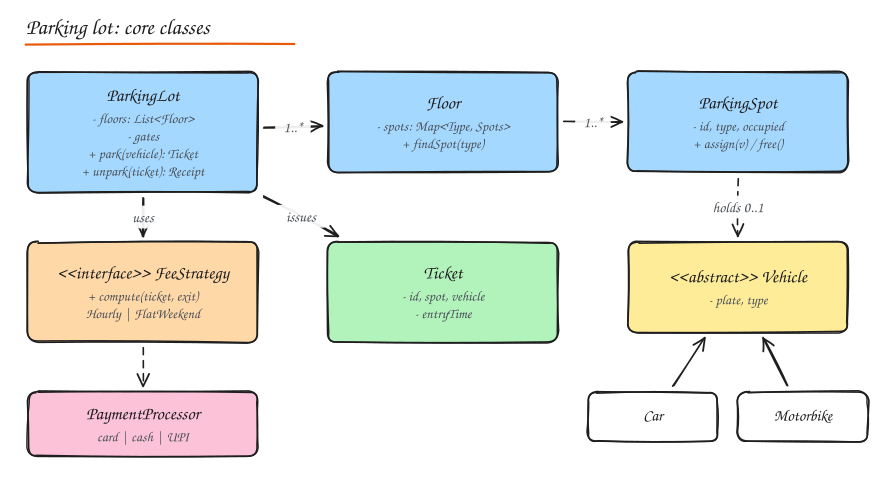

# LLD Walkthrough: Parking Lot

The most common LLD warm-up. It tests modeling, extensibility and concurrency in 45 minutes.

## 1. Requirements

Clarify and write down:

- Multiple floors; each floor has spots of types: **motorbike, compact, large, EV**.
- Vehicles: motorbike, car, truck, EV car. A vehicle fits spots of its size or larger (configurable).
- Entry gates issue a **ticket**; exit gates compute the **fee** and take **payment**.
- Fee rules vary (hourly by vehicle type, weekend flat rate, first 30 minutes free). Must be easy to change.
- Display boards show free spots per type per floor.
- Multiple gates operate **concurrently**: two cars must never get the same spot.
- Out of scope: reservations, valet, license plate recognition (mention as extensions).

## 2. Entities and responsibilities

| Class | Responsibility |
|---|---|
| `ParkingLot` | Facade/entry point: park, unpark; owns floors, ticket registry |
| `Floor` | Holds spots by type; finds a free spot |
| `ParkingSpot` | ID, type, occupancy; assign/free |
| `Vehicle` (+ subtypes) | Plate and type |
| `Ticket` | Vehicle, spot, entry time, status |
| `SpotAllocationStrategy` | Which spot to pick (nearest to gate, lowest floor first, spread load) |
| `FeeStrategy` | Compute the fee for a ticket and exit time |
| `PaymentProcessor` | Charge via card/cash/UPI (adapter per provider) |
| `DisplayBoard` | Observer of spot changes |



Patterns used: **Strategy** (allocation, fees), **Factory** (spots/vehicles), **Observer** (display boards), **Facade** (`ParkingLot`), **Singleton** scope for the lot instance (injected, not global), **State** for ticket lifecycle (`ACTIVE -> PAID -> EXITED`).

## 3. Code

```python
from __future__ import annotations
import itertools, threading
from dataclasses import dataclass, field
from datetime import datetime, timedelta
from enum import Enum
from typing import Protocol


class SpotType(Enum):
    MOTORBIKE = 1
    COMPACT = 2
    LARGE = 3
    EV = 4


class VehicleType(Enum):
    MOTORBIKE = "motorbike"
    CAR = "car"
    TRUCK = "truck"
    EV_CAR = "ev_car"


# which spot types a vehicle may use, in order of preference
FITS = {
    VehicleType.MOTORBIKE: [SpotType.MOTORBIKE, SpotType.COMPACT, SpotType.LARGE],
    VehicleType.CAR: [SpotType.COMPACT, SpotType.LARGE],
    VehicleType.EV_CAR: [SpotType.EV, SpotType.COMPACT, SpotType.LARGE],
    VehicleType.TRUCK: [SpotType.LARGE],
}


@dataclass(frozen=True)
class Vehicle:
    plate: str
    type: VehicleType


@dataclass
class ParkingSpot:
    id: str
    type: SpotType
    floor: int
    vehicle: Vehicle | None = None

    @property
    def free(self) -> bool:
        return self.vehicle is None


@dataclass
class Ticket:
    id: int
    vehicle: Vehicle
    spot: ParkingSpot
    entry: datetime
    status: str = "ACTIVE"          # ACTIVE -> PAID -> EXITED


class FeeStrategy(Protocol):
    def compute(self, ticket: Ticket, exit_time: datetime) -> int: ...


class HourlyFee:
    RATES = {VehicleType.MOTORBIKE: 20, VehicleType.CAR: 50, VehicleType.EV_CAR: 40, VehicleType.TRUCK: 100}

    def __init__(self, free_minutes: int = 30):
        self.free = timedelta(minutes=free_minutes)

    def compute(self, ticket: Ticket, exit_time: datetime) -> int:
        stayed = exit_time - ticket.entry
        if stayed <= self.free:
            return 0
        hours = -(-int(stayed.total_seconds()) // 3600)          # ceiling division
        return hours * self.RATES[ticket.vehicle.type]


class AllocationStrategy(Protocol):
    def pick(self, floors: list[Floor], vehicle: Vehicle) -> ParkingSpot | None: ...


class LowestFloorFirst:
    def pick(self, floors, vehicle):
        for spot_type in FITS[vehicle.type]:
            for floor in floors:
                spot = floor.first_free(spot_type)
                if spot:
                    return spot
        return None


class Floor:
    def __init__(self, number: int, spots: list[ParkingSpot]):
        self.number = number
        self.by_type: dict[SpotType, list[ParkingSpot]] = {}
        for s in spots:
            self.by_type.setdefault(s.type, []).append(s)

    def first_free(self, spot_type: SpotType) -> ParkingSpot | None:
        return next((s for s in self.by_type.get(spot_type, []) if s.free), None)

    def free_count(self, spot_type: SpotType) -> int:
        return sum(s.free for s in self.by_type.get(spot_type, []))


class ParkingFullError(Exception):
    pass


class ParkingLot:
    def __init__(self, floors, allocation: AllocationStrategy, fees: FeeStrategy, payments):
        self.floors, self.allocation, self.fees, self.payments = floors, allocation, fees, payments
        self.tickets: dict[int, Ticket] = {}
        self._ids = itertools.count(1)
        self._lock = threading.Lock()     # one lock is plenty for a single lot; see notes below
        self.observers = []

    def park(self, vehicle: Vehicle, now: datetime | None = None) -> Ticket:
        with self._lock:                  # find + assign must be atomic across gates
            spot = self.allocation.pick(self.floors, vehicle)
            if spot is None:
                raise ParkingFullError(vehicle.type)
            spot.vehicle = vehicle
            ticket = Ticket(next(self._ids), vehicle, spot, now or datetime.now())
            self.tickets[ticket.id] = ticket
        self._notify(spot)
        return ticket

    def unpark(self, ticket_id: int, now: datetime | None = None) -> int:
        ticket = self.tickets[ticket_id]
        if ticket.status != "ACTIVE":
            raise ValueError(f"ticket {ticket_id} is {ticket.status}")
        fee = self.fees.compute(ticket, now or datetime.now())
        if fee:
            self.payments.charge(fee, reference=f"ticket-{ticket_id}")   # idempotent by reference
        with self._lock:
            ticket.status = "EXITED"
            ticket.spot.vehicle = None
        self._notify(ticket.spot)
        return fee

    def _notify(self, spot):
        for obs in self.observers:
            obs.on_spot_changed(spot)
```

## 4. Concurrency discussion

- The critical section is **find a free spot + mark it occupied**. If two gates run it concurrently without protection, both can pick the same spot.
- One lot-wide lock is simple and fine (parking is low throughput: a few operations per second).
- Finer-grained options if asked: a lock per floor or per spot type; or optimistic **compare-and-set** on a spot (`if spot.vehicle is None: spot.vehicle = v` done atomically); or a per-type free-spot queue (`queue.get_nowait()` hands out each spot exactly once).
- Payment happens **outside** the lock (slow IO must not block other gates) and uses the ticket ID as an idempotency reference so retries do not double charge.

## 5. Extensibility answers

| Change request | Change needed |
|---|---|
| Weekend flat pricing | New `FeeStrategy`; no change to `ParkingLot` |
| EV spots with charging fee | New `SpotType.EV`, fee decorator adding charging cost |
| Reserve a spot in advance | `Reservation` entity; allocation strategy checks holds with expiry |
| Nearest spot to entry gate | New `AllocationStrategy` using distance per gate |
| Persist state | Repository interfaces for tickets and spots (DB with a unique constraint on active spot assignment) |
| Many lots in a city (HLD) | Each lot is a service/shard; central availability index updated by events |

## Interview questions

<details>
<summary>Why make FeeStrategy an interface instead of a method with if/else on vehicle type?</summary>

Pricing is the part most likely to change (promotions, weekends, city rules) and to vary per lot. Strategies keep each rule isolated and testable, allow choosing or composing rules at runtime (config per lot), and follow Open/Closed: new pricing means a new class, not edits to tested code.

</details>

<details>
<summary>How do you test the concurrency safety of park()?</summary>

Create a lot with a single free spot, start many threads calling `park()` at once (use a barrier so they start together), and assert exactly one succeeds and the others raise `ParkingFullError`. Repeat many iterations. Also unit test the allocation strategy and fee strategies in isolation with fixed clocks.

</details>

## Related

- [OOP and SOLID](01-oop-solid-principles.md)
- [Design Patterns](02-design-patterns.md)
- [Concurrency](03-concurrency.md)
