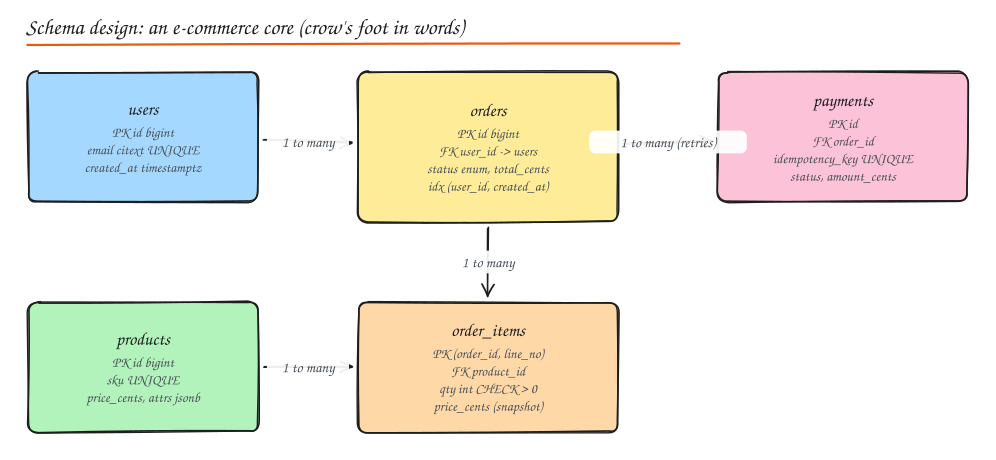

# Database Schema Design

> **TL;DR**
> - Start from the **queries** the product needs, then design tables, keys and indexes that make those queries cheap.
> - Let the database enforce correctness: `NOT NULL`, `UNIQUE`, `CHECK`, foreign keys and the right types catch bugs for free.
> - Use surrogate `BIGINT` (or UUIDv7) primary keys, money as integer minor units, timestamps with time zone.
> - Normalize the write model; denormalize deliberately (snapshots, counters, read models) where reads hurt.
> - Change schemas with **expand and contract** migrations so deploys never break.



## A worked schema (PostgreSQL)

```sql
CREATE TABLE users (
  id          BIGINT GENERATED ALWAYS AS IDENTITY PRIMARY KEY,
  email       CITEXT NOT NULL UNIQUE,                  -- case-insensitive uniqueness
  name        TEXT   NOT NULL CHECK (length(name) BETWEEN 1 AND 200),
  created_at  TIMESTAMPTZ NOT NULL DEFAULT now()
);

CREATE TABLE products (
  id           BIGINT GENERATED ALWAYS AS IDENTITY PRIMARY KEY,
  sku          TEXT NOT NULL UNIQUE,
  title        TEXT NOT NULL,
  price_cents  INTEGER NOT NULL CHECK (price_cents >= 0),
  attrs        JSONB NOT NULL DEFAULT '{}',            -- flexible per-category attributes
  search       TSVECTOR GENERATED ALWAYS AS (to_tsvector('english', title)) STORED
);
CREATE INDEX products_search_idx ON products USING GIN (search);   -- full-text index
CREATE INDEX products_attrs_idx  ON products USING GIN (attrs);    -- query JSON keys

CREATE TYPE order_status AS ENUM ('PENDING', 'PAID', 'SHIPPED', 'DELIVERED', 'CANCELLED');

CREATE TABLE orders (
  id           BIGINT GENERATED ALWAYS AS IDENTITY PRIMARY KEY,
  user_id      BIGINT NOT NULL REFERENCES users(id),
  status       order_status NOT NULL DEFAULT 'PENDING',
  total_cents  INTEGER NOT NULL CHECK (total_cents >= 0),
  created_at   TIMESTAMPTZ NOT NULL DEFAULT now()
);
CREATE INDEX orders_user_recent_idx ON orders (user_id, created_at DESC);   -- "my orders"
CREATE INDEX orders_pending_idx ON orders (created_at) WHERE status = 'PENDING';   -- partial index for the sweeper job

CREATE TABLE order_items (
  order_id     BIGINT  NOT NULL REFERENCES orders(id) ON DELETE CASCADE,
  line_no      SMALLINT NOT NULL,
  product_id   BIGINT  NOT NULL REFERENCES products(id),
  qty          INTEGER NOT NULL CHECK (qty > 0),
  price_cents  INTEGER NOT NULL,          -- snapshot: the price paid, not today's price
  PRIMARY KEY (order_id, line_no)
);

CREATE TABLE payments (
  id               BIGINT GENERATED ALWAYS AS IDENTITY PRIMARY KEY,
  order_id         BIGINT NOT NULL REFERENCES orders(id),
  idempotency_key  TEXT   NOT NULL UNIQUE,
  status           TEXT   NOT NULL,
  amount_cents     INTEGER NOT NULL,
  created_at       TIMESTAMPTZ NOT NULL DEFAULT now()
);
```

## Table design

1. **List entities** (nouns) and **relationships** (one-to-one, one-to-many, many-to-many). Many-to-many needs a join table (`user_follows(follower_id, followee_id)` with a composite primary key).
2. **List access patterns** with frequency: "orders by user, newest first", "pending orders older than 15 minutes", "product search by text".
3. **One table per entity**; avoid generic "entity-attribute-value" tables except for truly dynamic attributes (use JSONB instead).
4. **Name consistently**: plural table names, `snake_case`, `<table>_id` foreign keys, `created_at` / `updated_at`.

## Column types and constraints

| Data | Use | Avoid |
|---|---|---|
| Identifiers | `BIGINT` identity, or UUIDv7 if generated client side / across shards | `INT` (overflows at 2.1B), random UUIDv4 as clustered PK |
| Money | Integer minor units (`price_cents`) or `NUMERIC(19,4)` + currency code | `FLOAT`/`DOUBLE` (rounding errors) |
| Time | `TIMESTAMPTZ` stored in UTC | Local time without zone, strings |
| Status | `ENUM` or `TEXT` with `CHECK` (or a lookup table) | Free-form strings |
| Booleans | `BOOLEAN NOT NULL DEFAULT false` | Nullable booleans (three states) |
| Emails / usernames | `CITEXT` or a lowercased unique index | Case-sensitive uniqueness |
| Flexible attributes | `JSONB` with a GIN index | Dozens of nullable columns |
| Large blobs | Object storage + a URL column | Storing files in the DB |

Constraints are documentation that cannot drift: `NOT NULL` by default, `UNIQUE` for natural keys, `CHECK` for ranges, foreign keys for relationships, `EXCLUDE` constraints for things like overlapping bookings.

## Primary and foreign keys

- **Surrogate keys** (meaningless ids) are stable; **natural keys** (email, SKU) change. Use surrogate primary keys and `UNIQUE` constraints on natural keys.
- **Composite keys** fit child rows (`(order_id, line_no)`) and join tables.
- **Foreign keys** guarantee referential integrity and document relationships. Index the referencing column (Postgres does not do it automatically) or deletes on the parent scan the child table. At very high write rates or across shards, teams sometimes enforce relationships in application code instead.
- `ON DELETE CASCADE` for true ownership (items belong to an order), `RESTRICT` otherwise; prefer soft deletes (`deleted_at`) for user-facing data you may need to restore or audit.

## Indexes

| Index | Good for | Example |
|---|---|---|
| **B-tree** (default) | Equality, ranges, ordering, prefix `LIKE 'abc%'` | `(user_id, created_at DESC)` |
| **Hash** | Equality only | Rarely better than B-tree in Postgres |
| **Full-text** (GIN on `tsvector`, MySQL `FULLTEXT`) | Word search with ranking | Product titles, comments |
| **GIN on JSONB / arrays** | Containment queries | `attrs @> '{"color": "red"}'` |
| **Partial** | A small hot subset | `WHERE status = 'PENDING'` |
| **Covering** (`INCLUDE`) | Index-only scans | `(user_id) INCLUDE (status, total_cents)` |
| **Unique** | Enforce uniqueness and look up | `idempotency_key` |

Rules: index for real queries, put equality columns first, then range, then sort columns; every index slows writes, so drop unused ones. Deep dive: [Indexes and Storage Engines](../03-data/02-indexes-storage-engines.md).

## Normalization vs denormalization trade-offs

| Normalize (3NF) | Denormalize |
|---|---|
| Each fact stored once, no update anomalies | Faster reads, fewer joins |
| Smaller storage, integrity via constraints | Duplicate data must be kept in sync |
| Best for the **write model** (orders, payments) | Best for **read models** (feeds, dashboards, search) |

Good denormalizations: **snapshots** that are correct by design (the price on `order_items`), **counters** maintained transactionally or asynchronously (`comment_count`), **materialized views** refreshed on a schedule, read models fed by CDC.

## Schema evolution and migrations

Use a migration tool (Flyway, Liquibase, Alembic, Rails/Django migrations, golang-migrate) so every change is versioned and repeatable. For zero-downtime changes, **expand and contract**:

1. **Expand**: add the new column/table, nullable or with a default. Deploy code that writes both old and new.
2. **Backfill** in small batches (avoid one giant transaction and long locks).
3. **Switch reads** to the new column; verify.
4. **Contract**: stop writing the old column, then drop it in a later release.

Dangerous operations on big tables: adding a column with a volatile default (older engines rewrite the table), changing a column type, adding an index without `CONCURRENTLY` (Postgres) or an online tool (gh-ost, pt-online-schema-change for MySQL), adding a `NOT NULL` constraint without validating in steps.

## LLD interview checklist

- Draw entities and relationships, then write the `CREATE TABLE`s for the core 3 to 5 tables.
- Point out keys, constraints and the 2 or 3 indexes that serve the main queries.
- Mention money types, time zones, idempotency keys and soft deletes.
- Explain how the schema evolves and how you would shard it later (by `user_id` here).

## Interview questions

<details>
<summary>Why store the price on order_items when products already has a price?</summary>

Because the order must record what the customer actually paid at that time. Product prices change; recomputing totals from today's price would rewrite history. This is denormalization that is correct by design (a snapshot), not a cache that can go stale.

</details>

<details>
<summary>Model "users follow users" and support both "who do I follow" and "who follows me" efficiently.</summary>

A join table `follows(follower_id, followee_id, created_at)` with primary key `(follower_id, followee_id)` (serves "who do I follow" and prevents duplicates) plus a secondary index on `(followee_id, follower_id)` for "who follows me". At large scale, shard by user and keep two tables (one per direction) so each query hits one shard.

</details>

<details>
<summary>How do you rename a column used by a running service without downtime?</summary>

Expand and contract: add the new column, deploy code that writes both and reads the old, backfill, deploy code that reads the new column, stop writing the old one, then drop it in a later release. Never rename in place in one step, because old and new code run side by side during a deploy.

</details>

## Related

- [SQL, ACID and Transactions](../03-data/01-sql-acid-transactions.md)
- [Indexes and Storage Engines](../03-data/02-indexes-storage-engines.md)
- [Sharding](../03-data/05-sharding-partitioning.md)
- [Practice: Database Optimization Challenges](../12-practice/02-database-optimization-challenges.md)
