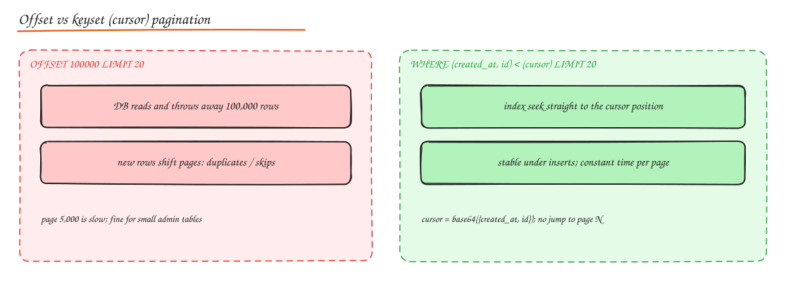

# API Implementation and Service Integration

> **TL;DR**
> - Validate at the edge, fail with one consistent error shape, and make writes idempotent.
> - Paginate with **cursors/keysets** for anything that grows; offsets only for small admin lists.
> - Every outbound call gets a **timeout**, a **retry policy** (backoff + jitter, idempotent only), and sits behind a **circuit breaker** and **bulkhead**.
> - Inject dependencies through constructors and load configuration from the environment, validated at startup.

[API Design](../04-networking-apis/03-api-design.md) covers *what* a good API looks like. This note shows *how* to build one and how to call other services safely. Examples use Python (FastAPI style), but the ideas are language-neutral.

## Endpoint design

```text
GET    /v1/orders?status=PAID&limit=20&cursor=...   list (filter + cursor pagination)
POST   /v1/orders                                   create (Idempotency-Key header)
GET    /v1/orders/{order_id}                        read
PATCH  /v1/orders/{order_id}                        partial update (If-Match: ETag)
POST   /v1/orders/{order_id}/cancel                 action
```

Checklist per endpoint: auth scope, object-level authorization (does this user own the order?), input schema, idempotency, pagination, rate limit, response schema, error codes, and an entry in the OpenAPI spec.

## Request and response validation

Validate types, ranges, lengths and formats before any business logic, and reject unknown or dangerous fields (no mass assignment).

```python
from pydantic import BaseModel, Field, conint

class OrderItemIn(BaseModel):
    product_id: int = Field(gt=0)
    qty: conint(gt=0, le=100)

class CreateOrderIn(BaseModel):
    items: list[OrderItemIn] = Field(min_length=1, max_length=50)
    coupon: str | None = Field(default=None, max_length=32)

    model_config = {"extra": "forbid"}     # unknown fields -> 422, blocks mass assignment
```

Validate responses too (in tests or in debug builds) so the contract in the OpenAPI spec stays true.

## A consistent error response format

One shape for every error (RFC 9457 Problem Details), produced by a single exception handler:

```python
class DomainError(Exception):
    status, type_, title = 400, "about:blank", "Bad request"

class InsufficientStock(DomainError):
    status, type_, title = 409, "https://api.example.com/errors/insufficient-stock", "Insufficient stock"

@app.exception_handler(DomainError)
def handle_domain_error(request, exc: DomainError):
    return JSONResponse(status_code=exc.status, media_type="application/problem+json", content={
        "type": exc.type_, "title": exc.title, "status": exc.status,
        "detail": str(exc), "instance": request.url.path,
        "request_id": request.state.request_id,       # correlate with logs and traces
    })
```

Never leak stack traces or SQL errors to clients; log them with the request id instead.

## Pagination implementation



**Offset-based** (simple, slow for deep pages, unstable under inserts):

```sql
SELECT * FROM orders WHERE user_id = $1 ORDER BY created_at DESC LIMIT 20 OFFSET 40;
```

**Keyset (seek) pagination** uses the last row's sort key; with an index on `(user_id, created_at DESC, id DESC)` every page is a direct index seek:

```sql
SELECT * FROM orders
WHERE user_id = $1 AND (created_at, id) < ($2, $3)      -- values from the previous page's last row
ORDER BY created_at DESC, id DESC
LIMIT 20;
```

**Cursor-based** pagination wraps the keyset in an opaque token so clients cannot depend on internals:

```python
import base64, json, hmac, hashlib

SECRET = b"rotate-me"

def encode_cursor(row) -> str:
    raw = json.dumps({"t": row.created_at.isoformat(), "id": row.id}).encode()
    sig = hmac.new(SECRET, raw, hashlib.sha256).digest()[:8]       # tamper protection
    return base64.urlsafe_b64encode(sig + raw).decode()

def decode_cursor(cursor: str):
    blob = base64.urlsafe_b64decode(cursor)
    sig, raw = blob[:8], blob[8:]
    if not hmac.compare_digest(sig, hmac.new(SECRET, raw, hashlib.sha256).digest()[:8]):
        raise DomainError("invalid cursor")
    d = json.loads(raw)
    return d["t"], d["id"]
```

Fetch `limit + 1` rows to know whether `has_more` is true without a count query.

## Filtering and sorting

Allow-list filters and sort fields that are backed by indexes; translate them to parameterized SQL (never string concatenation). Reject unknown sort fields with 400 rather than silently ignoring them.

## Versioning strategy

Additive changes in place; breaking changes in a new version (`/v2` path or a dated `API-Version` header); deprecate with `Deprecation` and `Sunset` headers; track usage per version before removal. See [API Design](../04-networking-apis/03-api-design.md#versioning).

## Documentation (OpenAPI / Swagger)

Generate the OpenAPI spec from code (FastAPI, springdoc, NestJS) or write it first and generate server stubs and clients. Publish it, lint it (Spectral), and run contract tests against it in CI.

## Rate limiting implementation

Middleware that runs before handlers, keyed by API key or user id, backed by an atomic Redis script; return 429 with `Retry-After`. See [Rate Limiters build](../11-builds/02-rate-limiters.md).

## Service integration

### Service-to-service communication

- Sync calls (REST/gRPC) for queries, async events for state changes. See [Communication Patterns](../04-networking-apis/06-communication-patterns.md).
- Generate typed clients from the spec (OpenAPI generator, protobuf), propagate `traceparent` and deadlines, authenticate with mTLS or service tokens.

### Retry strategies

```python
import random, time

RETRYABLE = {429, 502, 503, 504}

def call_with_retry(send, max_retries=3, base=0.1, cap=2.0, deadline=None):
    for attempt in range(max_retries + 1):
        resp = send()
        if resp.status_code not in RETRYABLE:
            return resp
        if attempt == max_retries:
            return resp
        delay = random.uniform(0, min(cap, base * 2 ** attempt))         # exponential backoff, full jitter
        retry_after = resp.headers.get("Retry-After")
        if retry_after:
            delay = max(delay, float(retry_after))
        if deadline and time.monotonic() + delay > deadline:
            return resp                                                  # out of time budget
        time.sleep(delay)
```

- **Exponential backoff** spreads retries out; **jitter** desynchronizes clients; **max retries** caps amplification.
- Retry only idempotent requests or those carrying an `Idempotency-Key`.
- Retry at one layer only, within a retry budget.

### Timeout handling

Set connect and read timeouts on every client (HTTP, DB, cache). Derive per-call timeouts from the remaining request deadline so a 1 s user budget is never exceeded by downstream work. Treat a timeout as "unknown outcome" for writes and reconcile, never assume failure.

### Circuit breaker and bulkhead

Wrap each dependency in a circuit breaker (fail fast, fallback) and give it its own bounded pool (bulkhead). Full implementation: [Circuit Breaker build](../11-builds/07-circuit-breaker.md); theory: [Resilience Patterns](../06-reliability-ops/01-resilience-patterns.md).

### Dependency injection

Construct dependencies once at startup and pass them in, so code is testable and wiring is explicit:

```python
class PaymentClient(Protocol):
    def charge(self, order_id: int, cents: int, key: str) -> str: ...

class OrderService:
    def __init__(self, repo: OrderRepository, payments: PaymentClient, clock=time.time):
        self.repo, self.payments, self.clock = repo, payments, clock

# composition root (main): the only place that knows concrete classes
service = OrderService(PostgresOrderRepository(pool), StripePaymentClient(http, breaker), time.time)

# tests: fakes, no network
service = OrderService(InMemoryOrderRepository(), FakePayments(), clock=lambda: 1_700_000_000)
```

### Configuration management

- **12-factor**: config comes from the environment (env vars, mounted files), never from code branches per environment.
- **Validate at startup** with a typed settings object; crash early on missing or invalid config.
- **Secrets** from a secrets manager, never in images, repos or logs.
- **Dynamic config and feature flags** (timeouts, rate limits, kill switches) from a config service with validation, gradual rollout and audit; cache the last known good value.

```python
from pydantic_settings import BaseSettings

class Settings(BaseSettings):
    database_url: str
    payments_timeout_s: float = 2.0
    payments_max_retries: int = 3
    feature_new_checkout: bool = False

settings = Settings()          # reads env vars, raises on missing/invalid values
```

## Interview questions

<details>
<summary>Why fetch limit + 1 rows when paginating?</summary>

To know whether another page exists without a separate `COUNT(*)` query (which is expensive on large tables). If you get limit + 1 rows, return the first `limit`, set `has_more = true`, and build the cursor from the last returned row.

</details>

<details>
<summary>A downstream call times out during order creation. Should you retry?</summary>

Only if the call is idempotent or carries an idempotency key, because the timeout means the outcome is unknown: the downstream may have succeeded. With a key, retry within the deadline using backoff and jitter; without one, mark the operation pending and reconcile by querying the downstream's status.

</details>

<details>
<summary>What makes a good error response for API clients?</summary>

A consistent machine-readable shape (type, title, status, detail, field errors), the correct HTTP status (4xx client, 5xx server, 409 conflicts, 422 validation, 429 rate limit), a request id for support, no internal details, and stable error types clients can program against.

</details>

## Related

- [API Design](../04-networking-apis/03-api-design.md)
- [Resilience Patterns](../06-reliability-ops/01-resilience-patterns.md)
- [OOP and SOLID (dependency inversion)](01-oop-solid-principles.md)
- [Distributed Transactions and Idempotency](../03-data/06-distributed-transactions.md)
