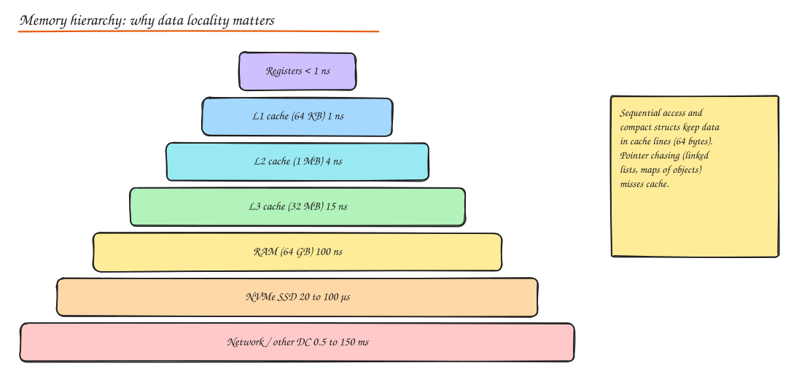

# Performance Optimization

> **TL;DR**
> - **Measure first.** Profile, find the hot path, fix the biggest cost, measure again. Most "optimizations" without a profile are guesses.
> - Algorithm choice beats micro-tuning: O(n log n) instead of O(n^2) wins every time at scale.
> - Memory is a performance problem: allocations cause GC pauses, poor locality causes cache misses, leaks cause crashes.
> - I/O dominates most services: batch, buffer, stream, and avoid round trips.

## The optimization loop

1. Define the goal with a number ("p99 under 50 ms at 2k RPS").
2. **Measure** under realistic load (load test, production profiles).
3. **Profile** to find where time and memory go (CPU flame graphs, allocation profiles, tracing).
4. Fix the top item; re-measure; stop when the goal is met.

Amdahl's law: speeding up a part that takes 5% of the time can never save more than 5%.

## Algorithm optimization

### Big O notation

Big O describes how cost grows with input size `n`, ignoring constants.

| Complexity | Name | Example | n = 1M operations, roughly |
|---|---|---|---|
| O(1) | Constant | Hash map lookup | 1 |
| O(log n) | Logarithmic | Binary search, B-tree lookup | 20 |
| O(n) | Linear | Scan a list | 1M |
| O(n log n) | Linearithmic | Good sorting | 20M |
| O(n^2) | Quadratic | Nested loops over the same list | 10^12 (hours) |
| O(2^n) | Exponential | Brute-force subsets | impossible |

- **Time complexity**: how running time grows.
- **Space complexity**: how extra memory grows. Trading space for time (caching, indexes, precomputation) is the most common optimization in system design.
- Look at **amortized** cost (dynamic arrays: occasional O(n) resize, O(1) amortized append) and **worst case** (hash maps degrade to O(n) with many collisions).

Common wins:

```python
# O(n^2): "for each order, find its user" with a list scan
for o in orders:
    user = next(u for u in users if u.id == o.user_id)

# O(n): build a dict once
by_id = {u.id: u for u in users}
for o in orders:
    user = by_id[o.user_id]
```

Also: sort once and binary search, use heaps for top-k (O(n log k)), use sets for membership, and push filtering and joins into the database (with indexes) instead of loading everything into the app.

## Memory management

### Garbage collection

Managed runtimes (JVM, Go, .NET, Python, JS) free memory automatically:

- **Generational GC** (JVM, .NET): most objects die young, so collect the young generation often and cheaply; long-lived objects are promoted and collected rarely.
- **Concurrent, low-pause collectors**: G1 and ZGC (JVM), Go's concurrent mark-and-sweep, aim for short stop-the-world pauses.
- **Reference counting** (Python, Swift): frees immediately, plus a cycle collector for reference cycles.

GC costs show up as **CPU overhead** and **pauses** that inflate p99. Reduce them by allocating less (reuse buffers, avoid temporary objects in hot loops), right-sizing heaps, and choosing a low-pause collector for latency-sensitive services.

### Memory leaks

In managed languages, a leak is memory that is still referenced but no longer needed:

- Unbounded caches and maps (use LRU with a size limit and TTL).
- Listeners, callbacks and goroutines that are never removed or stopped.
- Static/global collections that only grow.
- Closures capturing large objects; thread-locals in pooled threads.
- In native code: missing frees, file descriptors and sockets not closed.

Symptoms: memory grows steadily until OOM kills or GC thrashing. Detect with heap dumps and diffing (JVM: jmap + Eclipse MAT; Go: pprof heap; Python: tracemalloc; Node: heap snapshots).

### Profiling

| Profile | Answers | Tools |
|---|---|---|
| CPU (sampling, flame graphs) | Which functions burn CPU | pprof, async-profiler, py-spy, perf, Chrome DevTools |
| Allocation | Who allocates the most | pprof alloc, JFR, memray |
| Heap | What is holding memory now | Heap dumps, MAT |
| Lock / contention | Where threads wait | JFR, pprof mutex/block |
| Continuous profiling | Production behaviour over time | Pyroscope, Parca, Datadog |

## CPU optimization



- **CPU caching**: data moves in 64-byte cache lines. Sequential access over contiguous arrays is fast; pointer chasing through linked lists and maps of small objects causes cache misses (each one costs ~100 ns from RAM, about 100x an L1 hit). Prefer arrays of structs or struct of arrays for hot data.
- **False sharing**: two threads writing different variables on the same cache line slow each other down; pad hot per-thread counters.
- **Branch prediction**: CPUs guess which way an `if` goes. Unpredictable branches in tight loops cost ~10 to 20 cycles each when mispredicted; sorted data or branchless code helps.
- **SIMD** (single instruction, multiple data): process 4 to 16 values per instruction. Libraries (NumPy, simdjson, vectorized query engines like DuckDB/ClickHouse) do this for you.
- **Concurrency**: use all cores for CPU-bound work (worker pools sized to cores), avoid lock contention (sharded locks, lock-free structures, per-thread state).

## I/O optimization

I/O is usually the bottleneck in services.

- **Buffering**: write through buffered writers, read in large chunks; avoid one syscall per byte or line.
- **Batching**: one query with `IN (...)` instead of N queries (fix N+1), bulk inserts, batched Kafka produces, pipelined Redis commands.
- **Streaming**: process large files and responses as streams instead of loading everything into memory; stream HTTP responses.
- **Async / non-blocking I/O**: overlap waiting with other work (event loops, virtual threads).
- **Connection reuse and pooling** for databases and HTTP.
- **Compression** for network-bound transfers; avoid it for CPU-bound paths with small payloads.
- **Sequential over random I/O** on disks (why LSM trees and Kafka are fast).

## Code-level tips

### Object creation

- Reuse expensive objects (HTTP clients, DB pools, regex patterns, serializers) instead of creating per request.
- Pool large buffers; use object pools only where allocation is measurably costly (pools add complexity and can leak).
- Prefer value types / primitives in hot paths; avoid boxing (Java `Integer` lists).
- Lazy initialization for rarely used heavy objects.

### String handling

- Build strings with a builder (`StringBuilder`, `"".join(parts)`, `strings.Builder`) instead of repeated `+` in loops (which is O(n^2)).
- Avoid repeated formatting and regex compilation in hot paths; precompile patterns.
- Parse once into typed structures instead of re-parsing strings.
- Watch encoding conversions and accidental copies (substring copies, `bytes` to `str` round trips).

### Collection usage

| Need | Use | Avoid |
|---|---|---|
| Membership test | Set / hash set | List `in` checks (O(n)) |
| Key lookup | Hash map | Scanning lists of pairs |
| Ordered data, range queries | Tree map / sorted array + bisect | Re-sorting on every insert |
| Top-k | Heap of size k | Full sort |
| Queue (FIFO) | Deque / ring buffer | List `pop(0)` (O(n)) |
| Many appends | Pre-size arrays when length is known | Repeated growth |

## Interview questions

<details>
<summary>A service's p99 latency has periodic spikes every few minutes. What could it be?</summary>

Garbage collection pauses (check GC logs and pause metrics), periodic jobs (cache refresh, compaction, cron), connection pool churn, log rotation, or a scheduled dependency task. Correlate spike timing with GC and job metrics, then reduce allocation rate, tune or switch the collector, or move periodic work off the request path.

</details>

<details>
<summary>Why can iterating a linked list be much slower than an array of the same length, even though both are O(n)?</summary>

Big O ignores constants. Array elements are contiguous, so the CPU prefetches whole cache lines and most accesses hit L1/L2. Linked list nodes are scattered in memory, so each step can be a cache miss costing ~100 ns. The constant factor difference can be 10 to 100x.

</details>

<details>
<summary>Memory grows slowly until the container is OOM-killed every few days. How do you find the leak?</summary>

Take heap snapshots at two points in time (or use continuous profiling), diff them to see which object types grow, and follow their retaining paths to the root (often a global map, an unbounded cache, or listeners never removed). Add bounds (LRU with size limits), remove references when done, and add a memory alert with headroom so it is caught before OOM.

</details>

## Related

- [Concurrency](03-concurrency.md)
- [Scalability, Latency and Throughput](../01-fundamentals/03-scalability-performance.md)
- [Back of the Envelope (latency numbers)](../00-start-here/02-back-of-envelope.md)
- [Indexes and Query Optimization](../03-data/02-indexes-storage-engines.md)
